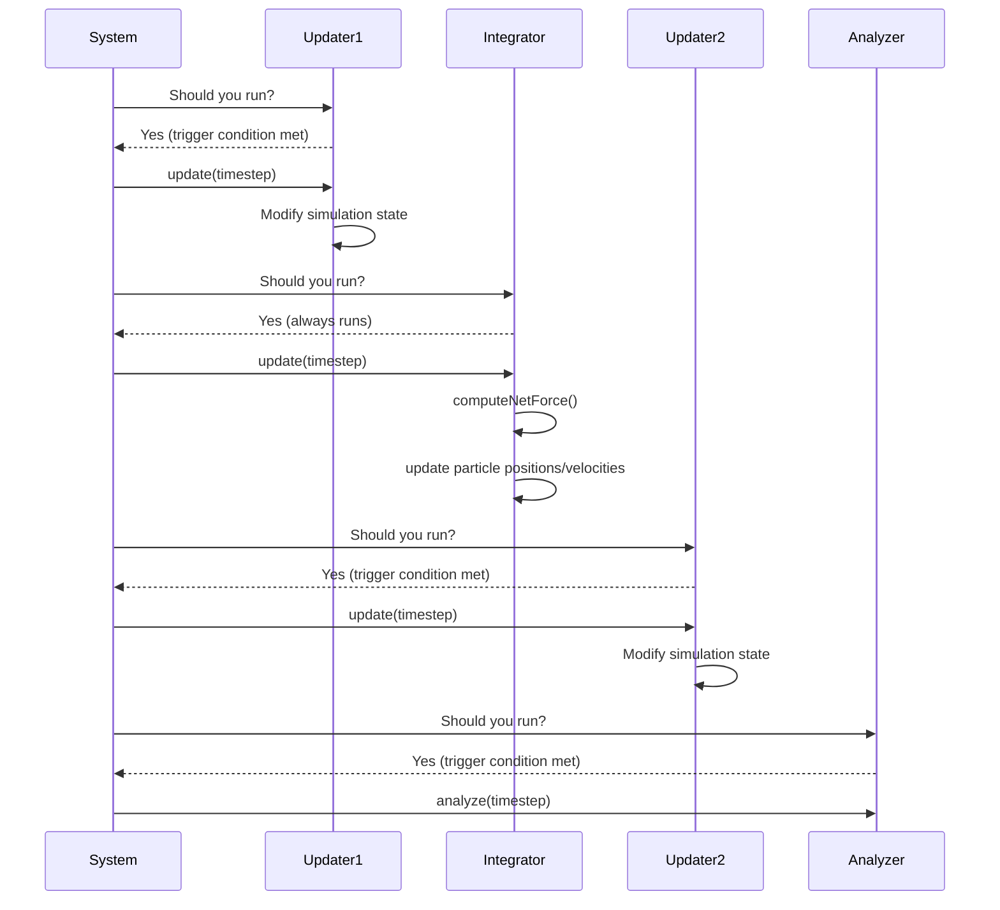

In the world of molecular dynamics simulations, integrators and updaters are the engines that drive your system forward in time. Think of them as the **conductors of your simulation orchestra** - integrators move particles according to physical laws, while updaters handle everything else that needs to change during a simulation. Let's dive into how these critical components work in HOOMD-blue.

## The Foundation: Actions and Updaters

At the heart of HOOMD-blue's simulation architecture lies a hierarchy of classes that perform actions on the system. The base class `Action` provides common functionality for all components that interact with the simulation state. `Action` holds references to the system definition, particle data, and execution configuration - essentially everything needed to interact with the simulation.

Building on this foundation, the `Updater` class defines the basic contract for any component that modifies the simulation state. An updater is conceptually simple - it takes the current state and changes it in some way. This could mean moving particles, changing the simulation box, or any other modification needed during the simulation.

Sources: [Action.h#L21-71](hoomd/Action.h#L21-71), [Updater.h#L39-113](hoomd/Updater.h#L39-113)

## Integrators: The Physics Engines

Integrators are specialized updaters that implement the physics of moving particles forward in time. They inherit from `Updater` but add specific functionality for force computation and particle dynamics. The base `Integrator` class provides the framework that all specific integration methods build upon.

### Core Integrator Architecture

The `Integrator` class manages two fundamental types of forces:

1. **Regular Forces** (`m_forces`): These are computed independently and summed to get the net force on each particle
2. **Constraint Forces** (`m_constraint_forces`): These are computed after the net force is available and can read the current unconstrained forces

This two-stage computation is crucial for simulations with constraints (like rigid bodies or fixed bonds), where constraint forces depend on the current state of the system.

```cpp
class Integrator : public Updater {
    std::vector<std::shared_ptr<ForceCompute>> m_forces;
    std::vector<std::shared_ptr<ForceConstraint>> m_constraint_forces;
    Scalar m_deltaT; // Time step size
    // ... other members and methods
};
```

Sources: [Integrator.h#L60-200](hoomd/Integrator.h#L60-200)

### The Integration Process

The magic happens in the `update()` method, which advances the system by one time step. Here's how it works:

1. **Compute Net Forces**: The integrator first calculates all regular forces and sums them up
2. **Apply Constraints**: Then it computes constraint forces that depend on the current net force
3. **Update Particle States**: Finally, it updates particle positions and velocities based on the total forces

The base `Integrator` class actually leaves the particle updating to derived classes - it only handles the force computation part. This makes sense because different integration methods (like Velocity Verlet, Brownian dynamics, etc.) have different ways of updating particle states.

Sources: [Integrator.cc#L782-796](hoomd/Integrator.cc#L782-796)

### Force Computation in Detail

The force computation process is worth examining closely. The `computeNetForce()` method:

1. **Zeroes out** the net force and virial arrays
2. **Computes each force** independently by calling `force->compute(timestep)`
3. **Sums all forces** into the net force array
4. **Handles constraint forces** separately after regular forces are complete

```cpp
void Integrator::computeNetForce(uint64_t timestep) {
    // Zero out net force arrays
    net_force.zeroFill();
    net_virial.zeroFill();
    
    // Compute and sum all regular forces
    for (auto& force : m_forces) {
        force->compute(timestep);
        // Sum forces into net arrays...
    }
    
    // Handle constraint forces
    for (auto& constraint_force : m_constraint_forces) {
        constraint_force->compute(timestep);
        // Sum constraint forces...
    }
}
```

Sources: [Integrator.cc#L166-337](hoomd/Integrator.cc#L166-337)

> [!TIP]
> Integrators take "ownership" of particle accelerations in HOOMD-blue. Any other updater that modifies accelerations directly will produce undefined results. All acceleration changes must be done through forces added to the integrator.

## Specialized Integrators: Two-Step Methods

HOOMD-blue provides specialized integrators for different simulation needs. A particularly important one is `IntegratorTwoStep`, which implements the popular two-step integration methods used in molecular dynamics.

Two-step methods (like Velocity Verlet) work by:
1. **Half-step velocity update**
2. **Full-step position update** 
3. **Force computation**
4. **Second half-step velocity update**

This approach is more accurate and stable than simpler methods, making it the workhorse of many MD simulations.

```cpp
class IntegratorTwoStep : public Integrator {
    std::vector<std::shared_ptr<IntegrationMethodTwoStep>> m_methods;
    std::shared_ptr<ForceComposite> m_rigid_bodies;
    // ...
};
```

Sources: [IntegratorTwoStep.h#L38-123](hoomd/md/IntegratorTwoStep.h#L38-123)

## Updaters: Beyond Particle Integration

While integrators handle particle motion, updaters manage everything else that needs to change during a simulation. They're incredibly versatile - any transformation of the simulation state that doesn't follow standard integration rules can be implemented as an updater.

### BoxResizeUpdater: A Concrete Example

Let's look at `BoxResizeUpdater`, a practical updater that changes the simulation box size over time. This is useful for simulations under pressure, where you want the box to expand or contract in response to the system's state.

```cpp
class BoxResizeUpdater : public Updater {
    std::shared_ptr<VectorVariantBox> m_box;  // Box as a function of time
    std::shared_ptr<ParticleGroup> m_group;   // Particles to scale with the box
    
    void update(uint64_t timestep) {
        // Get new box dimensions
        BoxDim new_box = getCurrentBox(timestep);
        
        // Update the box
        m_pdata->setGlobalBox(new_box);
        
        // Scale particle positions
        scaleAndWrapParticles(cur_box, new_box);
    }
};
```

The `update()` method is simple but effective:
1. **Gets the new box dimensions** from a time-dependent variant
2. **Updates the global box** if dimensions changed
3. **Scales particle positions** to maintain their relative locations in the new box
4. **Wraps particles** back into the simulation box if they moved outside

Sources: [BoxResizeUpdater.h#L34-79](hoomd/BoxResizeUpdater.h#L34-79), [BoxResizeUpdater.cc#L45-72](hoomd/BoxResizeUpdater.cc#L45-72)

### The Trigger System

One of the most powerful features of updaters is their integration with the **trigger system**. Every updater has a trigger that determines when it should run:

```cpp
class Updater : public Action {
    std::shared_ptr<Trigger> m_trigger;
    
    virtual void update(uint64_t timestep) { }
    // ...
};
```

Triggers can be as simple as "run every step" or as complex as "run every 100 steps but only after step 10,000". This flexibility allows you to precisely control when different updates occur in your simulation.

Sources: [Updater.h#L91-99](hoomd/Updater.h#L91-99)

## Working Together: The Simulation Pipeline

Integrators and updaters work together in a carefully orchestrated sequence during each simulation step. Here's how they fit into the larger simulation workflow:



The key insight is that **integrators typically run every step** (they have a periodic trigger with period 1), while other updaters run only when their specific conditions are met. This design allows for efficient simulations where expensive operations only occur when needed.

## Best Practices and Common Patterns

When working with integrators and updaters, keep these guidelines in mind:

### 1. Choose the Right Tool for the Job

- Use **integrators** for standard particle dynamics following physical laws
- Use **updaters** for everything else (box changes, particle insertion/removal, etc.)
- Consider **trigger conditions** carefully - running operations too often wastes computation

### 2. Order Matters

The sequence of operations matters in simulations. Generally:
1. **Pre-integration updaters** run before the integrator (e.g., box resizing)
2. **The integrator** runs, updating particle positions
3. **Post-integration updaters** run after the integrator (e.g., data analysis)

### 3. Performance Considerations

- **Force computation** is often the bottleneck - minimize unnecessary force calculations
- **GPU acceleration** is available for many operations - use it when possible
- **Communication overhead** in MPI simulations can be significant - batch operations when possible

Sources: [Integrator.h#L48-57](hoomd/Integrator.h#L48-57)

## Conclusion

Integrators and updaters form the backbone of HOOMD-blue's simulation engine. The integrator handles the physics of particle motion through force computation and position updates, while updaters provide a flexible framework for everything else that needs to change during a simulation.

This modular design allows you to build complex simulations by combining simple, well-tested components. Whether you're running a simple molecular dynamics simulation or a complex Monte Carlo with box resizing, the integrator-updater architecture provides the flexibility you need.

The key to mastering this system is understanding the separation of concerns: integrators for physics, updaters for everything else, and triggers for controlling when operations occur. With this foundation, you're ready to explore the specific integration methods and updaters available in HOOMD-blue's extensive toolkit.