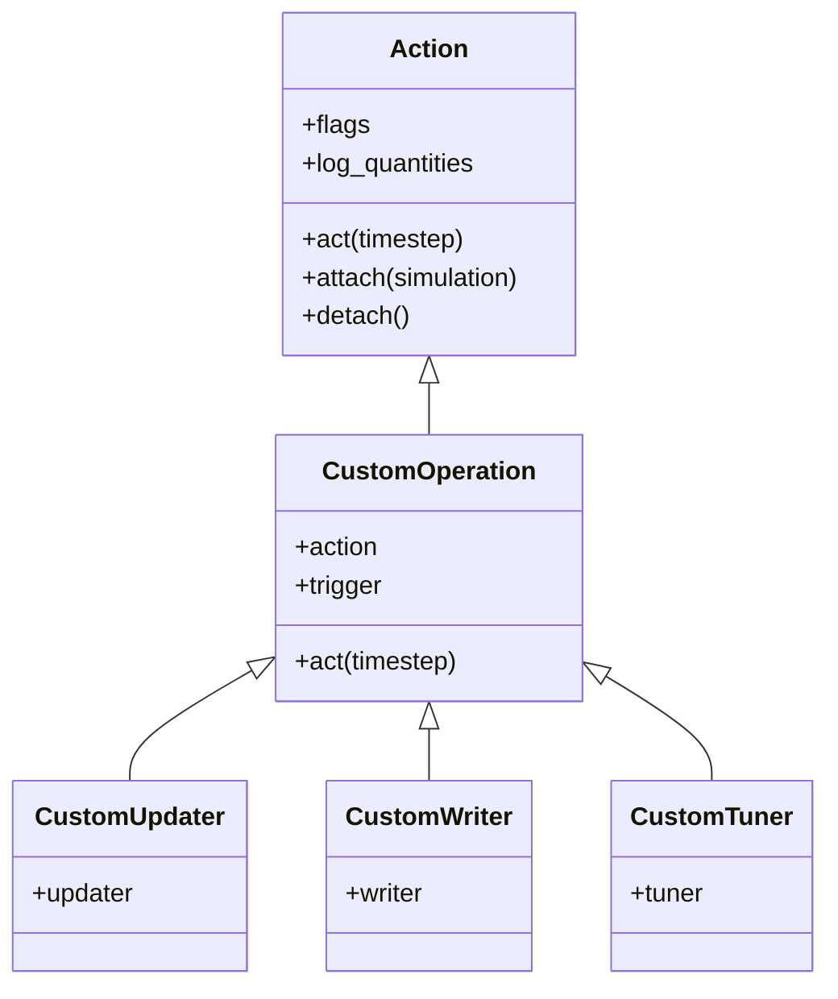

HOOMD-blue provides a powerful extension mechanism that allows you to create custom operations in Python, enabling you to prototype new simulation methods, analyze system state during simulation progression, or write output to custom file formats. This flexibility makes HOOMD-blue a versatile platform for developing and testing novel simulation algorithms without needing to modify the core C++ codebase.

## Understanding the Extension Architecture

The custom extension system in HOOMD-blue is built around two key components: the `Action` base class and the `CustomOperation` wrapper. These components work together to create a seamless integration between your Python code and HOOMD-blue's simulation engine.

The `Action` class serves as the foundation for all custom extensions. When you create a custom operation, you inherit from this base class and implement the `act` method, which contains your custom logic. This method is called at specified timesteps during the simulation, allowing your code to interact with the simulation state.

The `CustomOperation` class wraps your `Action` instance and integrates it into HOOMD-blue's operation system. It handles the communication between Python and C++, manages triggers that determine when your action should execute, and provides a clean interface for accessing your action's attributes and methods.



## Creating Your First Custom Action

To create a custom extension, you start by defining a class that inherits from `hoomd.custom.Action`. Let's create a simple example that calculates the center of mass of the system:

```python
class CenterOfMassAction(hoomd.custom.Action):
    def __init__(self):
        super().__init__()
        self.com = None
    
    def act(self, timestep):
        """Calculate the center of mass of the system."""
        snapshot = self._state.get_snapshot()
        if snapshot.communicator.rank == 0:  # Only compute on rank 0
            self.com = snapshot.particles.position.mean(axis=0)
```

In this example, we've created a simple action that calculates the center of mass by accessing the particle positions through the simulation state. The `act` method is where you implement your custom logic, and it receives the current timestep as an argument.

> [!TIP]
> Remember that when working with MPI simulations, you should be careful about which operations are performed on which MPI ranks. In the example above, we only compute the center of mass on rank 0 to avoid redundant calculations.

## Integrating Your Action into the Simulation

Once you've defined your action, you need to wrap it in an appropriate operation type and add it to the simulation. HOOMD-blue provides three types of custom operations:

1. **CustomUpdater**: For operations that modify the system state
2. **CustomWriter**: For operations that read the system state and generate output
3. **CustomTuner**: For operations that tune parameters of other operations

Here's how you would integrate our center of mass action as a writer:

```python
# Create the action
com_action = CenterOfMassAction()

# Wrap it in a CustomWriter
com_writer = hoomd.write.CustomWriter(
    action=com_action,
    trigger=hoomd.trigger.Periodic(1000)  # Run every 1000 steps
)

# Add to the simulation
simulation.operations.writers.append(com_writer)
```

The `trigger` parameter determines when your action will be executed. In this case, it will run every 1000 timesteps. You can use various trigger types like `Periodic`, `Before`, `After`, or create custom triggers to suit your needs.

## Advanced Features of Custom Actions

### Requesting Computed Quantities

Sometimes your custom action may need access to quantities that HOOMD-blue doesn't compute by default, such as the pressure tensor or rotational kinetic energy. You can request these by setting the `flags` attribute in your action:

```python
class PressureAction(hoomd.custom.Action):
    flags = [
        hoomd.custom.Action.Flags.PRESSURE_TENSOR,
        hoomd.custom.Action.Flags.ROTATIONAL_KINETIC_ENERGY,
    ]
    
    def act(self, timestep):
        """Access computed pressure and kinetic energy."""
        # These quantities are now available in the simulation state
        pass
```

### Logging Custom Properties

You can expose properties of your action to HOOMD-blue's logging system by using the `@hoomd.logging.log` decorator:

```python
class LoggingAction(hoomd.custom.Action):
    def __init__(self):
        super().__init__()
        self._temperature = 0.0
    
    @hoomd.logging.log
    def temperature(self):
        """Return the computed temperature."""
        return self._temperature
    
    def act(self, timestep):
        """Compute and store temperature."""
        snapshot = self._state.get_snapshot()
        # Calculate temperature from kinetic energy
        self._temperature = 2.0 * snapshot.particles.kinetic_energy.mean() / (3.0 * snapshot.particles.N)
```

Now you can add this action to a logger and access the temperature property:

```python
logger = hoomd.logging.Logger()
logger.add(logging_action, quantities=['temperature'])
```

## Understanding the Pass-Through System

One of the most powerful features of HOOMD-blue's custom operation system is the pass-through mechanism. This allows you to access attributes and methods of your action directly through the operation wrapper:

```python
# Instead of writing:
com_writer.action.com

# You can write directly:
com_writer.com
```

This makes your custom operations feel like native HOOMD-blue operations and provides a cleaner API for users of your extensions.

## Best Practices for Custom Extensions

When developing custom extensions, keep these best practices in mind:

1. **Minimize computation in the act method**: The `act` method is called frequently during simulation, so keep it efficient.

2. **Use appropriate operation types**: Choose `CustomUpdater` for state modifications, `CustomWriter` for output generation, and `CustomTuner` for parameter tuning.

3. **Handle MPI correctly**: Be mindful of parallel execution and ensure your code works correctly in MPI environments.

4. **Document your extensions**: Use docstrings to document your action's behavior, parameters, and any special requirements.

5. **Test thoroughly**: Test your custom extensions with different system sizes and configurations to ensure robustness.

## Example: A Complete Custom Extension

Let's put everything together with a more complete example that calculates and logs the radius of gyration of a polymer chain:

```python
class RadiusOfGyration(hoomd.custom.Action):
    """Calculate the radius of gyration of selected particles."""
    
    def __init__(self, particle_group):
        super().__init__()
        self.particle_group = particle_group
        self._rg = 0.0
    
    @hoomd.logging.log
    def radius_of_gyration(self):
        """Return the computed radius of gyration."""
        return self._rg
    
    def act(self, timestep):
        """Calculate radius of gyration."""
        snapshot = self._state.get_snapshot()
        
        # Get positions of particles in the group
        positions = snapshot.particles.position[self.particle_group]
        
        # Calculate center of mass
        com = positions.mean(axis=0)
        
        # Calculate radius of gyration
        distances_squared = np.sum((positions - com)**2, axis=1)
        self._rg = np.sqrt(np.mean(distances_squared))

# Usage example
polymer_group = hoomd.filter.Tags([1, 2, 3, 4, 5])  # Select polymer particles
rg_calculator = RadiusOfGyration(polymer_group)

rg_writer = hoomd.write.CustomWriter(
    action=rg_calculator,
    trigger=hoomd.trigger.Periodic(100)
)

simulation.operations.writers.append(rg_writer)

# Set up logging
logger = hoomd.logging.Logger()
logger.add(rg_writer, quantities=['radius_of_gyration'])
```

This example demonstrates a complete custom extension that calculates a useful quantity (radius of gyration), makes it available through the logging system, and integrates cleanly into the simulation workflow.

## Conclusion

HOOMD-blue's custom extension system provides a flexible and powerful way to extend the simulation engine with your own Python code. By understanding the `Action` and `CustomOperation` classes, you can create custom updaters, writers, and tuners that integrate seamlessly with HOOMD-blue's simulation engine. Whether you're prototyping new algorithms, analyzing simulation data, or creating custom output formats, the extension system gives you the tools you need to customize HOOMD-blue for your specific research needs.
