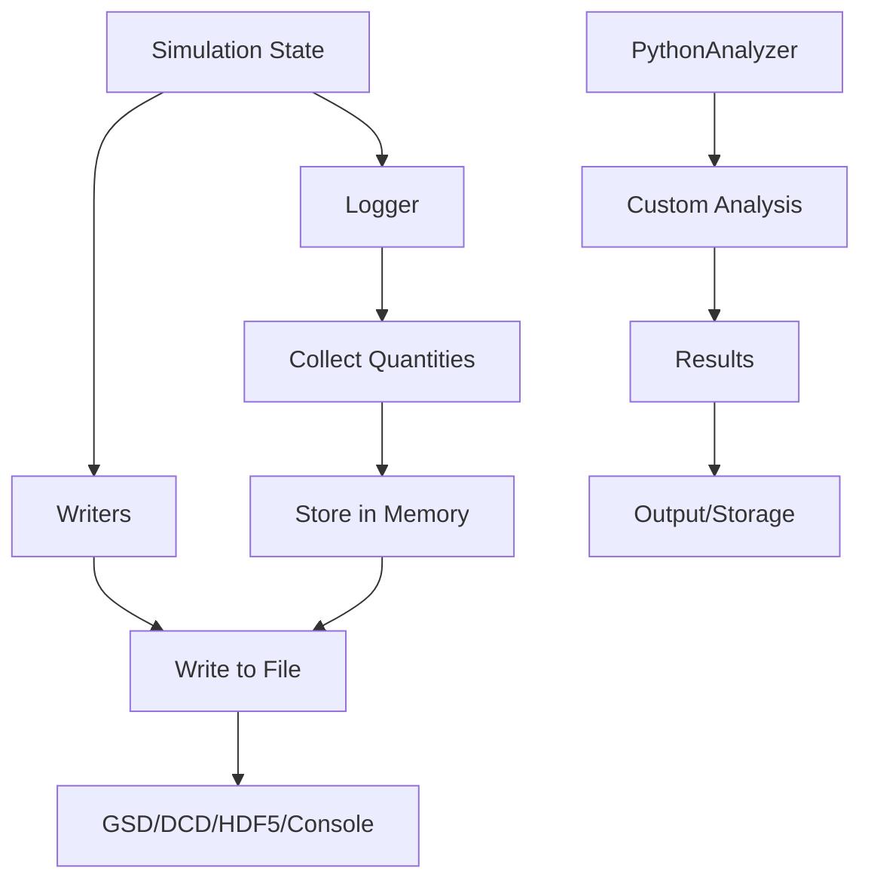

In molecular simulations, collecting and analyzing data is as crucial as running the simulation itself. HOOMD-blue provides a comprehensive framework for outputting simulation data and performing analysis both during and after simulations. This guide will walk you through the various data output formats, logging capabilities, and analysis tools available in HOOMD-blue.

## Understanding the Data Output Architecture

HOOMD-blue's data output system is built around two main concepts: **Writers** and **Analyzers**. Writers are responsible for saving simulation data to files or displaying it, while Analyzers perform calculations on the simulation state without modifying it.

The base `Analyzer` class provides the foundation for all analysis operations in HOOMD-blue. It defines a simple interface where derived classes implement the `analyze()` method to perform their calculations and make output whenever called by the simulation system. `Sources: [Analyzer.h#L38-L57](hoomd/Analyzer.h#L38-L57)`

Writers in HOOMD-blue are implemented as operations that can be attached to a simulation. They handle various output formats and are triggered at specific intervals during the simulation. The `hoomd.write` module contains all the available writers, each designed for specific use cases.

## Trajectory Output Formats

HOOMD-blue supports several popular trajectory formats, each with its own strengths and use cases.

### GSD Files: The Modern Standard

GSD (General Simulation Data) is HOOMD-blue's native trajectory format, offering the most comprehensive support for simulation data. It can store particle positions, velocities, types, bonds, angles, dihedrals, impropers, constraints, and arbitrary logged quantities.

```python
# Write a GSD trajectory every 1,000 steps
gsd_writer = hoomd.write.GSD(
    trigger=hoomd.trigger.Periodic(1000),
    filename='trajectory.gsd',
    mode='wb'
)
simulation.operations.writers.append(gsd_writer)
```

GSD files are particularly powerful because they can handle simulations where the number of particles or particle types changes over time. They also support storing arbitrary quantities from the logging system, making them ideal for complex analyses. `Sources: [gsd.py#L60-L82](hoomd/write/gsd.py#L60-L82)`

> [!TIP]
> OVITO has native support for GSD files, including logged per-particle array quantities and particle shapes, making it an excellent choice for visualization.

### DCD Files: Lightweight Trajectory Storage

DCD (CHARMM/NAMD trajectory) is a compact format that stores only particle positions and box dimensions. It's ideal for long simulations where file size is a concern and you only need positional data.

```python
# Write a DCD trajectory every 10,000 steps
dcd_writer = hoomd.write.DCD(
    trigger=hoomd.trigger.Periodic(10000),
    filename='trajectory.dcd'
)
simulation.operations.writers.append(dcd_writer)
```

DCD files are limited to simulations with a fixed number of particles but offer excellent compression for positional data. `Sources: [dcd.py#L19-L47](hoomd/write/dcd.py#L19-L47)`

## Logging System: Capturing Simulation Properties

The logging system in HOOMD-blue allows you to collect various simulation properties and computed quantities during the simulation. The `Logger` class serves as the central component for this functionality.

### Logger Categories

The logging system supports different categories of data, each suited for specific types of quantities:

| Category | Description | Example |
|----------|-------------|---------|
| scalar | Single numerical values | Temperature, pressure |
| sequence | Arrays of numbers | Per-particle energies |
| string | Text values | Simulation state |
| particle | Per-particle properties | Positions, velocities |
| bond | Per-bond properties | Bond lengths, energies |

```python
# Create a logger that captures various quantities
logger = hoomd.logging.Logger(categories=['scalar', 'particle', 'bond'])
logger.add(simulation, quantities=['kinetic_temperature', 'potential_energy'])
```

The `LoggerCategories` enum provides a way to specify which types of data you want to collect, ensuring you only capture what you need. `Sources: [logging.py#L32-67](hoomd/logging.py#L32-67)`

### Combining Loggers with Writers

The real power of the logging system comes when you combine it with writers to save the logged data:

```python
# Create a logger and add quantities
logger = hoomd.logging.Logger()
logger.add(simulation, quantities=['kinetic_temperature', 'potential_energy'])

# Write logged data to GSD file
gsd_writer = hoomd.write.GSD(
    trigger=hoomd.trigger.Periodic(1000),
    filename='trajectory_with_log.gsd',
    logger=logger
)
simulation.operations.writers.append(gsd_writer)
```

This approach allows you to save both trajectory data and computed quantities in the same file, simplifying post-processing. `Sources: [gsd.py#L10-L11](hoomd/write/__init__.py#L10-L11)`

## Real-time Output and Monitoring

### Table Writer: Console Output

The `Table` writer provides real-time output to the console, making it ideal for monitoring simulation progress during runs:

```python
# Display simulation status every 1,000 steps
table_writer = hoomd.write.Table(
    trigger=hoomd.trigger.Periodic(1000),
    logger=logger
)
simulation.operations.writers.append(table_writer)
```

The Table writer formats the output neatly in columns, making it easy to track key quantities as the simulation progresses. It includes a sophisticated formatter that handles numbers and strings with appropriate precision and alignment. `Sources: [table.py#L61-82](hoomd/write/table.py#L61-82)`

### HDF5 Log: Efficient Binary Logging

For high-performance logging of time-series data, HOOMD-blue provides the HDF5 writer:

```python
# Write logged data to HDF5 file
hdf5_writer = hoomd.write.HDF5Log(
    trigger=hoomd.trigger.Periodic(100),
    filename='simulation_log.h5',
    logger=logger
)
simulation.operations.writers.append(hdf5_writer)
```

HDF5 files are particularly useful for long simulations where you need to log many quantities frequently, as they provide efficient storage and fast access to the data. `Sources: [hdf5.py#L4-5](hoomd/write/hdf5.py#L4-5)`

## Custom Analysis with PythonAnalyzer

HOOMD-blue allows you to implement custom analysis operations in Python using the `PythonAnalyzer` class. This is particularly useful for analysis that doesn't fit into the standard logging framework.

```python
class CustomAnalyzer:
    def __init__(self, simulation):
        self.simulation = simulation
    
    def act(self, timestep):
        # Perform custom analysis here
        state = self.simulation.state
        # Calculate and store custom quantities
        return results

# Create and attach the custom analyzer
custom_analyzer = CustomAnalyzer(simulation)
python_analyzer = hoomd.analyze.PythonAnalyzer(
    trigger=hoomd.trigger.Periodic(1000),
    analyzer=custom_analyzer
)
simulation.operations.analyzers.append(python_analyzer)
```

The `PythonAnalyzer` bridges the C++ core of HOOMD-blue with Python, allowing you to implement complex analysis logic while maintaining good performance. `Sources: [PythonAnalyzer.h#L12-33](hoomd/PythonAnalyzer.h#L12-33)`

## Burst Mode: High-Frequency Data Collection

For cases where you need high-frequency data collection but don't want to store every frame, HOOMD-blue provides the Burst writer:

```python
# Collect data every 10 steps but keep only the last 100 frames
burst_writer = hoomd.write.Burst(
    trigger=hoomd.trigger.Periodic(10),
    filename='burst_trajectory.gsd',
    max_frames=100
)
simulation.operations.writers.append(burst_writer)
```

The Burst writer maintains a sliding window of trajectory frames, which is particularly useful for analyzing short-time phenomena without overwhelming your storage. `Sources: [__init__.py#L8-9](hoomd/write/__init__.py#L8-9)`

## Data Output Workflow



This workflow shows how data flows through HOOMD-blue's output and analysis system. The simulation state feeds both the logging system and writers, while custom analyzers can perform additional processing.

## Best Practices for Data Output

1. **Choose the right format**: Use GSD for comprehensive data, DCD for lightweight trajectories, and HDF5 for time-series logging.

2. **Balance frequency and storage**: Writing too frequently can slow down simulations and create huge files. Find the right balance for your specific needs.

3. **Use triggers effectively**: Combine different triggers for different quantities - log thermodynamic properties frequently but save trajectories less often.

4. **Plan your analysis**: Consider what analysis you'll need before setting up your logging to ensure you capture all necessary data.

5. **Monitor file sizes**: Large simulations can generate terabytes of data. Use filters and selective logging to keep file sizes manageable.

## Advanced Topics

### Custom Writers

For specialized output needs, you can create custom writers by extending the `CustomWriter` class:

```python
class MyCustomWriter(hoomd.write.CustomWriter):
    def __init__(self, trigger):
        super().__init__(trigger)
        # Initialize your writer
    
    def write(self):
        # Implement your custom output logic
        pass
```

This gives you complete control over how data is formatted and saved. `Sources: [__init__.py#L15](hoomd/write/__init__.py#L15)`

### Performance Considerations

Data output can become a bottleneck in large simulations. To optimize performance:

- Use the `filter` parameter in writers to output only relevant particles
- Consider using the `dynamic` parameter in GSD writers to control which fields are written
- Balance the frequency of output with your storage capacity
- Use compression in formats that support it (like GSD)

HOOMD-blue's data output and analysis system provides a flexible and powerful framework for capturing simulation data. By understanding the available options and how they work together, you can design an effective data collection strategy for your specific research needs.