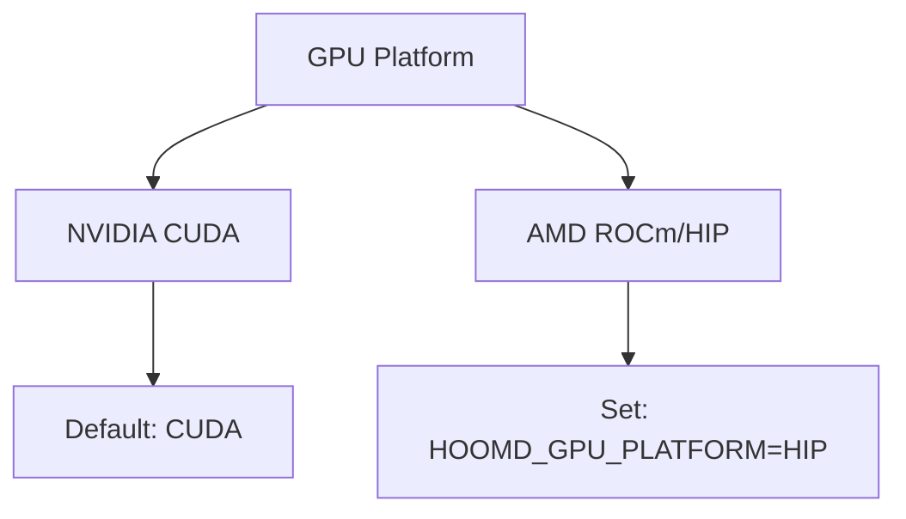

HOOMD-blue is a powerful Python package that performs particle simulations on CPUs and GPUs, supporting both hard particle Monte Carlo and molecular dynamics simulations. This guide will walk you through installing HOOMD-blue using the easiest methods first, then cover advanced options for developers who need custom builds.

## Why Installation Matters

Getting HOOMD-blue installed correctly is your first step toward running high-performance particle simulations. Whether you're studying soft matter materials, biological systems, or other particle-based phenomena, proper installation ensures you can leverage HOOMD-blue's GPU acceleration and parallel computing capabilities for maximum performance.

## Installation Options

HOOMD-blue offers two main installation paths, each suited for different use cases:

| Installation Method | Best For | Time Required | Technical Skill |
|-------------------|----------|---------------|----------------|
| **Binary Installation** | Quick start, standard use cases | 5-10 minutes | Beginner |
| **Build from Source** | Custom builds, MPI support, development | 30-60 minutes | Intermediate |

## Prerequisites

Before installing HOOMD-blue, ensure your system meets these requirements:

**System Requirements:**
- **Operating System:** Linux (x86_64), macOS (x86_64 or ARM64)
- **Python:** 3.8 or later
- **Memory:** 4 GB RAM minimum (8 GB recommended)
- **Storage:** 1 GB free space

**For GPU Acceleration:**
- **NVIDIA GPU:** CUDA 11.8 or 12.6 compatible driver
- **AMD GPU:** ROCm 5.7 or later

> [!TIP]
> HOOMD-blue automatically detects GPU capabilities during installation. You don't need to manually specify GPU support unless you want to force a specific configuration.

## Binary Installation (Recommended)

Binary installation is the fastest and easiest way to get started with HOOMD-blue. We'll use conda-forge, which provides pre-compiled packages for most systems.

### Step 1: Install a Package Manager

First, install micromamba, a fast package manager:

```bash
# Linux/macOS
curl -Ls https://micro.mamba.pm/api/micromamba/linux-64/latest | tar -xvj bin/micromamba
sudo mv bin/micromamba /usr/local/bin/
```

### Step 2: Install HOOMD-blue

Install HOOMD-blue with a single command. Micromamba will automatically detect your system capabilities:

```bash
micromamba install hoomd=5.3.1
```

This command installs the latest stable version and automatically chooses between CPU and GPU builds based on your system.

### Step 3: Verify Installation

Test your installation with a simple Python script:

```python
import hoomd

# Create a simulation device
device = hoomd.device.CPU()
print(f"HOOMD-blue version: {hoomd.version.version}")
print(f"Device: {device}")
```

If you see the version information without errors, your installation is successful!

Sources: [INSTALLING.rst#L19-26](INSTALLING.rst#L19-26), [README.md#L11-15](README.md#L11-15)

### GPU-Specific Installation

If you have an NVIDIA GPU and want to ensure GPU acceleration is enabled:

```bash
# Force GPU installation with CUDA 12.6
export CONDA_OVERRIDE_CUDA="12.6"
micromamba install "hoomd=5.3.1=*gpu*" "cuda-version=12.6"
```

For systems with older CUDA 11.8 drivers:

```bash
export CONDA_OVERRIDE_CUDA="11.8"
micromamba install "hoomd=5.3.1=*gpu*" "cuda-version=11.8"
```

> [!TIP]
> If you encounter CUDA version conflicts, check your NVIDIA driver version with `nvidia-smi` and match the CUDA version accordingly.

### CPU-Only Installation

If you explicitly want a CPU-only build (useful for development or testing):

```bash
micromamba install "hoomd=5.3.1=*cpu*"
```

Sources: [INSTALLING.rst#L29-51](INSTALLING.rst#L29-51)

## Building from Source

Building from source is necessary when you need:
- MPI parallel execution support
- Custom build configurations
- Development environment setup
- Integration with specific libraries

### Step 1: Install Build Dependencies

Install the required packages for building HOOMD-blue:

```bash
# Core dependencies
micromamba install cmake eigen git ninja numpy pybind11 python

# Testing dependencies
micromamba install pytest rowan

# Optional: Documentation building
micromamba install sphinx furo nbsphinx ipython
```

**Important:** Avoid installing compilers (clang, gcc) in your conda environment, as they can interfere with system compilers and cause build errors.

Sources: [BUILDING.rst#L73-95](BUILDING.rst#L73-95)

### Step 2: Obtain Source Code

Clone the HOOMD-blue repository with all submodules:

```bash
git clone --recursive git@github.com:glotzerlab/hoomd-blue.git
cd hoomd-blue
```

The `--recursive` flag is crucial as HOOMD-blue uses Git submodules for external dependencies.

Sources: [BUILDING.rst#L153-173](BUILDING.rst#L153-173)

### Step 3: Configure the Build

Use CMake to configure your build. The basic configuration is:

```bash
cmake -B build -S . -GNinja
```

For advanced configurations, you can specify various options:

```bash
# Enable GPU support
cmake -B build -S . -GNinja -DENABLE_GPU=on

# Enable MPI support
cmake -B build -S . -GNinja -DENABLE_MPI=on

# Build with specific precision settings
cmake -B build -S . -GNinja -DHOOMD_LONGREAL_SIZE=64 -DHOOMD_SHORTREAL_SIZE=32

# Optimize for your processor
cmake -B build -S . -GNinja -DCMAKE_CXX_FLAGS=-march=native -DCMAKE_C_FLAGS=-march=native
```

**Key Configuration Options:**

| Option | Default | Description |
|--------|---------|-------------|
| `ENABLE_GPU` | `off` | Enable GPU acceleration |
| `ENABLE_MPI` | `off` | Enable MPI parallel execution |
| `BUILD_HPMC` | `on` | Build HPMC module |
| `BUILD_MD` | `on` | Build MD module |
| `BUILD_TESTING` | `on` | Build unit tests |
| `CMAKE_BUILD_TYPE` | `Release` | Build optimization level |

Sources: [BUILDING.rst#L181-268](BUILDING.rst#L181-268)

### Step 4: Build and Test

Compile HOOMD-blue using Ninja:

```bash
cd build
ninja
```

Run the test suite to verify your build:

```bash
python3 -m pytest hoomd
```

This may take 10-30 minutes depending on your system and configuration.

Sources: [BUILDING.rst#L274-302](BUILDING.rst#L274-302)

### Step 5: Install (Optional)

Install HOOMD-blue to your Python environment:

```bash
ninja install
```

Alternatively, use the build directory without installation by setting the Python path:

```bash
export PYTHONPATH=/path/to/hoomd-blue/build:$PYTHONPATH
```

Sources: [BUILDING.rst#L308-325](BUILDING.rst#L308-325)

## Platform-Specific Considerations

### GPU Platform Selection

HOOMD-blue supports both NVIDIA CUDA and AMD ROCm/HIP platforms:



For AMD GPU support:

```bash
cmake -B build -S . -GNinja -DENABLE_GPU=on -DHOOMD_GPU_PLATFORM=HIP
```

Sources: [BUILDING.rst#L125-142](BUILDING.rst#L125-142)

### MPI Parallel Builds

For multi-node or multi-GPU simulations, enable MPI support:

```bash
# Install MPI dependencies
micromamba install openmpi cereal

# Configure with MPI
cmake -B build -S . -GNinja -DENABLE_MPI=on -DMPI_HOME=/path/to/mpi/install
```

MPI builds are essential for large-scale simulations on HPC clusters.

Sources: [INSTALLING.rst#L7-14](INSTALLING.rst#L7-14), [BUILDING.rst#L120-124](BUILDING.rst#L120-124)

## Verification and Testing

After installation, verify that HOOMD-blue works correctly with your hardware:

### Basic Functionality Test

```python
import hoomd

# Test CPU device
cpu_device = hoomd.device.CPU()
print(f"CPU device created: {cpu_device}")

# Test GPU device (if available)
try:
    gpu_device = hoomd.device.GPU()
    print(f"GPU device created: {gpu_device}")
    print(f"GPU compute capability: {gpu_device.compute_capability}")
except Exception as e:
    print(f"GPU not available: {e}")

# Test version
print(f"HOOMD-blue version: {hoomd.version.version}")
```

### Performance Test

Run a quick simulation to test performance:

```python
import hoomd
import hoomd.md

# Create simulation
device = hoomd.device.GPU()  # or hoomd.device.CPU()
sim = hoomd.Simulation(device=device, seed=42)

# Create a simple system
sim.create_state_from_gsd('init.gsd')  # You'll need to create this file first

# Set up MD simulation
integrator = hoomd.md.Integrator(dt=0.005)
sim.operations.integrator = integrator

# Run a short simulation
sim.run(1000)
print(f"Simulation completed. TPS: {sim.tps}")
```

Sources: [hoomd/device.py#L17-23](hoomd/device.py#L17-23), [README.md#L47-68](README.md#L47-68)

## Troubleshooting Common Issues

### Installation Issues

**Problem:** `micromamba install` fails with dependency conflicts
```bash
# Solution: Create a clean environment
micromamba create -n hoomd_env python=3.10
micromamba activate hoomd_env
micromamba install hoomd=5.3.1
```

**Problem:** CUDA version mismatch
```bash
# Solution: Check your driver version
nvidia-smi

# Install matching CUDA version
micromamba install "cuda-version=12.6" "hoomd=5.3.1=*gpu*"
```

### Build Issues

**Problem:** CMake cannot find Python
```bash
# Solution: Specify Python executable explicitly
cmake -B build -S . -GNinja -DPython_EXECUTABLE=/usr/bin/python3
```

**Problem:** GPU compilation fails
```bash
# Solution: Specify CUDA compiler
cmake -B build -S . -GNinja -DCMAKE_CUDA_COMPILER=/usr/local/cuda/bin/nvcc
```

**Problem:** MPI not found
```bash
# Solution: Specify MPI installation path
cmake -B build -S . -GNinja -DENABLE_MPI=on -DMPI_HOME=/usr/lib/openmpi
```

### Runtime Issues

**Problem:** Import error: `No module named 'hoomd'`
```bash
# Solution: Check Python path
export PYTHONPATH=/path/to/hoomd-blue/build:$PYTHONPATH
```

**Problem:** GPU not detected
```bash
# Solution: Verify GPU drivers and CUDA installation
nvidia-smi
nvcc --version
```

> [!TIP]
> If you encounter persistent issues, check the HOOMD-blue discussion board at https://github.com/glotzerlab/hoomd-blue/discussions/ for community support.

## Next Steps

Congratulations! You now have HOOMD-blue installed and ready for simulations. Here's what to explore next:

1. **Basic Simulation Tutorial** - Learn to create and run your first simulation
2. **Understanding Simulation Components** - Dive deeper into HOOMD-blue's architecture
3. **Documentation** - Explore the full API reference at https://hoomd-blue.readthedocs.io/
4. **Examples** - Check out the example scripts in the repository and documentation

Remember that HOOMD-blue is designed to be flexible and powerful. Start with simple simulations and gradually explore more advanced features like GPU acceleration, MPI parallelization, and custom extensions as you become comfortable with the basics.
