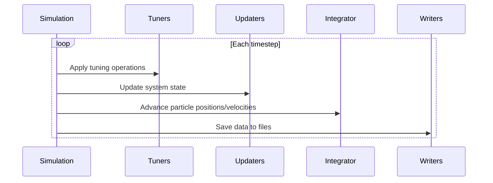

Welcome to the **Basic Simulation Tutorial** for HOOMD-blue! This tutorial will guide you through creating your first molecular dynamics simulation from scratch. By the end, you'll understand the core components of a HOOMD-blue simulation and be able to run your own simulations with confidence.

## Understanding the Simulation Lifecycle

A HOOMD-blue simulation follows a clear lifecycle that consists of four main stages:

1. **Initialization**: Create a simulation object and device
2. **State Creation**: Define the initial configuration of particles
3. **Operations Setup**: Add forces, integrators, and other operations
4. **Execution**: Run the simulation and collect data

This structure ensures that your simulations are organized, modular, and easy to modify. Let's explore each stage in detail.

## Step 1: Creating a Simulation Object

Every HOOMD-blue simulation starts with creating a `Simulation` object, which serves as the central container for all simulation components. The simulation requires two key parameters: a device to execute on and a random seed.

```python
import hoomd

# Create a simulation running on CPU with random seed 42
simulation = hoomd.Simulation(device=hoomd.device.CPU(), seed=42)
```

The `device` parameter determines where the simulation will run:
- `hoomd.device.CPU()`: Runs on CPU (available everywhere)
- `hoomd.device.GPU()`: Runs on GPU (requires CUDA support)

The `seed` parameter is crucial for reproducibility. HOOMD-blue uses deterministic random number generation, so the same seed will produce identical results across runs.

> [!TIP]
> Always set a seed for your simulations! This ensures your results are reproducible and debuggable. Without a seed, HOOMD-blue will use a default value of 0, but it's better to be explicit.

Sources: [simulation.py#L59-L67](hoomd/simulation.py#L59-L67), [__init__.py#L100](hoomd/__init__.py#L100)

## Step 2: Creating the Initial State

Before running a simulation, you need to define the initial configuration of particles. HOOMD-blue provides two main ways to create a simulation state:

### Method A: From a GSD File

The easiest way to start is by loading an existing configuration from a GSD (General Simulation Data) file:

```python
# Create state from a GSD file
simulation.create_state_from_gsd('initial_config.gsd')
```

This method is ideal when you have pre-equilibrated structures or want to restart from previous simulations.

### Method B: From a Snapshot

For creating initial configurations programmatically, use snapshots:

```python
# Create an empty snapshot
snapshot = hoomd.Snapshot()

# Set up a simple cubic box
snapshot.box = [10, 10, 10, 0, 0, 0]  # Lx, Ly, Lz, xy, xz, yz

# Add particles
snapshot.particles.N = 100  # Number of particles
snapshot.particles.position[:] = [[0, 0, 0]] * 100  # Set positions
snapshot.particles.typeid[:] = [0] * 100  # All particles are type 0

# Define particle types
snapshot.particles.types = ['A']

# Create state from snapshot
simulation.create_state_from_snapshot(snapshot)
```

Snapshots give you complete control over the initial configuration, including particle positions, velocities, types, and bonded interactions.

Sources: [simulation.py#L193-L246](hoomd/simulation.py#L193-L246), [snapshot.py#L52-L100](hoomd/snapshot.py#L52-L100)

## Step 3: Setting Up Operations

Operations define what happens during each simulation step. The main types of operations are:

- **Integrator**: Advances particle positions and velocities
- **Forces**: Compute interactions between particles
- **Updaters**: Modify the simulation state periodically
- **Writers**: Save data to files
- **Tuners**: Optimize performance parameters

### Creating a Molecular Dynamics Simulation

Let's set up a simple Lennard-Jones fluid simulation:

```python
# Create an MD integrator
integrator = hoomd.md.Integrator(dt=0.001)

# Add Lennard-Jones forces
lj = hoomd.md.pair.LJ(nlist=hoomd.md.nlist.Cell())
lj.params[('A', 'A')] = dict(epsilon=1.0, sigma=1.0)
lj.r_cut[('A', 'A')] = 2.5

# Add the force to the integrator
integrator.forces.append(lj)

# Add the integrator to the simulation
simulation.operations.integrator = integrator
```

### Adding Data Output

To save simulation data, add a writer operation:

```python
# Write trajectory every 1000 steps
gsd_writer = hoomd.write.GSD(
    filename='trajectory.gsd',
    trigger=hoomd.trigger.Periodic(1000),
    mode='wb'
)
simulation.operations.writers.append(gsd_writer)
```

### Adding Thermodynamic Logging

Monitor simulation progress with a logger:

```python
# Log thermodynamic quantities every 100 steps
logger = hoomd.logging.Logger()
logger.add(simulation, quantities=['timestep', 'tps'])
logger.add(integrator, quantities=['kinetic_energy', 'potential_energy'])

# Write log to file
table_writer = hoomd.write.Table(
    trigger=hoomd.trigger.Periodic(100),
    logger=logger,
    output=open('log.txt', 'w')
)
simulation.operations.writers.append(table_writer)
```

Sources: [operations.py#L66-L75](hoomd/operations.py#L66-L75), [operations.py#L278-L296](hoomd/operations.py#L278-L296)

## Step 4: Running the Simulation

With everything set up, you can now run the simulation:

```python
# Run for 10,000 steps
simulation.run(10_000)
```

During the run, HOOMD-blue executes operations in a specific order each timestep:



The `run` method advances the simulation by the specified number of steps, applying all operations in the correct sequence. You can monitor progress using the logged quantities or by checking the simulation object's properties:

```python
print(f"Completed {simulation.timestep} steps")
print(f"Performance: {simulation.tps:.1f} steps per second")
```

Sources: [simulation.py#L484-L561](hoomd/simulation.py#L484-L561)

## Complete Example: Simple Lennard-Jones Simulation

Here's a complete example that puts everything together:

```python
import hoomd
import hoomd.md

# 1. Initialize simulation
simulation = hoomd.Simulation(device=hoomd.device.CPU(), seed=42)
simulation.timestep = 0

# 2. Create initial state
snapshot = hoomd.Snapshot()
snapshot.box = [10, 10, 10, 0, 0, 0]
snapshot.particles.N = 100
snapshot.particles.position[:] = [[0, 0, 0]] * 100
snapshot.particles.typeid[:] = [0] * 100
snapshot.particles.types = ['A']
simulation.create_state_from_snapshot(snapshot)

# 3. Set up operations
integrator = hoomd.md.Integrator(dt=0.001)

# Add Lennard-Jones forces
lj = hoomd.md.pair.LJ(nlist=hoomd.md.nlist.Cell())
lj.params[('A', 'A')] = dict(epsilon=1.0, sigma=1.0)
lj.r_cut[('A', 'A')] = 2.5
integrator.forces.append(lj)

# Add data output
gsd_writer = hoomd.write.GSD(
    filename='trajectory.gsd',
    trigger=hoomd.trigger.Periodic(1000),
    mode='wb'
)
simulation.operations.writers.append(gsd_writer)

# Add logging
logger = hoomd.logging.Logger()
logger.add(simulation, quantities=['timestep', 'tps'])
table_writer = hoomd.write.Table(
    trigger=hoomd.trigger.Periodic(100),
    logger=logger,
    output=open('log.txt', 'w')
)
simulation.operations.writers.append(table_writer)

# Set the integrator
simulation.operations.integrator = integrator

# 4. Run simulation
simulation.run(10_000)

print(f"Simulation completed at step {simulation.timestep}")
```

## Common Patterns and Best Practices

### Performance Tuning

HOOMD-blue includes automatic performance tuning that optimizes kernel parameters during the simulation:

```python
# Check if tuning is complete
while not simulation.operations.is_tuning_complete:
    simulation.run(1000)
    print(f"Tuning... TPS: {simulation.tps:.1f}")
```

### Simulation Control

You can run simulations in segments and modify parameters between runs:

```python
# Initial equilibration
simulation.run(5_000)

# Change temperature and continue
integrator.kT = 2.0  # Higher temperature
simulation.run(5_000)
```

### Error Handling

Always check for common issues:

```python
# Verify state is created
if simulation.state is None:
    raise RuntimeError("Simulation state not initialized")

# Check operations are scheduled
if not simulation.operations._scheduled:
    print("Operations not scheduled - run() will schedule them")
```

## Next Steps

Congratulations! You've created and run your first HOOMD-blue simulation. From here, you can explore:

- **More complex force fields**: Combine multiple force types for realistic molecular models
- **Advanced integrators**: Use NPT, NVT, or other ensembles
- **Analysis techniques**: Compute custom properties and correlations
- **Parallel computing**: Scale up to larger systems with MPI

The modular structure of HOOMD-blue makes it easy to build upon this foundation and create sophisticated simulations for your research needs.
