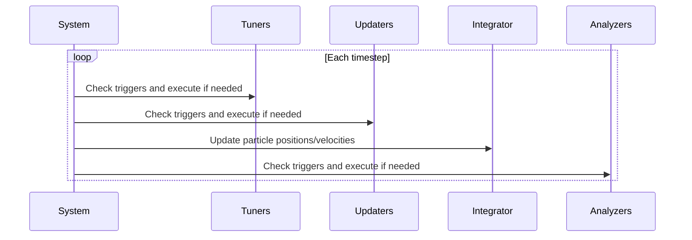

HOOMD-blue is a powerful simulation engine that performs particle-based simulations using both Monte Carlo and molecular dynamics methods. To effectively use and extend HOOMD-blue, it's essential to understand its core simulation components and how they work together. This guide will walk you through the fundamental building blocks that make up a HOOMD-blue simulation.

## The System: Orchestrating Your Simulation

At the heart of every HOOMD-blue simulation is the **System** class, which acts as the conductor of your simulation orchestra. The System manages all the operations and coordinates their execution during a simulation run. Think of it as the central hub that brings together all the individual components to create a cohesive simulation.

The System maintains lists of different operation types and executes them in a specific order during each time step. This organized approach ensures that all computations happen in the correct sequence and that the simulation progresses smoothly from one state to the next.

Sources: [System.h#L34-L60](hoomd/System.h#L34-L60)

## Core Operation Types

HOOMD-blue organizes simulation functionality into five distinct operation types, each with a specific responsibility:

### 1. Integrator: Advancing Time

The **Integrator** is perhaps the most critical component in a dynamic simulation. Its job is to advance the simulation forward in time by updating particle positions and velocities. In HOOMD-blue, there can only be one Integrator per System, reflecting the fact that a simulation follows a single time evolution path.

The Integrator manages forces and constraints that act on particles. It collects all ForceCompute objects, calculates the net force on each particle, and then uses this information to update particle states according to the equations of motion.

```python
# Example of setting up an MD integrator
integrator = hoomd.md.Integrator(dt=0.005)
sim.operations.integrator = integrator
```

Sources: [Integrator.h#L25-L59](hoomd/Integrator.h#L25-L59)

### 2. Updater: Modifying System State

**Updaters** are operations that modify the system state in some way. Unlike the Integrator, which has the specific job of time advancement, Updaters can perform various modifications to the particle data. Examples include:

- Sorting particles to improve memory access patterns
- Changing box dimensions
- Applying external fields
- Modifying particle properties

Each Updater is associated with a Trigger that determines when it should execute. This allows you to control how frequently certain updates occur during the simulation.

```python
# Example of creating an updater with a periodic trigger
box_resize = hoomd.update.BoxResize(trigger=hoomd.trigger.Periodic(1000))
sim.operations.updaters.append(box_resize)
```

Sources: [Updater.h#L39-L55](hoomd/Updater.h#L39-L55)

### 3. Compute: Calculating Properties

**Computes** are read-only operations that calculate properties of the system without modifying it. They provide the foundation for many other operations by computing essential quantities like:

- Neighbor lists for efficient force calculations
- Forces and energies
- Temperature and pressure
- Order parameters

Computes are designed to be efficient by avoiding redundant calculations. They track when they were last computed and skip recalculation if the system state hasn't changed.

```python
# Example of a compute (neighbor list)
cell = hoomd.md.nlist.Cell(buffer=0.4)
```

Sources: [Compute.h#L38-L57](hoomd/Compute.h#L38-L57)

### 4. Analyzer: Output and Analysis

**Analyzers** (called "Writers" in the Python API) are responsible for analyzing the system state and outputting data. Like Computes, they don't modify the system, but their primary purpose is to provide information to the user through:

- Writing trajectory files
- Logging thermodynamic properties
- Computing and saving custom analysis
- Generating visualization data

Analyzers also use Triggers to control when they run, allowing you to balance between data collection frequency and performance.

```python
# Example of an analyzer (writer)
gsd_writer = hoomd.write.GSD(filename='trajectory.gsd', 
                            trigger=hoomd.trigger.Periodic(1000))
sim.operations.writers.append(gsd_writer)
```

Sources: [Analyzer.h#L38-L56](hoomd/Analyzer.h#L38-L56)

### 5. Tuner: Optimizing Performance

**Tuners** are special operations that modify parameters of other components to optimize performance without affecting the physical correctness of the simulation. Examples include:

- Adjusting neighbor list skin distances
- Optimizing GPU kernel parameters
- Reordering particles in memory

Tuners help HOOMD-blue maintain high performance across different system configurations and hardware.

Sources: [ARCHITECTURE.md#L148-L150](ARCHITECTURE.md#L148-L150)

## Triggers: Controlling Execution Timing

**Triggers** determine when operations should execute during a simulation. They provide a flexible way to control the timing of different operations without modifying the operations themselves. HOOMD-blue includes several built-in trigger types:

- **PeriodicTrigger**: Execute every N steps with an optional phase offset
- **BeforeTrigger**: Execute on all steps before a specified timestep
- **OnTrigger**: Execute only on a specific timestep
- **AfterTrigger**: Execute on all steps after a specified timestep

```python
# Example trigger usage
# Run every 1000 steps
periodic_trigger = hoomd.trigger.Periodic(1000)

# Run every 100 steps starting at step 50
phase_trigger = hoomd.trigger.Periodic(100, phase=50)

# Run only at step 10000
single_trigger = hoomd.trigger.On(10000)
```

Sources: [Trigger.h#L16-L24](hoomd/Trigger.h#L16-L24)

## Simulation Execution Flow

Understanding how these components work together during simulation execution is crucial. Here's the typical flow of operations during each time step:



The System orchestrates this flow, ensuring that operations execute in the correct order and only when their triggers indicate they should run.

Sources: [System.h#L84-L93](hoomd/System.h#L84-L93)

## Data Management

All operations work with the same underlying system data, which is managed through several key classes:

- **SystemDefinition**: Combines all system data into a single object
- **ParticleData**: Stores particle positions, velocities, masses, and other properties
- **ParticleGroup**: Represents subsets of particles for targeted operations
- **BondedGroupData**: Manages bonds, angles, dihedrals, and other bonded interactions

This shared data model ensures consistency across all operations and enables efficient communication between different components.

Sources: [ARCHITECTURE.md#L125-L131](ARCHITECTURE.md#L125-L131)

## Simulation Methods

HOOMD-blue supports two primary simulation methods, each with its own set of specialized components:

### Molecular Dynamics (MD)

MD simulations use numerical integration to solve Newton's equations of motion. The MD module includes:

- **IntegratorTwoStep**: The main MD integrator implementing velocity-Verlet integration
- **ForceCompute**: Classes for various force calculations (LJ, Coulomb, bonds, etc.)
- **IntegrationMethodTwoStep**: Different integration schemes (NVT, NPT, etc.)

```python
# Example MD setup
lj = hoomd.md.pair.LJ(nlist=cell)
lj.params[('A', 'A')] = dict(epsilon=1, sigma=1)
lj.r_cut[('A', 'A')] = 2.5

integrator = hoomd.md.Integrator(dt=0.005)
integrator.forces.append(lj)
```

Sources: [README.md#L70-L93](README.md#L70-L93)

### Hard Particle Monte Carlo (HPMC)

HPMC simulations use stochastic moves to sample equilibrium configurations. The HPMC module includes:

- **HPMCIntegrator**: The main HPMC integrator handling trial moves
- **Shape classes**: Various particle shape implementations
- **Updaters**: Specialized updaters for HPMC-specific operations

```python
# Example HPMC setup
mc = hoomd.hpmc.integrate.ConvexPolyhedron()
mc.shape['octahedron'] = dict(vertices=[
    (-0.5, 0, 0), (0.5, 0, 0), (0, -0.5, 0),
    (0, 0.5, 0), (0, 0, -0.5), (0, 0, 0.5)
])
```

Sources: [README.md#L47-L68](README.md#L47-L68)

> [!TIP]
> When building complex simulations, remember that operations execute in the order they were added to the System. This can affect results, especially when multiple operations modify the same system properties.

## Conclusion

Understanding HOOMD-blue's simulation components is key to creating effective simulations. The modular design allows you to mix and match different operations to create custom simulation workflows while maintaining high performance through optimized C++ implementations and GPU acceleration.

As you continue exploring HOOMD-blue, you'll discover how these components can be combined and extended to solve complex scientific problems. The flexibility of the operation-based architecture makes HOOMD-blue a powerful tool for a wide range of particle-based simulations.
