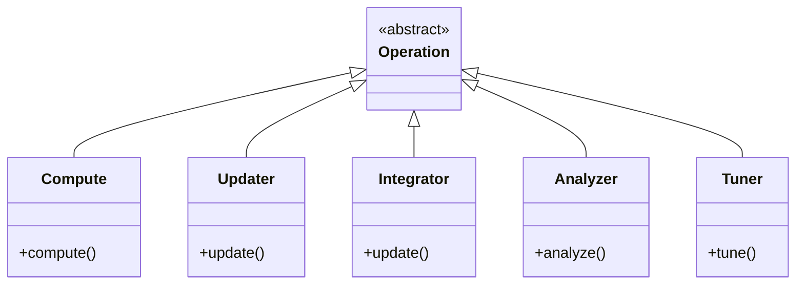
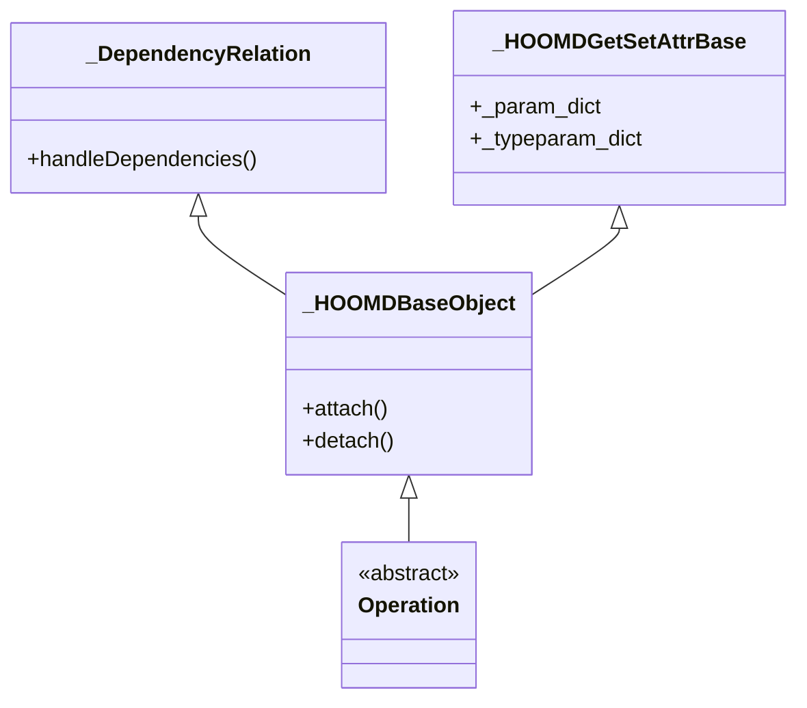

HOOMD-blue is a high-performance molecular dynamics simulation engine designed to run efficiently on both CPUs and GPUs. Its architecture is built around a modular design that emphasizes performance, maintainability, and extensibility. Let's explore the key components and design principles that make up the HOOMD-blue system architecture.

## Core Architecture Overview

At its heart, HOOMD-blue follows a **component-based architecture** where the simulation system is composed of multiple specialized components that work together. The architecture is designed to handle complex molecular simulations while providing flexibility for different simulation methods and hardware configurations.

The main execution flow revolves around the **System** class, which acts as the central orchestrator for all simulation operations. It manages lists of operations that act on the system state and controls the simulation loop. This design allows for a clean separation of concerns, where each component has a specific responsibility.

Sources: [ARCHITECTURE.md#L134-L151](ARCHITECTURE.md#L134-L151), [System.h#L34-L62](hoomd/System.h#L34-L62)

## Execution Model and Hardware Support

HOOMD-blue implements a **unified execution model** that can run on CPUs, GPUs, or multiple GPUs using MPI. The `ExecutionConfiguration` class is responsible for selecting and managing the execution environment:

```cpp
enum executionMode {
    GPU,  //!< Execute on the GPU
    CPU,  //!< Execute on the CPU
    AUTO, //!< Auto select between GPU and CPU
};
```

This design allows HOOMD-blue to automatically adapt to the available hardware while maintaining a consistent API. The system uses **HIP** (Heterogeneous-Compute Interface for Portability) to support both NVIDIA and AMD GPUs, ensuring broad hardware compatibility.

For parallel computing, HOOMD-blue implements **domain decomposition** through MPI, where the simulation space is divided among multiple processes. Each process handles a portion of the particles, and the `Communicator` class manages the exchange of particles and data between neighboring domains.

Sources: [ARCHITECTURE.md#L67-L88](ARCHITECTURE.md#L67-L88), [ExecutionConfiguration.h#L49-L66](hoomd/ExecutionConfiguration.h#L49-L66)

## Data Model and System State

The simulation state is managed through a hierarchical data model centered around the `SystemDefinition` class. This class acts as a container for all essential simulation data:

- **ParticleData**: Stores particle positions, velocities, masses, and other per-particle properties
- **BondedGroupData**: Manages bonds, angles, dihedrals, and other bonded interactions
- **BoxDim**: Defines the simulation box geometry and boundary conditions

HOOMD-blue uses specialized data types optimized for performance:
- `Scalar`: Configurable floating-point type (float or double)
- `ScalarN`: Vector types (Scalar2, Scalar3, Scalar4) for efficient GPU memory access
- `GPUArray<T>`: Dual CPU/GPU arrays with automatic synchronization
- `ManagedArray<T>`: Arrays using CUDA unified memory for seamless CPU/GPU access

```cpp
// Example of using GPUArray for particle positions
GPUArray<Scalar4> m_positions;  // x, y, z coordinates + type
GPUArray<Scalar4> m_velocities;  // vx, vy, vz + mass
```

This data model ensures efficient memory access patterns while maintaining flexibility for different simulation scenarios.

Sources: [ARCHITECTURE.md#L89-L132](ARCHITECTURE.md#L89-L132), [SystemDefinition.h#L34-L72](hoomd/SystemDefinition.h#L34-L72)

## Operation-Based Architecture

HOOMD-blue uses an **operation-based architecture** where simulations are defined by composing different types of operations. The `System` class manages these operations and executes them based on `Trigger` conditions:



Each operation type serves a specific purpose:
- **Compute**: Calculates system properties without modifying the state (e.g., neighbor lists)
- **Updater**: Modifies the system state (e.g., temperature controllers)
- **Integrator**: Advances the system in time (only one per simulation)
- **Analyzer**: Analyzes and outputs data (e.g., trajectory writers)
- **Tuner**: Optimizes performance parameters (e.g., kernel block sizes)

This modular design allows users to build complex simulations by combining simple, well-defined operations.

Sources: [ARCHITECTURE.md#L134-L151](ARCHITECTURE.md#L134-L151), [System.h#L147-L165](hoomd/System.h#L147-L165)

## Simulation Methods and Templates

HOOMD-blue supports multiple simulation methods through a **template-based design** that minimizes code duplication while maintaining high performance:

- **Molecular Dynamics (MD)**: Implemented through `IntegratorTwoStep` and `FIREEnergyMinimizer`
- **Hard Particle Monte Carlo (HPMC)**: Implemented through `HPMCIntegrator`
- **Multi-Particle Collision Dynamics (MPCD)**: Optional module for fluid dynamics

The template evaluator pattern allows HOOMD-blue to implement complex mathematical operations efficiently:

```cpp
// Example of template evaluator pattern
template<class Evaluator>
void computePairForces() {
    // General implementation works with any evaluator
    Evaluator eval;
    for each particle pair {
        Scalar force = eval.evaluate(r, params);
        applyForce(force);
    }
}
```

This approach allows developers to add new functional forms (e.g., new pair potentials) by implementing only the evaluator class, while reusing the general computation framework.

Sources: [ARCHITECTURE.md#L152-L187](ARCHITECTURE.md#L152-L187)

## Python Integration and User Interface

HOOMD-blue provides a comprehensive Python interface that wraps the C++ core functionality. The Python layer follows a hierarchical class structure:



Key features of the Python interface include:
- **Parameter validation**: Automatic type checking and validation through `ParameterDict`
- **Type parameters**: Per-type parameter management through `TypeParameter`
- **Synced lists**: Lists that maintain synchronization between Python and C++
- **Automatic attachment/detachment**: Objects can be attached to simulations or exist as pure Python objects

This design ensures that users get a clean, Pythonic interface while maintaining the performance benefits of the C++ backend.

Sources: [ARCHITECTURE.md#L214-L400](ARCHITECTURE.md#L214-L400)

## Performance Optimization Features

HOOMD-blue includes several performance optimization features that work automatically:

### Autotuning

The `Autotuner` class automatically optimizes kernel parameters such as block sizes and threads per particle. It cycles through possible parameters, measures performance using CUDA events, and selects the best configuration:

```cpp
class Autotuned {
    virtual bool isAutotuningComplete();
    virtual void startAutotuning();
    std::vector<std::shared_ptr<Autotuner>> m_tuners;
};
```

> [!TIP]
> Autotuning happens automatically in the background, but you can monitor its progress and check when it's complete using the provided methods. This ensures optimal performance without manual intervention.

### Zero-Copy Buffer Access

HOOMD-blue supports direct access to GPU and CPU data buffers from Python using the `__cuda_array_interface__` and `__array_interface__` protocols. This allows for efficient data exchange with other Python libraries like NumPy and CuPy without unnecessary memory copies.

Sources: [ARCHITECTURE.md#L201-L213](ARCHITECTURE.md#L201-L213), [ARCHITECTURE.md#L456-L463](ARCHITECTURE.md#L456-L463)

## Build System and Development

HOOMD-blue uses **CMake** as its build system, following modern CMake practices:

- **Modular configuration**: Components can be enabled/disabled using `ENABLE_*` and `BUILD_*` variables
- **Package management**: Uses `find_package(... CONFIG)` for dependency management
- **Developer workflow**: Supports iterative development without requiring installation

The project structure is organized as:
- `CMake/`: Build configuration scripts
- `hoomd/`: Source code for the Python package
- `sphinx-doc/`: Documentation source files

This organization makes it easy for developers to navigate the codebase and contribute to specific components.

Sources: [ARCHITECTURE.md#L32-L50](ARCHITECTURE.md#L32-L50), [ARCHITECTURE.md#L464-L472](ARCHITECTURE.md#L464-L472)

## Conclusion

HOOMD-blue's architecture represents a carefully balanced design that prioritizes performance, maintainability, and extensibility. By combining a modular C++ core with a flexible Python interface, it provides both high performance for large-scale simulations and ease of use for researchers and developers. The operation-based architecture, combined with automatic performance optimization and hardware abstraction, makes HOOMD-blue a powerful tool for molecular dynamics simulations across diverse hardware configurations.

The architecture's success lies in its ability to abstract away low-level details while providing the flexibility needed for advanced simulation techniques. Whether you're running simulations on a single CPU, multiple GPUs, or large-scale MPI clusters, HOOMD-blue's architecture ensures optimal performance with minimal code changes.