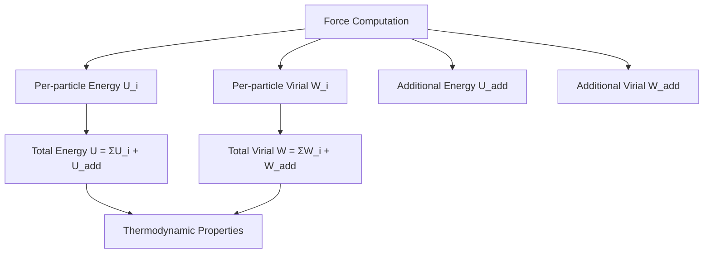

Molecular Dynamics (MD) is a fundamental simulation method in HOOMD-blue that numerically integrates the degrees of freedom in a system as a function of time under the influence of forces. MD simulations enable researchers to study the dynamic behavior of molecules, atoms, and particles by solving Newton's equations of motion, providing insights into thermodynamic properties, structural changes, and time-dependent phenomena.

## Understanding MD in HOOMD-blue

At its core, HOOMD-blue's MD implementation follows a modular design where the `Integrator` class serves as the central orchestrator of the time integration process. The Integrator manages lists of integration methods, forces, and constraints that work together to evolve the system state over time. This design allows for flexible configuration of simulation parameters while maintaining high performance through optimized C++ backend implementations.

The MD module in HOOMD-blue is built around several key components that work in concert:

1. **Integration Methods**: Define the equations of motion for different subsets of particles
2. **Forces**: Compute interactions between particles (pairwise, bonded, external, etc.)
3. **Constraints**: Enforce specific conditions on the system (fixed distances, rigid bodies)
4. **Neighbor Lists**: Optimize force calculations by tracking nearby particles

Sources: [hoomd/md/__init__.py#L4-L18](hoomd/md/__init__.py#L4-L18), [hoomd/md/integrate.py#L159-L162](hoomd/md/integrate.py#L159-L162)

## The MD Integration Process

The MD integration process in HOOMD-blue follows a well-defined sequence that ensures accurate and efficient time evolution of the system. Let's examine this process through a typical simulation workflow:

```mermaid
sequenceDiagram
    participant User as User Code
    participant Integrator as MD Integrator
    participant Methods as Integration Methods
    participant Forces as Force Computations
    particant System as Simulation State
    
    User->>Integrator: Create with dt, methods, forces
    Integrator->>Methods: Attach integration methods
    Integrator->>Forces: Attach force calculations
    User->>Integrator: Attach to simulation
    loop Each timestep
        Integrator->>Forces: Compute net forces/torques
        Forces-->>Integrator: Return F_i, τ_i, U, W
        Integrator->>Methods: Apply equations of motion
        Methods->>System: Update positions/velocities
        System-->>Methods: Return updated state
    end
```

The integration process begins with force computation, where all forces and constraints are evaluated to determine the net force and torque on each particle. The Integrator then applies the selected integration methods to update particle positions and velocities according to the equations of motion.

Sources: [hoomd/md/integrate.py#L169-L199](hoomd/md/integrate.py#L169-L199)

## Integration Methods

HOOMD-blue provides several integration methods to suit different physical scenarios:

```python
# NVE integration (constant energy)
nve = hoomd.md.methods.ConstantVolume(filter=hoomd.filter.All())

# NVT integration (constant temperature)
nvt = hoomd.md.methods.Langevin(filter=hoomd.filter.All(), 
                                kT=1.0, 
                                alpha=0.1)

# NPT integration (constant pressure)
npt = hoomd.md.methods.ConstantPressure(filter=hoomd.filter.All(), 
                                       kT=1.0, 
                                       tau=1.0,
                                       S=1.0, 
                                       tauS=1.0)
```

Each method can be applied to specific particle subsets through filters, allowing for multi-component systems with different integration schemes. The `Langevin` method implements stochastic dynamics with a thermostat, while `ConstantPressure` enables barostat control for pressure coupling.

> [!TIP]
> When using multiple integration methods, ensure that their particle filters are mutually exclusive to prevent double-counting forces and incorrect dynamics.

Sources: [hoomd/md/methods/__init__.py#L19-L28](hoomd/md/methods/__init__.py#L19-L28)

## Force Computations

Forces in HOOMD-blue's MD module are organized into several categories, each optimized for specific types of interactions:

| Force Type | Description | Examples |
|------------|-------------|----------|
| Pairwise | Short-range interactions between particle pairs | LJ, Yukawa, Morse |
| Bonded | Connectivity-based forces | Bonds, angles, dihedrals |
| External | Field-based forces | Electric, gravitational |
| Constraints | Enforced geometric constraints | Distance, Rigid bodies |

Pairwise forces are particularly important in MD simulations and are implemented using neighbor lists for computational efficiency:

```python
# Create a neighbor list
nlist = hoomd.md.nlist.Cell()
nlist.buffer = 0.4

# Lennard-Jones potential
lj = hoomd.md.pair.LJ(nlist=nlist, default_r_cut=2.5)
lj.params[('A', 'A')] = dict(epsilon=1.0, sigma=1.0)
lj.params[('A', 'B')] = dict(epsilon=1.5, sigma=0.8)
lj.params[('B', 'B')] = dict(epsilon=0.5, sigma=1.2)
```

The Pair force implementation supports various shifting and smoothing modes to handle cutoffs gracefully, reducing energy drift in long simulations.

Sources: [hoomd/md/pair/__init__.py#L4-L31](hoomd/md/pair/__init__.py#L4-L31), [hoomd/md/force.py#L21-L41](hoomd/md/force.py#L21-L41)

## Energy and Virial Computation

HOOMD-blue's MD module carefully tracks energy and virial contributions for thermodynamic property calculations. The total potential energy and virial are computed as sums of per-particle and additional terms:



This decomposition allows for efficient computation of system properties while maintaining consistency with the underlying physics. The Force base class provides methods to access these quantities:

```python
# Access energy and force data
total_energy = lj.energy
particle_energies = lj.energies
forces = lj.forces
virials = lj.virials
```

Sources: [hoomd/md/force.py#L36-L41](hoomd/md/force.py#L36-L41), [hoomd/md/force.py#L145-L151](hoomd/md/force.py#L145-L151)

## Practical Example: Simple MD Simulation

Let's put together a complete MD simulation example that demonstrates the key concepts:

```python
import hoomd
import hoomd.md

# Initialize simulation
sim = hoomd.Simulation(device=hoomd.device.CPU(), seed=42)
sim.create_state_from_gsd('initial.gsd')

# Create neighbor list
nlist = hoomd.md.nlist.Cell(buffer=0.4)

# Define Lennard-Jones forces
lj = hoomd.md.pair.LJ(nlist=nlist, default_r_cut=2.5)
lj.params[('A', 'A')] = dict(epsilon=1.0, sigma=1.0)
lj.params[('A', 'B')] = dict(epsilon=1.5, sigma=0.8)
lj.params[('B', 'B')] = dict(epsilon=0.5, sigma=1.2)

# Choose integration method (NVT)
nvt = hoomd.md.methods.Langevin(filter=hoomd.filter.All(), 
                                kT=1.0, 
                                alpha=0.1)

# Create integrator
integrator = hoomd.md.Integrator(dt=0.005, 
                                 methods=[nvt], 
                                 forces=[lj])

# Attach integrator to simulation
sim.operations.integrator = integrator

# Run simulation
sim.run(10000)
```

This example demonstrates the typical workflow: setting up the simulation state, defining forces, selecting an integration method, creating the integrator, and running the simulation. The modular design makes it easy to modify individual components while maintaining the overall structure.

Sources: [hoomd/md/integrate.py#L131-L158](hoomd/md/integrate.py#L131-L158)

## Performance Considerations

HOOMD-blue's MD implementation is designed for high performance, particularly on GPU hardware. Key performance features include:

1. **Neighbor List Optimization**: Cell lists and tree structures minimize the number of pairwise evaluations
2. **GPU Acceleration**: Computationally intensive routines are optimized for GPU execution
3. **Mixed Precision**: Selective use of single and double precision balances accuracy and speed
4. **Parallel Decomposition**: MPI support enables scaling to large systems

The MD module automatically selects the optimal backend (CPU or GPU) based on the available hardware, ensuring maximum performance without requiring code changes.

> [!TIP]
> For best performance, ensure your system size is large enough to充分利用 GPU parallelism. Small systems may benefit more from CPU execution due to GPU overhead.

Sources: [hoomd/md/__init__.py#L4-L18](hoomd/md/__init__.py#L4-L18)

## Advanced Features

HOOMD-blue's MD module includes several advanced features for sophisticated simulations:

- **Rigid Body Dynamics**: Special handling for molecules with fixed internal geometry
- **Anisotropic Particles**: Support for non-spherical particles with orientation-dependent interactions
- **External Fields**: Application of time-dependent external forces and torques
- **Thermostats and Barostats**: Multiple schemes for temperature and pressure control
- **Energy Minimization**: FIRE algorithm for finding local energy minima

These features extend the basic MD framework to handle complex physical systems while maintaining the same modular design principles.
