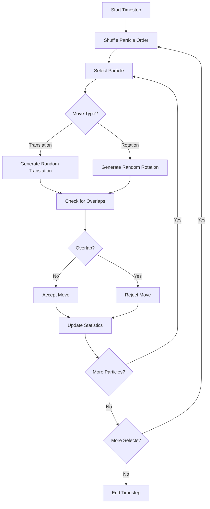
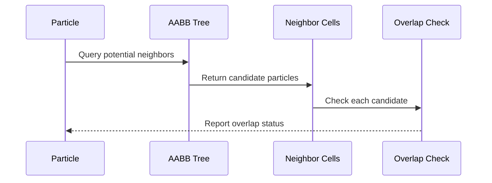

Hard Particle Monte Carlo (HPMC) is a powerful simulation method in HOOMD-blue that enables the study of systems composed of particles with hard interactions. Unlike molecular dynamics which simulates continuous motion, HPMC performs stochastic moves to sample equilibrium configurations of hard particle systems efficiently.

## Overview of HPMC in HOOMD-blue

HPMC in HOOMD-blue implements a sophisticated framework for simulating systems where particles interact through hard-core repulsions. This means particles cannot overlap, creating a purely entropic system that's ideal for studying colloids, granular materials, and other systems dominated by shape effects. The HPMC module provides a flexible architecture that supports various particle shapes, from simple spheres to complex polyhedra and user-defined shapes.

The core of HPMC is built around the `IntegratorHPMC` base class, which defines the common interface for all HPMC integrators. This base class handles fundamental operations like move size management, statistics tracking, and interaction with the broader HOOMD-blue framework. For monodisperse systems (single particle type), the `IntegratorHPMCMono` template class provides specialized implementations optimized for performance.

Sources: [IntegratorHPMC.h#L114-L125](hoomd/hpmc/IntegratorHPMC.h#L114-L125), [IntegratorHPMCMono.h#L107-L111](hoomd/hpmc/IntegratorHPMCMono.h#L107-L111)

## Core HPMC Algorithm

The HPMC algorithm follows a straightforward but powerful approach to sampling equilibrium configurations:

1. **Particle Selection**: For each timestep, particles are selected in a random order to ensure unbiased sampling.

2. **Trial Moves**: Selected particles undergo either translational or rotational moves, with the probability controlled by the translation move probability parameter.

3. **Overlap Detection**: After a trial move, the system checks if the moved particle overlaps with any other particles. This is the most computationally intensive step and is highly optimized in HOOMD-blue.

4. **Accept/Reject**: If the move results in no overlaps, it's accepted; otherwise, it's rejected. The algorithm maintains detailed balance to ensure proper equilibrium sampling.

5. **Statistics**: The integrator tracks acceptance rates for both translational and rotational moves, providing important feedback on simulation performance.



Sources: [IntegratorHPMCMono.h#L421-L473](hoomd/hpmc/IntegratorHPMCMono.h#L421-L473)

## Key Components of HPMC

### Move Types and Parameters

HPMC supports two fundamental types of moves:

- **Translational moves**: Particles are displaced by a random vector with maximum length controlled by the `d` parameter for each particle type.
- **Rotational moves**: Particles are rotated by a random quaternion with maximum rotation angle controlled by the `a` parameter for each particle type.

The relative probability of translation versus rotation moves is controlled by the `translation_move_probability` parameter, which defaults to 0.5 (equal probability). For spherical particles, only translational moves are performed since rotations don't change the configuration.

Sources: [IntegratorHPMC.h#L142-L227](hoomd/hpmc/IntegratorHPMC.h#L142-L227)

### Particle Shapes

HPMC in HOOMD-blue supports a wide variety of particle shapes through a templated design. Each shape is implemented as a class that provides methods for checking overlaps and computing bounding volumes. The supported shapes include:

- Spheres
- Convex polygons (2D)
- Convex polyhedra (3D)
- Ellipsoids
- Spheropolygons and spheropolyhedra (rounded shapes)
- Simple polygons
- Faceted ellipsoids
- Sphinx particles
- Unions of shapes

This extensible architecture allows users to easily add new shape types by implementing the required interface methods.

Sources: [IntegratorHPMCMono.h#L113-L116](hoomd/hpmc/IntegratorHPMCMono.h#L113-L116)

### Overlap Detection and Performance Optimization

The most critical aspect of HPMC performance is efficient overlap detection. HOOMD-blue implements several optimizations:

1. **Cell Lists**: The simulation box is divided into cells, and only particles in neighboring cells are checked for overlaps.

2. **AABB Trees**: Axis-Aligned Bounding Box (AABB) trees provide hierarchical spatial data structures that accelerate broad-phase collision detection.

3. **Image Lists**: For small systems, the algorithm maintains a list of periodic images to check, avoiding unnecessary computations.

4. **Shape-Specific Optimizations**: Each shape implementation includes optimized overlap checks tailored to its geometry.



Sources: [IntegratorHPMCMono.h#L346-L349](hoomd/hpmc/IntegratorHPMCMono.h#L346-L349), [IntegratorHPMCMono.h#L289-L293](hoomd/hpmc/IntegratorHPMCMono.h#L289-L293)

### Interaction Matrix

HPMC supports an interaction matrix that allows selective overlap checking between particle types. This is useful for systems where certain particle types should not interact (e.g., in mixtures with size disparity). The interaction matrix is a 2D array where each element indicates whether overlap checks should be performed between the corresponding particle types.

Sources: [IntegratorHPMCMono.h#L332](hoomd/hpmc/IntegratorHPMCMono.h#L332), [IntegratorHPMCMono.h#L351](hoomd/hpmc/IntegratorHPMCMono.h#L351)

## Advanced Features

### Pair Potentials

While HPMC primarily focuses on hard interactions, it also supports soft pair potentials that can be combined with hard core repulsions. This enables the simulation of systems with both entropic and energetic interactions. Pair potentials are implemented as separate modules that can be attached to the HPMC integrator.

Sources: [IntegratorHPMC.h#L517-521](hoomd/hpmc/IntegratorHPMC.h#L517-521)

### External Fields

HPMC supports external fields that can bias particle positions or orientations. These include:

- Wall potentials
- Harmonic traps
- Linear fields

External fields are implemented as plugins that compute energy contributions during the move acceptance step.

Sources: [IntegratorHPMC.h#L520-521](hoomd/hpmc/IntegratorHPMC.h#L520-521)

### GPU Acceleration

For high-performance computing, HPMC includes GPU-accelerated implementations through the `IntegratorHPMCMonoGPU` class. The GPU version follows the same algorithmic structure as the CPU version but leverages parallel processing to achieve significant speedups, especially for large systems.

Sources: [IntegratorHPMCMonoGPU.h](hoomd/hpmc/IntegratorHPMCMonoGPU.h)

## Usage Example

Here's a simple example of setting up an HPMC simulation with spherical particles:

```python
import hoomd
import hoomd.hpmc

# Initialize the simulation
sim = hoomd.Simulation(device=hoomd.device.CPU(), seed=42)

# Create a system of hard spheres
mc = hoomd.hpmc.integrate.Sphere()
mc.shape.set_parameters(A=1.0)  # Sphere diameter
mc.d['A'] = 0.1  # Maximum translation distance
mc.a['A'] = 0.1  # Maximum rotation distance (not used for spheres)

# Set the translation move probability
mc.translation_move_probability = 0.5

# Run the simulation
sim.run(1000)
```

> [!TIP]
> For optimal performance, adjust the move sizes (d and a parameters) to achieve acceptance rates between 20-50%. Too small moves result in slow exploration, while too large moves lead to high rejection rates.

Sources: [integrate.py](hoomd/hpmc/integrate.py)

## Performance Considerations

HPMC performance depends on several factors:

1. **Move Sizes**: Optimal move sizes balance exploration and acceptance rates. The `getMPS()` method provides moves-per-second statistics to help tune performance.

2. **Cell Width**: The nominal cell width affects neighbor list efficiency. It's automatically updated based on particle sizes and move distances.

3. **nselect Parameter**: Controls how many move attempts are made per particle per timestep. Higher values improve sampling but increase computational cost.

4. **Shape Complexity**: More complex shapes require more expensive overlap checks, affecting overall simulation speed.

Sources: [IntegratorHPMC.h#L275-279](hoomd/hpmc/IntegratorHPMC.h#L275-279), [IntegratorHPMC.h#L526-530](hoomd/hpmc/IntegratorHPMC.h#L526-530)

## Conclusion

Hard Particle Monte Carlo in HOOMD-blue provides a comprehensive framework for simulating systems dominated by shape and entropy. Its modular design supports a wide range of particle shapes and interaction types, while its optimized algorithms ensure efficient sampling of equilibrium configurations. Whether studying simple hard spheres or complex colloidal systems, HPMC offers the flexibility and performance needed for advanced molecular simulations.

The combination of CPU and GPU implementations, along with support for external fields and pair potentials, makes HPMC a versatile tool for researchers in soft matter physics, materials science, and related fields.