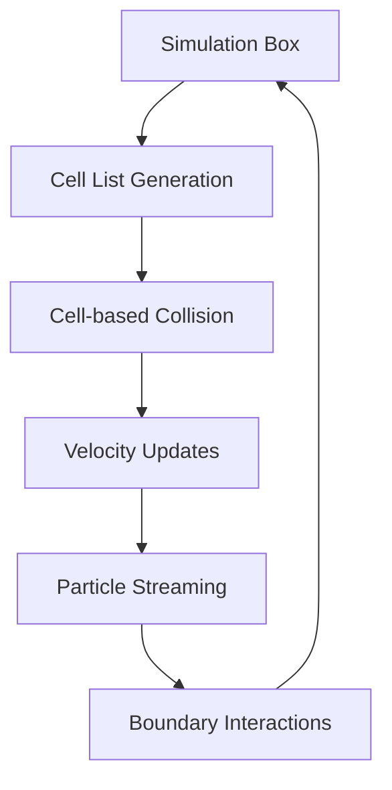
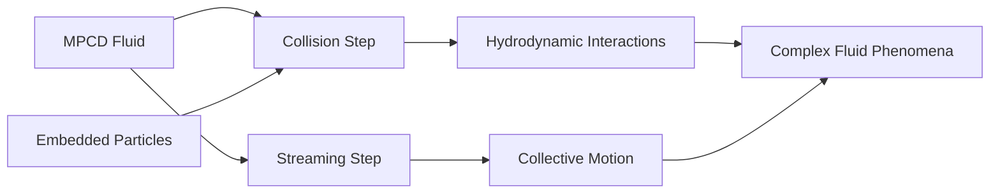

Multi-Particle Collision Dynamics (MPCD) is a powerful mesoscale simulation technique that bridges the gap between atomistic molecular dynamics and continuum fluid dynamics. In HOOMD-blue, the MPCD module provides a comprehensive implementation of this method, enabling efficient simulation of complex fluid systems with embedded particles.

## Understanding MPCD: The Big Picture

MPCD is a particle-based method for simulating hydrodynamic behavior in fluids. Unlike traditional molecular dynamics that tracks every atom, MPCD uses coarse-grained "solvent" particles that undergo periodic collisions and streaming steps. This approach captures essential fluid dynamics while being computationally efficient for larger systems and longer timescales.

In HOOMD-blue, the MPCD implementation seamlessly integrates with the existing simulation framework, allowing you to combine MPCD fluids with other simulation methods like Molecular Dynamics (MD) and Hard Particle Monte Carlo (HPMC).

### Core Components of HOOMD's MPCD Implementation

The MPCD module in HOOMD-blue is built around several key classes that work together:

1. **Integrator**: The main orchestrator that manages the MPCD simulation
2. **CollisionMethod**: Implements the collision rules between particles
3. **StreamingMethod**: Handles the ballistic motion of particles
4. **ParticleData**: Specialized data structure for MPCD particles
5. **CellList**: Efficient cell-based operations for collision detection

## The MPCD Algorithm: Two Steps to Fluid Dynamics

The MPCD algorithm alternates between two fundamental steps: collision and streaming. This two-step approach efficiently captures both local momentum exchange (collision) and collective fluid motion (streaming).

### Step 1: Collision - Local Momentum Exchange

In the collision step, particles are grouped into cells based on their positions, and their velocities are updated according to specific collision rules. The most common collision method implemented in HOOMD-blue is the Stochastic Rotation Dynamics (SRD).

```python
# Example of setting up SRD collision in HOOMD
import hoomd
import hoomd.mpcd

# Initialize the SRD collision method
srd = hoomd.mpcd.collide.SRD(seed=42, period=1, angle=130)
srd.temperature = 1.0
```

The SRD collision method works by:
1. Dividing the simulation box into cells
2. Calculating the center-of-mass velocity for each cell
3. Rotating particle velocities around the center-of-mass
4. Applying thermostatting to maintain desired temperature

This rotation preserves momentum but changes kinetic energy, effectively modeling viscous behavior. The rotation angle and collision frequency control fluid properties like viscosity.

Sources: [SRDCollisionMethod.h#L25-L121](hoomd/mpcd/SRDCollisionMethod.h#L25-L121), [CollisionMethod.h#L33-L111](hoomd/mpcd/CollisionMethod.h#L33-L111)

### Step 2: Streaming - Ballistic Motion

In the streaming step, particles move ballistically according to their velocities for a fixed time interval. HOOMD-blue offers several streaming methods to handle different boundary conditions:

```python
# Example of setting up bulk streaming
stream = hoomd.mpcd.stream.Bulk(period=1)

# For confined geometries, you can use bounce-back streaming
from hoomd.mpcd import geometry
channel_geom = geometry.ParallelPlateSeparation(separation=10.0)
stream = hoomd.mpcd.stream.BounceBack(geometry=channel_geom, period=1)
```

The streaming methods handle:
- Ballistic motion of particles
- Boundary condition enforcement (bounce-back, periodic, etc.)
- Integration of external forces

For confined systems, the bounce-back streaming method ensures particles remain within defined boundaries by reflecting their velocities when they collide with walls.

Sources: [StreamingMethod.h#L31-L95](hoomd/mpcd/StreamingMethod.h#L31-L95), [BounceBackStreamingMethod.h#L42-L200](hoomd/mpcd/BounceBackStreamingMethod.h#L42-L200)

> [!TIP]
> The collision and streaming steps don't need to occur at every timestep. You can control their frequency using the `period` parameter, which helps balance accuracy and performance. Typical simulations use collision periods of 1-10 timesteps.

## Understanding MPCD Particle Data

MPCD particles in HOOMD-blue are managed through a specialized `ParticleData` class that's optimized for the unique requirements of MPCD simulations:

```cpp
// MPCD particles store position + type, velocity + cell index
// All particles share the same mass for simplicity
GPUArray<Scalar4> m_pos;     // Position + type
GPUArray<Scalar4> m_vel;     // Velocity + cell index
GPUArray<unsigned int> m_tag; // Particle identifier
```

Unlike regular HOOMD particles, MPCD particles:
- All share the same mass (reducing memory usage)
- Store cell indices with velocities for efficient cell-based operations
- Lack a reverse tag mapping (optimizing for local operations)
- Support virtual particles for maintaining density in confined systems

Sources: [ParticleData.h#L43-L200](hoomd/mpcd/ParticleData.h#L43-L200)

## Cell-Based Operations: The Heart of MPCD

Efficient cell management is crucial for MPCD performance. The `CellList` class in HOOMD-blue organizes particles into a spatial grid, enabling:

1. Fast collision partner identification
2. Efficient computation of cell properties
3. Support for grid shifting to prevent artifacts
4. Parallel communication in MPI simulations



The cell list divides space into a regular grid where each cell contains particles that will collide together. The cell size is a critical parameter that affects both physical accuracy and computational efficiency.

Sources: [CellList.h#L33-L200](hoomd/mpcd/CellList.h#L33-L200)

## Practical Implementation: A Complete MPCD Simulation

Let's put it all together with a complete example of setting up an MPCD simulation in HOOMD-blue:

```python
import hoomd
import hoomd.mpcd

# Initialize the simulation
simulation = hoomd.Simulation(device=hoomd.device.CPU(), seed=42)

# Create the system with MPCD particles
mpcd = hoomd.mpcd.init.read_snapshot(
    snapshot=mpcd_snapshot,
    kT=1.0
)

# Set up the MPCD integrator
integrator = hoomd.mpcd.Integrator(dt=0.1)

# Configure the collision method
collision = hoomd.mpcd.collide.SRD(seed=42, period=1, angle=130.0)
collision.temperature = 1.0
integrator.collision_method = collision

# Configure the streaming method
stream = hoomd.mpcd.stream.Bulk(period=1)
integrator.streaming_method = stream

# Set up the cell list
cell_size = 1.0
cl = hoomd.mpcd.cell_list.CellList(cell_size=cell_size)
integrator.cell_list = cl

# Run the simulation
simulation.run(1000)
```

This example shows how to:
1. Initialize MPCD particles from a snapshot
2. Create an MPCD integrator
3. Configure collision and streaming methods
4. Set up the cell list
5. Run the simulation

## Advanced Features and Customization

HOOMD-blue's MPCD module offers several advanced features for specialized applications:

### Embedded Particles

You can embed larger particles (such as colloids or polymers) in the MPCD fluid. These particles participate in collisions with the solvent, creating realistic hydrodynamic interactions:

```python
# Embed particles from an MD simulation
embedded_group = hoomd.filter.Type('colloid')
collision.setEmbeddedGroup(embedded_group)
```

### Multiple Collision Methods

Beyond SRD, HOOMD-blue implements other collision methods like:
- **AT (Alternating Thermostat)**: More accurate temperature control
- Custom collision methods through extensibility

### Complex Geometries

The module supports various confined geometries:
- Parallel plates
- Cylinders
- Spherical boundaries
- Custom-defined geometries

```python
# Define a cylindrical confinement
cylinder = geometry.ConcentricCylinders(
    inner_radius=5.0,
    outer_radius=15.0
)
stream = stream.BounceBack(geometry=cylinder)
```

### Virtual Particle Fillers

For confined systems, virtual particle fillers maintain proper solvent density in regions that would otherwise be depleted:

```python
# Add virtual particles to maintain density
filler = hoomd.mpcd.fill.VirtualParticleFiller(
    density=5.0, seed=123
)
integrator.fillers.append(filler)
```

## Performance Considerations

MPCD simulations can be computationally intensive, but HOOMD-blue provides several optimizations:

1. **GPU Acceleration**: Many MPCD operations have GPU implementations for significant speedups
2. **Cell Sorting**: Sorting particles by cell improves memory access patterns
3. **Tunable Parameters**: Autotuning optimizes kernel launch parameters
4. **MPI Parallelization**: Distributes computation across multiple nodes

> [!TIP]
> For optimal performance, match the cell size to the mean free path of your fluid and ensure your collision period is appropriate for the timescales you want to capture. Too frequent collisions waste computation, while too infrequent ones miss important physics.

## Integration with Other HOOMD-blue Methods

One of the strengths of HOOMD-blue's MPCD implementation is its seamless integration with other simulation techniques:

- **Molecular Dynamics**: Simulate solutes with explicit interactions
- **HPMC**: Study colloidal suspensions with hydrodynamic interactions
- **Analysis Tools**: Use HOOMD-blue's full suite of analysis methods



This integration allows you to create hybrid simulations that capture multiple physical phenomena simultaneously.

## Conclusion

HOOMD-blue's MPCD implementation provides a powerful, flexible framework for mesoscale fluid simulations. By combining efficient algorithms with a modular design, it enables researchers to study complex fluid systems from simple bulk flows to intricate confined geometries with embedded particles.

Whether you're studying membrane proteins in solution, colloidal suspensions, or microfluidics, the MPCD module in HOOMD-blue offers the tools you need to capture essential hydrodynamic behavior while maintaining computational efficiency.
