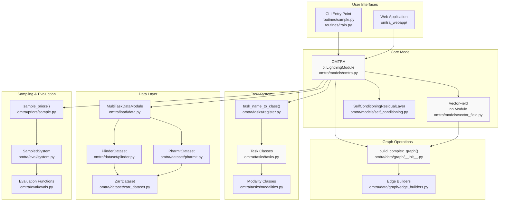
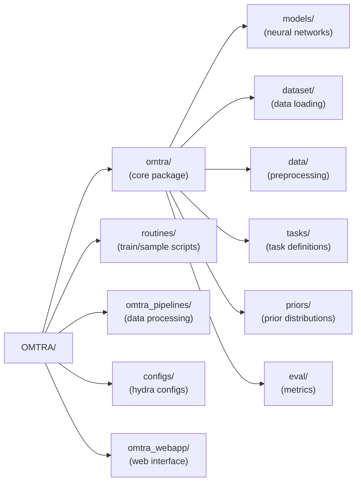

# Overview

Relevant source files

The following files were used as context for generating this wiki page:

- [omtra/models/omtra.py](omtra/models/omtra.py)
- [omtra/models/self_conditioning.py](omtra/models/self_conditioning.py)
- [omtra/models/vector_field.py](omtra/models/vector_field.py)
- [readme.md](readme.md)

This document provides a high-level introduction to the OMTRA codebase: what it is, what it does, and how the code is organized. For installation and usage instructions, see [Getting Started](#2). For detailed explanations of core concepts, see [Core Concepts](#3). For model architecture details, see [Model Architecture](#4).

## What is OMTRA?

OMTRA (Omni-Task Representation and Assembly) is a multi-task generative model for structure-based drug design. It uses flow matching to generate 3D molecular structures, protein conformations, and pharmacophore features either unconditionally or conditioned on various inputs.

The model is implemented as a PyTorch Lightning module ([omtra/models/omtra.py:55-1053]()) that orchestrates training and sampling across multiple tasks using a shared `VectorField` architecture ([omtra/models/vector_field.py:40-1179]()).

**Sources:** [readme.md:1-21](), [omtra/models/omtra.py:1-86]()

## Core Capabilities

OMTRA supports the following task categories:

| Task Category | Representative Tasks | Code Entity |
|--------------|---------------------|-------------|
| **Unconditional Generation** | Generate novel drug-like molecules | `denovo_ligand_condensed` |
| **Protein-Conditioned Design** | Design ligands for binding sites | `fixed_protein_ligand_denovo_condensed` |
| **Molecular Docking** | Dock ligands into protein structures | `rigid_docking_condensed` |
| **Conformer Generation** | Generate 3D conformations | `ligand_conformer_condensed` |
| **Pharmacophore-Guided Design** | Design molecules matching pharmacophore constraints | `denovo_ligand_from_pharmacophore_condensed` |

Each task is defined by which **modalities** (molecular properties) are fixed as inputs versus generated by the model. See [Tasks and Modalities](#3.1) for details.

**Sources:** [readme.md:7-16](), [readme.md:217-256]()

## System Architecture

### High-Level Component Diagram

**Sources:** [omtra/models/omtra.py:1-52](), [omtra/models/vector_field.py:1-40](), [readme.md:1-38]()

### Component Responsibilities

| Component | File(s) | Purpose |
|-----------|---------|---------|
| **OMTRA** | [omtra/models/omtra.py:55-1053]() | Main model class; orchestrates training, conditional path sampling, and inference |
| **VectorField** | [omtra/models/vector_field.py:40-1179]() | GNN architecture that predicts trajectory destinations during flow matching |
| **Task Classes** | [omtra/tasks/tasks.py]() | Define which modalities are fixed vs generated for each task |
| **Modality Classes** | [omtra/tasks/modalities.py]() | Define molecular properties (atom types, positions, bonds, etc.) |
| **Graph Construction** | [omtra/data/graph/]() | Convert molecular data into DGL heterogeneous graphs |
| **Prior Sampling** | [omtra/priors/]() | Initialize generation by sampling from prior distributions |
| **Datasets** | [omtra/dataset/]() | Load training data from Zarr stores |

**Sources:** [omtra/models/omtra.py:55-86](), [omtra/models/vector_field.py:40-76]()

## Codebase Organization

### Directory Structure

**Sources:** Repository structure inferred from file paths

### Key Directories

| Directory | Purpose | Key Files |
|-----------|---------|-----------|
| `omtra/models/` | Neural network architectures | `omtra.py`, `vector_field.py`, `gvp.py`, `self_conditioning.py` |
| `omtra/tasks/` | Task and modality definitions | `tasks.py`, `modalities.py`, `register.py`, `utils.py` |
| `omtra/dataset/` | Dataset classes for training data | `plinder.py`, `pharmit.py`, `zarr_dataset.py` |
| `omtra/data/` | Data preprocessing utilities | `graph/`, `xace_ligand.py`, `pharmacophores.py` |
| `omtra/priors/` | Prior distribution sampling | `sample.py`, `prior_factory.py`, `gaussian.py` |
| `omtra/eval/` | Evaluation metrics and output | `system.py`, `evals.py`, `register.py` |
| `routines/` | Training and sampling scripts | `train.py`, `sample.py` |
| `configs/` | Hydra configuration files | `config.yaml`, task-specific configs |
| `omtra_pipelines/` | Data processing pipelines | `plinder_dataset/`, `pharmit_dataset/` |

**Sources:** File paths from provided files

## Data Flow

### Training Pipeline

```mermaid
graph LR
    subgraph "Data Loading"
        Zarr["Zarr Store<br/>(chunked arrays)"]
        Dataset["Dataset Class<br/>PlinderDataset/<br/>PharmitDataset"]
        Sampler["MultiTaskSampler<br/>(batch construction)"]
    end
    
    subgraph "Graph Construction"
        RawData["Molecular Data<br/>(coords, types, bonds)"]
        BuildGraph["build_complex_graph()<br/>DGL HeteroGraph"]
    end
    
    subgraph "Model Forward Pass"
        SampleTime["Sample t ~ U(0,1)"]
        CondPath["sample_conditional_path()<br/>(x_t = α_t·x_0 + β_t·x_1)"]
        VFForward["VectorField.forward()<br/>(predict x_1 from x_t)"]
        Loss["Compute Losses<br/>(MSE, CrossEntropy)"]
    end
    
    Zarr --> Dataset
    Dataset --> Sampler
    Sampler --> RawData
    RawData --> BuildGraph
    BuildGraph --> SampleTime
    SampleTime --> CondPath
    CondPath --> VFForward
    VFForward --> Loss
```

**Sources:** [omtra/models/omtra.py:269-322](), [omtra/models/omtra.py:386-517]()

### Sampling Pipeline

```mermaid
graph LR
    subgraph "Initialization"
        Task["Task Definition<br/>task_name_to_class()"]
        LoadModel["omtra_from_checkpoint()"]
        SamplePrior["sample_priors()<br/>(x_0 ~ prior)"]
    end
    
    subgraph "Integration Loop"
        SetXT["Set x_t = x_0"]
        Predict["VectorField.forward()<br/>(predict x_1)"]
        Step["VectorField.step()<br/>(x_t += dt·vf)"]
        Iterate["Repeat for<br/>n_timesteps"]
    end
    
    subgraph "Output"
        Unbatch["dgl.unbatch()"]
        Convert["SampledSystem<br/>(to RDKit/Biotite)"]
        Write["Write SDF/PDB/CIF"]
    end
    
    Task --> LoadModel
    LoadModel --> SamplePrior
    SamplePrior --> SetXT
    SetXT --> Predict
    Predict --> Step
    Step --> Iterate
    Iterate --> Predict
    Iterate --> Unbatch
    Unbatch --> Convert
    Convert --> Write
```

**Sources:** [omtra/models/omtra.py:602-940](), [omtra/models/vector_field.py:778-932]()

## Key Concepts

### Tasks and Modalities

OMTRA's flexibility comes from its **task-modality** system:
- **Tasks** define generation scenarios (e.g., docking, de novo design)
- **Modalities** are molecular properties (e.g., atom positions `lig_x`, atom types `lig_a`, bond orders `lig_e`)
- Each task specifies which modalities are **fixed** (provided as input) vs **generated** (predicted by the model)

For example:
- `rigid_docking_condensed`: fixes protein structure (`prot_x`, `prot_a`) and ligand identity (`lig_a`), generates ligand positions (`lig_x`)
- `denovo_ligand_condensed`: generates all ligand modalities unconditionally

See [Tasks and Modalities](#3.1) for complete details.

**Sources:** [omtra/models/omtra.py:111-113](), [omtra/tasks/tasks.py]()

### Flow Matching

OMTRA uses **flow matching** to gradually transform samples from a prior distribution (t=0) to the data distribution (t=1):

1. Sample a time `t` uniformly from [0, 1]
2. Construct `x_t` via conditional path: `x_t = α_t·x_0 + β_t·x_1`
3. Train `VectorField` to predict `x_1` (the destination)
4. At inference, integrate the learned vector field from t=0 to t=1

The `InterpolantScheduler` ([omtra/models/interpolant_scheduler.py]()) defines the interpolation functions `α_t` and `β_t` for each modality.

See [Flow Matching for Molecules](#3.2) for details.

**Sources:** [omtra/models/omtra.py:542-600](), [omtra/models/vector_field.py:778-932]()

### Heterogeneous Graphs

OMTRA represents molecular systems as **DGL heterogeneous graphs** with multiple node types:
- `lig`: ligand atoms
- `prot_atom`: protein atoms  
- `pharm`: pharmacophore features
- `npnde`: non-polymeric non-drug entity atoms

Edge types connect these nodes spatially (k-NN, radius) and chemically (covalent bonds). The `VectorField` processes these graphs using `HeteroGVPConv` layers that operate on geometric vector features.

See [Graph Representation](#3.3) for details.

**Sources:** [omtra/models/vector_field.py:108-183](), [omtra/data/graph/]()

## Entry Points

### Command-Line Interface

The primary CLI entry point is `routines/sample.py`, which:
1. Loads a checkpoint using `omtra_from_checkpoint()`
2. Prepares input graphs from provided files
3. Calls `OMTRA.sample()` to generate molecules
4. Writes outputs to SDF/PDB/CIF files

The CLI is wrapped by the `omtra` command installed via setup.py.

**Sources:** [readme.md:159-168](), [routines/sample.py]()

### Training Scripts

The training entry point is `routines/train.py`, which:
1. Constructs a `MultiTaskDataModule` from Hydra configs
2. Instantiates the `OMTRA` model
3. Uses PyTorch Lightning `Trainer` for multi-GPU training
4. Saves checkpoints periodically

**Sources:** [readme.md:548-550](), [routines/train.py]()

### Web Application

The web application (`omtra_webapp/`) provides an interactive interface built with Flask/FastAPI. It wraps the same `OMTRA.sample()` method used by the CLI but adds visualization and interactive parameter tuning.

**Sources:** [readme.md:520-544]()

## Model Checkpoints and Inference

Pre-trained model weights are stored in `omtra/trained_models/` and loaded using checkpoint utilities. The CLI automatically selects the appropriate checkpoint based on the `--task` argument, or users can specify one explicitly with `--checkpoint`.

During inference:
1. `omtra_from_checkpoint()` loads the model state
2. The task class determines which modalities to generate
3. Prior distributions are sampled for each generated modality
4. `VectorField.integrate()` performs the flow matching integration
5. Outputs are converted to standard molecular file formats via `SampledSystem`

**Sources:** [readme.md:141-149](), [omtra/models/omtra.py:602-940](), [omtra/eval/system.py]()

## Next Steps

- For installation instructions, see [Installation and Setup](#2.1)
- For detailed task and modality explanations, see [Tasks and Modalities](#3.1)
- For model architecture details, see [Model Architecture](#4)
- For dataset information, see [Datasets and Data Loading](#5)
- For training a model, see [Training](#7)
- For API documentation, see [API Reference](#11)

**Sources:** Table of contents from context

---