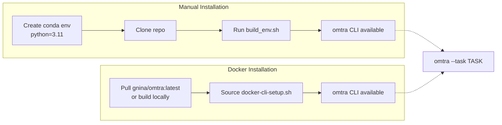
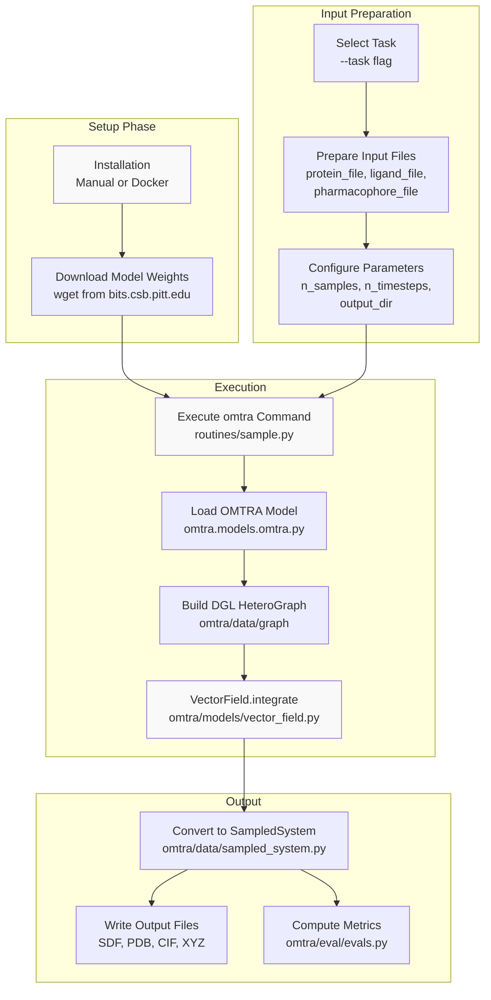
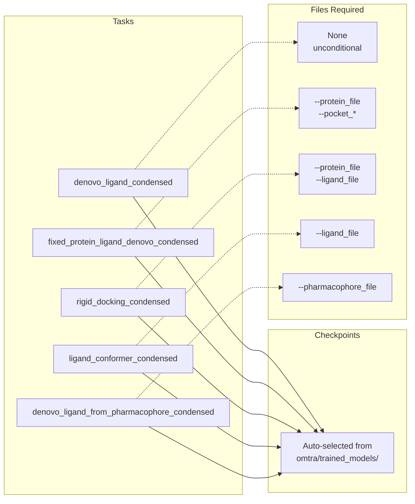

# Getting Started

<details>
<summary>Relevant source files</summary>

The following files were used as context for generating this wiki page:

- [readme.md](readme.md)

</details>


This page provides an overview of how to install, configure, and run OMTRA for the first time. It covers the essential prerequisites, the main workflow from setup to sampling, and a minimal working example. For detailed instructions on specific topics, see the child pages: [Installation and Setup](#2.1), [Command Line Interface](#2.2), and [Quick Start Examples](#2.3).

## Prerequisites

Before installing OMTRA, ensure your system meets the following requirements:

| Requirement | Specification |
|-------------|---------------|
| Operating System | Linux |
| GPU | NVIDIA GPU with CUDA support |
| CUDA Version | CUDA 12.1 recommended |
| Python | Python 3.11 |
| Package Manager | conda or mamba (for manual installation) |
| Docker | Docker + NVIDIA Container Toolkit (for Docker installation) |

**Sources:** [readme.md:47-51]()

## Installation Overview

OMTRA provides two installation methods, each suited to different use cases:

### Installation Methods



| Method | Best For | Key Steps |
|--------|----------|-----------|
| **Manual** | Development, most users | Create conda env → Clone repo → Run `build_env.sh` |
| **Docker** | Deployment, web application | Pull/build image → Source `docker-cli-setup.sh` |

The manual installation ([Installation and Setup](#2.1)) provides direct control over the environment by installing PyTorch, DGL, PyG, and all dependencies through the `build_env.sh` script. The Docker installation encapsulates everything in a container and is particularly useful for the web application interface.

**Sources:** [readme.md:41-138]()

## Core Workflow

The typical OMTRA workflow follows these stages:

### End-to-End OMTRA Workflow



**Sources:** [readme.md:153-331]()

## Key Components

Understanding these core components is essential for working with OMTRA:

### Component Reference Table

| Component | Location | Purpose |
|-----------|----------|---------|
| **`omtra` CLI** | Entry point installed by setup | Command-line interface for all operations |
| **Model Checkpoints** | `omtra/trained_models/` | Pre-trained weights for different tasks |
| **OMTRA Model** | [omtra/models/omtra.py]() | Main generative model class (flow matching) |
| **VectorField** | [omtra/models/vector_field.py]() | GNN architecture for trajectory prediction |
| **Sample Script** | [routines/sample.py]() | Sampling/inference pipeline |
| **DGL HeteroGraph** | Used throughout | Molecular representation with multiple node/edge types |

### Task-to-Checkpoint Mapping



Each task automatically selects the appropriate checkpoint from `omtra/trained_models/` unless overridden with `--checkpoint`.

**Sources:** [readme.md:141-149](), [readme.md:215-256]()

## Minimal Working Example

Here is a complete minimal workflow to generate your first molecules:

### Step 1: Install OMTRA

**Manual installation:**
```bash
mamba create -n omtra python=3.11
mamba activate omtra
git clone https://github.com/gnina/OMTRA.git
cd OMTRA
chmod +x build_env.sh
./build_env.sh
```

**Docker installation:**
```bash
git clone https://github.com/gnina/OMTRA.git
cd OMTRA
source docker-cli-setup.sh
```

### Step 2: Download Model Weights

```bash
wget -r -np -nH --cut-dirs=3 -R "index.html*" -P omtra/trained_models https://bits.csb.pitt.edu/files/OMTRA/omtra_v0_weights/
```

This creates `omtra/trained_models/` with checkpoint files.

### Step 3: Generate Molecules

**Unconditional generation (no input files needed):**
```bash
omtra --task denovo_ligand_condensed \
  --n_samples 10 \
  --n_timesteps 250 \
  --output_dir outputs/first_generation
```

**Structure-based design (requires protein PDB):**
```bash
omtra --task fixed_protein_ligand_denovo_condensed \
  --protein_file examples/protein.pdb \
  --pocket_center 10.5,20.3,15.2 \
  --bbox_length 23.0 \
  --n_samples 10 \
  --output_dir outputs/sbdd_example
```

**Molecular docking (requires protein and ligand):**
```bash
omtra --task rigid_docking_condensed \
  --protein_file examples/protein.pdb \
  --ligand_file examples/ligand.sdf \
  --n_samples 10 \
  --output_dir outputs/docking_example
```

### Step 4: View Results

Output files are organized in the specified `output_dir`:
- `*.sdf` - Generated ligand structures
- `*.pdb` / `*.cif` - Protein structures (for flexible tasks)
- `*_pharm.xyz` - Pharmacophore features (for pharmacophore tasks)
- `eval_metrics.csv` - Evaluation metrics (if `--metrics` flag used)

**Sources:** [readme.md:53-69](), [readme.md:80-138](), [readme.md:141-149](), [readme.md:259-331]()

## Command Line Interface Overview

The `omtra` command accepts the following argument categories:

### Core Arguments

```bash
omtra --task <TASK> --checkpoint <PATH> --n_samples <N> --n_timesteps <N> --output_dir <DIR>
```

| Argument | Required | Default | Description |
|----------|----------|---------|-------------|
| `--task` | Yes | - | Task identifier (see [Available Tasks](#available-tasks)) |
| `--checkpoint` | No | Auto-detected | Path to model checkpoint file |
| `--n_samples` | No | 100 | Number of samples to generate |
| `--n_timesteps` | No | 250 | Integration steps during sampling |
| `--output_dir` | No | None | Directory for output files |

### Input File Arguments

```bash
omtra --task <TASK> --protein_file <PDB> --ligand_file <SDF> --pharmacophore_file <JSON>
```

| Argument | Format | Description |
|----------|--------|-------------|
| `--protein_file` | PDB or CIF | Protein structure |
| `--ligand_file` | SDF | Ligand structure |
| `--pharmacophore_file` | JSON, XYZ, or SDF | Pharmacophore constraints |
| `--pocket_ligand` | SDF | Reference ligand for pocket definition |
| `--pocket_center` | `x,y,z` | Pocket center coordinates |
| `--pocket_residues` | `CHAIN:RESID` | Pocket residue specification |

See [Command Line Interface](#2.2) for complete reference and [Quick Start Examples](#2.3) for usage patterns.

**Sources:** [readme.md:159-213]()

## Available Tasks

OMTRA supports multiple drug design tasks through a unified interface:

### Task Categories

| Category | Example Task | Description |
|----------|--------------|-------------|
| **Unconditional** | `denovo_ligand_condensed` | Generate molecules without constraints |
| **Protein-Conditioned** | `fixed_protein_ligand_denovo_condensed` | Design ligands for protein binding sites |
| **Docking** | `rigid_docking_condensed` | Dock known ligands into proteins |
| **Conformer** | `ligand_conformer_condensed` | Generate 3D conformations |
| **Pharmacophore** | `denovo_ligand_from_pharmacophore_condensed` | Design molecules matching pharmacophores |

Each task corresponds to a specific combination of fixed and generated modalities (see [Tasks and Modalities](#3.1)). The task name determines:
- Which modalities are generated vs. fixed
- Which input files are required
- Which checkpoint is loaded (auto-selected)
- Which prior distributions are used

**Sources:** [readme.md:215-256]()

## Common Options

### Ligand Size Control

Control the number of atoms in generated ligands:

```bash
# Use ground truth atom count (for tasks with reference ligands)
omtra --task rigid_docking_condensed --use_gt_n_lig_atoms --n_lig_atom_margin 0.15 ...

# Specify explicit distribution
omtra --task denovo_ligand_condensed --n_lig_atoms_mean 25 --n_lig_atoms_std 5 ...
```

### Stochastic vs Deterministic Sampling

```bash
# Deterministic sampling (default)
omtra --task denovo_ligand_condensed ...

# Stochastic sampling with noise
omtra --task denovo_ligand_condensed --stochastic_sampling --noise_scaler 1.0 ...
```

### Debug Mode

Enable full stack traces for troubleshooting:

```bash
OMTRA_DEBUG=1 omtra --task denovo_ligand_condensed --n_samples 10
```

**Sources:** [readme.md:199-213](), [readme.md:512-516]()

## Web Application

OMTRA includes an interactive web interface for exploring generation tasks:

### Starting the Web Application

```bash
cd omtra_webapp
docker-compose up -d
```

Access at `http://localhost:5900` (default port). The web application provides:
- Interactive task selection
- File upload for proteins, ligands, pharmacophores
- Real-time visualization of generated structures
- Downloadable results

See `omtra_webapp/START.md` for detailed configuration options.

**Sources:** [readme.md:520-544]()

## Next Steps

After completing this minimal setup, explore the following topics:

1. **[Installation and Setup](#2.1)** - Detailed installation instructions, troubleshooting, and environment configuration
2. **[Command Line Interface](#2.2)** - Complete CLI reference with all available arguments and options
3. **[Quick Start Examples](#2.3)** - Common use cases with example commands for different scenarios

For understanding OMTRA's core concepts:
- **[Tasks and Modalities](#3.1)** - How tasks define what the model generates
- **[Flow Matching for Molecules](#3.2)** - The generative modeling framework
- **[Graph Representation](#3.3)** - How molecular systems are represented

For advanced usage:
- **[Training](#7)** - Training custom models (see `docs/training.md`)
- **[Evaluation](#9)** - Evaluating generated molecules with metrics and docking
- **[Advanced Usage](#10)** - Customizing tasks, priors, and model architecture

**Sources:** [readme.md:1-558]()

---