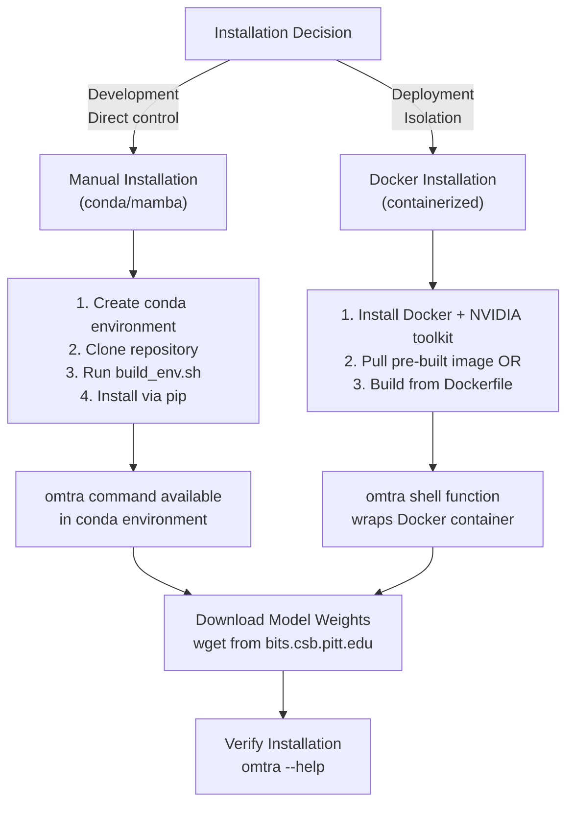
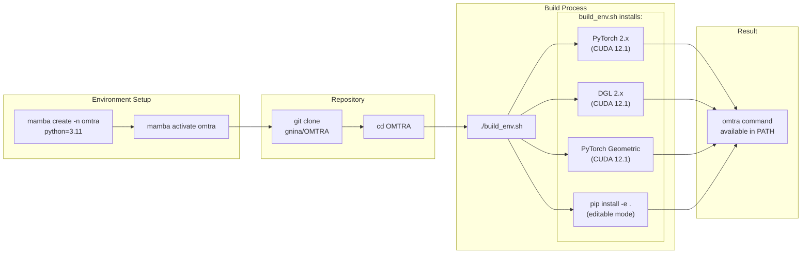
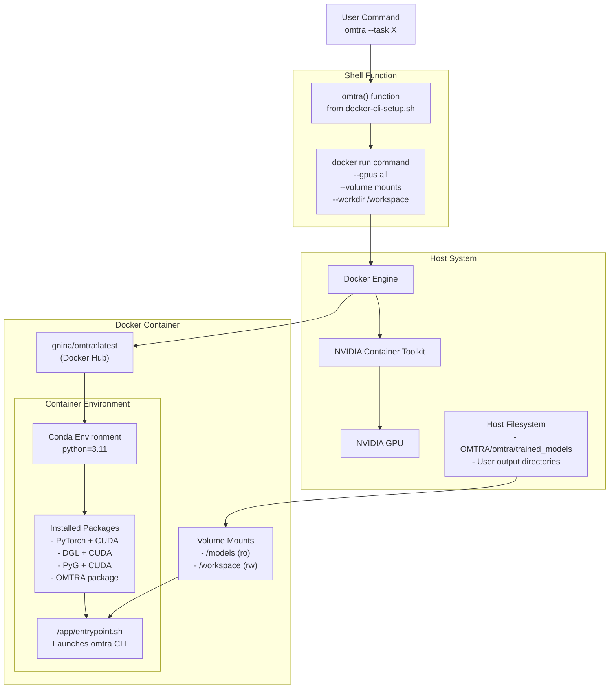
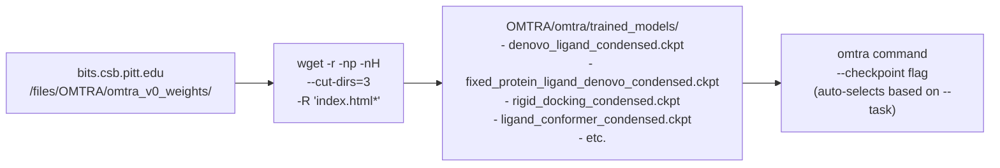
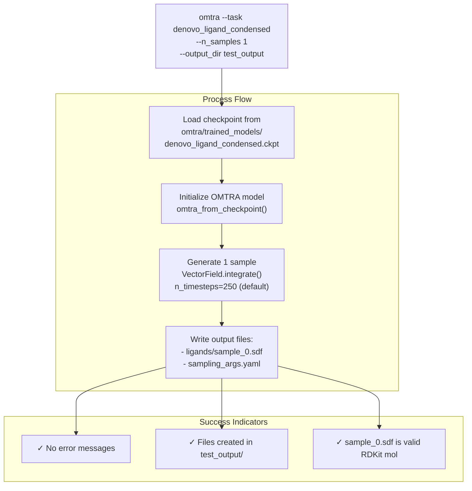
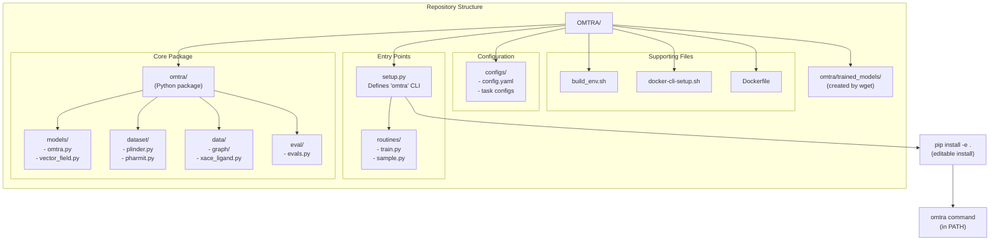

# Installation and Setup

<details>
<summary>Relevant source files</summary>

The following files were used as context for generating this wiki page:

- [readme.md](readme.md)

</details>


This page provides comprehensive instructions for installing OMTRA and preparing your environment for training and sampling. It covers both manual (conda/mamba) and Docker-based installation methods, model weight acquisition, and installation verification.

For information about running OMTRA commands after installation, see [Command Line Interface](#2.2). For quick examples of common usage patterns, see [Quick Start Examples](#2.3).

---

## System Requirements

OMTRA requires the following system configuration:

| Requirement | Specification |
|------------|---------------|
| Operating System | Linux (tested on Ubuntu 20.04+) |
| GPU | NVIDIA GPU with CUDA support |
| CUDA Version | 12.1 (recommended) |
| Python | 3.11 |
| RAM | 16GB+ recommended |
| Disk Space | ~10GB for dependencies, ~5GB for model weights |

**Sources:** [readme.md:47-51]()

---

## Installation Methods Overview

OMTRA offers two installation approaches:



**Comparison:**

| Aspect | Manual Installation | Docker Installation |
|--------|-------------------|-------------------|
| **Best For** | Development, debugging, training | Deployment, web app, reproducibility |
| **Setup Complexity** | Moderate (dependency management) | Low (pre-configured) |
| **Disk Space** | ~10GB (environment only) | ~15GB (includes container) |
| **GPU Access** | Direct | Via NVIDIA Container Toolkit |
| **File Access** | Direct filesystem | Volume mounts |
| **Customization** | Full control | Limited to Dockerfile/compose |

**Sources:** [readme.md:41-46](), [readme.md:53-80](), [readme.md:80-138]()

---

## Manual Installation (Recommended)

The manual installation provides direct access to the Python environment and is recommended for most users, especially those who want to develop or train models.

### Installation Flow Diagram



### Step-by-Step Instructions

**1. Create and activate conda environment:**

```bash
mamba create -n omtra python=3.11
mamba activate omtra
```

**Note:** You can use `conda` instead of `mamba`, but `mamba` is faster for dependency resolution.

**2. Clone the repository:**

```bash
git clone https://github.com/gnina/OMTRA.git
cd OMTRA
```

**3. Run the build script:**

```bash
chmod +x build_env.sh
./build_env.sh
```

The `build_env.sh` script performs the following operations:

| Step | Action | Purpose |
|------|--------|---------|
| 1 | Install PyTorch with CUDA 12.1 | Core deep learning framework |
| 2 | Install DGL with CUDA 12.1 | Graph neural network library |
| 3 | Install PyG with CUDA 12.1 | Additional graph layers |
| 4 | `pip install -e .` | Install OMTRA package in editable mode |

**4. Verify installation:**

```bash
omtra --help
```

You should see the OMTRA CLI help text. The `omtra` command is installed as an entry point defined in `setup.py`.

**Sources:** [readme.md:53-78]()

---

## Docker Installation

Docker installation provides an isolated, reproducible environment and is required for the web application. It uses the NVIDIA Container Toolkit to provide GPU access to containers.

### Docker Architecture



### Prerequisites

Before using Docker installation, ensure you have:

1. **Docker and Docker Compose** - Follow [official Docker installation guide](https://docs.docker.com/engine/install/)
2. **NVIDIA Container Toolkit** - Follow [NVIDIA installation guide](https://docs.nvidia.com/datacenter/cloud-native/container-toolkit/install-guide.html)
3. **Model weights** - Downloaded to `omtra/trained_models/` directory (see [Model Weights section](#model-weights))

### Using the Pre-built Image

The simplest approach is to use the pre-built image from Docker Hub:

```bash
cd OMTRA
source docker-cli-setup.sh
omtra --task denovo_ligand_condensed --n_samples 10
```

The `docker-cli-setup.sh` script creates a shell function that:

1. Pulls `gnina/omtra:latest` from Docker Hub (first run only)
2. Sets up volume mounts for model weights and output directories
3. Configures GPU access via `--gpus all`
4. Wraps all arguments and passes them to the container

### Building Locally (Optional)

To build the Docker image yourself:

```bash
cd OMTRA
docker build -t gnina/omtra:latest .
source docker-cli-setup.sh
```

The `Dockerfile` defines the container build process (not shown but referenced in readme).

### Shell Function Configuration

The `docker-cli-setup.sh` script supports customization via environment variables:

| Environment Variable | Purpose | Default |
|---------------------|---------|---------|
| `OMTRA_CLI_IMAGE` | Docker image name and tag | `gnina/omtra:latest` |
| `OMTRA_NO_GPU` | Disable GPU support (for testing) | Not set (GPU enabled) |
| `OMTRA_MODELS_DIR` | Path to model weights | `$PWD/omtra/trained_models` |

**Examples:**

```bash
# Use a specific version
export OMTRA_CLI_IMAGE="gnina/omtra:v1.0.0"
source docker-cli-setup.sh

# Disable GPU for testing
export OMTRA_NO_GPU=1
source docker-cli-setup.sh
```

### Making the CLI Available Permanently

Add to `~/.bashrc` or `~/.zshrc`:

```bash
source /path/to/OMTRA/docker-cli-setup.sh
```

**Sources:** [readme.md:80-138]()

---

## Model Weights

OMTRA requires pre-trained model weights for sampling. These checkpoints are not included in the repository and must be downloaded separately.

### Download Location



### Download Command

From the `OMTRA` repository root:

```bash
wget -r -np -nH --cut-dirs=3 -R "index.html*" \
  -P omtra/trained_models \
  https://bits.csb.pitt.edu/files/OMTRA/omtra_v0_weights/
```

**Command explanation:**

| Flag | Purpose |
|------|---------|
| `-r` | Recursive download |
| `-np` | No parent directories |
| `-nH` | No host directory |
| `--cut-dirs=3` | Remove 3 directory levels from path |
| `-R "index.html*"` | Reject index files |
| `-P omtra/trained_models` | Save to this directory |

### Expected Directory Structure

After download, you should have:

```
OMTRA/
└── omtra/
    └── trained_models/
        ├── denovo_ligand_condensed.ckpt
        ├── fixed_protein_ligand_denovo_condensed.ckpt
        ├── rigid_docking_condensed.ckpt
        ├── ligand_conformer_condensed.ckpt
        ├── denovo_ligand_from_pharmacophore_condensed.ckpt
        ├── ligand_conformer_from_pharmacophore_condensed.ckpt
        ├── fixed_protein_pharmacophore_ligand_denovo_condensed.ckpt
        └── rigid_docking_pharmacophore_condensed.ckpt
```

### Checkpoint Selection

The `omtra` CLI automatically selects the appropriate checkpoint based on the `--task` argument. The mapping is:

| Task | Checkpoint File |
|------|----------------|
| `denovo_ligand_condensed` | `denovo_ligand_condensed.ckpt` |
| `fixed_protein_ligand_denovo_condensed` | `fixed_protein_ligand_denovo_condensed.ckpt` |
| `rigid_docking_condensed` | `rigid_docking_condensed.ckpt` |
| `ligand_conformer_condensed` | `ligand_conformer_condensed.ckpt` |
| `denovo_ligand_from_pharmacophore_condensed` | `denovo_ligand_from_pharmacophore_condensed.ckpt` |

You can override the automatic selection with `--checkpoint`:

```bash
omtra --task denovo_ligand_condensed \
  --checkpoint /path/to/custom/checkpoint.ckpt \
  --n_samples 10
```

**Sources:** [readme.md:141-149]()

---

## Verification

After installation, verify that OMTRA is working correctly:

### Basic Verification

```bash
# Check CLI is available
omtra --help

# Expected output: OMTRA help text with available arguments
```

### Test Sample Generation

Run a minimal sampling test:

```bash
# Manual installation
omtra --task denovo_ligand_condensed \
  --n_samples 1 \
  --output_dir test_output

# Docker installation  
# (same command - docker-cli-setup.sh handles the container)
omtra --task denovo_ligand_condensed \
  --n_samples 1 \
  --output_dir test_output
```

### Expected Results



Successful verification should produce:

```
test_output/
├── ligands/
│   └── sample_0.sdf
└── sampling_args.yaml
```

### Verification with Metrics

To verify evaluation metrics work:

```bash
omtra --task denovo_ligand_condensed \
  --n_samples 5 \
  --output_dir test_output \
  --metrics
```

This should additionally create:

```
test_output/
├── ligands/
│   ├── sample_0.sdf
│   ├── sample_1.sdf
│   ├── sample_2.sdf
│   ├── sample_3.sdf
│   └── sample_4.sdf
├── sampling_args.yaml
└── eval_metrics.csv
```

**Sources:** [readme.md:75-78](), [readme.md:259-265]()

---

## Installation File Structure

Understanding the installed package structure:



**Key installation components:**

| Component | Location | Purpose |
|-----------|----------|---------|
| `setup.py` | Repository root | Defines package metadata and `omtra` CLI entry point |
| `build_env.sh` | Repository root | Installs PyTorch, DGL, PyG, and OMTRA package |
| `docker-cli-setup.sh` | Repository root | Creates shell function wrapper for Docker CLI |
| `Dockerfile` | Repository root | Docker image build definition |
| `omtra/` | Package directory | Main Python package |
| `routines/sample.py` | Sampling script | Invoked by `omtra` CLI for generation |
| `routines/train.py` | Training script | Used for model training |
| `configs/` | Configuration files | Hydra configs for tasks and training |

**Sources:** [readme.md:1-558]()

---

## Troubleshooting

### Common Issues

| Issue | Cause | Solution |
|-------|-------|----------|
| `omtra: command not found` | Environment not activated or not in PATH | Activate conda environment: `mamba activate omtra` |
| `CUDA error: no kernel image` | CUDA version mismatch | Reinstall PyTorch/DGL with matching CUDA version |
| `FileNotFoundError: checkpoint` | Model weights not downloaded | Run wget command from [Model Weights section](#model-weights) |
| `Permission denied: ./build_env.sh` | Script not executable | Run `chmod +x build_env.sh` |
| Docker: `GPU not found` | NVIDIA Container Toolkit not installed | Install toolkit per NVIDIA docs |
| Docker: `Cannot connect to Docker daemon` | Docker service not running | `sudo systemctl start docker` |

### Debug Mode

Enable verbose error output:

```bash
# Set environment variable
export OMTRA_DEBUG=1

# Run command
omtra --task denovo_ligand_condensed --n_samples 1
```

This provides full stack traces for debugging issues.

### Verifying CUDA Setup

Check GPU visibility:

```python
# Manual installation
python -c "import torch; print(torch.cuda.is_available()); print(torch.cuda.get_device_name(0))"

# Docker installation
docker run --rm --gpus all gnina/omtra:latest \
  python -c "import torch; print(torch.cuda.is_available())"
```

Expected output: `True` and your GPU name.

**Sources:** [readme.md:512-516]()

---

## Next Steps

After successful installation:

- Learn about CLI commands: [Command Line Interface](#2.2)
- Try example workflows: [Quick Start Examples](#2.3)  
- Understand the task system: [Tasks and Modalities](#3.1)
- Generate molecules: [Sampling Pipeline](#8.1)
- Train models: [Training Pipeline Overview](#7.1)

---