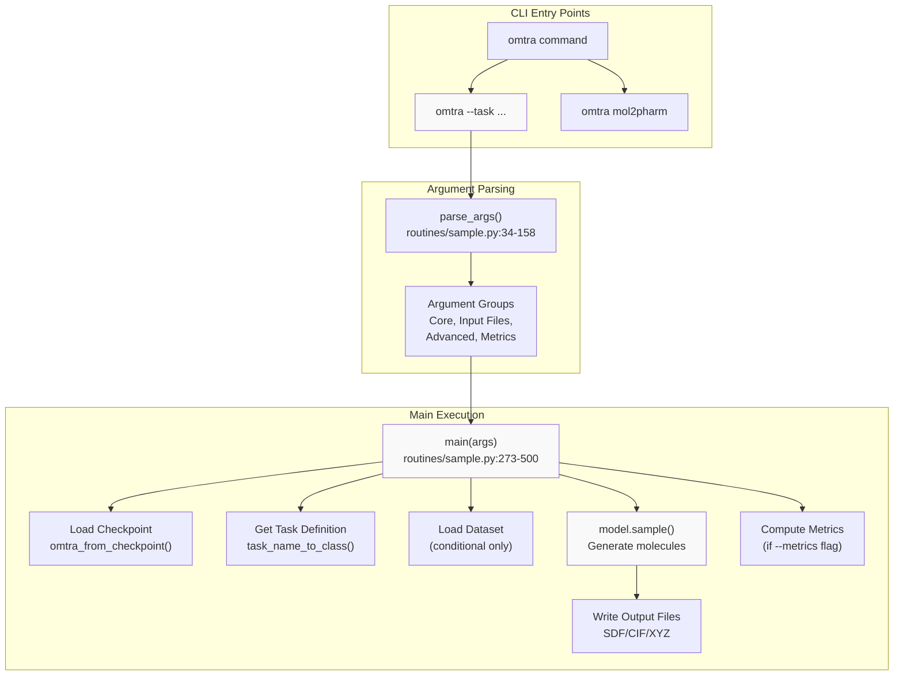
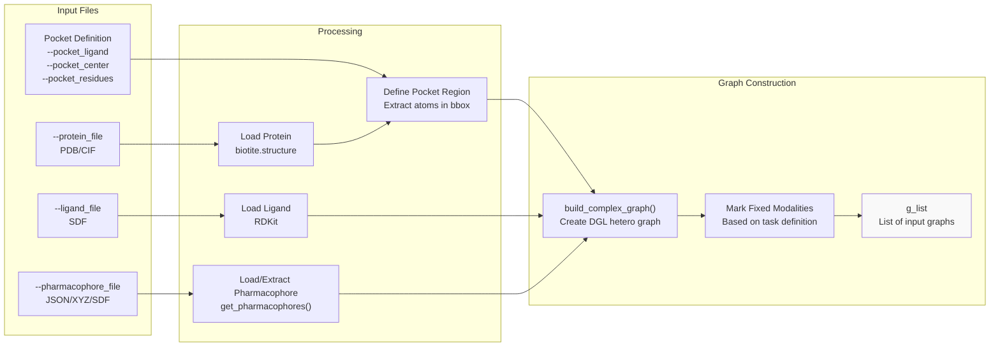
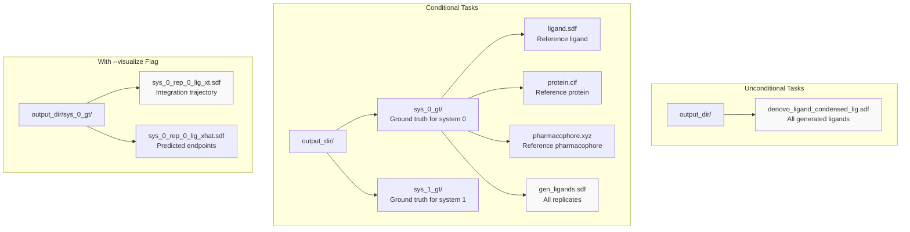
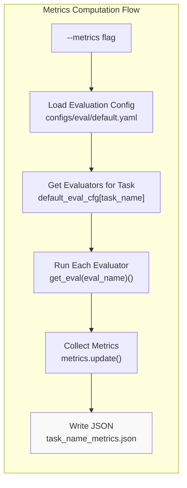

# Command Line Interface

<details>
<summary>Relevant source files</summary>

The following files were used as context for generating this wiki page:

- [configs/eval/default.yaml](configs/eval/default.yaml)
- [omtra/data/graph/utils.py](omtra/data/graph/utils.py)
- [omtra/eval/evals.py](omtra/eval/evals.py)
- [omtra/eval/system.py](omtra/eval/system.py)
- [omtra/eval/utils.py](omtra/eval/utils.py)
- [readme.md](readme.md)
- [routines/sample.py](routines/sample.py)

</details>


The Command Line Interface (CLI) provides the primary method for running OMTRA sampling tasks from the command line. This page documents the `omtra` command, its arguments, and subcommands.

For information about installation and setup, see [Installation and Setup](#2.1). For practical examples and common workflows, see [Quick Start Examples](#2.3). For detailed information about the underlying sampling pipeline, see [Sampling Pipeline](#8.1).

---

## Overview

The `omtra` command is the main entry point for running molecular generation tasks. It is available after installation via either manual setup or Docker. The CLI interfaces with the sampling routine implemented in [routines/sample.py](), which orchestrates model loading, data preparation, generation, and output writing.

Two primary CLI modes are available:

1. **Sampling mode**: Generate molecules using trained models (`omtra --task <task> [options]`)
2. **Utility mode**: Convert molecular structures to pharmacophore representations (`omtra mol2pharm`)

---

## CLI Architecture



**Sources:** [readme.md:159-196](), [routines/sample.py:34-158](), [routines/sample.py:273-500]()

---

## Command Structure

### Basic Invocation

```bash
omtra --task <task_name> [options]
```

The `--task` argument is required and specifies which generation task to perform. All other arguments are optional with sensible defaults.

### Implementation Details

The CLI is implemented through the `parse_args()` function which defines all command-line arguments, and the `main()` function which orchestrates the sampling workflow:

| Component | Location | Purpose |
|-----------|----------|---------|
| Argument parser | [routines/sample.py:34-158]() | Defines all CLI arguments and their types |
| Main routine | [routines/sample.py:273-500]() | Orchestrates model loading, sampling, and output |
| Checkpoint loading | [omtra/load/quick.py]() | Loads trained model from checkpoint |
| Task registry | [omtra/tasks/register.py]() | Maps task names to Task classes |

**Sources:** [routines/sample.py:34-158](), [routines/sample.py:273-500]()

---

## Core Arguments

These arguments control the fundamental sampling behavior:

| Argument | Type | Default | Description |
|----------|------|---------|-------------|
| `--task` | string | *required* | Sampling task name (see [Available Tasks](#available-tasks)) |
| `--checkpoint` | path | `args.checkpoint` | Path to model checkpoint file |
| `--n_samples` | int | 100 | Number of samples to generate |
| `--n_timesteps` | int | 250 | Number of integration steps during generation |
| `--output_dir` | path | auto | Directory for output files |
| `--metrics` | flag | False | Compute evaluation metrics after generation |

### Implementation

These arguments are parsed in [routines/sample.py:38-99]():

```python
p.add_argument("checkpoint", type=Path, help="Path to the model checkpoint (required)")
p.add_argument("--task", type=str, help="Task to sample for (e.g. denovo_ligand)", required=True)
p.add_argument("--n_samples", type=int, default=100, help="Number of samples to draw")
p.add_argument("--n_timesteps", type=int, default=250, help="Number of integration steps")
p.add_argument("--output_dir", type=Path, default=None, help="Directory to write outputs to")
p.add_argument("--metrics", action="store_true", help="If set, compute metrics for the samples")
```

### Checkpoint Selection

When `--checkpoint` is not explicitly provided, the CLI automatically selects the appropriate checkpoint based on the task name. Pre-trained checkpoints are stored in `omtra/trained_models/` and loaded via `quick_load.omtra_from_checkpoint()` at [routines/sample.py:282]().

**Sources:** [readme.md:169-179](), [routines/sample.py:38-99](), [routines/sample.py:274-282]()

---

## Input File Arguments

For conditional generation tasks, these arguments specify input structures:

| Argument | Type | Description |
|----------|------|-------------|
| `--protein_file` | path | Protein structure (PDB or CIF format) |
| `--ligand_file` | path | Ligand structure (SDF format) |
| `--pharmacophore_file` | path | Pharmacophore constraints (JSON, XYZ, or SDF format) |

### Pocket Definition Arguments

When using `--protein_file`, one of the following methods must be used to define the binding pocket:

| Argument | Type | Description |
|----------|------|-------------|
| `--pocket_ligand` | path | Reference ligand SDF to define pocket center |
| `--pocket_center` | string | Pocket center as 'x,y,z' coordinates |
| `--pocket_residues` | string | Residues defining pocket (format: 'CHAIN:RESID,CHAIN:START-END') |
| `--bbox_length` | float | Bounding box size in Angstroms (default: 23.0) |

### Input Processing Flow



**Sources:** [readme.md:182-194](), [routines/sample.py:293-296]()

---

## Advanced Sampling Options

These arguments provide fine-grained control over the generation process:

| Argument | Type | Default | Description |
|----------|------|---------|-------------|
| `--stochastic_sampling` | flag | False | Enable stochastic (vs deterministic) sampling |
| `--noise_scaler` | float | 1.0 | Scaling factor for noise in stochastic sampling |
| `--eps` | float | 0.01 | Epsilon value for numerical stability |
| `--visualize` | flag | False | Save generation trajectory for visualization |

### Ligand Size Control

Control the number of atoms in generated ligands:

| Argument | Type | Default | Description |
|----------|------|---------|-------------|
| `--use_gt_n_lig_atoms` | flag | False | Match ground truth ligand atom count |
| `--n_lig_atom_margin` | float | 0.075 | ±% margin around ground truth atom count |
| `--n_lig_atoms_mean` | float | None | Mean for atom count distribution |
| `--n_lig_atoms_std` | float | None | Standard deviation for atom count distribution |

### Dataset Arguments

For conditional sampling from existing datasets:

| Argument | Type | Default | Description |
|----------|------|---------|-------------|
| `--dataset` | string | 'pharmit' | Dataset to sample from |
| `--dataset_start_idx` | int | 0 | Starting index in dataset |
| `--n_replicates` | int | 1 | Replicates per input sample |
| `--split` | string | 'val' | Data split to use |
| `--sys_idx_file` | path | None | File with pre-selected indices |

**Sources:** [readme.md:197-214](), [routines/sample.py:118-156]()

---

## Available Tasks

The `--task` argument accepts the following task names:

### Unconditional Generation

| Task Name | Description |
|-----------|-------------|
| `denovo_ligand_condensed` | Generate novel drug-like molecules from scratch |

### Protein-Conditioned Generation

| Task Name | Description |
|-----------|-------------|
| `fixed_protein_ligand_denovo_condensed` | Design ligands for a fixed protein binding site |
| `protein_ligand_denovo_condensed` ⚠️ | Joint generation of ligand with flexible protein |
| `exp_apo_conditioned_denovo_ligand_condensed` ⚠️ | Generate from experimental apo structure |
| `pred_apo_conditioned_denovo_ligand_condensed` ⚠️ | Generate from predicted apo structure |

### Docking Tasks

| Task Name | Description |
|-----------|-------------|
| `rigid_docking_condensed` | Dock known ligand into fixed protein |
| `flexible_docking_condensed` ⚠️ | Dock with protein flexibility |
| `expapo_conditioned_ligand_docking_condensed` ⚠️ | Dock from experimental apo |
| `predapo_conditioned_ligand_docking_condensed` ⚠️ | Dock from predicted apo |

### Conformer Generation

| Task Name | Description |
|-----------|-------------|
| `ligand_conformer_condensed` | Generate 3D conformations for given ligand |

### Pharmacophore-Conditioned Tasks

| Task Name | Description |
|-----------|-------------|
| `denovo_ligand_pharmacophore_condensed` ⚠️ | Generate ligand and pharmacophore jointly |
| `denovo_ligand_from_pharmacophore_condensed` | Design ligand matching pharmacophore |
| `ligand_conformer_from_pharmacophore_condensed` | Generate conformer satisfying pharmacophore |
| `fixed_protein_pharmacophore_ligand_denovo_condensed` | Design ligand for protein with pharmacophore |
| `rigid_docking_pharmacophore_condensed` | Dock with pharmacophore constraints |
| `protein_ligand_pharmacophore_denovo_condensed` ⚠️ | Joint generation with pharmacophore |

⚠️ = Checkpoint not yet available

### Task Implementation

Tasks are registered in [omtra/tasks/register.py]() and retrieved via `task_name_to_class()` at [routines/sample.py:286]():

```python
task_name: str = args.task
task: Task = task_name_to_class(task_name)
```

**Sources:** [readme.md:215-256](), [routines/sample.py:285-286]()

---

## Output Organization

### Output Directory Structure

The CLI organizes outputs based on whether the task is conditional or unconditional:



### File Writing Implementation

Output files are written in [routines/sample.py:382-481](). The logic differs based on task type and visualization flag:

1. **Unconditional, no visualization** ([routines/sample.py:382-386]()): Single SDF file with all ligands
2. **Unconditional, with visualization** ([routines/sample.py:387-391]()): Trajectory files per system
3. **Conditional, no visualization** ([routines/sample.py:392-438]()): Organized by system with ground truth
4. **Conditional, with visualization** ([routines/sample.py:440-481]()): Trajectory files per replicate

### Output File Formats

| File Type | Extension | Writer Function |
|-----------|-----------|-----------------|
| Ligands | `.sdf` | `write_mols_to_sdf()` |
| Proteins | `.cif` | `write_arrays_to_cif()` |
| Pharmacophores | `.xyz` | `pharm_to_xyz()` |

The `SampledSystem` class ([omtra/eval/system.py:38-800]()) provides methods for writing different molecular components:

- `write_ligand()` at [omtra/eval/system.py:735-751]()
- `write_protein()` at [omtra/eval/system.py:753-768]()
- `write_pharmacophore()` at [omtra/eval/system.py:783-800]()

**Sources:** [routines/sample.py:373-481](), [omtra/eval/system.py:735-800]()

---

## Evaluation and Metrics

### The --metrics Flag

When `--metrics` is specified, the CLI computes evaluation metrics after generation:



### Implementation

Metrics computation occurs in [routines/sample.py:483-498]():

```python
if args.metrics:
    default_eval_cfg = OmegaConf.load(default_eval_path)
    metrics = {}
    for eval_entry in default_eval_cfg[task_name]:
        for eval_name, config in eval_entry.items():
            metrics.update(get_eval(eval_name)(sampled_systems, config.get("params", {})))
    
    metrics_file = output_dir / f"{task_name}_metrics.json"
    with open(metrics_file, 'w') as f:
        json.dump(metrics, f)
```

### Available Metrics by Task

Metrics are configured per task in [configs/eval/default.yaml](). Common metrics include:

| Metric Category | Evaluator Function | Location |
|----------------|-------------------|----------|
| Validity | `validity()` | [omtra/eval/evals.py:37-41]() |
| Stability | `stability()` | [omtra/eval/evals.py:44-48]() |
| REOS filters | `check_reos_and_rings()` | [omtra/eval/evals.py:51-55]() |
| Geometry | `geometry()` | [omtra/eval/evals.py:58-95]() |
| Flatness | `flatness()` | [omtra/eval/evals.py:98-123]() |
| Intermolecular distance | `intermolecular_distance()` | [omtra/eval/evals.py:126-148]() |
| Ligand RMSD | `ligand_rmsd()` | [omtra/eval/evals.py:151-177]() |
| Volume overlap | `volume_overlap()` | [omtra/eval/evals.py:180-199]() |
| PoseBusters | `pb_valid_*()` | [omtra/eval/evals.py:202-322]() |
| Pharmacophore match | `check_pharm_match()` | [omtra/eval/evals.py:325-329]() |

### Metric Registration

Evaluators are registered via the `@register_eval()` decorator and retrieved through `get_eval()` from [omtra/eval/register.py]().

**Sources:** [routines/sample.py:483-498](), [omtra/eval/evals.py:1-329](), [configs/eval/default.yaml:1-684]()

---

## Utility Commands

### mol2pharm: Pharmacophore Extraction

The `omtra mol2pharm` command extracts pharmacophore features from ligand SDF files and outputs them in JSON format compatible with Pharmit.

#### Basic Usage

```bash
omtra mol2pharm ligand.sdf -o pharmacophore.json --pretty
```

#### Arguments

| Argument | Description |
|----------|-------------|
| `input.sdf` | Input ligand file in SDF format |
| `-o`, `--output` | Output JSON file path |
| `--pretty` | Format JSON with indentation |
| `--verbose` | Print extracted features to console |
| `--all-disabled` | Set all features as disabled by default |
| `--first-only` | Process only first molecule in multi-molecule SDF |

#### Output Format

The tool generates JSON in Pharmit format:

```json
{
  "points": [
    {
      "name": "Aromatic",
      "x": 10.5,
      "y": 20.3,
      "z": 15.2,
      "enabled": true
    },
    {
      "name": "HydrogenAcceptor",
      "x": 8.2,
      "y": 18.7,
      "z": 14.1,
      "enabled": true
    }
  ]
}
```

#### Supported Feature Types

| Feature Type | Description |
|--------------|-------------|
| `Aromatic` | Aromatic ring centers |
| `HydrogenDonor` | H-bond donor groups |
| `HydrogenAcceptor` | H-bond acceptor atoms |
| `PositiveIon` | Positively charged groups |
| `NegativeIon` | Negatively charged groups |
| `Hydrophobic` | Hydrophobic regions |
| `Halogen` | Halogen bond donors |

Pharmacophore extraction is implemented via `get_pharmacophores()` from [omtra/data/pharmacophores.py]().

**Sources:** [readme.md:336-481]()

---

## Debug Mode

Set the `OMTRA_DEBUG` environment variable to enable full stack traces for troubleshooting:

```bash
OMTRA_DEBUG=1 omtra --task denovo_ligand_condensed --n_samples 10
```

**Sources:** [readme.md:512-516]()

---