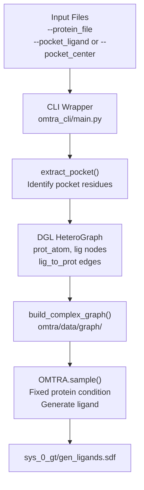
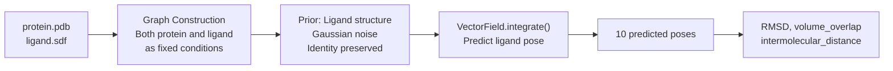
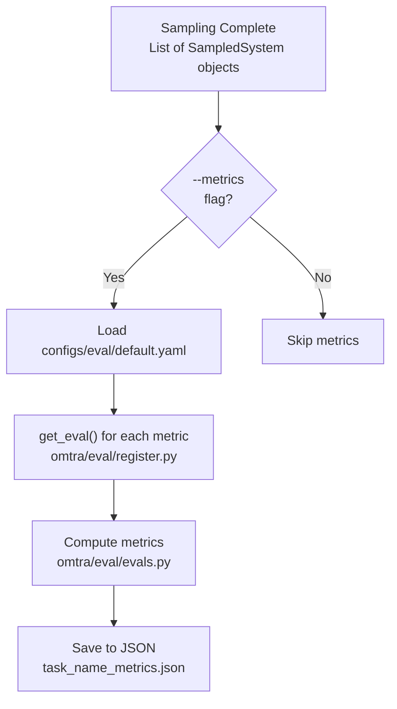
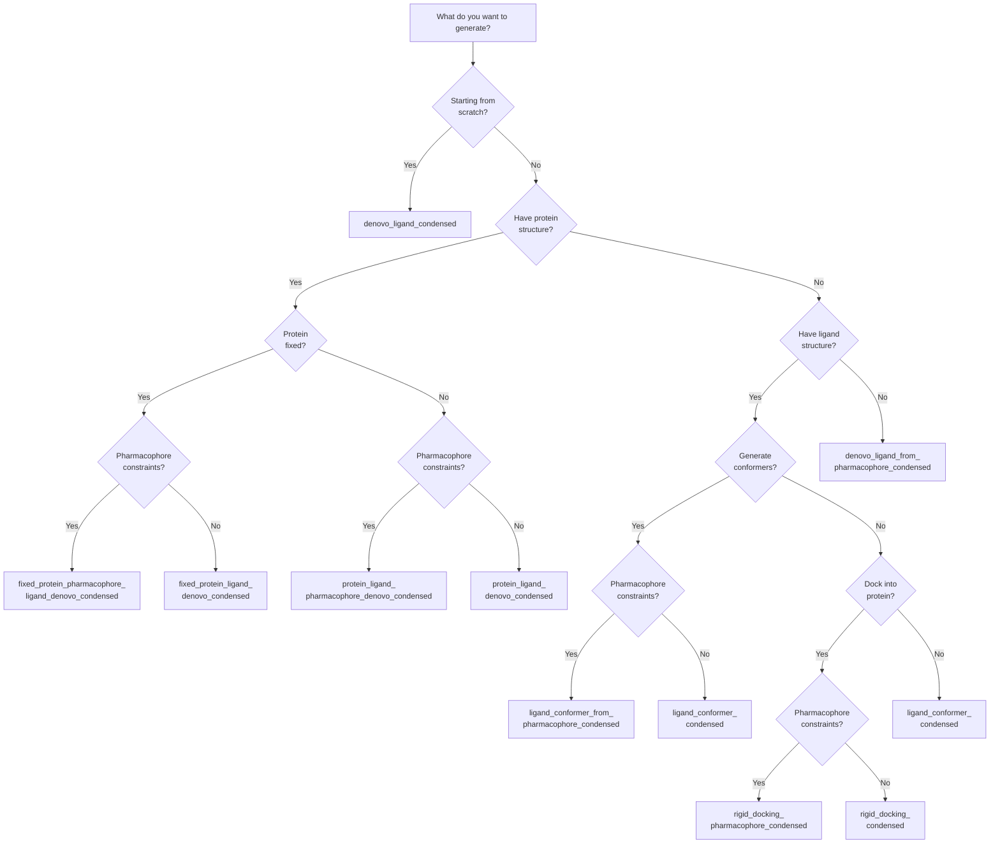

# Quick Start Examples

<details>
<summary>Relevant source files</summary>

The following files were used as context for generating this wiki page:

- [configs/eval/default.yaml](configs/eval/default.yaml)
- [omtra/data/graph/utils.py](omtra/data/graph/utils.py)
- [omtra/eval/evals.py](omtra/eval/evals.py)
- [omtra/eval/system.py](omtra/eval/system.py)
- [omtra/eval/utils.py](omtra/eval/utils.py)
- [readme.md](readme.md)
- [routines/sample.py](routines/sample.py)

</details>


This page provides practical, copy-paste-ready examples for common OMTRA use cases. Each example includes the complete command, expected outputs, and explanation of key parameters.

**Purpose and Scope:** This guide demonstrates typical workflows for generating molecules with OMTRA's command-line interface. For complete CLI reference and all available arguments, see [Command Line Interface](#2.2). For installation instructions, see [Installation and Setup](#2.1). For understanding the underlying task system, see [Tasks and Modalities](#3.1).

---

## Prerequisites

Before running these examples:

1. **Installation completed** - Either manual or Docker installation (see [Installation and Setup](#2.1))
2. **Model weights downloaded** - Located in `omtra/trained_models/` directory
3. **GPU available** - CUDA-enabled GPU recommended for reasonable performance

Verify your installation:
```bash
omtra --help
```

---

## Quick Reference: Task Overview

The following table summarizes the available tasks with pre-trained checkpoints:

| Task | Input Requirements | Generates | Typical Use Case |
|------|-------------------|-----------|------------------|
| `denovo_ligand_condensed` | None | Ligand only | Exploring chemical space |
| `fixed_protein_ligand_denovo_condensed` | Protein PDB/CIF + pocket definition | Ligand in binding site | Structure-based drug design |
| `rigid_docking_condensed` | Protein PDB/CIF + ligand SDF | Ligand pose | Binding pose prediction |
| `ligand_conformer_condensed` | Ligand SDF | Ligand conformations | Conformer generation |
| `denovo_ligand_from_pharmacophore_condensed` | Pharmacophore JSON/XYZ/SDF | Ligand matching pharmacophore | Pharmacophore-constrained design |
| `ligand_conformer_from_pharmacophore_condensed` | Ligand SDF + pharmacophore | Conformations matching pharmacophore | Constrained conformer sampling |
| `fixed_protein_pharmacophore_ligand_denovo_condensed` | Protein + pharmacophore + pocket | Ligand in pocket with constraints | Multi-constraint SBDD |
| `rigid_docking_pharmacophore_condensed` | Protein + ligand + pharmacophore | Pose matching pharmacophore | Constrained docking |

**Sources:** [readme.md:216-256]()

---

## Example 1: Unconditional Ligand Generation

**Goal:** Generate novel drug-like molecules from scratch without constraints.

### Basic Command

```bash
omtra --task denovo_ligand_condensed \
  --n_samples 100 \
  --output_dir outputs/denovo_samples
```

### With Metrics

```bash
omtra --task denovo_ligand_condensed \
  --n_samples 100 \
  --output_dir outputs/denovo_samples \
  --metrics
```

### Output Structure

```
outputs/denovo_samples/
├── denovo_ligand_condensed_lig.sdf      # All generated molecules
└── denovo_ligand_condensed_metrics.json  # Metrics (if --metrics flag used)
```

### Understanding the Output

The SDF file contains all generated molecules as multi-structure SDF. Each molecule is a complete 3D structure with atom types, charges, and bond orders.

**Metrics computed** (when `--metrics` flag is used):
- **Validity metrics**: Fraction of chemically valid molecules
- **Stability metrics**: Fraction of atoms with valid valencies
- **REOS filters**: Drug-likeness rule violations
- **Ring system checks**: Detection of unusual/out-of-distribution ring systems
- **PoseBusters checks**: Geometry and structural quality

### Workflow Diagram

```mermaid
graph LR
    Command["omtra --task denovo_ligand_condensed"]
    Checkpoint["Auto-select checkpoint<br/>omtra/trained_models/"]
    Model["OMTRA.sample()<br/>omtra/models/omtra.py"]
    Prior["sample_priors()<br/>Gaussian noise<br/>omtra/priors/"]
    VectorField["VectorField.integrate()<br/>250 timesteps<br/>omtra/models/vector_field.py"]
    System["SampledSystem objects<br/>omtra/eval/system.py"]
    SDF["denovo_ligand_condensed_lig.sdf"]
    
    Command --> Checkpoint
    Checkpoint --> Model
    Model --> Prior
    Prior --> VectorField
    VectorField --> System
    System --> SDF
```



**Sources:** [readme.md:259-265](), [routines/sample.py:273-503]()

---

## Example 2: Structure-Based Drug Design

**Goal:** Design ligands that bind to a specific protein pocket.

### Option A: Define Pocket with Reference Ligand

```bash
omtra --task fixed_protein_ligand_denovo_condensed \
  --protein_file my_protein.pdb \
  --pocket_ligand reference_ligand.sdf \
  --n_samples 50 \
  --output_dir outputs/sbdd_samples
```

This extracts the binding pocket based on atoms within a distance threshold of the reference ligand.

### Option B: Define Pocket by Center Coordinates

```bash
omtra --task fixed_protein_ligand_denovo_condensed \
  --protein_file my_protein.pdb \
  --pocket_center 10.5,20.3,15.2 \
  --bbox_length 25.0 \
  --n_samples 50 \
  --output_dir outputs/sbdd_samples
```

**Parameters:**
- `--pocket_center`: x,y,z coordinates in Angstroms
- `--bbox_length`: Side length of cubic bounding box (default: 23.0 Å)

### Option C: Define Pocket by Residues

```bash
omtra --task fixed_protein_ligand_denovo_condensed \
  --protein_file my_protein.pdb \
  --pocket_residues A:123-130,A:200,B:50-55 \
  --n_samples 50 \
  --output_dir outputs/sbdd_samples
```

**Residue format:** `CHAIN:RESID` or `CHAIN:START-END`

### Output Structure

```
outputs/sbdd_samples/
└── sys_0_gt/
    ├── protein.cif                # Input protein structure
    └── gen_ligands.sdf           # All 50 generated ligands
```

### SBDD Workflow Diagram



**Sources:** [readme.md:268-295](), [routines/sample.py:348-355]()

---

## Example 3: Molecular Docking

**Goal:** Predict binding poses for a known ligand in a protein structure.

### Basic Docking Command

```bash
omtra --task rigid_docking_condensed \
  --protein_file protein.pdb \
  --ligand_file ligand.sdf \
  --n_samples 10 \
  --output_dir outputs/docking
```

### With Metrics

```bash
omtra --task rigid_docking_condensed \
  --protein_file protein.pdb \
  --ligand_file ligand.sdf \
  --n_samples 10 \
  --output_dir outputs/docking \
  --metrics
```

### Output Structure

```
outputs/docking/
└── sys_0_gt/
    ├── ligand.sdf              # Ground truth ligand
    ├── protein.cif             # Input protein
    └── gen_ligands.sdf         # 10 predicted poses
```

### Key Docking Metrics

When `--metrics` is used, the system computes:
- **RMSD**: Root-mean-square deviation from ground truth
- **Kabsch RMSD**: RMSD after optimal alignment
- **Centroid distance**: Distance between centroids
- **Volume overlap**: Protein-ligand volume overlap
- **Intermolecular distance**: Minimum distance to protein

### Docking Task Flow



**Sources:** [readme.md:297-304](), [configs/eval/default.yaml:180-206]()

---

## Example 4: Conformer Generation

**Goal:** Generate diverse 3D conformations for a given molecule.

### Basic Conformer Generation

```bash
omtra --task ligand_conformer_condensed \
  --ligand_file molecule.sdf \
  --n_samples 20 \
  --output_dir outputs/conformers
```

### With Evaluation

```bash
omtra --task ligand_conformer_condensed \
  --ligand_file molecule.sdf \
  --n_samples 20 \
  --output_dir outputs/conformers \
  --metrics
```

### Output Structure

```
outputs/conformers/
└── sys_0_gt/
    ├── ligand.sdf              # Input ligand (reference conformation)
    └── gen_ligands.sdf         # 20 generated conformations
```

### Conformer Metrics

Computed when `--metrics` flag is used:
- **Stability**: Valency checks
- **RMSD**: Deviation from reference conformation
- **Kabsch RMSD**: Alignment-corrected RMSD
- **Flatness**: Ring planarity checks
- **PoseBusters conformer checks**: Geometry validation

**Sources:** [readme.md:306-312](), [configs/eval/default.yaml:115-133]()

---

## Example 5: Pharmacophore-Guided Design

**Goal:** Generate molecules that satisfy specific pharmacophore constraints.

### From Pharmacophore JSON File

```bash
omtra --task denovo_ligand_from_pharmacophore_condensed \
  --pharmacophore_file constraints.json \
  --n_samples 100 \
  --output_dir outputs/pharm_guided
```

### From Reference Ligand (Auto-Extract Pharmacophore)

```bash
omtra --task denovo_ligand_from_pharmacophore_condensed \
  --pharmacophore_file reference_ligand.sdf \
  --n_samples 100 \
  --output_dir outputs/pharm_guided
```

When an SDF file is provided, OMTRA automatically extracts pharmacophore features using pattern matching (see [Pharmacophore Extraction](#6.4)).

### Creating Pharmacophore JSON

Use the built-in converter:

```bash
omtra mol2pharm ligand.sdf -o pharmacophore.json --pretty --verbose
```

**Output example:**
```json
{
  "points": [
    {
      "name": "Aromatic",
      "x": 12.456,
      "y": 8.234,
      "z": 15.789,
      "enabled": true
    },
    {
      "name": "HydrogenDonor",
      "x": 10.123,
      "y": 11.456,
      "z": 14.234,
      "enabled": true
    }
  ]
}
```

### Multi-Constraint Example: Protein + Pharmacophore

```bash
omtra --task fixed_protein_pharmacophore_ligand_denovo_condensed \
  --protein_file protein.pdb \
  --pocket_center 10.0,15.0,20.0 \
  --pharmacophore_file constraints.json \
  --n_samples 50 \
  --output_dir outputs/multi_constraint
```

### Pharmacophore Feature Types

| Feature | Description | Example Groups |
|---------|-------------|----------------|
| `Aromatic` | Aromatic ring centers | Phenyl, pyridine |
| `HydrogenDonor` | H-bond donor | NH, OH |
| `HydrogenAcceptor` | H-bond acceptor | C=O, N |
| `PositiveIon` | Positive charge | Ammonium |
| `NegativeIon` | Negative charge | Carboxylate |
| `Hydrophobic` | Lipophilic region | Alkyl chains |
| `Halogen` | Halogen bond donor | Cl, Br, F, I |

**Sources:** [readme.md:314-331](), [readme.md:333-481]()

---

## Understanding Output Files

### Output Directory Structure

The output structure depends on whether the task is unconditional or conditional:

#### Unconditional Tasks

```
outputs/denovo_samples/
├── denovo_ligand_condensed_lig.sdf       # All samples in one file
└── denovo_ligand_condensed_metrics.json   # Metrics (optional)
```

#### Conditional Tasks

```
outputs/sbdd_samples/
└── sys_0_gt/
    ├── ligand.sdf              # Ground truth ligand (if available)
    ├── protein.cif             # Input protein
    ├── pharmacophore.xyz       # Input pharmacophore (if applicable)
    └── gen_ligands.sdf         # Generated samples
```

For multiple input systems, directory pattern repeats:
```
outputs/batch_samples/
├── sys_0_gt/
│   ├── protein.cif
│   └── gen_ligands.sdf
├── sys_1_gt/
│   ├── protein.cif
│   └── gen_ligands.sdf
└── sys_2_gt/
    ├── protein.cif
    └── gen_ligands.sdf
```

### File Formats

| Extension | Format | Contains | Written By |
|-----------|--------|----------|------------|
| `.sdf` | Structure Data File | Ligand structures with 3D coords, bonds, charges | `write_mols_to_sdf()` |
| `.cif` | Crystallographic Information File | Protein structures | `write_arrays_to_cif()` |
| `.pdb` | Protein Data Bank | Protein structures (alternative) | `write_arrays_to_pdb()` |
| `.xyz` | XYZ coordinate file | Pharmacophore features | `pharm_to_xyz()` |
| `.json` | JSON | Metrics or pharmacophore definitions | `json.dump()` |

### Reading Outputs Programmatically

```python
from rdkit import Chem
import json

# Read generated ligands
supplier = Chem.SDMolSupplier('outputs/sbdd_samples/sys_0_gt/gen_ligands.sdf')
mols = [mol for mol in supplier if mol is not None]

# Read metrics
with open('outputs/denovo_samples/denovo_ligand_condensed_metrics.json') as f:
    metrics = json.load(f)
    print(f"Validity: {metrics['frac_valid_mols']:.2%}")
```

**Sources:** [omtra/eval/system.py:735-799](), [routines/sample.py:382-439]()

---

## Computing and Understanding Metrics

### Enabling Metrics

Add the `--metrics` flag to any sampling command:

```bash
omtra --task rigid_docking_condensed \
  --protein_file protein.pdb \
  --ligand_file ligand.sdf \
  --n_samples 10 \
  --output_dir outputs/docking \
  --metrics
```

### Metrics Computation Flow



### Metric Categories

The evaluation configuration is task-specific and defined in [configs/eval/default.yaml:1-684]().

#### Chemistry Validity Metrics

Computed by `validity()` evaluation function:
- **`frac_valid_mols`**: Fraction of molecules that pass RDKit sanitization
- **`avg_frag_frac`**: Average fraction of atoms in largest connected component
- **`avg_num_components`**: Average number of disconnected fragments
- **`frac_connected`**: Fraction of fully connected molecules

#### Stability Metrics

Computed by `stability()` evaluation function:
- **`frac_atoms_stable`**: Fraction of atoms with valid valencies
- **`frac_mols_stable_valence`**: Fraction of molecules with all atoms stable

#### Geometry Metrics

Computed by `geometry()` evaluation function:
- **`geometry_frac_valid_bonds`**: Fraction of bonds with physically reasonable lengths
- **`geometry_frac_valid_angles`**: Fraction of angles within acceptable ranges
- **`geometry_number_clashes`**: Average number of atomic clashes per molecule

#### RMSD Metrics (Docking/Conformer Tasks)

Computed by `ligand_rmsd()` evaluation function:
- **`ligand_rmsd`**: Standard RMSD from reference
- **`ligand_kabsch_rmsd`**: RMSD after optimal superposition
- **`ligand_centroid_distance`**: Distance between centroids

#### Protein-Ligand Interface Metrics

Computed by `intermolecular_distance()` and `volume_overlap()`:
- **`intermolecular_distance_smallest`**: Minimum distance between ligand and protein atoms
- **`volume_overlap`**: Volume overlap between ligand and protein

#### Pharmacophore Match Metrics

Computed by `pharm_match()` evaluation function:
- **`pharm_match_rate`**: Fraction of pharmacophore features satisfied
- **`pharm_match_threshold`**: Binary pass/fail based on distance threshold (default: 1.0 Å)

### Example Metrics Output

```json
{
  "frac_valid_mols": 0.92,
  "frac_atoms_stable": 0.95,
  "geometry_frac_valid_bonds": 0.98,
  "ligand_rmsd": 1.45,
  "ligand_kabsch_rmsd": 1.23,
  "intermolecular_distance_smallest": 2.1,
  "volume_overlap": 0.05,
  "pb_valid_unconditional": 0.88
}
```

**Sources:** [routines/sample.py:483-498](), [omtra/eval/evals.py:1-329](), [configs/eval/default.yaml:1-684]()

---

## Common Patterns and Advanced Options

### Controlling Ligand Size

#### Use Ground Truth Size (with margin)

```bash
omtra --task fixed_protein_ligand_denovo_condensed \
  --protein_file protein.pdb \
  --pocket_ligand reference.sdf \
  --use_gt_n_lig_atoms \
  --n_lig_atom_margin 0.15 \
  --n_samples 50 \
  --output_dir outputs/size_controlled
```

- `--use_gt_n_lig_atoms`: Match reference ligand atom count
- `--n_lig_atom_margin`: Allow ±15% variation (default: 0.075)

#### Specify Size Distribution

```bash
omtra --task fixed_protein_ligand_denovo_condensed \
  --protein_file protein.pdb \
  --pocket_center 10.0,15.0,20.0 \
  --n_lig_atoms_mean 25 \
  --n_lig_atoms_std 5 \
  --n_samples 50 \
  --output_dir outputs/custom_size
```

### Stochastic vs Deterministic Sampling

#### Deterministic (Default)

```bash
omtra --task denovo_ligand_condensed --n_samples 10
```

#### Stochastic (More Diverse)

```bash
omtra --task denovo_ligand_condensed \
  --n_samples 10 \
  --stochastic_sampling \
  --noise_scaler 1.0 \
  --eps 0.01
```

**Parameters:**
- `--stochastic_sampling`: Enable noise injection during integration
- `--noise_scaler`: Scale factor for noise (higher = more diversity)
- `--eps`: Small epsilon for numerical stability

### Adjusting Integration Steps

More steps = higher quality but slower:

```bash
omtra --task rigid_docking_condensed \
  --protein_file protein.pdb \
  --ligand_file ligand.sdf \
  --n_timesteps 500 \
  --n_samples 10
```

**Default:** 250 timesteps  
**Typical range:** 100-500 timesteps

### Batch Processing Multiple Inputs

For processing many protein-ligand pairs, save system indices to a file:

```bash
# Create index file
echo "0,5,10,15,20" > system_indices.txt

# Sample from specific systems
omtra --task rigid_docking_condensed \
  --dataset plinder \
  --sys_idx_file system_indices.txt \
  --n_replicates 5 \
  --output_dir outputs/batch
```

This generates 5 replicates for each of 5 systems (25 total samples).

### Visualizing Sampling Trajectories

Generate intermediate structures during generation:

```bash
omtra --task denovo_ligand_condensed \
  --n_samples 5 \
  --visualize \
  --output_dir outputs/trajectory
```

**Output:**
```
outputs/trajectory/
├── sys0_xt.sdf        # Noisy trajectory (x_t values)
└── sys0_xhat.sdf      # Predicted trajectory (denoised predictions)
```

Each SDF contains multiple conformations showing the generation process from noise to final structure.

### Debug Mode

For troubleshooting, enable full stack traces:

```bash
OMTRA_DEBUG=1 omtra --task denovo_ligand_condensed --n_samples 10
```

**Sources:** [routines/sample.py:34-157](), [readme.md:512-517]()

---

## Task Selection Guide

Use this decision tree to choose the appropriate task:



**Sources:** [readme.md:216-256](), [omtra/tasks/register.py]()

---

## Summary: Quick Command Templates

### Template 1: De Novo Design

```bash
omtra --task denovo_ligand_condensed \
  --n_samples <number> \
  --output_dir <path> \
  [--metrics]
```

### Template 2: Pocket-Conditioned Design

```bash
omtra --task fixed_protein_ligand_denovo_condensed \
  --protein_file <pdb/cif> \
  --pocket_ligand <sdf> \
  --n_samples <number> \
  --output_dir <path> \
  [--metrics]
```

### Template 3: Docking

```bash
omtra --task rigid_docking_condensed \
  --protein_file <pdb/cif> \
  --ligand_file <sdf> \
  --n_samples <number> \
  --output_dir <path> \
  [--metrics]
```

### Template 4: Conformer Generation

```bash
omtra --task ligand_conformer_condensed \
  --ligand_file <sdf> \
  --n_samples <number> \
  --output_dir <path> \
  [--metrics]
```

### Template 5: Pharmacophore-Guided

```bash
omtra --task denovo_ligand_from_pharmacophore_condensed \
  --pharmacophore_file <json/xyz/sdf> \
  --n_samples <number> \
  --output_dir <path> \
  [--metrics]
```

**Sources:** [readme.md:159-331](), [routines/sample.py:273-503]()

---