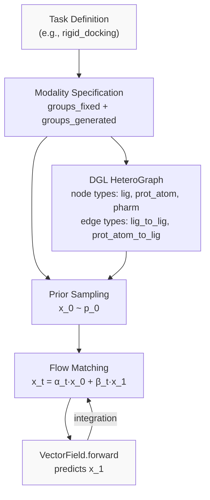
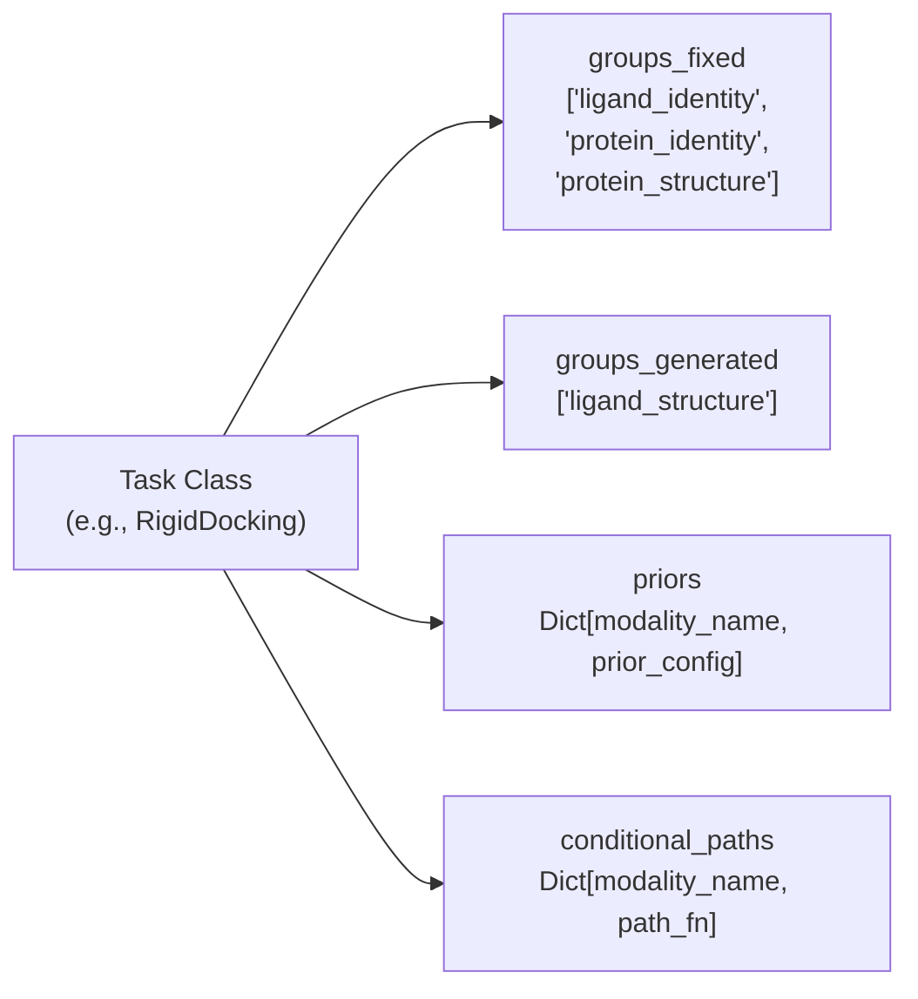
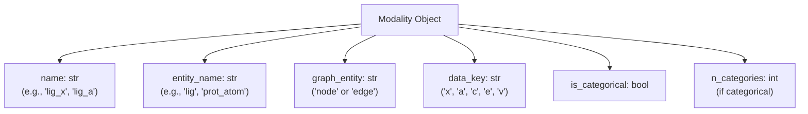
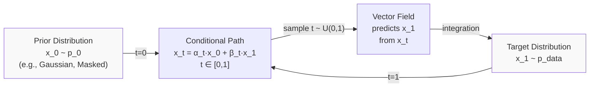
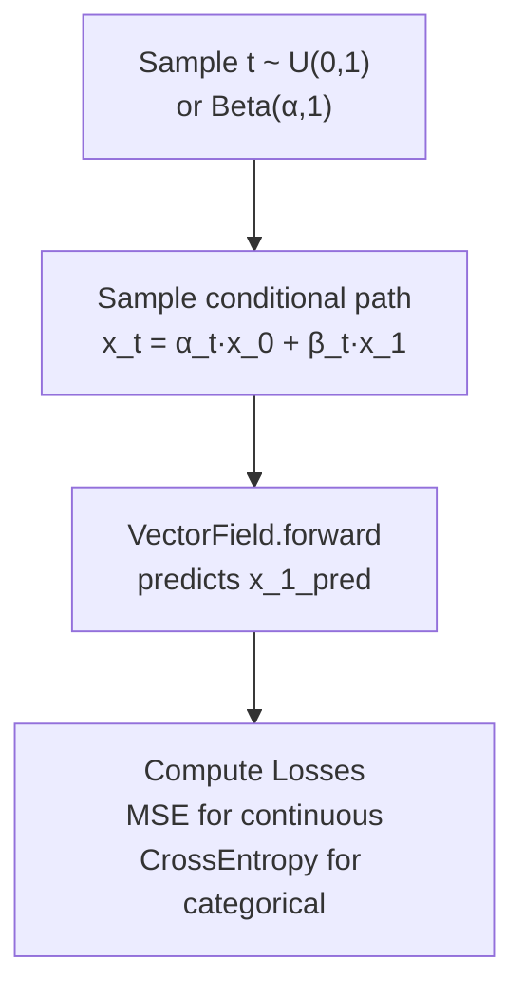
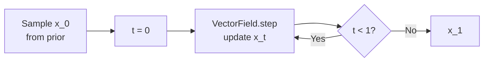
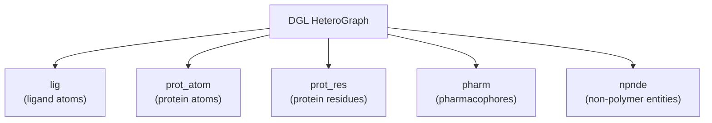
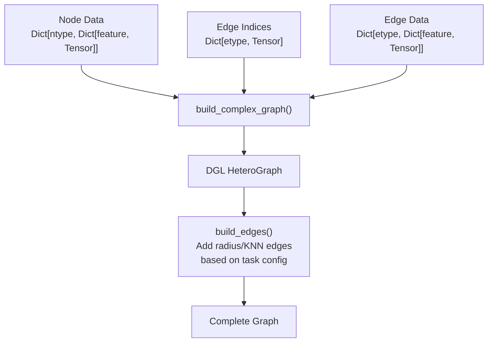
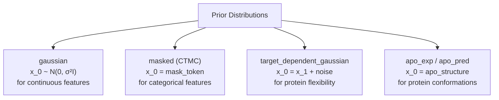
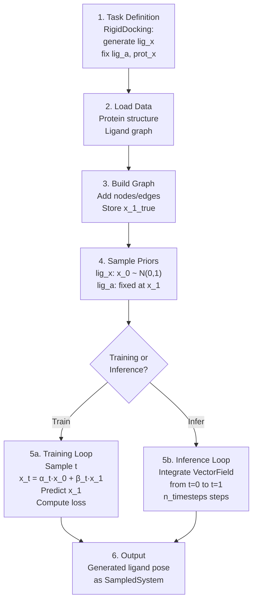

# Core Concepts

<details>
<summary>Relevant source files</summary>

The following files were used as context for generating this wiki page:

- [configs/graph/default.yaml](configs/graph/default.yaml)
- [omtra/data/graph/__init__.py](omtra/data/graph/__init__.py)
- [omtra/data/graph/edge_builders.py](omtra/data/graph/edge_builders.py)
- [omtra/data/graph/edge_factory.py](omtra/data/graph/edge_factory.py)
- [omtra/data/graph/register.py](omtra/data/graph/register.py)
- [omtra/dataset/pharmit.py](omtra/dataset/pharmit.py)
- [omtra/dataset/plinder.py](omtra/dataset/plinder.py)
- [omtra/models/omtra.py](omtra/models/omtra.py)
- [omtra/models/self_conditioning.py](omtra/models/self_conditioning.py)
- [omtra/models/vector_field.py](omtra/models/vector_field.py)
- [omtra/priors/prior_factory.py](omtra/priors/prior_factory.py)
- [omtra/priors/priors.py](omtra/priors/priors.py)
- [omtra/priors/sample.py](omtra/priors/sample.py)
- [omtra/tasks/tasks.py](omtra/tasks/tasks.py)
- [omtra/tasks/utils.py](omtra/tasks/utils.py)

</details>


This page introduces the fundamental concepts that underpin OMTRA's architecture and operation. Understanding these concepts is essential for working with the codebase, whether you're training models, running inference, or extending the system.

**Scope**: This page provides a high-level overview of tasks, modalities, flow matching, graph representation, priors, and conditional paths. For detailed information, see:
- [Tasks and Modalities](#3.1) for comprehensive task definitions and modality specifications
- [Flow Matching for Molecules](#3.2) for the mathematical formulation and implementation details
- [Graph Representation](#3.3) for graph construction and edge building mechanics

---

## Overview: The Task-Modality-Flow Matching Framework

OMTRA generates molecular structures using a task-based framework built on flow matching. Each **task** defines what to generate and what to condition on by specifying which **modalities** (molecular features) are fixed versus generated. The model learns to transform samples from a **prior distribution** at time t=0 to the target distribution at t=1 through a learned **vector field**.

### Core Architecture Flow



**Sources**: [omtra/models/omtra.py:55-186](), [omtra/tasks/tasks.py:1-226]()

---

## Tasks: Defining What to Generate

A **task** in OMTRA specifies a molecular generation problem by declaring which modality groups are fixed (provided as input) versus generated (predicted by the model).

### Task Definition Structure



**Sources**: [omtra/tasks/tasks.py:33-60](), [omtra/tasks/base_task.py]()

### Key Task Examples

| Task Name | Fixed Groups | Generated Groups | Use Case |
|-----------|-------------|------------------|----------|
| `denovo_ligand` | `[]` | `ligand_identity`, `ligand_structure` | Unconditional ligand generation |
| `rigid_docking` | `ligand_identity`, `protein_identity`, `protein_structure` | `ligand_structure` | Pose prediction with fixed protein |
| `flexible_docking` | `ligand_identity`, `protein_identity` | `ligand_structure`, `protein_structure` | Pose prediction with flexible protein |
| `fixed_protein_ligand_denovo` | `protein_identity`, `protein_structure` | `ligand_identity`, `ligand_structure` | De novo design for binding pocket |

**Sources**: [omtra/tasks/tasks.py:13-70]()

### Code Entity Mapping

Tasks are defined as classes inheriting from `Task` and registered using the `@register_task` decorator:

```python
@register_task("rigid_docking")
class RigidDocking(Task):
    groups_fixed = ["ligand_identity", "protein_identity", "protein_structure"]
    groups_generated = ["ligand_structure"]
```

- Task classes are located in [omtra/tasks/tasks.py]()
- Task registry: [omtra/tasks/register.py]()
- Task retrieval: `task_name_to_class(task_name)` function

**Sources**: [omtra/tasks/tasks.py:33-45](), [omtra/tasks/register.py]()

---

## Modalities and Modality Groups

**Modalities** are the fundamental features of molecular systems that OMTRA models. Each modality represents a specific type of data defined on graph nodes or edges.

### Modality Structure



**Sources**: [omtra/tasks/modalities.py]()

### Modality Data Keys

| Data Key | Meaning | Entity Types | Example Modality |
|----------|---------|--------------|------------------|
| `x` | 3D coordinates | `lig`, `prot_atom`, `pharm` | `lig_x`, `prot_atom_x` |
| `a` | Atom types | `lig`, `prot_atom`, `pharm` | `lig_a`, `pharm_a` |
| `c` | Formal charges | `lig` | `lig_c` |
| `e` | Bond orders | `lig_to_lig` | `lig_e` |
| `v` | Direction vectors | `pharm` | `pharm_v` |

**Sources**: [omtra/tasks/modalities.py]()

### Modality Groups

Modalities are organized into **groups** that represent coherent aspects of molecular systems:

| Group Name | Modalities Included | Description |
|------------|-------------------|-------------|
| `ligand_identity` | `lig_a`, `lig_c`, `lig_e` | Atom types, charges, bonds |
| `ligand_structure` | `lig_x` | 3D coordinates |
| `protein_identity` | `prot_atom_a`, `prot_res_a` | Protein sequence |
| `protein_structure` | `prot_atom_x` | Protein 3D structure |
| `pharmacophore` | `pharm_x`, `pharm_a`, `pharm_v` | Pharmacophore positions, types, vectors |

**Sources**: [omtra/tasks/modalities.py]()

### Modality Access in Code

```python
# Get modality object by name
modality = name_to_modality("lig_x")

# Access modality properties
entity_name = modality.entity_name  # "lig"
data_key = modality.data_key        # "x"
is_categorical = modality.is_categorical  # False

# Iterate over task modalities
for m in task_class.modalities_generated:
    print(f"Generating {m.name}")
```

**Sources**: [omtra/tasks/modalities.py](), [omtra/models/omtra.py:424-442]()

---

## Flow Matching: The Generative Process

OMTRA uses **flow matching** to generate molecular structures. This approach learns a time-dependent vector field that transports samples from a simple prior distribution at t=0 to the complex target distribution at t=1.

### Flow Matching Overview



**Sources**: [omtra/models/omtra.py:386-516](), [omtra/models/vector_field.py:360-565]()

### Conditional Path Functions

The **conditional path** defines how features interpolate between prior (x_0) and target (x_1) states:

**Continuous Features** (positions):
```
x_t = α_t · x_0 + β_t · x_1
```

**Categorical Features** (atom types, bond orders):
```
x_t = {
    x_1           with probability β_t
    mask_token    with probability α_t
}
```

The interpolation weights α_t and β_t are computed by `InterpolantScheduler` based on time t.

**Sources**: [omtra/models/omtra.py:542-600](), [omtra/models/interpolant_scheduler.py]()

### Training Process



During training:
1. Sample time t from a distribution (uniform or beta)
2. Sample conditional path to get x_t
3. Predict x_1 using the vector field
4. Compute losses comparing predicted vs true x_1

**Sources**: [omtra/models/omtra.py:269-322](), [omtra/models/omtra.py:386-516]()

### Inference Process



During inference, the model integrates the vector field from t=0 to t=1:
1. Sample from prior distribution: x_0 ~ p_0
2. Integrate using `VectorField.integrate` with n_timesteps steps
3. At each step, predict x_1 and update x_t

**Sources**: [omtra/models/omtra.py:602-899](), [omtra/models/vector_field.py:902-1122]()

---

## Graph Representation

OMTRA represents molecular systems as **heterogeneous DGL graphs** with different node types and edge types.

### Graph Node Types



**Sources**: [omtra/data/graph/__init__.py:13-18]()

### Graph Edge Types

Edges connect nodes and enable message passing:

| Edge Type | Connection | Graph Type | Purpose |
|-----------|-----------|------------|---------|
| `lig_to_lig` | Ligand-Ligand | Complete | Bond structure |
| `prot_atom_to_prot_atom` | Protein-Protein | Radius (4.5Å) | Local protein structure |
| `lig_to_prot_atom` | Ligand-Protein | KNN (k=5) | Binding interactions |
| `prot_atom_to_lig` | Protein-Ligand | Radius (8Å) | Binding interactions |
| `lig_to_pharm` | Ligand-Pharmacophore | KNN (k=3) | Constraint satisfaction |
| `prot_atom_covalent_lig` | Protein-Ligand | Inferred | Covalent bonds |

**Sources**: [configs/graph/default.yaml:1-80](), [omtra/data/graph/__init__.py:13-42]()

### Graph Construction Process



**Process**:
1. `build_complex_graph()` creates initial graph with pre-computed edges (e.g., `lig_to_lig`)
2. `build_edges()` adds dynamic edges (radius, KNN) based on current node positions
3. Edge builders are configured per task in [configs/graph/default.yaml]()

**Sources**: [omtra/data/graph/__init__.py:74-155](), [omtra/tasks/utils.py:16-63]()

### Graph Data Storage

Node and edge features are stored as tensors in `g.nodes[ntype].data` and `g.edges[etype].data`:

```python
# Node features
g.nodes['lig'].data['x_t']        # Current positions
g.nodes['lig'].data['a_t']        # Current atom types
g.nodes['lig'].data['x_1_true']   # Target positions

# Edge features  
g.edges['lig_to_lig'].data['e_t']  # Current bond orders
```

Features are named with suffixes:
- `_0`: Prior/initial state
- `_t`: Current state at time t
- `_1_true`: Target/ground truth state
- `_1_pred`: Predicted final state

**Sources**: [omtra/models/omtra.py:388-402](), [omtra/dataset/plinder.py:667-830]()

---

## Priors: Initial Distributions

**Priors** define the initial distribution p_0 from which generation starts at t=0. Different modalities use different prior types.

### Prior Types



**Sources**: [omtra/priors/priors.py:1-102]()

### Prior Configuration

Priors are configured per-modality in task definitions:

```python
# Example from RigidDocking task
priors = {
    'lig_x': {
        'type': 'gaussian',
        'params': {'std': 1.0}
    },
    'lig_a': {
        'type': 'masked',
    },
    'prot_atom_x': {
        'type': 'target_dependent_gaussian',
        'params': {'std': 0.1}
    }
}
```

**Sources**: [omtra/tasks/tasks.py:33-60](), [omtra/priors/prior_factory.py:5-34]()

### Prior Sampling

The `sample_priors()` function samples from configured priors and stores results in graph:

```python
# During training
g = sample_priors(g, task_class, prior_fns, training=True)

# After sampling, priors are stored as:
g.nodes['lig'].data['x_0']  # Sampled ligand positions
g.nodes['lig'].data['a_0']  # Sampled ligand atom types (mask tokens)
```

**Sources**: [omtra/priors/sample.py:10-113]()

### Prior Types and Use Cases

| Prior Type | Modalities | Training Behavior | Inference Behavior |
|------------|-----------|-------------------|-------------------|
| `gaussian` | `lig_x`, `pharm_x` | Sample from N(0,σ²) with OT alignment | Sample from N(0,σ²) |
| `masked` | `lig_a`, `lig_c`, `lig_e` | All tokens → mask | All tokens → mask |
| `target_dependent_gaussian` | `prot_atom_x` (flexible) | x_0 = x_1 + noise | x_0 = x_1 + noise |
| `apo_exp` | `prot_atom_x` (apo) | x_0 = apo structure | x_0 = apo structure |

**Sources**: [omtra/priors/priors.py:11-101](), [omtra/tasks/tasks.py:33-143]()

---

## Putting It All Together

### Complete Generation Pipeline



**Sources**: [omtra/models/omtra.py:269-899]()

### Key Classes and Functions

| Component | Primary Class/Function | File Location |
|-----------|----------------------|---------------|
| Main Model | `OMTRA` | [omtra/models/omtra.py:55]() |
| Vector Field | `VectorField` | [omtra/models/vector_field.py:40]() |
| Task Definitions | `Task` subclasses | [omtra/tasks/tasks.py]() |
| Graph Building | `build_complex_graph()` | [omtra/data/graph/__init__.py:74]() |
| Prior Sampling | `sample_priors()` | [omtra/priors/sample.py:10]() |
| Conditional Paths | `sample_conditional_path()` | [omtra/models/omtra.py:542]() |

**Sources**: [omtra/models/omtra.py](), [omtra/models/vector_field.py](), [omtra/tasks/tasks.py](), [omtra/data/graph/__init__.py](), [omtra/priors/sample.py]()

---

## Summary

The OMTRA system is built on four core concepts:

1. **Tasks** define molecular generation problems by specifying which modalities to generate versus fix
2. **Modalities** represent molecular features (positions, atom types, bonds, etc.) organized into coherent groups
3. **Flow Matching** provides the generative mechanism, learning to transform priors to targets through a vector field
4. **Graph Representation** uses heterogeneous DGL graphs to encode molecular structure and enable message passing

These concepts work together: tasks determine which modalities appear in graphs, priors initialize those modalities, and flow matching generates final structures by integrating a learned vector field over time.

For detailed information on specific aspects, see the child pages:
- [Tasks and Modalities](#3.1)
- [Flow Matching for Molecules](#3.2)
- [Graph Representation](#3.3)

**Sources**: [omtra/models/omtra.py](), [omtra/tasks/tasks.py](), [omtra/models/vector_field.py](), [omtra/data/graph/__init__.py]()

---