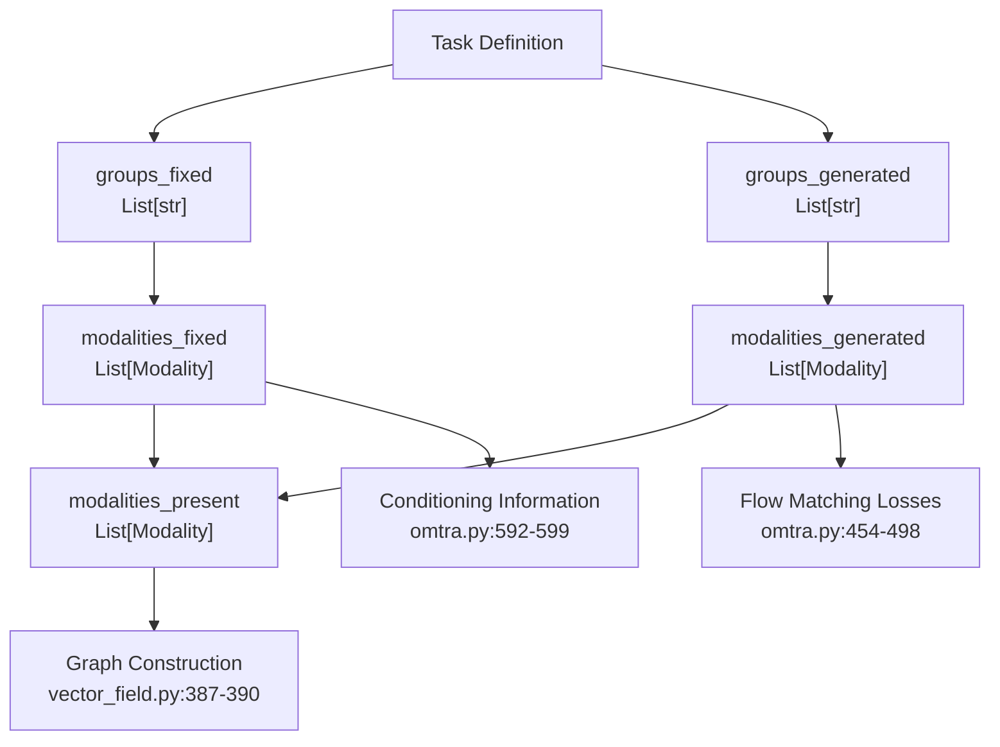
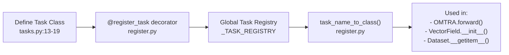
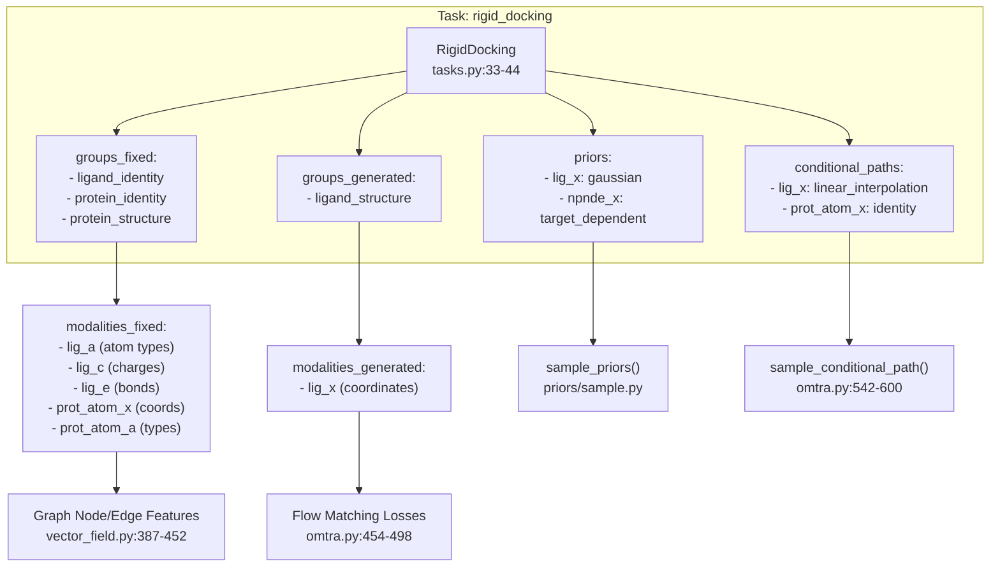
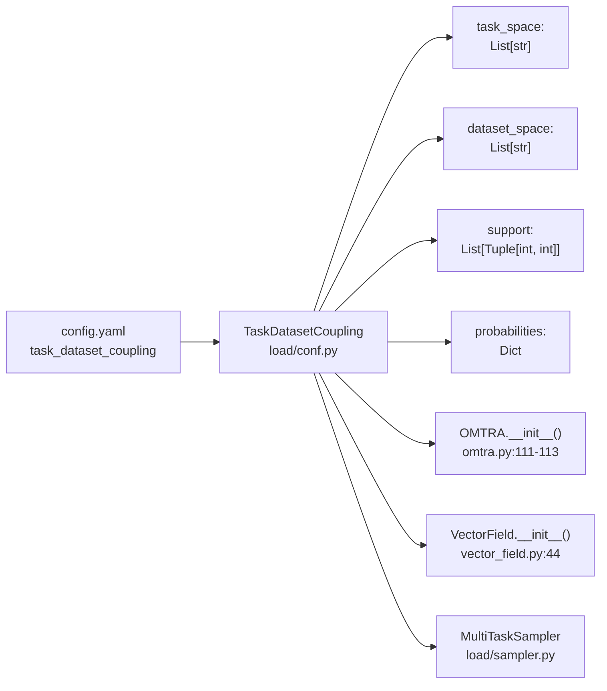
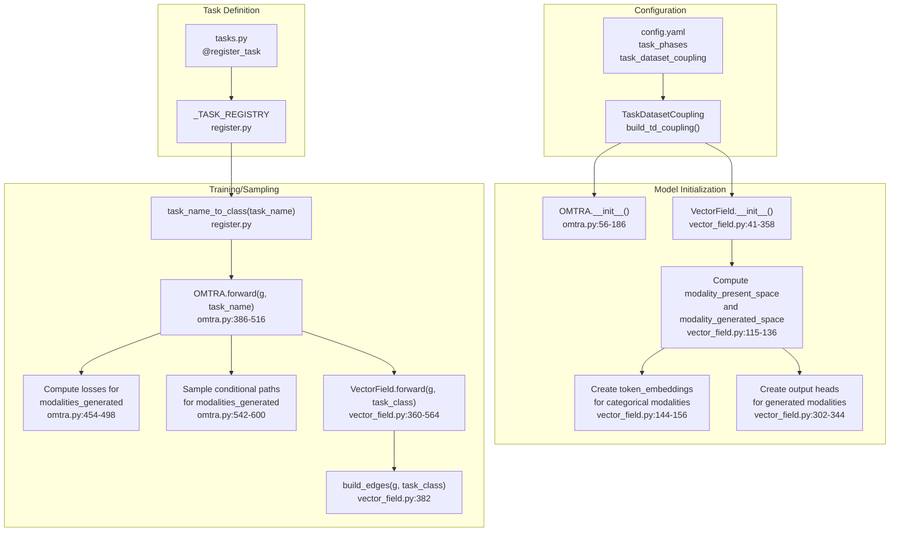

# Tasks and Modalities

<details>
<summary>Relevant source files</summary>

The following files were used as context for generating this wiki page:

- [omtra/dataset/pharmit.py](omtra/dataset/pharmit.py)
- [omtra/dataset/plinder.py](omtra/dataset/plinder.py)
- [omtra/models/omtra.py](omtra/models/omtra.py)
- [omtra/models/self_conditioning.py](omtra/models/self_conditioning.py)
- [omtra/models/vector_field.py](omtra/models/vector_field.py)
- [omtra/tasks/tasks.py](omtra/tasks/tasks.py)

</details>


## Purpose and Scope

This page explains the **task and modality system** that defines what OMTRA can generate and how it operates. Tasks specify which molecular features (modalities) are provided as conditioning information versus which are generated by the model. This system enables OMTRA to perform diverse molecular generation problems—from unconditional ligand generation to protein-ligand docking—using a single unified architecture.

For information about how tasks are used during training, see [Multi-Task Learning](#7.3). For details on how priors are configured per-task, see [Prior Distributions](#8.2).

---

## Core Concepts

### Tasks

A **Task** defines a specific molecular generation problem by specifying:
1. Which **modality groups** are fixed (provided as input)
2. Which **modality groups** are generated (predicted by the model)
3. The **prior distributions** to use for sampling initial states
4. The **conditional path functions** for interpolating between initial and target states

All tasks inherit from a base `Task` class and are registered using the `@register_task` decorator [omtra/tasks/tasks.py:1-226]().

**Task Class Structure:**

| Attribute | Type | Description |
|-----------|------|-------------|
| `groups_fixed` | `List[str]` | Modality groups provided as conditioning |
| `groups_generated` | `List[str]` | Modality groups predicted by the model |
| `priors` | `Dict` | Prior distribution configurations |
| `conditional_paths` | `Dict` | Conditional path function configurations |

**Sources:** [omtra/tasks/tasks.py:1-226](), [omtra/models/omtra.py:27-29]()

---

### Modality Groups

**Modality groups** are high-level organizational units that aggregate related molecular features. OMTRA uses five primary modality groups:

| Group Name | Description | Component Modalities |
|------------|-------------|---------------------|
| `ligand_identity` | Ligand atom types, charges, bonds | `lig_a`, `lig_c`, `lig_e` |
| `ligand_identity_condensed` | Condensed ligand atom representation | `lig_cond_a`, `lig_e_condensed` |
| `ligand_structure` | Ligand 3D coordinates | `lig_x` |
| `protein_identity` | Protein sequence and atom types | `prot_atom_a`, `prot_res_a` |
| `protein_structure` | Protein 3D coordinates | `prot_atom_x`, `prot_res_x` |
| `pharmacophore` | Pharmacophore positions, types, vectors | `pharm_x`, `pharm_a`, `pharm_v` |

Each task specifies which groups appear in `groups_fixed`, `groups_generated`, or both (combined in `groups_present`).

**Sources:** [omtra/tasks/tasks.py:14-225](), [omtra/dataset/plinder.py:683-684](), [omtra/models/vector_field.py:115-136]()

---

### Modalities

**Modalities** are the specific molecular features that the model operates on. Each modality has:

- **`name`**: Unique identifier (e.g., `"lig_x"`, `"lig_a"`)
- **`entity_name`**: Graph node/edge type (e.g., `"lig"`, `"prot_atom"`, `"lig_to_lig"`)
- **`data_key`**: Feature type identifier (e.g., `"x"` for positions, `"a"` for atom types)
- **`graph_entity`**: Whether it's a node or edge feature
- **`is_categorical`**: Boolean indicating discrete vs continuous features
- **`n_categories`**: Number of categories for categorical features (None for continuous)

**Common Modality Data Keys:**

| Data Key | Type | Description | Example Modality |
|----------|------|-------------|-----------------|
| `x` | Continuous | 3D coordinates | `lig_x`, `prot_atom_x` |
| `a` | Categorical | Atom/residue types | `lig_a`, `prot_atom_a` |
| `c` | Categorical | Formal charges | `lig_c` |
| `e` | Categorical | Bond orders | `lig_e` |
| `v` | Continuous | Direction vectors | `pharm_v` |
| `cond_a` | Categorical | Condensed atom types | `lig_cond_a` |

During training and inference, modalities are referenced using their names and accessed via the `name_to_modality()` function [omtra/models/omtra.py:29]().

**Sources:** [omtra/models/omtra.py:29](), [omtra/models/vector_field.py:18-21](), [omtra/models/omtra.py:236-240]()

---

### Fixed vs Generated Modalities

Tasks define which modalities are **fixed** (conditioning) versus **generated** (predicted):

- **Fixed modalities** (`modalities_fixed`): Provided as input, held constant during generation
- **Generated modalities** (`modalities_generated`): Predicted by the model during the forward pass
- **Present modalities** (`modalities_present`): Union of fixed and generated

The model computes flow matching losses only for generated modalities [omtra/models/omtra.py:454-498]().



**Example: Rigid Docking Task**

For the `RigidDocking` task:
- **Fixed**: `ligand_identity`, `protein_identity`, `protein_structure`
- **Generated**: `ligand_structure`

This means the protein is held fixed while the ligand position is optimized.

**Sources:** [omtra/tasks/tasks.py:33-44](), [omtra/models/omtra.py:236-240](), [omtra/models/omtra.py:454-498]()

---

## Task Registration System

Tasks are registered using a decorator-based system that maps task names to task classes.

**Registration Process:**



**Registration Example:**

```python
@register_task("denovo_ligand")
class DeNovoLigand(Task):
    groups_fixed = []
    groups_generated = ['ligand_identity', 'ligand_structure']
    priors = pc.denovo_ligand
    conditional_paths = cpc.denovo_ligand
```

The `task_name_to_class()` function retrieves task classes by name [omtra/models/omtra.py:28](), [omtra/models/vector_field.py:16]().

**Sources:** [omtra/tasks/tasks.py:13-19](), [omtra/models/omtra.py:28](), [omtra/models/vector_field.py:116]()

---

## Task Examples

### Ligand-Only Tasks

These tasks operate on ligands without protein context:

| Task Name | Fixed Groups | Generated Groups | Use Case |
|-----------|--------------|------------------|----------|
| `denovo_ligand` | None | `ligand_identity`, `ligand_structure` | Unconditional ligand generation |
| `ligand_conformer` | `ligand_identity` | `ligand_structure` | Conformer generation for known molecules |

**De Novo Ligand Task:**

[omtra/tasks/tasks.py:13-19]()

```python
@register_task("denovo_ligand")
class DeNovoLigand(Task):
    groups_fixed = []
    groups_generated = ['ligand_identity', 'ligand_structure']
    priors = pc.denovo_ligand
    conditional_paths = cpc.denovo_ligand
```

**Sources:** [omtra/tasks/tasks.py:13-28]()

---

### Protein-Ligand Tasks

These tasks involve both protein and ligand:

| Task Name | Fixed Groups | Generated Groups | Use Case |
|-----------|--------------|------------------|----------|
| `rigid_docking` | `ligand_identity`, `protein_identity`, `protein_structure` | `ligand_structure` | Dock ligand into fixed protein |
| `flexible_docking` | `ligand_identity`, `protein_identity` | `ligand_structure`, `protein_structure` | Flexible protein-ligand docking |
| `fixed_protein_ligand_denovo` | `protein_identity`, `protein_structure` | `ligand_identity`, `ligand_structure` | Generate ligand for pocket |
| `protein_ligand_denovo` | `protein_identity` | `protein_structure`, `ligand_identity`, `ligand_structure` | Joint protein-ligand generation |

**Rigid Docking Task:**

[omtra/tasks/tasks.py:33-44]()

```python
@register_task("rigid_docking")
class RigidDocking(Task):
    groups_fixed = ["ligand_identity", "protein_identity", "protein_structure"]
    groups_generated = ["ligand_structure"]
    priors = deepcopy(pc.ligand_conformer)
    priors["npnde_x"] = {"type": "target_dependent_gaussian"}
    conditional_paths = dict(**cpc.ligand_conformer, **cpc.protein)
```

**Sources:** [omtra/tasks/tasks.py:33-84]()

---

### Apo-Conditioned Tasks

These tasks use apo (unbound) protein structures as priors:

| Task Name | Fixed Groups | Generated Groups | Prior Type |
|-----------|--------------|------------------|------------|
| `exp_apo_conditioned_denovo_ligand` | `protein_identity` | `ligand_identity`, `ligand_structure`, `protein_structure` | `apo_exp` |
| `pred_apo_conditioned_denovo_ligand` | `protein_identity` | `ligand_identity`, `ligand_structure`, `protein_structure` | `apo_pred` |

The distinction between `apo_exp` (experimental) and `apo_pred` (predicted) determines the source of the apo structure used as the prior [omtra/tasks/tasks.py:86-112]().

**Sources:** [omtra/tasks/tasks.py:86-143]()

---

### Pharmacophore Tasks

These tasks include pharmacophore constraints:

| Task Name | Fixed Groups | Generated Groups | Use Case |
|-----------|--------------|------------------|----------|
| `denovo_ligand_pharmacophore` | None | `ligand_identity`, `ligand_structure`, `pharmacophore` | Generate ligand and pharmacophore |
| `denovo_ligand_from_pharmacophore` | `pharmacophore` | `ligand_identity`, `ligand_structure` | Generate ligand from pharmacophore |
| `protein_ligand_pharmacophore_denovo` | `protein_identity` | `protein_structure`, `ligand_identity`, `ligand_structure`, `pharmacophore` | Full system generation |

**Sources:** [omtra/tasks/tasks.py:145-183]()

---

## Task Configuration Visualization

The following diagram shows how tasks define the generation problem through their configuration:



**Sources:** [omtra/tasks/tasks.py:33-44](), [omtra/models/omtra.py:236-240](), [omtra/models/omtra.py:542-600]()

---

## How Tasks Configure the Model

Tasks control multiple aspects of model behavior:

### 1. Loss Computation

Only generated modalities contribute to the loss [omtra/models/omtra.py:454-498]():

```python
# Get all modalities generated by the model
modalities_generated = task_class.modalities_generated

# Compute losses only for generated modalities
losses = {}
for modality in modalities_generated:
    inp = vf_output[modality.name]
    target = targets[modality.name]
    losses[modality.name] = self.loss_fn_dict[modality.name](inp, target)
```

### 2. Graph Construction

Tasks determine which edges are built in the heterogeneous graph [omtra/models/vector_field.py:382]():

```python
# Build edges appropriate for this task
g = build_edges(g, task_class, node_batch_idx, self.graph_config)
```

### 3. Feature Embedding

The VectorField creates embeddings for all modalities present in any task [omtra/models/vector_field.py:115-157]():

```python
# Get the set of all modalities that will be present
modality_present_space = set()
for task_class in task_classes:
    for m in task_class.modalities_fixed:
        modality_present_space.add(m.name)
    for m in task_class.modalities_generated:
        modality_present_space.add(m.name)

# Create token embeddings for categorical features
for m in modalities_present_cls:
    if not m.is_categorical:
        continue
    self.token_embeddings[m.name] = nn.Embedding(
        m.n_categories + int(is_generated), token_dim
    )
```

### 4. Conditional Path Sampling

Tasks specify how to interpolate between initial (x_0) and target (x_1) states [omtra/models/omtra.py:542-600]():

```python
# Get conditional path functions for this task
conditonal_path_fns = get_conditional_path_fns(
    task_class, self.conditional_path_config
)
for modality_name in conditonal_path_fns:
    conditional_path_fn = conditonal_path_fns[modality_name]
    # Apply interpolation: x_t = α_t·x_0 + β_t·x_1
    data_src[entity_name].data[f"{dk}_t"] = conditional_path_fn(
        source, target, alpha_t_modality, beta_t_modality
    )
```

**Sources:** [omtra/models/omtra.py:236-240](), [omtra/models/omtra.py:454-516](), [omtra/models/vector_field.py:115-157](), [omtra/models/vector_field.py:382]()

---

## Task-Dataset Coupling

Tasks are coupled with datasets through the `TaskDatasetCoupling` system, which controls:
- Which tasks are trained on which datasets
- Sampling probabilities for each task-dataset pair
- Phase-based scheduling of task distributions

The coupling is configured in `configs/config.yaml` and built using `build_td_coupling()` [omtra/models/omtra.py:111-113]().

**Coupling Structure:**



For detailed information on how task-dataset coupling works during training, see [Multi-Task Learning](#7.3).

**Sources:** [omtra/models/omtra.py:111-113](), [omtra/models/vector_field.py:44](), [omtra/models/vector_field.py:88]()

---

## Complete Task-Modality Flow

This diagram shows how tasks flow through the entire system from definition to model execution:



**Sources:** [omtra/tasks/tasks.py:1-226](), [omtra/models/omtra.py:56-186](), [omtra/models/omtra.py:386-516](), [omtra/models/vector_field.py:41-358](), [omtra/models/vector_field.py:360-564]()

---

## Summary

The task and modality system provides a flexible, declarative way to specify diverse molecular generation problems:

- **Tasks** define the generation problem through `groups_fixed` and `groups_generated`
- **Modality groups** organize related features (identity vs structure, ligand vs protein)
- **Modalities** are the specific features the model operates on (positions, atom types, etc.)
- **Task registration** enables runtime lookup and configuration
- **Task-dataset coupling** controls multi-task training distributions

This design allows a single OMTRA model to handle multiple generation tasks—from unconditional ligand sampling to protein-ligand docking—by simply changing which modalities are fixed versus generated.

**Sources:** [omtra/tasks/tasks.py:1-226](), [omtra/models/omtra.py:56-186](), [omtra/models/vector_field.py:41-358]()

---