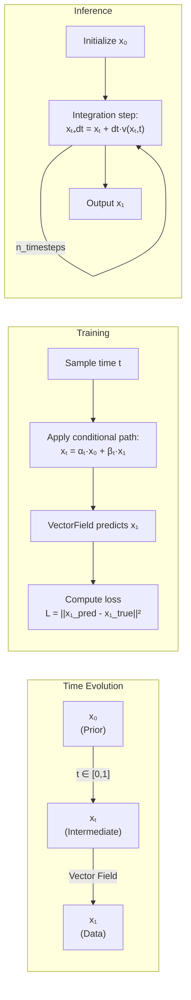
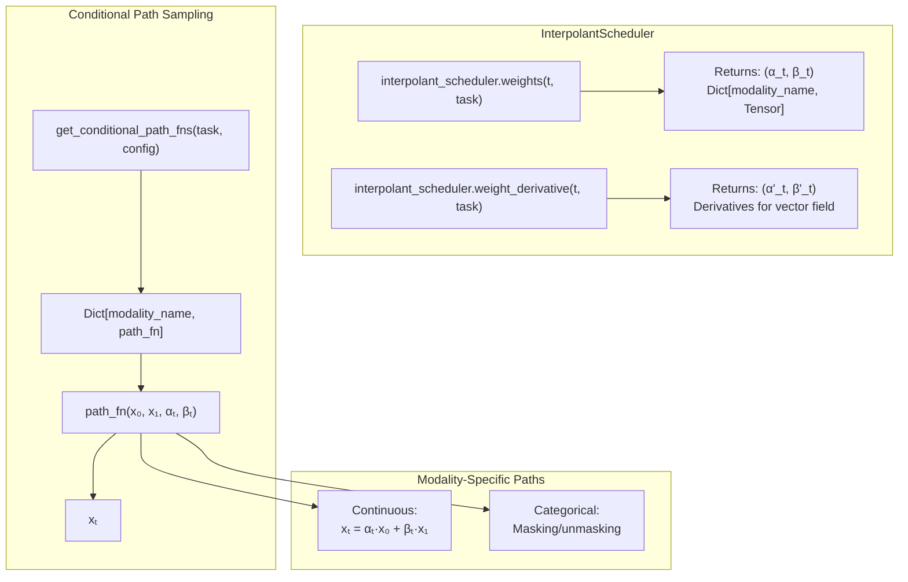
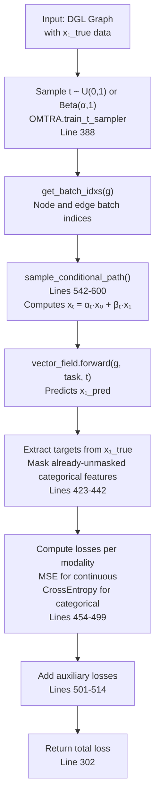
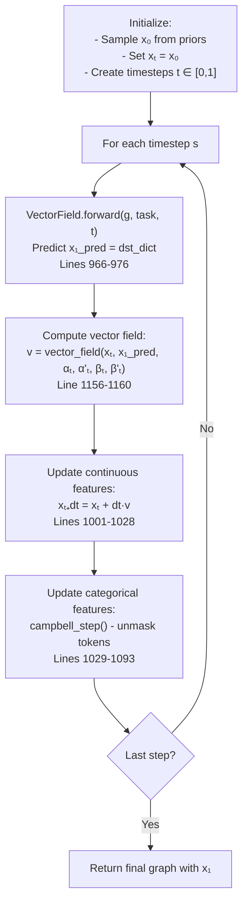
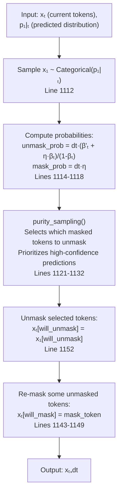
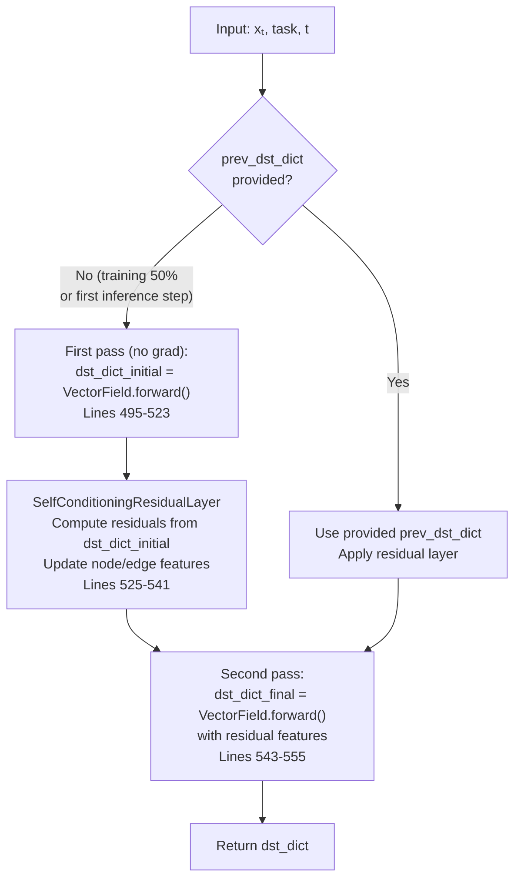

# Flow Matching for Molecules

<details>
<summary>Relevant source files</summary>

The following files were used as context for generating this wiki page:

- [omtra/models/omtra.py](omtra/models/omtra.py)
- [omtra/models/self_conditioning.py](omtra/models/self_conditioning.py)
- [omtra/models/vector_field.py](omtra/models/vector_field.py)

</details>


This page explains the core generative mechanism used by OMTRA: **flow matching**. Flow matching is a continuous-time generative modeling approach that learns to transform samples from a simple prior distribution into complex molecular structures by predicting trajectory destinations.

**Scope**: This document covers the mathematical formulation of flow matching, conditional path sampling, the training objective, and the integration-based sampling procedure. For information about the neural network architecture that implements the trajectory prediction, see [VectorField Architecture](#4.2). For details on prior distributions, see [Prior Distributions](#8.2).

---

## Overview of Flow Matching

Flow matching is a generative modeling framework that learns a time-dependent vector field to transport samples from a prior distribution (at time t=0) to a data distribution (at time t=1). Unlike diffusion models that add noise and then denoise, flow matching directly learns the optimal transport path between distributions.

### Key Concepts

| Concept | Description | Code Reference |
|---------|-------------|----------------|
| **Time** | Continuous variable t ∈ [0, 1] representing progress along trajectory | `t` in [`omtra/models/omtra.py:388`]() |
| **Prior (x₀)** | Initial state sampled from simple distribution | `{data_key}_0` in graph node/edge data |
| **Data (x₁)** | Target state from training data | `{data_key}_1_true` in graph node/edge data |
| **Path (xₜ)** | Intermediate state at time t | `{data_key}_t` in graph node/edge data |
| **Vector Field** | Neural network predicting trajectory destination | `VectorField` class in [`omtra/models/vector_field.py:40-1248`]() |
| **Conditional Path** | Function defining how to interpolate between x₀ and x₁ | Functions in `conditional_paths/` |

**Diagram: Flow Matching Concept**



**Sources**: [`omtra/models/omtra.py:386-516`](), [`omtra/models/vector_field.py:778-932`]()

---

## Conditional Paths and Interpolants

A **conditional path** defines how to interpolate between the prior x₀ and data x₁ as a function of time t. The path is parameterized by two weight functions:
- **αₜ**: Weight on the prior distribution
- **βₜ**: Weight on the data distribution

The interpolated state is: **xₜ = αₜ·x₀ + βₜ·x₁**

### Interpolant Scheduler

The `InterpolantScheduler` controls the time-dependent weights αₜ and βₜ. OMTRA uses a linear schedule by default:

```
αₜ = 1 - t
βₜ = t
```

This creates a straight-line path from x₀ to x₁.

**Diagram: Conditional Path Components**



**Sources**: [`omtra/models/omtra.py:542-600`](), [`omtra/models/interpolant_scheduler.py`]() (referenced but not provided)

### Path Functions for Different Modalities

Different molecular modalities use different conditional path functions:

| Modality Type | Path Function | Description |
|---------------|---------------|-------------|
| **Continuous** (positions, vectors) | Linear interpolation | xₜ = (1-t)·x₀ + t·x₁ |
| **Categorical** (atom types, charges) | CTMC masking | Tokens gradually unmasked as t → 1 |
| **Bond orders** | CTMC masking | Edge features unmasked over time |

**Code Reference**: The method `sample_conditional_path()` in [`omtra/models/omtra.py:542-600`]() applies conditional paths to all modalities being generated.

**Sources**: [`omtra/models/omtra.py:542-600`](), [`omtra/models/conditional_paths/path_factory.py`]() (referenced at line 31)

---

## Training with Flow Matching

During training, OMTRA learns to predict the trajectory destination x₁ given an intermediate state xₜ at time t.

### Training Step Overview

**Diagram: Training Forward Pass**



**Sources**: [`omtra/models/omtra.py:386-516`]()

### Loss Computation

The flow matching loss for each modality measures how well the model predicts the destination:

**Continuous Features** (positions, vectors):
```
L_continuous = MSE(x₁_pred, x₁_true)
```

**Categorical Features** (atom types, charges, bond orders):
```
L_categorical = CrossEntropy(logits_pred, x₁_true)
```

**Time-Scaled Loss** (optional):

When `time_scaled_loss=True`, losses are weighted by `1/(1-t)²` to emphasize learning near the endpoint:

```python
t_weights = 1.0 / ((1.0 - t).clamp(min=1e-6)) ** 2
t_weights = torch.clamp(t_weights, max=100.0)
loss = loss * t_weights
```

**Masking for Categorical Features**:

For categorical modalities, targets are set to `ignore_index=-100` when the feature is already unmasked in xₜ. This ensures the model only receives loss for features that are still masked:

```python
# Line 437-441 in omtra.py
target[xt_idxs != mask_token] = -100
```

**Sources**: [`omtra/models/omtra.py:226-267`]() (loss function configuration), [`omtra/models/omtra.py:423-514`]() (loss computation)

---

## Sampling via Trajectory Integration

At inference time, OMTRA generates molecules by integrating the learned vector field from t=0 to t=1.

### Integration Process

**Diagram: Sampling Integration Loop**



**Sources**: [`omtra/models/vector_field.py:778-932`]() (integrate method), [`omtra/models/vector_field.py:934-1094`]() (step method)

### Vector Field Computation

The vector field for continuous features is computed as:

```python
def vector_field(self, x_t, x_1, alpha_t, alpha_t_prime, beta_t, beta_t_prime):
    term_1 = alpha_t_prime/alpha_t * x_t
    term_2 = (alpha_t*beta_t_prime - beta_t*alpha_t_prime)/alpha_t * x_1
    vf = term_1 + term_2
    return vf
```

This formula ensures that following the vector field moves xₜ along the conditional path toward x₁.

**Sources**: [`omtra/models/vector_field.py:1156-1160`]()

### Time Spacing

The integration supports different time spacing strategies:

| Strategy | Description | Code |
|----------|-------------|------|
| `"even"` | Uniform spacing: `linspace(0, 1, n_timesteps)` | Line 800 |
| `"uneven"` | Log-dense near t=1 for final refinement | Lines 802-804 |

**Sources**: [`omtra/models/vector_field.py:798-806`]()

---

## Continuous vs Categorical Modalities

Flow matching handles continuous and categorical molecular features differently during both training and sampling.

### Continuous Features

**Examples**: Positions (`lig_x`, `pharm_x`), velocity vectors (`pharm_v`)

**Training**: Direct regression to target
```python
loss = MSE(x_1_pred, x_1_true)
```

**Sampling**: Euler integration step
```python
x_t_next = x_t + dt * vector_field(x_t, x_1_pred, alpha_t, alpha_t_prime, beta_t, beta_t_prime)
```

**Sources**: [`omtra/models/omtra.py:492`]() (training), [`omtra/models/vector_field.py:1001-1028`]() (sampling)

### Categorical Features

**Examples**: Atom types (`lig_a`), charges (`lig_c`), bond orders (`lig_e`)

**Conditional Path**: Continuous-time Markov Chain (CTMC) with masking
- At t=0: All tokens are masked
- As t increases: Tokens progressively unmask
- At t=1: All tokens revealed

**Training**: Cross-entropy loss only on masked tokens
```python
# Ignore already-unmasked tokens
target[xt != mask_token] = -100
loss = CrossEntropy(logits_pred, target, ignore_index=-100)
```

**Sampling**: Campbell discrete-time step
1. Predict probability distribution over token classes
2. Sample which tokens to unmask (using purity sampling)
3. Sample which tokens to re-mask (stochastic component)
4. Assign sampled values to unmasked tokens

**Diagram: Categorical Feature Update (Campbell Step)**



**Sources**: [`omtra/models/vector_field.py:1096-1154`]() (campbell_step method), [`omtra/utils/ctmc.py`]() (purity_sampling, referenced at line 1121)

### Purity Sampling

For categorical features, **purity sampling** is used to decide which masked tokens to unmask. Instead of randomly selecting tokens, it prioritizes unmasking tokens where the model has high confidence:

```python
will_unmask = purity_sampling(
    g, m, xt, x1_probs, unmask_prob, mask_index,
    batch_size, batch_num_nodes, device, upper_edge_mask
)
```

This encourages the model to first generate high-confidence features (e.g., core scaffold atoms) before committing to uncertain features (e.g., peripheral functional groups).

**Sources**: [`omtra/models/vector_field.py:1121-1132`](), [`omtra/utils/ctmc.py`]() (implementation)

---

## Self-Conditioning (Optional)

When `self_conditioning=True`, OMTRA uses an iterative refinement strategy during the forward pass:

1. **First pass**: Make an initial prediction with no previous information
2. **Compute residuals**: Encode the difference between current state and first prediction
3. **Second pass**: Make a refined prediction incorporating the residual information

**Diagram: Self-Conditioning Flow**



**Sources**: [`omtra/models/vector_field.py:489-541`](), [`omtra/models/self_conditioning.py:18-229`]()

---

## Stochastic Sampling (Optional)

By default, OMTRA uses deterministic (ODE) integration. With `stochastic_sampling=True`, it adds controlled noise during integration, converting the ODE to an SDE:

```python
g_t = 1 / (t_i + eps) if t_i < 0.90 else 0.0
score = (t_i * vf - x_t) / (1 - t_i)
noise = torch.randn_like(x_t)

x_t_next = x_t + (vf + g_t*score)*dt + sqrt(2*dt*g_s*noise_scaler)*noise
```

This can improve sample diversity at the cost of some determinism.

**Sources**: [`omtra/models/vector_field.py:1016-1022`]()

---

## Code Entity Reference

### Key Classes and Methods

| Entity | File | Purpose |
|--------|------|---------|
| `OMTRA.forward()` | [`omtra/models/omtra.py:386-516`]() | Training step: sample path, predict, compute losses |
| `OMTRA.sample()` | [`omtra/models/omtra.py:602-940`]() | Inference: initialize priors, integrate trajectory |
| `OMTRA.sample_conditional_path()` | [`omtra/models/omtra.py:542-600`]() | Apply conditional paths to get xₜ from x₀ and x₁ |
| `VectorField.integrate()` | [`omtra/models/vector_field.py:778-932`]() | Main integration loop over timesteps |
| `VectorField.step()` | [`omtra/models/vector_field.py:934-1094`]() | Single integration step: predict and update |
| `VectorField.vector_field()` | [`omtra/models/vector_field.py:1156-1160`]() | Compute vector field for continuous features |
| `VectorField.campbell_step()` | [`omtra/models/vector_field.py:1096-1154`]() | Discrete update for categorical features |
| `InterpolantScheduler` | Referenced in imports | Computes αₜ, βₜ and their derivatives |
| `get_conditional_path_fns()` | [`omtra/models/conditional_paths/path_factory.py`]() | Returns path functions per modality |
| `SelfConditioningResidualLayer` | [`omtra/models/self_conditioning.py:18-229`]() | Computes residual features for iterative refinement |

**Sources**: Various files as cited in table

---

## Summary

Flow matching in OMTRA works by:

1. **Training**: Sample random times t, apply conditional paths to create xₜ, predict x₁, minimize prediction error
2. **Sampling**: Initialize from priors, integrate the learned vector field from t=0 to t=1
3. **Continuous features**: Use direct regression and Euler integration
4. **Categorical features**: Use masked token modeling with purity-based unmasking
5. **Optional enhancements**: Self-conditioning for iterative refinement, stochastic sampling for diversity

This approach enables OMTRA to generate diverse, high-quality molecular structures across multiple tasks with a single unified model.

---