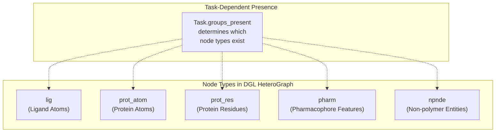
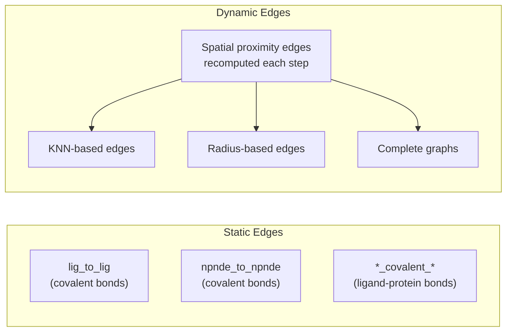
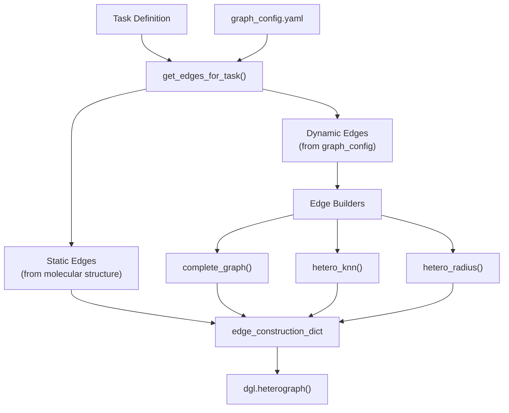
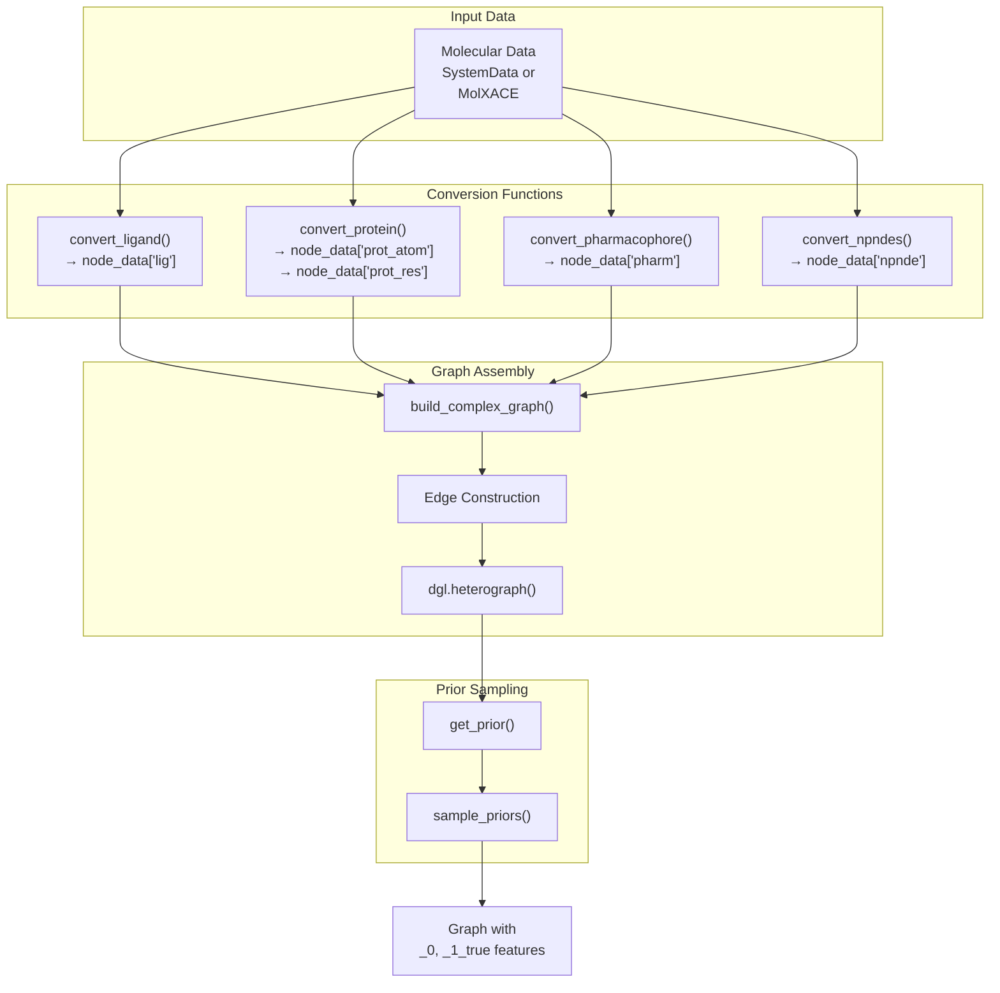
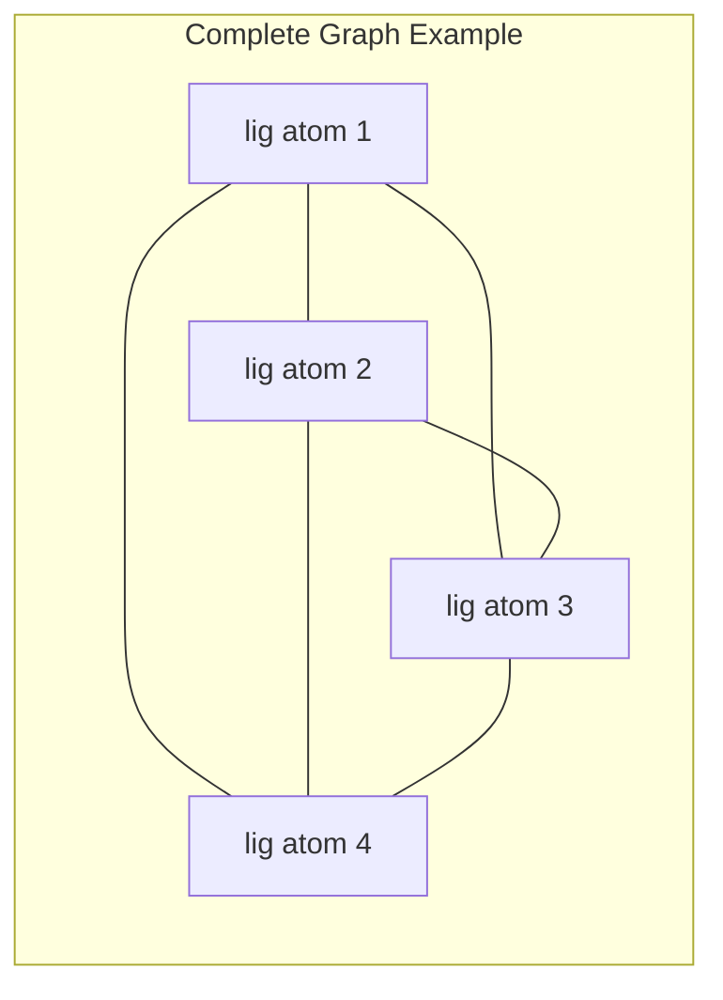
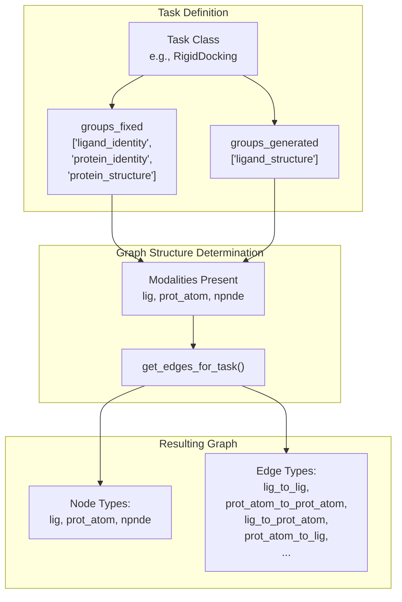
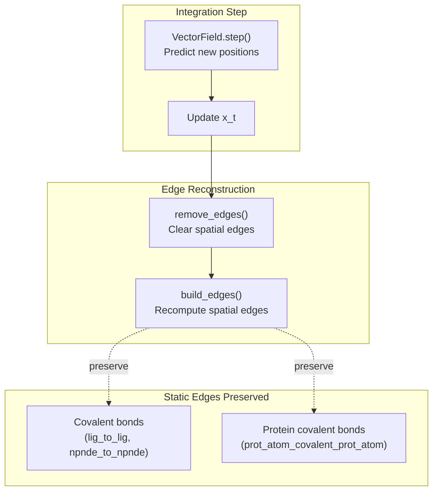

# Graph Representation

<details>
<summary>Relevant source files</summary>

The following files were used as context for generating this wiki page:

- [configs/graph/default.yaml](configs/graph/default.yaml)
- [omtra/data/graph/__init__.py](omtra/data/graph/__init__.py)
- [omtra/data/graph/edge_builders.py](omtra/data/graph/edge_builders.py)
- [omtra/data/graph/edge_factory.py](omtra/data/graph/edge_factory.py)
- [omtra/data/graph/register.py](omtra/data/graph/register.py)
- [omtra/dataset/pharmit.py](omtra/dataset/pharmit.py)
- [omtra/dataset/plinder.py](omtra/dataset/plinder.py)
- [omtra/priors/prior_factory.py](omtra/priors/prior_factory.py)
- [omtra/priors/priors.py](omtra/priors/priors.py)
- [omtra/priors/sample.py](omtra/priors/sample.py)
- [omtra/tasks/tasks.py](omtra/tasks/tasks.py)
- [omtra/tasks/utils.py](omtra/tasks/utils.py)

</details>


This page describes how molecular systems are represented as heterogeneous graphs in OMTRA. Molecular graphs serve as the fundamental data structure that flows through the entire pipeline—from dataset loading to model training and inference.

For information about how raw molecular data is converted into graphs, see [Graph Construction](#5.5). For details on how these graphs are used in the model architecture, see [VectorField Architecture](#4.2).

---

## Overview

OMTRA represents molecular systems as **heterogeneous graphs** using the DGL (Deep Graph Library) framework. Unlike homogeneous graphs where all nodes and edges are of the same type, heterogeneous graphs can contain multiple node types (ligands, proteins, pharmacophores) and multiple edge types (covalent bonds, spatial proximity, interactions).

The graph representation enables:
- **Multi-modal learning**: Different molecular entities coexist in the same graph
- **Task flexibility**: Graph structure adapts based on what the model generates vs. what is fixed
- **Efficient message passing**: GNN layers operate on the heterogeneous structure
- **Dynamic edges**: Spatial edges are recomputed during generation as molecule positions change

**Sources:** [omtra/data/graph/__init__.py:1-156]()

---

## Node Types

OMTRA defines five fundamental node types that represent different molecular entities:

| Node Type | Code Symbol | Represents | Example Usage |
|-----------|-------------|------------|---------------|
| **Ligand** | `lig` | Small molecule atoms | Drug candidate being generated or docked |
| **Protein Atom** | `prot_atom` | Individual protein atoms | Binding pocket atoms in docking |
| **Protein Residue** | `prot_res` | Amino acid residues (backbone only) | Coarse-grained protein representation |
| **Pharmacophore** | `pharm` | Interaction features | Desired binding interactions |
| **Non-polymer Entity** | `npnde` | Cofactors, ions, small molecules | ATP, metal ions, covalent ligands |

### Node Type Schema



Not all node types are present in every graph. The task determines which entities are included:

```python
# Example from denovo_ligand task
groups_fixed = []
groups_generated = ['ligand_identity', 'ligand_structure']
# Graph will only have 'lig' nodes

# Example from rigid_docking task
groups_fixed = ['ligand_identity', 'protein_identity', 'protein_structure']
groups_generated = ['ligand_structure']
# Graph will have 'lig', 'prot_atom', and potentially 'npnde' nodes
```

**Sources:** [omtra/data/graph/__init__.py:13-14](), [omtra/tasks/tasks.py:1-226]()

---

## Edge Types

Edges represent relationships between nodes. OMTRA uses both **static edges** (predetermined from molecular structure) and **dynamic edges** (computed based on spatial proximity).

### Edge Type Categories



### Key Edge Types

**Intra-entity Edges:**
- `lig_to_lig`: Ligand atom covalent bonds (complete graph)
- `prot_atom_to_prot_atom`: Protein atom spatial proximity (radius graph)
- `prot_res_to_prot_res`: Not currently used
- `pharm_to_pharm`: Pharmacophore interactions (complete graph)
- `npnde_to_npnde`: Non-polymer entity bonds (k-hop graph)

**Inter-entity Edges:**
- `lig_to_prot_atom`: Ligand to protein (KNN from ligand perspective)
- `prot_atom_to_lig`: Protein to ligand (radius from protein perspective)
- `lig_to_pharm`: Ligand to pharmacophore (KNN)
- `pharm_to_prot_atom`: Pharmacophore to protein (KNN)
- `lig_to_npnde`: Ligand to non-polymer entities (KNN)

**Covalent Edges:**
- `prot_atom_covalent_lig`: Covalent ligand-protein bonds
- `lig_covalent_prot_atom`: Reverse direction
- `prot_atom_covalent_npnde`: Covalent protein-npnde bonds
- Similar reverse edges

### Edge Type Construction



**Sources:** [omtra/data/graph/__init__.py:16-37](), [omtra/data/graph/__init__.py:45-72](), [configs/graph/default.yaml:1-80]()

---

## Graph Features

Each node and edge stores features as tensors in the DGL graph. Features are stored with specific naming conventions:

### Feature Naming Convention

- `{key}_0`: Prior/initial state at time t=0
- `{key}_t`: Current state at time t
- `{key}_1_true`: Target/ground truth at time t=1

### Node Features by Type

**Ligand (`lig`) nodes:**
```python
{
    'x_1_true': torch.Tensor,  # Positions (N, 3)
    'a_1_true': torch.Tensor,  # Atom types (N,)
    'c_1_true': torch.Tensor,  # Charges (N,)
    # Or alternatively:
    'cond_a_1_true': torch.Tensor,  # Condensed atom typing (N,)
    # Optional extra features:
    'impl_H_1_true': torch.Tensor,  # Implicit hydrogens
    'aro_1_true': torch.Tensor,     # Aromaticity
    'hyb_1_true': torch.Tensor,     # Hybridization
    'ring_1_true': torch.Tensor,    # Ring membership
    'chiral_1_true': torch.Tensor   # Chirality
}
```

**Protein Atom (`prot_atom`) nodes:**
```python
{
    'x_1_true': torch.Tensor,         # Positions (N, 3)
    'a_1_true': torch.Tensor,         # Atom names (N,)
    'e_1_true': torch.Tensor,         # Element types (N,)
    'res_id': torch.Tensor,           # Residue IDs (N,)
    'res_names': torch.Tensor,        # Residue names (N,)
    'res_names_1_true': torch.Tensor, # Residue names for generation
    'chain_id': torch.Tensor,         # Chain IDs (N,)
    'backbone_mask': torch.Tensor     # Is backbone atom (N,)
}
```

**Protein Residue (`prot_res`) nodes:**
```python
{
    'x_1_true': torch.Tensor,   # Backbone positions (N, 3)
    'res_id': torch.Tensor,     # Residue IDs (N,)
    'a_1_true': torch.Tensor,   # Residue types (N,)
    'chain_id': torch.Tensor    # Chain IDs (N,)
}
```

**Pharmacophore (`pharm`) nodes:**
```python
{
    'x_1_true': torch.Tensor,   # Positions (N, 3)
    'a_1_true': torch.Tensor,   # Pharmacophore types (N,)
    'v_1_true': torch.Tensor,   # Direction vectors (N, 4, 3)
    'i_1_true': torch.Tensor    # Interaction flags (N,)
}
```

**Sources:** [omtra/dataset/plinder.py:692-736](), [omtra/dataset/pharmit.py:156-217]()

### Edge Features

**Ligand bonds (`lig_to_lig`):**
```python
{
    'e_1_true': torch.Tensor  # Bond orders (E,) - 0=none, 1=single, 2=double, 3=triple
}
```

**Non-polymer bonds (`npnde_to_npnde`):**
```python
{
    'e_1_true': torch.Tensor  # Bond orders (E,)
}
```

Most spatial edges (KNN, radius) do not store features; they are purely structural.

**Sources:** [omtra/dataset/plinder.py:713-717](), [omtra/dataset/pharmit.py:185-192]()

---

## Graph Construction Pipeline

### From Molecular Data to DGL Graph



### Step-by-Step Process

**1. Convert molecular entities to dictionaries:**
Each entity type is converted to three dictionaries:
- `node_data`: Dict[str, Dict[str, Tensor]] - Node features
- `edge_idxs`: Dict[str, Tensor] - Edge connectivity (2, E)
- `edge_data`: Dict[str, Dict[str, Tensor]] - Edge features

**2. Call `build_complex_graph()`:**
This function ([omtra/data/graph/__init__.py:74-156]()):
- Validates node and edge types
- Counts nodes per type
- Filters edges based on task
- Constructs the DGL heterograph
- Assigns node and edge features

**3. Sample priors:**
The `sample_priors()` function ([omtra/priors/sample.py:10-113]()):
- Iterates over modalities in `task.modalities_generated`
- Calls appropriate prior sampling function
- Stores results as `{key}_0` features

**Sources:** [omtra/data/graph/__init__.py:74-156](), [omtra/dataset/plinder.py:902-966](), [omtra/dataset/pharmit.py:74-231]()

---

## Edge Construction Strategies

OMTRA uses three main strategies for constructing edges between nodes. These are configured in `configs/graph/default.yaml` and implemented in edge builder functions.

### Complete Graph

All nodes of the same type are connected to each other (excluding self-loops).



**Used for:**
- `lig_to_lig`: All ligand atoms connected (covalent structure is subset)
- `pharm_to_pharm`: All pharmacophore features connected

**Implementation:** [omtra/data/graph/edge_builders.py:13-16]()
```python
@register_edge_builder("complete")
def complete_graph(src_pos, dst_pos, src_batch_idx, dst_batch_idx):
    edge_idxs = hetero_radius(src_pos, dst_pos, src_batch_idx, dst_batch_idx, r=float("Inf"))
    return edge_idxs
```

**Sources:** [omtra/data/graph/edge_builders.py:13-16](), [configs/graph/default.yaml:2-5]()

### K-Nearest Neighbors (KNN)

Each source node is connected to its k nearest destination nodes based on Euclidean distance.

```mermaid
graph LR
    subgraph "KNN Example k=3"
        L1["lig atom"]
        P1["prot atom 1<br/>(closest)"]
        P2["prot atom 2"]
        P3["prot atom 3"]
        P4["prot atom 4<br/>(far)"]
        
        L1 --> P1
        L1 --> P2
        L1 --> P3
        L1 -.x.- P4
    end
```

**Configuration example:**
```yaml
lig_to_prot_atom:
  type: knn
  params:
    k: 5
```

**Used for:**
- `lig_to_prot_atom`: Each ligand atom → 5 nearest protein atoms
- `lig_to_pharm`: Each ligand atom → 3 nearest pharmacophore features
- `pharm_to_prot_atom`: Each pharmacophore → 5 nearest protein atoms

**Implementation:** [omtra/data/graph/edge_builders.py:23-26]()
```python
@register_edge_builder("knn")
def hetero_knn(src_pos, dst_pos, src_batch_idx, dst_batch_idx, k):
    edge_idxs = tc.knn(x=dst_pos, y=src_pos, batch_x=dst_batch_idx, batch_y=src_batch_idx, k=k)
    return edge_idxs
```

**Sources:** [omtra/data/graph/edge_builders.py:23-26](), [configs/graph/default.yaml:11-33]()

### Radius Graph

Nodes are connected if they are within a certain distance threshold.

```mermaid
graph LR
    subgraph "Radius Example r=8.0"
        P1["prot atom"]
        L1["lig atom 1<br/>(dist=3.5)"]
        L2["lig atom 2<br/>(dist=7.2)"]
        L3["lig atom 3<br/>(dist=9.1)"]
        
        P1 --> L1
        P1 --> L2
        P1 -.x.- L3
    end
```

**Configuration example:**
```yaml
prot_atom_to_lig:
  type: radius
  params:
    r: 8
```

**Used for:**
- `prot_atom_to_lig`: Protein atoms within 8Å of ligand
- `prot_atom_to_prot_atom`: Protein atoms within 4.5Å (spatial proximity)
- `prot_atom_to_pharm`: Protein atoms within 8Å of pharmacophore

**Implementation:** [omtra/data/graph/edge_builders.py:18-21]()
```python
@register_edge_builder("radius")
def hetero_radius(src_pos, dst_pos, src_batch_idx, dst_batch_idx, r, max_num_neighbors=1000):
    edge_idxs = tc.radius(x=dst_pos, y=src_pos, batch_x=dst_batch_idx, batch_y=src_batch_idx, r=r, max_num_neighbors=max_num_neighbors)
    return edge_idxs
```

**Sources:** [omtra/data/graph/edge_builders.py:18-21](), [configs/graph/default.yaml:22-62]()

### Symmetric Edges

Some edge types are marked as symmetric, meaning both directions are created:

```yaml
symmetric_etypes:
  - lig_to_pharm      # Also creates pharm_to_lig
  - npnde_to_pharm    # Also creates pharm_to_npnde
  - lig_to_npnde      # Also creates npnde_to_lig
```

**Sources:** [configs/graph/default.yaml:73-78](), [omtra/data/graph/__init__.py:28-34]()

---

## Task-Dependent Graph Structure

The graph structure adapts based on the task being performed. Tasks define which entities are present and which are generated.

### Task-to-Graph Mapping



### Example: Different Tasks, Different Graphs

**De Novo Ligand Generation:**
```python
# omtra/tasks/tasks.py:13-19
groups_fixed = []
groups_generated = ['ligand_identity', 'ligand_structure']
# Graph contains: lig nodes only
# Edges: lig_to_lig only
```

**Rigid Docking:**
```python
# omtra/tasks/tasks.py:33-44
groups_fixed = ['ligand_identity', 'protein_identity', 'protein_structure']
groups_generated = ['ligand_structure']
# Graph contains: lig, prot_atom, potentially npnde
# Edges: lig_to_lig, prot_atom_to_prot_atom, lig_to_prot_atom, 
#        prot_atom_to_lig, covalent edges
```

**Protein-Ligand-Pharmacophore Co-generation:**
```python
# omtra/tasks/tasks.py:167-180
groups_fixed = ['protein_identity']
groups_generated = ['protein_structure', 'ligand_identity', 
                    'ligand_structure', 'pharmacophore']
# Graph contains: lig, prot_atom, pharm, npnde
# Edges: All applicable edge types between these entities
```

**Sources:** [omtra/tasks/tasks.py:1-226](), [omtra/data/graph/__init__.py:45-72]()

---

## Dynamic Edge Reconstruction

During generation, as molecular positions change, spatial edges must be recomputed. This happens at each integration step.

### Edge Update Process



The `build_edges()` function ([omtra/tasks/utils.py:16-63]()) is called after each position update:
1. Removes dynamic edges (KNN, radius)
2. Preserves static edges (covalent bonds)
3. Recomputes spatial edges based on new positions
4. Updates batch edge counts

**Key implementation details:**
- Predetermined edges (`lig_to_lig`, `npnde_to_npnde`) are never removed
- Covalent edges are never removed
- Edge builders use current `x_t` positions
- Batch indices are preserved for correct edge construction in batched graphs

**Sources:** [omtra/tasks/utils.py:16-63](), [omtra/tasks/utils.py:65-92]()

---

## Special Cases

### Covalent Ligand-Protein Bonds

When ligands are covalently bound to proteins, special edges are inferred:

```python
# omtra/dataset/plinder.py:586-665
def infer_covalent_bonds(ligand, pocket, atom_type_map):
    # Compute distance matrix between ligand and protein atoms
    dists = cdist(lig.coord, rec.coord)
    
    # For each element pair in DEFAULT_DISTANCE_RANGE:
    #   Find atoms within distance threshold
    #   Create covalent edges
    
    return prot_atom_to_lig_edges, prot_res_to_lig_edges
```

These edges are stored as:
- `prot_atom_covalent_lig` / `lig_covalent_prot_atom`
- `prot_res_covalent_lig` / `lig_covalent_prot_res`

**Sources:** [omtra/dataset/plinder.py:586-665](), [omtra/data/graph/__init__.py:14]()

### Protein Backbone Covalent Bonds

For protein structure refinement, covalent bonds between protein atoms can be pre-computed:

```python
# omtra/data/graph/__init__.py:122-137
if num_nodes['prot_atom'] > 0 and graph_config.get('cov_prot_edges', False):
    cov_edges = tc.radius_graph(
        node_data['prot_atom']['x_1_true'], 
        r=2.1,  # Captures covalent bonds and disulfide bridges
    )
    edge_construction_dict[('prot_atom', 'prot_atom_covalent_prot_atom', 'prot_atom')] = (cov_edges[0], cov_edges[1])
```

These are stored separately from `prot_atom_to_prot_atom` edges and combined during dynamic edge reconstruction.

**Sources:** [omtra/data/graph/__init__.py:122-137](), [omtra/tasks/utils.py:94-106]()

### Fake Atoms

During de novo ligand generation, "fake atoms" can be added to encourage diversity:

```python
# omtra/dataset/plinder.py:685-690
if self.fake_atom_p > 0 and denovo_ligand:
    if condensed_atom_typing:
        lig_xace = add_fake_atoms(lig_xace, self.fake_atom_p, cond_a_typer)
    else:
        lig_xace = add_fake_atoms(lig_xace, fake_atom_p=self.fake_atom_p)
```

Fake atoms:
- Are added with probability `fake_atom_p` per real atom
- Have a special atom type category
- Are connected in the `lig_to_lig` complete graph
- Are accounted for in prior sampling

**Sources:** [omtra/dataset/plinder.py:685-690](), [omtra/dataset/pharmit.py:139-143]()

---