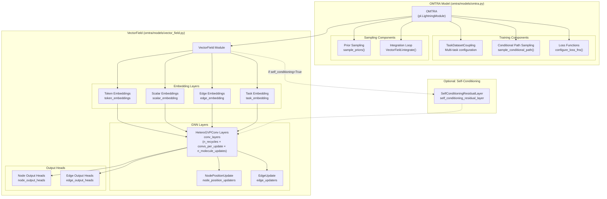
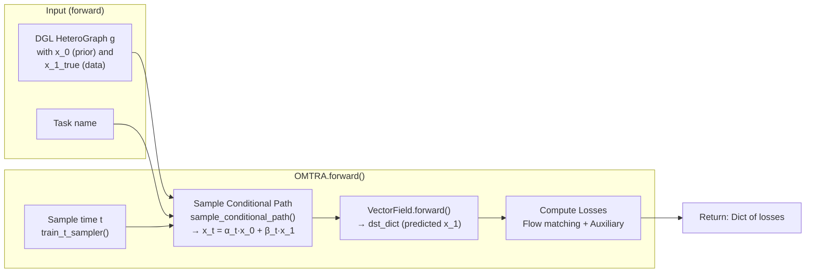
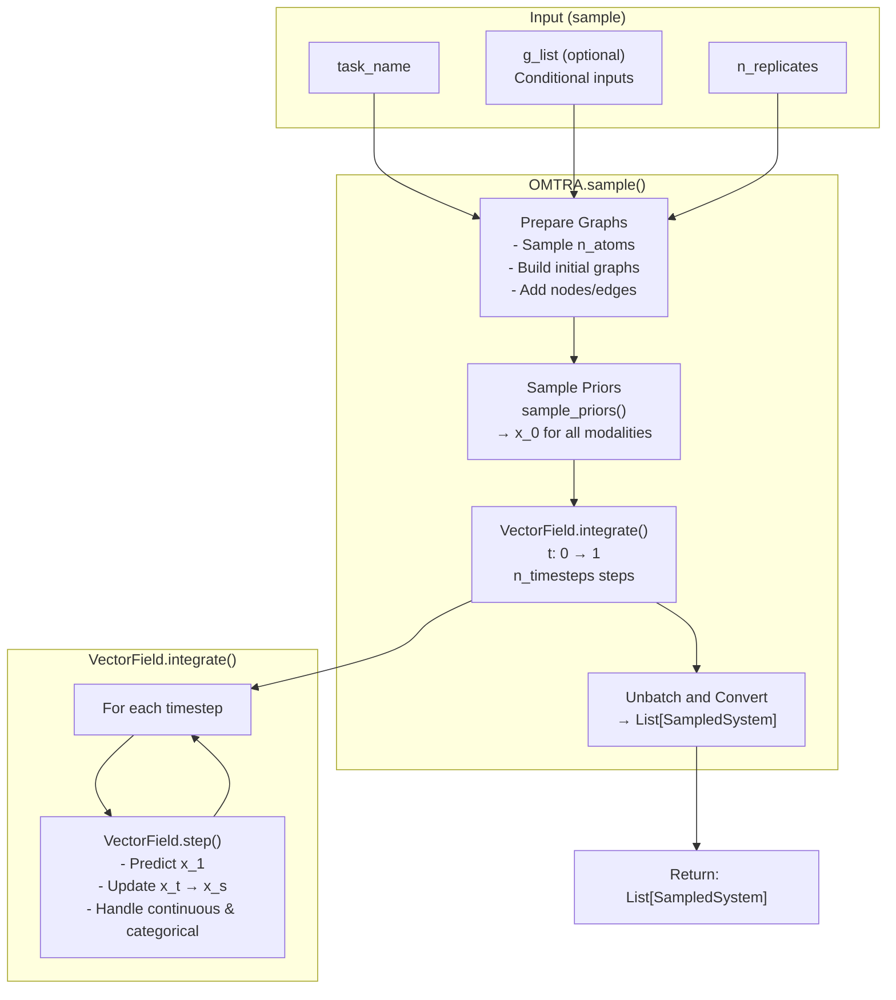
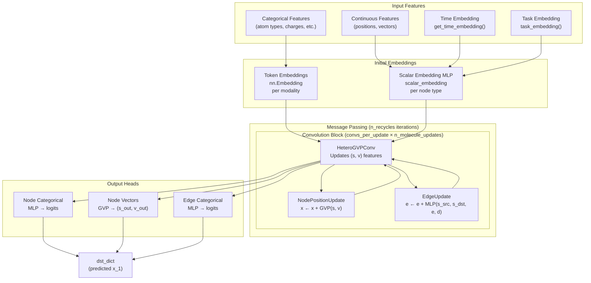
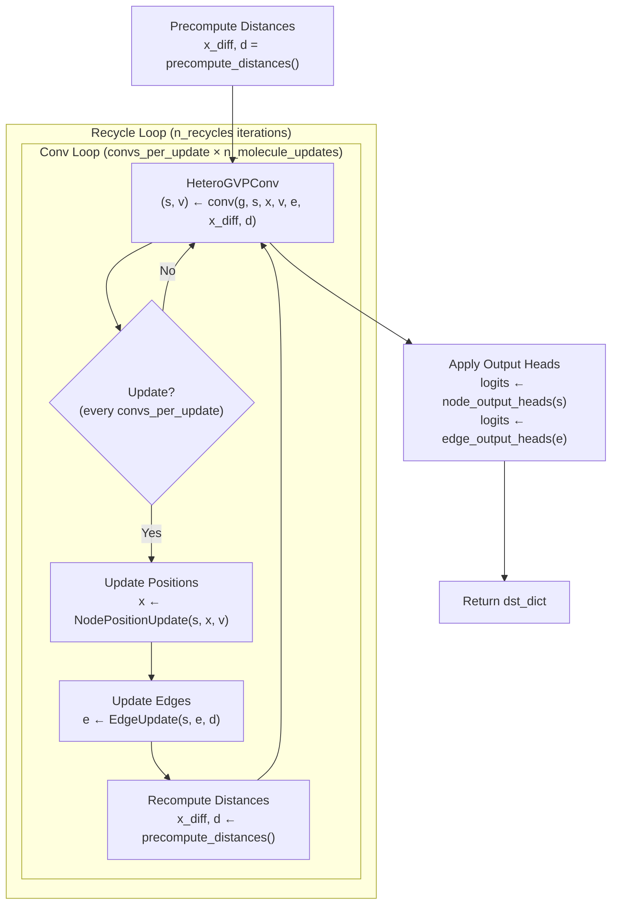
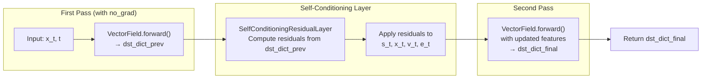
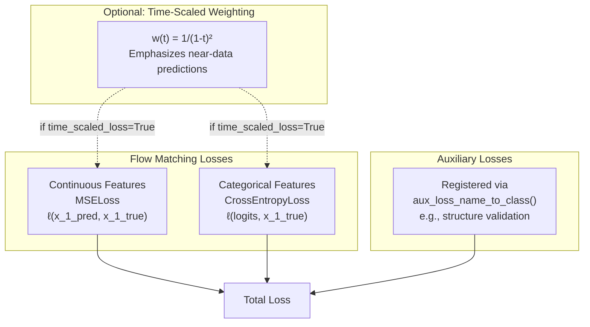
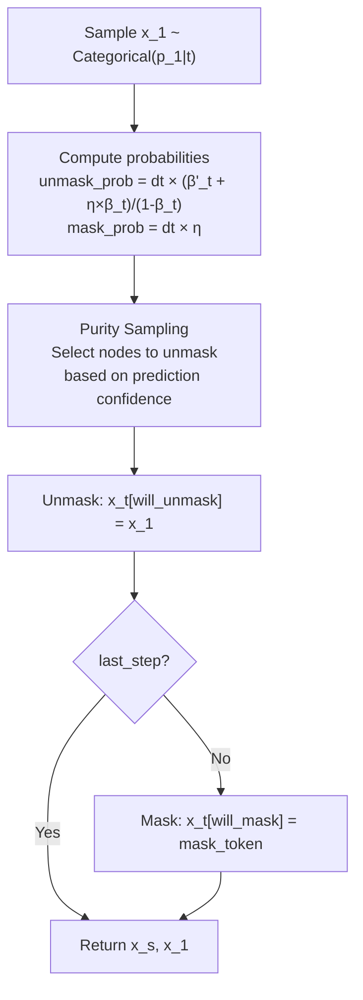
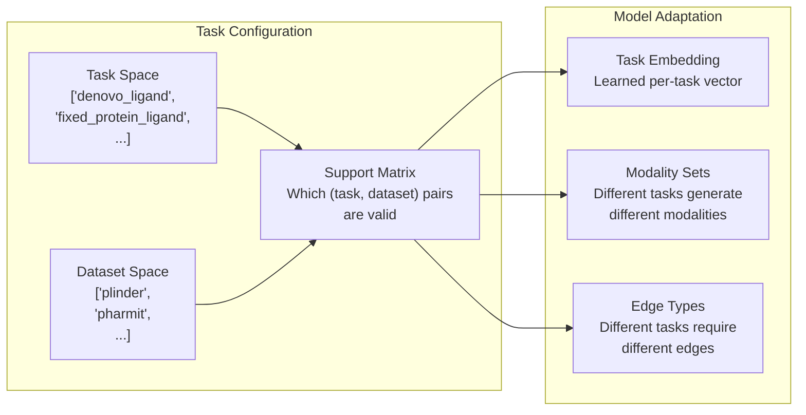

# Model Architecture

<details>
<summary>Relevant source files</summary>

The following files were used as context for generating this wiki page:

- [omtra/models/omtra.py](omtra/models/omtra.py)
- [omtra/models/self_conditioning.py](omtra/models/self_conditioning.py)
- [omtra/models/vector_field.py](omtra/models/vector_field.py)

</details>


This document provides a technical overview of OMTRA's neural network architecture and its core components. It explains how the model is structured, how data flows through different layers during training and inference, and the key architectural decisions that enable multi-modal molecular generation.

For specific implementation details of individual components, see:
- [OMTRA Generative Model](#4.1) - The main model class and training/sampling logic
- [VectorField Architecture](#4.2) - The GNN that predicts trajectory destinations
- [Self-Conditioning Mechanism](#4.3) - Iterative refinement through self-conditioning
- [Ligand Encoder (VQ-VAE)](#4.4) - Discrete ligand representation learning

For understanding the theoretical foundations, see [Flow Matching for Molecules](#3.2).

---

## Overview

OMTRA uses a **flow matching** framework to generate molecular structures by predicting trajectories from a prior distribution (time `t=0`) to a data distribution (time `t=1`). The core architecture consists of three main components:

| Component | Class | Primary Role | File |
|-----------|-------|--------------|------|
| **Generative Model** | `OMTRA` | Orchestrates training and sampling, manages conditional paths | [omtra/models/omtra.py]() |
| **VectorField** | `VectorField` | Predicts trajectory destinations using heterogeneous GNNs | [omtra/models/vector_field.py]() |
| **Self-Conditioning** | `SelfConditioningResidualLayer` | Optional refinement using previous predictions | [omtra/models/self_conditioning.py]() |

The model operates on **heterogeneous graphs** (via DGL) representing molecular systems with multiple node types (ligand atoms, protein atoms, pharmacophores, non-protein non-drug entities) and edge types (covalent bonds, spatial proximity).

**Sources:** [omtra/models/omtra.py:55-172](), [omtra/models/vector_field.py:40-103]()

---

## High-Level Architecture



**Sources:** [omtra/models/omtra.py:55-186](), [omtra/models/vector_field.py:40-358](), [omtra/models/self_conditioning.py:18-85]()

---

## Data Flow: Training vs Inference

### Training Forward Pass



During training, the model:

1. **Samples a time** `t ~ U(0,1)` or `t ~ Beta(α, 1)` ([omtra/models/omtra.py:388]())
2. **Samples the conditional path** to create intermediate state `x_t` by interpolating between prior `x_0` and data `x_1_true` ([omtra/models/omtra.py:400-402]())
3. **Predicts the destination** `x_1_pred` using `VectorField.forward()` ([omtra/models/omtra.py:415-421]())
4. **Computes losses** comparing predicted and true destinations for all modalities being generated ([omtra/models/omtra.py:455-514]())

**Sources:** [omtra/models/omtra.py:386-516]()

### Sampling/Inference



During sampling, the model:

1. **Prepares initial graphs** by sampling number of atoms and building graph structure ([omtra/models/omtra.py:659-852]())
2. **Samples priors** for all modalities being generated ([omtra/models/omtra.py:859-867]())
3. **Integrates the flow** from `t=0` to `t=1` using `VectorField.integrate()` ([omtra/models/omtra.py:908-913]())
4. **Unbatches and converts** to `SampledSystem` objects ([omtra/models/omtra.py:924-939]())

**Sources:** [omtra/models/omtra.py:603-940](), [omtra/models/vector_field.py:778-932]()

---

## VectorField Architecture Details

The `VectorField` is a heterogeneous graph neural network that predicts the trajectory destination given the current state `x_t`.

### Network Structure



**Key architectural parameters:**

| Parameter | Description | Default |
|-----------|-------------|---------|
| `n_hidden_scalars` | Scalar feature dimension | 64 |
| `n_vec_channels` | Vector feature dimension | 16 |
| `n_recycles` | Number of recycling iterations | 1 |
| `n_molecule_updates` | Position/edge updates per recycle | 1 |
| `convs_per_update` | Conv layers between updates | 2 |
| `n_message_gvps` | GVP layers in message function | 3 |
| `n_update_gvps` | GVP layers in update function | 3 |

**Sources:** [omtra/models/vector_field.py:40-103](), [omtra/models/vector_field.py:190-358]()

### Feature Processing Pipeline

The `VectorField.forward()` method processes features in the following sequence:

1. **Build edges** for the task ([omtra/models/vector_field.py:382]())
2. **Extract modality features** from graph nodes and edges ([omtra/models/vector_field.py:387-452]())
3. **Embed features**:
   - Categorical: token embeddings ([omtra/models/vector_field.py:423-426]())
   - Time: sinusoidal embedding ([omtra/models/vector_field.py:468-475]())
   - Task: learned embedding ([omtra/models/vector_field.py:455-463]())
4. **Optionally apply self-conditioning** ([omtra/models/vector_field.py:489-541]())
5. **Call `denoise_graph()`** to run GNN and generate predictions ([omtra/models/vector_field.py:543-555]())

**Sources:** [omtra/models/vector_field.py:360-564]()

### GNN Message Passing

The `denoise_graph()` method implements the core GNN computation:



**Sources:** [omtra/models/vector_field.py:567-741]()

### Edge Handling

The model maintains different edge types with different behaviors:

| Edge Type | Modality | Features | Update Strategy |
|-----------|----------|----------|-----------------|
| `lig_to_lig` | Ligand bonds | Edge type (none/single/double/triple) | Updated via `EdgeUpdate` |
| `lig_to_prot` | Ligand-protein interactions | Distance-based (RBF) | Rebuilt each update |
| `prot_to_prot` | Protein structure | Distance-based (RBF) | Static or rebuilt |
| `*_covalent` | Covalent bonds | None | Static |

**Sources:** [omtra/models/vector_field.py:167-183](), [omtra/models/vector_field.py:640-664]()

---

## Self-Conditioning Mechanism

When `self_conditioning=True`, the model uses a two-pass prediction strategy:



The residual layer computes corrections based on:

- **Position changes**: RBF-encoded distances between predicted and current positions ([omtra/models/self_conditioning.py:108-122]())
- **Vector changes**: Pairwise distances between predicted and current vector features ([omtra/models/self_conditioning.py:123-138]())
- **Categorical changes**: Predicted probability distributions ([omtra/models/self_conditioning.py:139-146]())
- **Edge length changes**: Change in bond distances for `lig_to_lig` edges ([omtra/models/self_conditioning.py:163-188]())

During training, self-conditioning is applied with 50% probability. During inference, it's applied at every step except the initial step (t=0).

**Sources:** [omtra/models/vector_field.py:489-541](), [omtra/models/self_conditioning.py:87-199]()

---

## Modality-Specific Output Heads

The model generates predictions for different modalities using specialized output heads:

### Node Modalities

| Modality | Data Key | Output Head | Output Shape |
|----------|----------|-------------|--------------|
| Ligand atom type | `a` | MLP | `(n_nodes, n_atom_types)` |
| Ligand charge | `c` | MLP | `(n_nodes, n_charges)` |
| Ligand position | `x` | `NodePositionUpdate` (GVP) | `(n_nodes, 3)` |
| Pharmacophore type | `a` | MLP | `(n_nodes, n_pharm_types)` |
| Pharmacophore vectors | `v` | GVP | `(n_nodes, 4, 3)` |

**Sources:** [omtra/models/vector_field.py:302-332](), [omtra/models/vector_field.py:1181-1210]()

### Edge Modalities

| Modality | Data Key | Output Head | Output Shape |
|----------|----------|-------------|--------------|
| Ligand bond order | `e` | MLP | `(n_edges, 4)` |

Edge predictions are applied to upper-triangular edges only to avoid redundancy ([omtra/models/vector_field.py:674-679]()).

**Sources:** [omtra/models/vector_field.py:334-344]()

---

## Loss Functions

The model supports multiple loss types configured via `configure_loss_fns()`:



**Flow matching loss computation:**

For continuous modalities (positions, vectors):
```
loss = MSE(x_1_pred, x_1_true)
```

For categorical modalities (atom types, charges, bond orders):
```
loss = CrossEntropy(logits, x_1_true)
# Note: x_1_true set to -100 (ignore_index) for already-unmasked features
```

With time-scaled loss:
```
loss = weight(t) × base_loss
where weight(t) = clamp(1/(1-t)², max=100)
```

**Sources:** [omtra/models/omtra.py:226-266](), [omtra/models/omtra.py:444-514]()

### Special Loss Handling

- **Masked tokens**: Categorical targets are set to `-100` (ignore index) when the feature is already unmasked at time `t` ([omtra/models/omtra.py:437-442]())
- **Zero bond order**: Optional downweighting via `zero_bo_loss_weight` parameter ([omtra/models/omtra.py:246-250]())
- **Auxiliary losses**: Registered losses that support the task are automatically applied ([omtra/models/omtra.py:501-514]())

**Sources:** [omtra/models/omtra.py:423-516]()

---

## Integration and Sampling

The `VectorField.integrate()` method implements the ODE/SDE solver:

### Time Discretization

The integration supports multiple time spacing strategies:

```python
# Even spacing (default)
t = torch.linspace(0, 1, n_timesteps)

# Uneven spacing (log-dense near t=1)
t = 1.0 - torch.logspace(-2, 0, steps=n_timesteps+1).flip(0)
t = (t - t.min()) / (t.max() - t.min())
```

**Sources:** [omtra/models/vector_field.py:799-806]()

### Integration Step

At each timestep, `VectorField.step()`:

1. **Predicts destination** `x_1` using `VectorField.forward()` ([omtra/models/vector_field.py:966-976]())
2. **Updates continuous features** using the vector field:
   ```
   x_s = x_t + dt × vf(x_t, x_1, α_t, β_t)
   where vf = (α'_t/α_t)×x_t + ((α_t×β'_t - β_t×α'_t)/α_t)×x_1
   ```
   ([omtra/models/vector_field.py:1002-1027]())
3. **Updates categorical features** using Campbell's CTMC step with purity sampling ([omtra/models/vector_field.py:1029-1093]())

**Sources:** [omtra/models/vector_field.py:934-1094](), [omtra/models/vector_field.py:1156-1160]()

### Campbell Step for Categorical Features

The `campbell_step()` method implements discrete-time CTMC sampling:



**Purity sampling** prioritizes unmasking nodes where the model is most confident, computed per-batch to maintain consistent unmasking rates.

**Sources:** [omtra/models/vector_field.py:1096-1154]()

---

## Multi-Task Architecture

The model supports training on multiple tasks simultaneously via `TaskDatasetCoupling`:



The architecture automatically adapts to each task by:

- Selecting appropriate **modalities** to generate vs. fix ([omtra/models/vector_field.py:115-136]())
- Building task-specific **edge types** ([omtra/models/vector_field.py:167-183]())
- Injecting **task embeddings** into node features ([omtra/models/vector_field.py:455-479]())
- Using task-specific **interpolant schedules** ([omtra/models/omtra.py:553]())

**Sources:** [omtra/models/omtra.py:111-113](), [omtra/models/vector_field.py:44](), [omtra/models/vector_field.py:115-183]()

---

## Key Architectural Design Decisions

### Heterogeneous Graph Representation

The model operates on **DGL heterogeneous graphs** with multiple node and edge types, enabling:
- Differentiated treatment of ligand atoms vs. protein atoms vs. pharmacophores
- Type-specific message passing and feature updates
- Flexible edge construction based on task requirements

**Sources:** [omtra/models/vector_field.py:40-103]()

### Interleaved Position and Feature Updates

Position updates are interleaved with convolution layers (every `convs_per_update` layers), allowing:
- Geometry-aware message passing with updated coordinates
- Co-evolution of structure and features
- Optional edge rebuilding based on updated positions

**Sources:** [omtra/models/vector_field.py:596-664]()

### GVP (Geometric Vector Perceptron) Layers

The use of GVP layers enables:
- **SE(3)-equivariant** message passing (important for 3D molecular generation)
- Joint processing of **scalar and vector features**
- Geometric reasoning through vector channels

**Sources:** [omtra/models/vector_field.py:224-250](), [omtra/models/vector_field.py:1181-1210]()

### Modular Output Heads

Separate output heads for different modalities allow:
- Task-specific generation (some tasks don't generate all modalities)
- Different output types (categorical vs. continuous vs. vector)
- Easy extension to new modalities

**Sources:** [omtra/models/vector_field.py:302-344]()

### Optional Self-Conditioning

Self-conditioning is implemented as an optional layer that:
- Computes residuals based on previous predictions
- Applies corrections to node and edge features
- Can be enabled/disabled without changing core architecture

**Sources:** [omtra/models/vector_field.py:347-357](), [omtra/models/self_conditioning.py:18-85]()

---