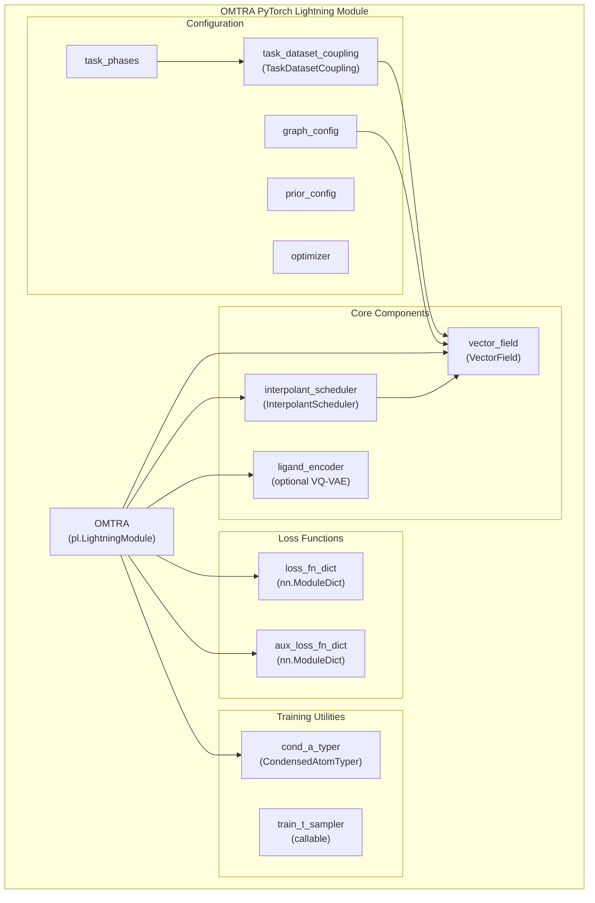
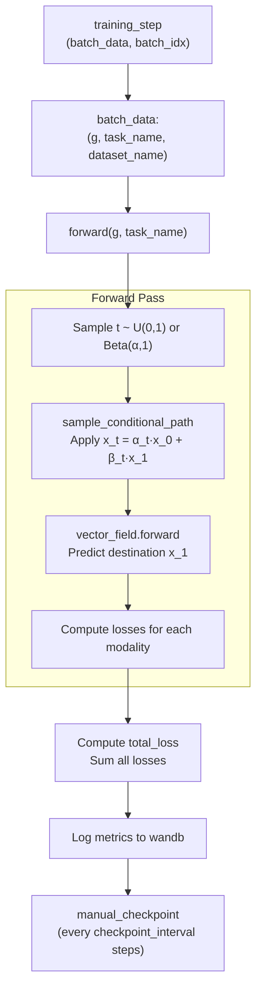
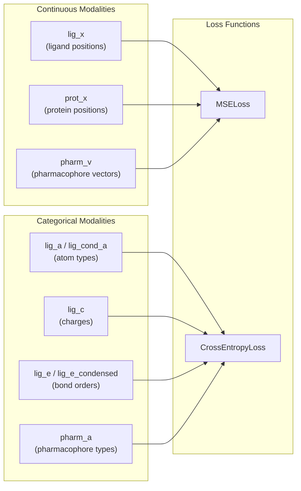

# OMTRA Generative Model

<details>
<summary>Relevant source files</summary>

The following files were used as context for generating this wiki page:

- [omtra/models/omtra.py](omtra/models/omtra.py)
- [omtra/models/self_conditioning.py](omtra/models/self_conditioning.py)
- [omtra/models/vector_field.py](omtra/models/vector_field.py)

</details>


## Purpose and Scope

This page documents the `OMTRA` class, the main generative model that orchestrates training and sampling for multi-task molecular generation. The `OMTRA` class is a PyTorch Lightning module that implements flow matching for heterogeneous molecular graphs, handling both continuous features (positions, vectors) and categorical features (atom types, bond orders, charges).

**Related pages:**
- For details on the `VectorField` GNN architecture that predicts trajectory destinations, see [VectorField Architecture](#4.2)
- For information on self-conditioning mechanism, see [Self-Conditioning Mechanism](#4.3)
- For task and modality concepts, see [Tasks and Modalities](#3.1)
- For flow matching theory, see [Flow Matching for Molecules](#3.2)
- For the sampling pipeline and outputs, see [Sampling Pipeline](#8.1)

---

## Overview

The `OMTRA` class serves as the top-level orchestrator for training and inference. It inherits from `pytorch_lightning.LightningModule` and implements:

- **Flow matching training**: Samples timepoints, applies conditional paths, and computes flow matching losses
- **Multi-task learning**: Supports training on multiple tasks and datasets simultaneously via `TaskDatasetCoupling`
- **Modality management**: Handles different feature types (positions, atom types, bond orders, etc.) uniformly
- **Sampling**: Generates molecules by integrating the learned vector field from prior to data

**Sources:** [omtra/models/omtra.py:55-186]()

---

## Class Structure and Initialization

### OMTRA Class Components



**Diagram: OMTRA Class Component Structure**

**Sources:** [omtra/models/omtra.py:55-186]()

### Initialization Parameters

The `__init__` method accepts extensive configuration through Hydra `DictConfig` objects:

| Parameter | Type | Description |
|-----------|------|-------------|
| `task_phases` | Config | Task phase definitions for curriculum learning |
| `task_dataset_coupling` | Config | Coupling between tasks and datasets |
| `graph_config` | DictConfig | Graph construction parameters (edge types, radii) |
| `conditional_paths` | DictConfig | Conditional path functions for each modality |
| `vector_field` | DictConfig | VectorField architecture configuration |
| `prior_config` | DictConfig | Prior distributions for each modality |
| `optimizer` | DictConfig | Optimizer configuration |
| `aux_losses` | DictConfig | Auxiliary loss configurations |
| `ligand_encoder` | DictConfig | Optional VQ-VAE encoder configuration |

**Key initialization steps:**

1. **Build TaskDatasetCoupling**: Constructs the multi-task training setup
2. **Initialize VectorField**: Creates the GNN that predicts trajectory destinations
3. **Configure Loss Functions**: Sets up MSE for continuous and CrossEntropy for categorical features
4. **Setup Auxiliary Losses**: Instantiates optional auxiliary loss modules
5. **Initialize CondensedAtomTyper**: For handling condensed atom type representations
6. **Configure Time Sampler**: Sets up uniform or beta distribution for sampling training times

**Sources:** [omtra/models/omtra.py:55-186](), [omtra/models/omtra.py:226-266]()

---

## Training Pipeline

### Training Step Flow



**Diagram: Training Step Execution Flow**

**Sources:** [omtra/models/omtra.py:268-323]()

### Forward Pass Detail

The `forward` method implements the core flow matching training logic:

```mermaid
graph TB
    Input["Input: DGL HeteroGraph g, task_name"]
    
    subgraph "Time and Batch Setup"
        SampleT["t ~ train_t_sampler(batch_size)"]
        GetBatchIdx["get_batch_idxs(g)<br/>node_batch_idxs, edge_batch_idxs"]
        GetMask["get_upper_edge_mask(g, 'lig_to_lig')"]
    end
    
    subgraph "Conditional Path Sampling"
        GetTask["task_class = task_name_to_class(task_name)"]
        SampleCP["sample_conditional_path<br/>x_t = α_t·x_0 + β_t·x_1"]
    end
    
    subgraph "Optional Perturbations"
        AddDistortion["Add distortion noise if distort_p > 0<br/>g.nodes['lig'].data['x_t'] += noise"]
        AddPharmNoise["Add pharmacophore noise if pharm_var > 0"]
    end
    
    subgraph "VectorField Forward"
        VFCall["vf_output = vector_field.forward<br/>(g, task_class, t, node_batch_idx)"]
    end
    
    subgraph "Loss Computation"
        BuildTargets["Build targets dict from x_1_true"]
        MaskTargets["Mask categorical targets<br/>where x_t != mask_token"]
        ComputeFMLosses["Compute flow matching losses<br/>MSE for continuous, CE for categorical"]
        ComputeAuxLosses["Compute auxiliary losses"]
        TimeScaleLoss["Apply time-scaled weighting if enabled"]
    end
    
    Output["Output: losses dict"]
    
    Input --> SampleT
    SampleT --> GetBatchIdx
    GetBatchIdx --> GetMask
    GetMask --> GetTask
    GetTask --> SampleCP
    SampleCP --> AddDistortion
    AddDistortion --> AddPharmNoise
    AddPharmNoise --> VFCall
    VFCall --> BuildTargets
    BuildTargets --> MaskTargets
    MaskTargets --> ComputeFMLosses
    ComputeFMLosses --> ComputeAuxLosses
    ComputeAuxLosses --> TimeScaleLoss
    TimeScaleLoss --> Output
```



**Diagram: Forward Pass for Flow Matching Training**

**Sources:** [omtra/models/omtra.py:385-516]()

### Conditional Path Sampling

The `sample_conditional_path` method interpolates between prior distribution x₀ and data distribution x₁:

**For each modality being generated:**

1. Get interpolant weights: `alpha_t, beta_t = interpolant_scheduler.weights(t, task_class)`
2. Get conditional path function from configuration
3. Apply interpolation: `x_t = conditional_path_fn(x_0, x_1_true, alpha_t, beta_t)`
4. For continuous features: typically `x_t = alpha_t * x_0 + beta_t * x_1`
5. For categorical features: mask-based interpolation with CTMC (Continuous-Time Markov Chain)

**For fixed modalities:** Simply set `x_t = x_1_true` (no interpolation needed)

**Sources:** [omtra/models/omtra.py:542-600]()

### Loss Function Configuration

The `configure_loss_fns` method sets up modality-specific loss functions:

| Modality Type | Loss Function | Configuration |
|---------------|---------------|---------------|
| **Continuous** (x, v) | `nn.MSELoss` | `reduction='none'` if time-scaled, else `'mean'` |
| **Categorical** (a, c, e) | `nn.CrossEntropyLoss` | `ignore_index=-100` for masked targets |
| **Bond Order** (e) | `nn.CrossEntropyLoss` | Optional `zero_bo_loss_weight` to downweight no-bond class |
| **Auxiliary Losses** | Custom modules | Registered via `aux_loss_name_to_class` |

**Time-scaled loss weighting:**
If `time_scaled_loss=True`, losses are weighted by `1 / (1-t)²` to emphasize learning near t=1:

```
weight = 1.0 / ((1.0 - t).clamp(min=1e-6)) ** 2
weight = torch.clamp(weight, max=100.0)
```

**Sources:** [omtra/models/omtra.py:226-266](), [omtra/models/omtra.py:445-514]()

---

## Sampling Pipeline

### Sample Method Overview

The `sample` method generates molecules by integrating the learned vector field from t=0 to t=1:

```mermaid
graph TB
    Input["Input: task_name, g_list, n_replicates"]
    
    subgraph "Setup"
        ValidateTask["Validate task requirements"]
        SetDevice["Set device (cuda/cpu)"]
        PrepareGraphs["Prepare/replicate input graphs"]
        SampleNComs["Sample centers of mass"]
    end
    
    subgraph "Add Nodes"
        SampleNLigAtoms["Sample n_lig_atoms<br/>from distributions or use GT±margin"]
        SampleNPharms["Sample n_pharm_nodes<br/>if generating pharmacophores"]
        AddLigNodes["Add ligand nodes to graphs<br/>g.add_nodes(n_lig_atoms, 'lig')"]
        AddPharmNodes["Add pharm nodes to graphs<br/>g.add_nodes(n_pharm_nodes, 'pharm')"]
        BuildLigEdges["build_lig_edge_idxs<br/>Add complete lig_to_lig edges"]
    end
    
    subgraph "Initialize Priors"
        BatchGraphs["Batch graphs: g = dgl.batch(g_flat)"]
        GetPriors["prior_fns = get_prior(task, prior_config)"]
        SamplePriors["sample_priors(g, task, prior_fns)<br/>Initialize x_0 for all modalities"]
        SetXT["Set x_t = x_0 for generated modalities<br/>Set x_t = x_1_true for fixed modalities"]
    end
    
    subgraph "Integration"
        Integrate["vector_field.integrate<br/>(g, task, n_timesteps, upper_edge_mask)"]
    end
    
    subgraph "Post-processing"
        Unbatch["dgl.unbatch(g)"]
        CreateSS["Create SampledSystem objects<br/>for each graph"]
    end
    
    Output["Output: List[SampledSystem]"]
    
    Input --> ValidateTask
    ValidateTask --> SetDevice
    SetDevice --> PrepareGraphs
    PrepareGraphs --> SampleNComs
    SampleNComs --> SampleNLigAtoms
    SampleNLigAtoms --> SampleNPharms
    SampleNPharms --> AddLigNodes
    AddLigNodes --> AddPharmNodes
    AddPharmNodes --> BuildLigEdges
    BuildLigEdges --> BatchGraphs
    BatchGraphs --> GetPriors
    GetPriors --> SamplePriors
    SamplePriors --> SetXT
    SetXT --> Integrate
    Integrate --> Unbatch
    Unbatch --> CreateSS
    CreateSS --> Output
```



**Diagram: Sample Method Execution Flow**

**Sources:** [omtra/models/omtra.py:602-940]()

### Number of Atoms Sampling

The `sample` method determines the number of ligand atoms to generate based on the task and available conditioning:

| Scenario | Sampling Strategy |
|----------|------------------|
| **Protein-conditioned with pharmacophore** | `sample_n_lig_atoms_plinder(n_prot_atoms, n_pharms)` |
| **Protein-conditioned without pharmacophore** | `sample_n_lig_atoms_plinder(n_prot_atoms, n_pharms=None)` (marginalizes) |
| **Pharmacophore-only** | `sample_n_lig_atoms_plinder(n_pharms=n_pharms)` or `sample_n_lig_atoms_pharmit` |
| **User-provided mean/std** | Sample from `Normal(n_lig_atoms_mean, n_lig_atoms_std)` |
| **Ground truth ± margin** | `n_lig_atoms = n_gt ± random(0, margin*n_gt)` |

**Fake atoms handling:** If `fake_atom_p > 0`, additional fake atoms are added during sampling (unless using ground truth counts).

**Sources:** [omtra/models/omtra.py:686-852]()

### Integration Process

The actual integration is delegated to `VectorField.integrate` (see [VectorField Architecture](#4.2)):

1. Divide time interval [0,1] into `n_timesteps` steps
2. For each timestep, call `VectorField.step` to:
   - Predict destination x₁ via `vector_field.forward`
   - Update continuous features using ODE/SDE solver
   - Update categorical features using CTMC sampling
3. Return final graph with x_t = x₁

**Optional features during sampling:**
- `visualize=True`: Collect trajectory frames for visualization
- `extract_latents_for_confidence=True`: Extract GNN latent features
- `stochastic_sampling=True`: Add noise during integration (SDE)
- `time_spacing='uneven'`: Use log-dense timesteps near t=1

**Sources:** [omtra/models/omtra.py:897-913]()

### Batch Sampling

The `sample_in_batches` method provides memory-efficient sampling for large numbers of replicates:

1. Splits input graphs into chunks of size `max_batch_size`
2. For each chunk, generates replicates in sub-batches
3. Re-orders results to maintain consistent indexing
4. Returns flattened list of all `SampledSystem` objects

**Sources:** [omtra/models/omtra.py:942-1036]()

---

## Key Implementation Details

### Modality Handling



**Diagram: Modality-to-Loss Function Mapping**

**Sources:** [omtra/models/omtra.py:235-259]()

### Training vs Inference Differences

| Aspect | Training | Inference |
|--------|----------|-----------|
| **Time sampling** | Random t from U(0,1) or Beta(α,1) | Deterministic linspace(0,1,n_timesteps) |
| **Conditional path** | Sample x_t at random t | Integrate from t=0 to t=1 |
| **Graph structure** | Provided by dataloader | Dynamically constructed |
| **Priors** | Sampled with `training=True` flag | Sampled with `training=False` flag |
| **Self-conditioning** | 50% probability during training | Always applied (if enabled) |
| **Output** | Loss dictionary | List of `SampledSystem` objects |

**Sources:** [omtra/models/omtra.py:268-323](), [omtra/models/omtra.py:602-940]()

### Validation Step

The `validation_step` method performs periodic generation during training:

1. Unbatch validation graphs
2. Call `self.sample` with `n_replicates=2` (or more for unconditional tasks)
3. Run evaluation functions from `eval_config`
4. Log metrics to wandb with task prefix

**Sources:** [omtra/models/omtra.py:324-383]()

### Optimizer Configuration

The `configure_optimizers` method sets up the optimizer and optional learning rate warmup:

```python
optimizer = hydra.utils.instantiate(self.optimizer_cfg, params=self.parameters())

if self.lr_warmup_steps > 0:
    def lr_lambda(current_step: int):
        if current_step < self.lr_warmup_steps:
            return float(current_step + 1) / float(self.lr_warmup_steps)
        return 1.0
    scheduler = torch.optim.lr_scheduler.LambdaLR(optimizer, lr_lambda=lr_lambda)
    return {"optimizer": optimizer, "lr_scheduler": {...}}
```

**Sources:** [omtra/models/omtra.py:518-540]()

### Manual Checkpointing

OMTRA implements custom checkpointing to maintain a rolling window of the most recent `k_checkpoints`:

1. Every `checkpoint_interval` steps, save a checkpoint
2. If already at `k_checkpoints`, delete the oldest one
3. Change file permissions for sharing across users

**Sources:** [omtra/models/omtra.py:201-224]()

---

## Integration with Other Components

### VectorField Integration

The `OMTRA` class delegates trajectory prediction to the `VectorField` module:

- **Training:** `vf_output = self.vector_field.forward(g, task_class, t, ...)`
- **Sampling:** `g = self.vector_field.integrate(g, task, upper_edge_mask, n_timesteps, ...)`

See [VectorField Architecture](#4.2) for details on the GNN architecture.

**Sources:** [omtra/models/omtra.py:414-421](), [omtra/models/omtra.py:907-913]()

### Self-Conditioning Integration

If `self_conditioning=True`, the `VectorField` uses a `SelfConditioningResidualLayer`:

- On first pass (or 50% during training), predict destination without self-conditioning
- Use predicted destination features as input to second pass
- Apply residual connection to improve prediction

See [Self-Conditioning Mechanism](#4.3) for details.

**Sources:** [omtra/models/vector_field.py:489-541]()

### TaskDatasetCoupling Integration

The `td_coupling` object controls multi-task training:

- Defines which tasks and datasets are active in each training phase
- Used by `MultiTaskDataModule` to sample batches
- Provides task-to-dataset probability distributions

See [Multi-Task Learning](#7.3) for details.

**Sources:** [omtra/models/omtra.py:111-133]()

---

## Summary

The `OMTRA` class is the central component that:

1. **Orchestrates training** by sampling conditional paths and computing flow matching losses
2. **Generates molecules** by integrating the learned vector field from prior to data  
3. **Manages modalities** uniformly across continuous and categorical features
4. **Supports multi-task learning** through `TaskDatasetCoupling`
5. **Delegates neural network computation** to `VectorField` (see [VectorField Architecture](#4.2))

Key methods:
- `forward(g, task_name)` - Training forward pass
- `sample(task_name, g_list, n_replicates, ...)` - Generate molecules
- `sample_conditional_path(g, task_class, t, ...)` - Apply interpolation
- `configure_loss_fns()` - Set up modality-specific losses

**Sources:** [omtra/models/omtra.py:1-1053]()

---