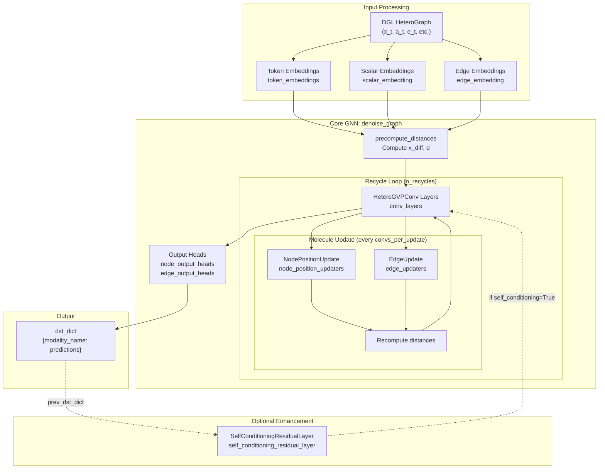
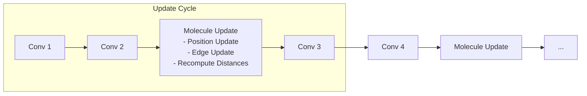
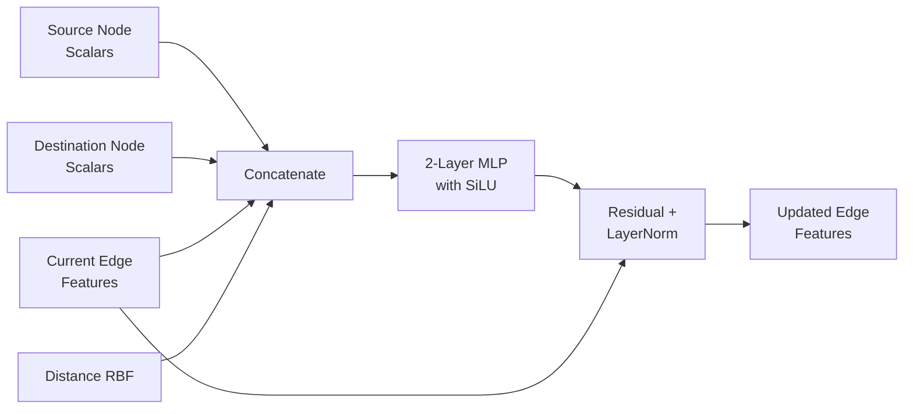
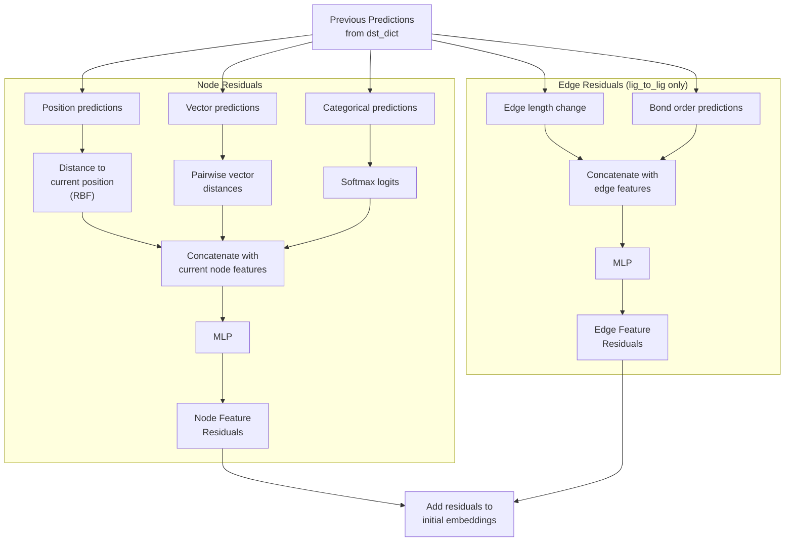
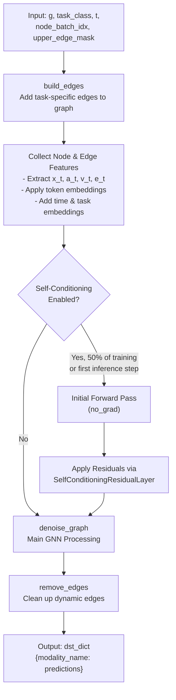
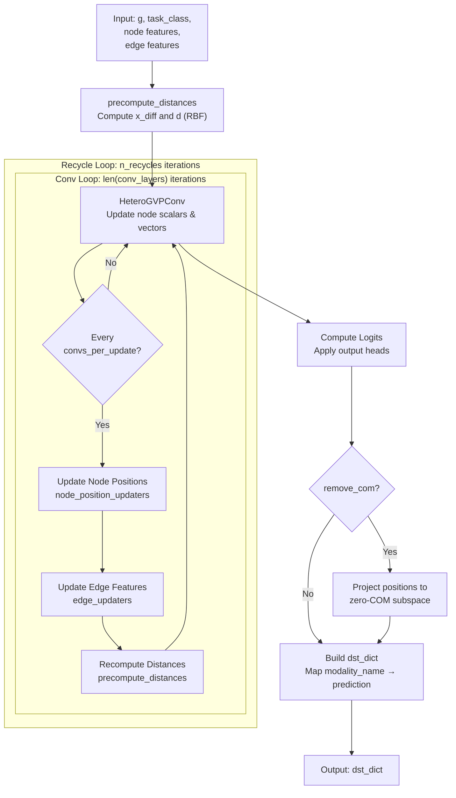
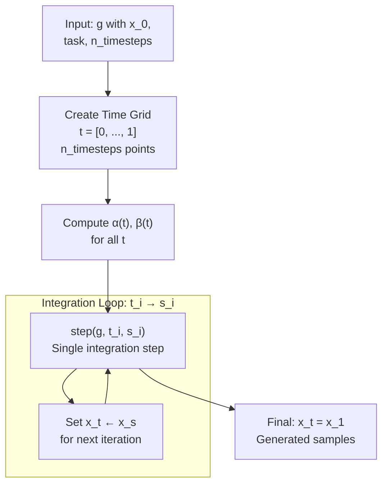
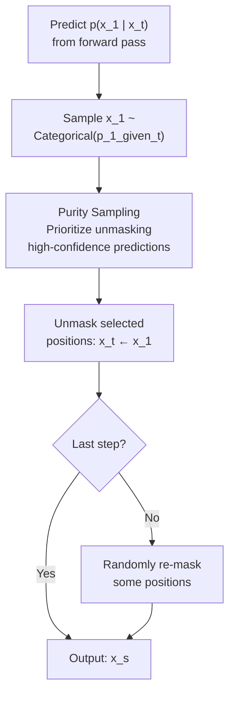

# VectorField Architecture

<details>
<summary>Relevant source files</summary>

The following files were used as context for generating this wiki page:

- [omtra/models/omtra.py](omtra/models/omtra.py)
- [omtra/models/self_conditioning.py](omtra/models/self_conditioning.py)
- [omtra/models/vector_field.py](omtra/models/vector_field.py)

</details>


## Purpose and Scope

This document provides a detailed explanation of the `VectorField` architecture, the core graph neural network (GNN) that powers OMTRA's generative capabilities. The VectorField predicts trajectory destinations (x₁) given current states (x_t) during both training and inference. 

For the overall OMTRA model that wraps VectorField and implements flow matching, see [OMTRA Generative Model](#4.1). For the self-conditioning mechanism details, see [Self-Conditioning Mechanism](#4.3). For information about how graphs are constructed and represented, see [Graph Representation](#3.3).

**Sources:** [omtra/models/vector_field.py:1-1248]()

---

## Overview

The VectorField is implemented as a heterogeneous GNN that operates on DGL graphs containing multiple node types (ligand atoms, protein atoms, pharmacophores, non-protein non-drug elements) and edge types (ligand-ligand, ligand-protein, etc.). It processes these graphs through multiple layers of message passing and updates to predict the final states of all generated modalities.

### Key Responsibilities

| Responsibility | Implementation |
|---------------|----------------|
| **Feature Embedding** | Token embeddings for categorical features, scalar embeddings for node types |
| **Message Passing** | `HeteroGVPConv` layers with geometric vector perceptrons |
| **Position Updates** | `NodePositionUpdate` modules that update 3D coordinates |
| **Edge Updates** | `EdgeUpdate` modules that refine edge features |
| **Output Prediction** | Modality-specific output heads for atoms, bonds, positions, vectors |
| **Self-Conditioning** | Optional residual layer that incorporates previous predictions |
| **Integration** | Discrete-time flow integration for sampling |

**Sources:** [omtra/models/vector_field.py:40-158]()

---

## Architecture Components

### Component Diagram



**Sources:** [omtra/models/vector_field.py:40-358](), [omtra/models/vector_field.py:360-565](), [omtra/models/vector_field.py:567-741]()

---

### Embedding Layers

The VectorField creates embeddings for all categorical and continuous features present in the input graphs.

#### Token Embeddings

Token embeddings map categorical features to dense vectors. Each modality gets its own embedding table.

| Modality Example | Entity | Vocabulary Size | Embedding Dimension |
|-----------------|--------|-----------------|---------------------|
| `lig_a` (atom types) | ligand | `len(lig_atom_type_map)` + mask + fake | `token_dim` (default: 64) |
| `lig_c` (charges) | ligand | `len(charge_map)` + mask | `token_dim` |
| `lig_e` (bond orders) | edges | 4 + mask | `token_dim` |
| `pharm_a` (pharmacophore types) | pharmacophore | `len(ph_idx_to_type)` + mask | `token_dim` |

The "+mask" accounts for the mask token used during categorical flow matching, and "+fake" accounts for fake atoms when `fake_atoms=True`.

**Code Implementation:**
```python
# From vector_field.py:144-156
for m in modalities_present_cls:
    if not m.is_categorical:
        continue
    is_generated = m.name in modality_generated_space
    has_fake_atoms = (m.name == 'lig_a' or m.name == 'lig_cond_a') and self.fake_atoms 
    self.token_embeddings[m.name] = nn.Embedding(
        m.n_categories + int(is_generated) + int(has_fake_atoms), token_dim
    )
```

**Sources:** [omtra/models/vector_field.py:144-157]()

#### Scalar and Edge Embeddings

After token embeddings are computed, they are combined with time and task embeddings, then projected to the hidden dimension.

**Node Scalar Embeddings:**
- Input: Concatenation of `[token_embeddings, time_embedding, task_embedding]` (and optionally `res_id_embedding` for proteins)
- Output: `n_hidden_scalars` dimensional features (default: 64)
- Architecture: Linear → SiLU → LayerNorm

**Edge Embeddings:**
- Input: Token embeddings for edge features (e.g., bond types)
- Output: `n_hidden_edge_feats` dimensional features (default: 64)
- Architecture: Linear → SiLU → LayerNorm

**Sources:** [omtra/models/vector_field.py:190-218](), [omtra/models/vector_field.py:465-487]()

---

### Graph Neural Network Layers

The core of VectorField consists of multiple `HeteroGVPConv` layers that perform message passing on heterogeneous graphs.

#### HeteroGVPConv Architecture

Each `HeteroGVPConv` layer processes nodes with both scalar and vector features using Geometric Vector Perceptrons (GVPs). The layer:

1. **Computes messages** between connected nodes using edge features, distances, and direction vectors
2. **Updates scalar features** via MLP processing of messages
3. **Updates vector features** via geometric operations preserving rotation equivariance
4. **Supports attention mechanisms** (optional) for weighted message aggregation

**Key Parameters:**

| Parameter | Default | Purpose |
|-----------|---------|---------|
| `n_message_gvps` | 3 | Number of GVP layers in message computation |
| `n_update_gvps` | 3 | Number of GVP layers in node update |
| `n_expansion_gvps` | 3 | Number of GVP layers in feature expansion |
| `attention` | False | Whether to use attention mechanism |
| `n_heads` | 1 | Number of attention heads if enabled |

**Sources:** [omtra/models/vector_field.py:224-250]()

#### Layer Organization

The VectorField organizes GNN layers with periodic updates to positions and edges:



- **Total convolutions:** `convs_per_update` × `n_molecule_updates` (default: 2 × 1 = 2)
- **Molecule updates occur:** Every `convs_per_update` convolutions
- **Recycles:** The entire sequence repeats `n_recycles` times (default: 1)

**Sources:** [omtra/models/vector_field.py:95-96](), [omtra/models/vector_field.py:582-665]()

---

### Update Modules

#### NodePositionUpdate

The `NodePositionUpdate` module predicts position displacements for node types being generated (e.g., ligand atoms, pharmacophores).

**Architecture:**
- Input: `(scalar_features, current_positions, vector_features)`
- Processing: Stack of GVP layers (default: 3)
- Output: Single vector representing position displacement
- Update rule: `new_position = old_position + displacement`

```python
# From vector_field.py:1181-1211
class NodePositionUpdate(nn.Module):
    def __init__(self, n_scalars, n_vec_channels, n_gvps: int = 3, n_cp_feats: int = 0):
        # Creates n_gvps GVP layers, final layer outputs 1 vector
        ...
    
    def forward(self, scalars, positions, vectors):
        _, vector_updates = self.gvps((scalars, vectors))
        return positions + vector_updates.squeeze(1)
```

**Sources:** [omtra/models/vector_field.py:1181-1211](), [omtra/models/vector_field.py:260-277]()

#### EdgeUpdate

The `EdgeUpdate` module refines edge features based on updated node positions and scalar features.

**Architecture:**
- Input: `[src_node_scalars, dst_node_scalars, current_edge_feats, distance_rbf]`
- Processing: Linear → SiLU → Linear → SiLU
- Output: Refined edge features with residual connection and layer normalization



**Sources:** [omtra/models/vector_field.py:1213-1248](), [omtra/models/vector_field.py:279-296]()

---

### Output Heads

Output heads convert the final node and edge features into predictions for each modality being generated.

#### Node Output Heads

| Modality Type | Architecture | Output Dimension |
|---------------|--------------|------------------|
| **Categorical** (e.g., atom types, charges) | Linear → SiLU → Linear | `n_categories` (+ fake atom if applicable) |
| **Vector features** (e.g., pharmacophore directions) | GVP layer | `(4 scalars, 4 vectors)` |
| **Positions** | N/A (handled by NodePositionUpdate) | - |

**Example for categorical features:**
```python
# From vector_field.py:311-315
self.node_output_heads[m.name] = nn.Sequential(
    nn.Linear(n_hidden_scalars, n_hidden_scalars),
    nn.SiLU(),
    nn.Linear(n_hidden_scalars, m.n_categories+int(has_fake_atoms)),
)
```

**Sources:** [omtra/models/vector_field.py:302-333]()

#### Edge Output Heads

Edge output heads predict categorical features on edges (e.g., bond orders). They process the sum of upper and lower triangle edge features:

```python
# From vector_field.py:674-679
ue_feats = edge_features[etype][upper_edge_mask[etype]]
le_feats = edge_features[etype][~upper_edge_mask[etype]]
logits[m.name] = self.edge_output_heads[m.name](ue_feats + le_feats)
```

**Sources:** [omtra/models/vector_field.py:334-344](), [omtra/models/vector_field.py:666-680]()

---

### Self-Conditioning Layer

When `self_conditioning=True`, the VectorField uses a `SelfConditioningResidualLayer` to incorporate predictions from a previous forward pass.

**Mechanism:**
1. During training, with 50% probability, run an initial forward pass with `torch.no_grad()`
2. Use the predictions (`prev_dst_dict`) to compute residuals for node and edge features
3. Add these residuals before the main GNN processing

**Residual Computation:**



**Sources:** [omtra/models/self_conditioning.py:18-229](), [omtra/models/vector_field.py:346-357](), [omtra/models/vector_field.py:489-541]()

---

## Forward Pass Flow

The `forward` method orchestrates the entire denoising process to predict trajectory destinations.

### Forward Method Overview



**Sources:** [omtra/models/vector_field.py:359-565]()

### Detailed Forward Pass Steps

#### 1. Edge Construction
```python
# From vector_field.py:382
g = build_edges(g, task_class, node_batch_idx, self.graph_config)
```
Adds dynamic edges based on the task requirements (e.g., k-NN edges between ligand and protein).

#### 2. Feature Collection

Loops over all modalities present in the task and collects:
- **Positions** (`x_t`): Stored directly
- **Vector features** (`v_t`): Padded to `n_vec_channels` if needed
- **Categorical features**: Passed through token embeddings
- **Edge features**: Passed through edge embeddings

**Sources:** [omtra/models/vector_field.py:386-452]()

#### 3. Time and Task Embeddings

Time and task embeddings are appended to node scalar features:

| Embedding | Dimension | Applied To |
|-----------|-----------|------------|
| Time embedding | `time_embedding_dim` (default: 64) | All node types |
| Task embedding | `task_embedding_dim` (default: 64) | All node types |

**Sources:** [omtra/models/vector_field.py:454-487]()

#### 4. Self-Conditioning (Optional)

If enabled, performs an initial forward pass and computes residuals:

**Training:** 50% probability of self-conditioning
**Inference:** Applied on all steps except the first (when `t=0`)

**Sources:** [omtra/models/vector_field.py:489-541]()

#### 5. Main Denoising

Calls `denoise_graph` to process the graph through all GNN layers and produce predictions.

**Sources:** [omtra/models/vector_field.py:543-555]()

---

### Denoise Graph Method

The `denoise_graph` method implements the core GNN processing loop.



**Sources:** [omtra/models/vector_field.py:566-741]()

#### Distance Precomputation

The `precompute_distances` method computes pairwise distance features for all edge types:

```python
# From vector_field.py:743-776
def precompute_distances(self, g, node_positions=None, etype=None):
    x_diff = {}  # Direction vectors (normalized)
    d = {}       # RBF-encoded distances
    
    for etype in etypes:
        g.apply_edges(fn.u_sub_v("x_d", "x_d", "x_diff"), etype=etype)
        dij = _norm_no_nan(g.edges[etype].data["x_diff"], keepdims=True) + 1e-8
        x_diff[etype] = g.edges[etype].data["x_diff"] / dij
        d[etype] = _rbf(dij.squeeze(1), D_max=self.rbf_dmax, D_count=self.rbf_dim)
    
    return x_diff, d
```

**RBF Encoding:** Distances are encoded using radial basis functions with `rbf_dim` centers (default: 32) up to a maximum distance of `rbf_dmax` (default: 18 Å).

**Sources:** [omtra/models/vector_field.py:743-776]()

---

## Integration and Sampling

During inference, the `integrate` method performs discrete-time flow integration to generate samples.

### Integration Method



**Time Spacing Options:**

| Mode | Distribution | Use Case |
|------|-------------|----------|
| `"even"` | Uniform grid from 0 to 1 | Default, balanced |
| `"uneven"` | Log-dense near t=1 | More refinement near endpoint |

**Sources:** [omtra/models/vector_field.py:778-932]()

### Step Method

The `step` method advances the state from time `t_i` to `s_i`:

#### Continuous Features

For continuous modalities (positions, vectors):

```python
# From vector_field.py:1014, 1156-1160
x_1 = dst_dict[m.name]  # Predicted destination
x_t = data_src[m.entity_name].data[f"{m.data_key}_t"]  # Current state

# Compute vector field
vf = self.vector_field(x_t, x_1, alpha_t_i, alpha_t_prime_i, beta_t_i, beta_t_prime_i)

# Update (deterministic)
x_s = x_t + dt * vf
```

**Stochastic Sampling (Optional):**
When `stochastic_sampling=True`, adds Langevin dynamics noise:

```python
# From vector_field.py:1016-1022
g_t = 1 / (t_i + eps) if t_i < 0.90 else 0.0
score = (t_i * vf - x_t) / (1 - t_i)
noise = torch.randn_like(x_t)
x_s = x_t + (vf + g_t*score)*dt + sqrt(2 * dt * g_s * noise_scaler) * noise
```

**Sources:** [omtra/models/vector_field.py:1001-1028]()

#### Categorical Features

For categorical modalities (atom types, bond orders, charges), uses the Campbell step algorithm with purity sampling:



**Purity Sampling:** Preferentially unmasks tokens where the model has high confidence in its prediction, leading to better sample quality.

**Sources:** [omtra/models/vector_field.py:1029-1094](), [omtra/models/vector_field.py:1096-1154]()

---

## Key Design Decisions

### Heterogeneous Graph Support

VectorField is designed from the ground up to handle heterogeneous graphs with multiple node and edge types, unlike many GNN architectures that assume homogeneous graphs.

**Implementation:**
- All node features stored in `Dict[str, torch.Tensor]` indexed by node type
- All edge features stored in `Dict[str, torch.Tensor]` indexed by edge type
- `HeteroGVPConv` explicitly handles message passing between different types

**Sources:** [omtra/models/vector_field.py:108-183]()

### Geometric Equivariance

The architecture maintains SE(3) equivariance for 3D positions through:
- **Direction vectors** (`x_diff`): Normalized displacement vectors between nodes
- **GVP layers**: Process both scalar and vector features while preserving geometric properties
- **Position updates**: Predicted as vector displacements, not absolute coordinates

**Sources:** [omtra/models/gvp.py]() (referenced but not provided), [omtra/models/vector_field.py:1181-1211]()

### Modular Update Strategy

The interleaving of convolutions and molecule updates allows:
- **Gradual refinement:** Positions and edges updated periodically rather than all at once
- **Consistent features:** Distances recomputed after position updates
- **Flexible control:** `convs_per_update` and `n_molecule_updates` control the update frequency

**Sources:** [omtra/models/vector_field.py:596-665]()

### Separate Updaters Option

When `separate_mol_updaters=True`, each molecule update cycle gets its own set of `NodePositionUpdate` and `EdgeUpdate` parameters. This allows the network to specialize updates based on how many convolutions have occurred.

**Sources:** [omtra/models/vector_field.py:86](), [omtra/models/vector_field.py:254-296]()

### Task-Aware Processing

The VectorField receives task information and uses it to:
- Condition all node features via task embeddings
- Determine which modalities to process via output heads
- Build appropriate edge types via `build_edges`

**Sources:** [omtra/models/vector_field.py:186-188](), [omtra/models/vector_field.py:454-464]()

---

## Configuration Parameters

### Key Hyperparameters

| Parameter | Type | Default | Description |
|-----------|------|---------|-------------|
| `n_hidden_scalars` | int | 64 | Dimension of node scalar features |
| `n_hidden_edge_feats` | int | 64 | Dimension of edge features |
| `n_vec_channels` | int | 16 | Number of vector channels per node |
| `n_recycles` | int | 1 | Number of times to repeat full GNN stack |
| `n_molecule_updates` | int | 1 | Number of position/edge update cycles |
| `convs_per_update` | int | 2 | Convolutions between each molecule update |
| `n_message_gvps` | int | 3 | GVP layers in message computation |
| `n_update_gvps` | int | 3 | GVP layers in node update |
| `rbf_dim` | int | 32 | Dimension of RBF distance encoding |
| `rbf_dmax` | float | 18.0 | Maximum distance for RBF (Angstroms) |
| `time_embedding_dim` | int | 64 | Dimension of time embedding |
| `token_dim` | int | 64 | Dimension of categorical token embeddings |
| `self_conditioning` | bool | False | Enable self-conditioning mechanism |
| `attention` | bool | False | Use attention in message passing |
| `n_heads` | int | 1 | Number of attention heads if enabled |

**Sources:** [omtra/models/vector_field.py:41-76]()

### Typical Configurations

**Small/Fast Model:**
```yaml
n_hidden_scalars: 32
n_vec_channels: 8
n_recycles: 1
convs_per_update: 1
n_molecule_updates: 1
```

**Large/Accurate Model:**
```yaml
n_hidden_scalars: 128
n_vec_channels: 32
n_recycles: 2
convs_per_update: 3
n_molecule_updates: 2
self_conditioning: true
```

**Sources:** Inferred from parameter ranges in [omtra/models/vector_field.py:41-76]()

---

## Integration with OMTRA

The OMTRA model instantiates and uses VectorField as follows:

```python
# From omtra.py:151-157
self.vector_field = hydra.utils.instantiate(
    vector_field,
    td_coupling=self.td_coupling,
    interpolant_scheduler=self.interpolant_scheduler,
    graph_config=self.graph_config,
    fake_atoms=self.fake_atom_p>0.0,
)
```

**During Training:**
```python
# From omtra.py:414-421
vf_output = self.vector_field.forward(
    g,
    task_class,
    t,
    node_batch_idx=node_batch_idxs,
    upper_edge_mask=upper_edge_mask,
)
# vf_output is dst_dict with predictions for each modality
```

**During Sampling:**
```python
# From omtra.py:908-913
itg_result = self.vector_field.integrate(
    g,
    task,
    upper_edge_mask=upper_edge_mask,
    n_timesteps=n_timesteps,
)
# Returns final graph with x_1 for all modalities
```

**Sources:** [omtra/models/omtra.py:151-157](), [omtra/models/omtra.py:414-421](), [omtra/models/omtra.py:908-913]()

---