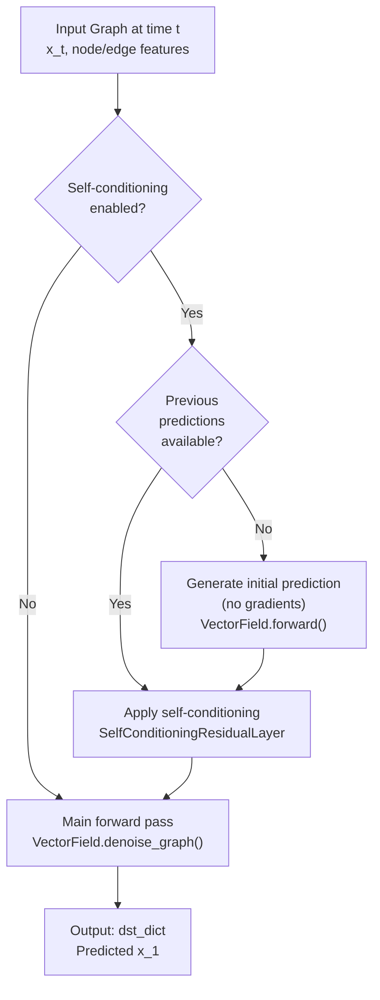
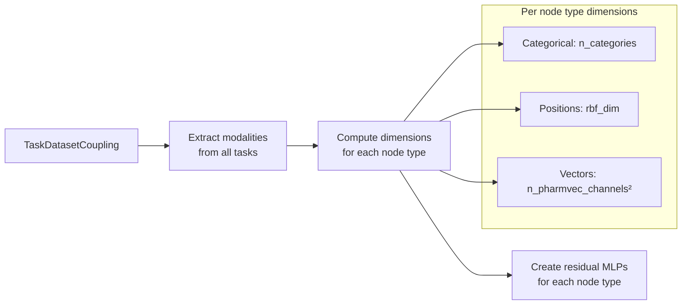
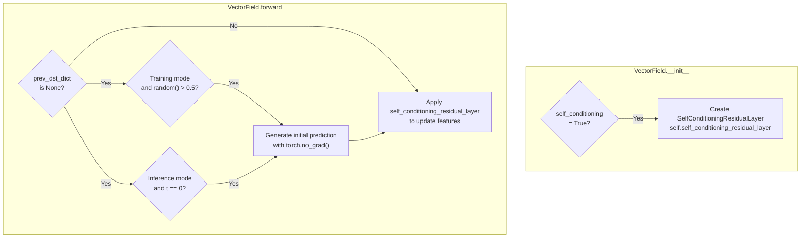
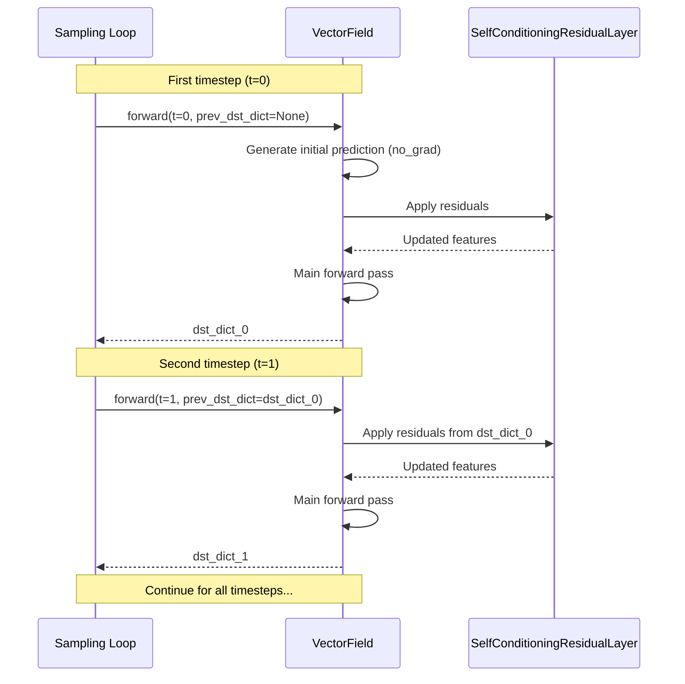
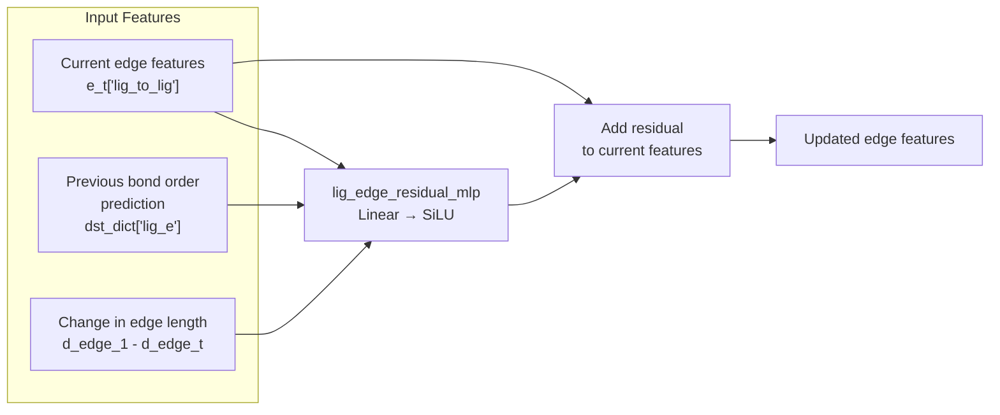
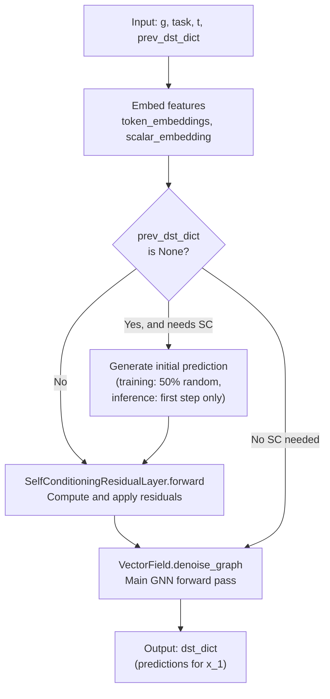

# Self-Conditioning Mechanism

<details>
<summary>Relevant source files</summary>

The following files were used as context for generating this wiki page:

- [omtra/models/omtra.py](omtra/models/omtra.py)
- [omtra/models/self_conditioning.py](omtra/models/self_conditioning.py)
- [omtra/models/vector_field.py](omtra/models/vector_field.py)

</details>


## Purpose and Scope

This page explains how self-conditioning improves generation quality in OMTRA by allowing the model to iteratively refine its predictions. Self-conditioning enables the model to use previous destination predictions as additional input when making new predictions, creating a feedback loop that enhances output quality.

For the broader model architecture context, see [OMTRA Generative Model](#4.1) and [VectorField Architecture](#4.2). For training details, see [Training Pipeline Overview](#7.1).

## Overview

Self-conditioning is an optional mechanism (controlled by the `self_conditioning` parameter in `VectorField`) that enhances generation quality through iterative refinement. The core idea is to provide the model with its own previous predictions as additional context when making new predictions.

**Key Benefits:**
- Improved generation quality through iterative refinement
- Better consistency across timesteps during sampling
- Enables the model to self-correct errors from previous predictions

**How it works:**
- **Training:** 50% of training steps use self-conditioning (randomly sampled)
- **Inference:** Always enabled after the first timestep
- **Mechanism:** Previous predictions are encoded as residual features and added to node/edge embeddings

Sources: [omtra/models/vector_field.py:70-93](), [omtra/models/self_conditioning.py:18-85]()

## Self-Conditioning Flow



**Diagram: Self-Conditioning Decision Flow**

The flow shows how self-conditioning is applied conditionally during forward passes. The key decision points are whether self-conditioning is enabled and whether previous predictions exist.

Sources: [omtra/models/vector_field.py:489-541]()

## Architecture and Components

### SelfConditioningResidualLayer

The `SelfConditioningResidualLayer` class in [omtra/models/self_conditioning.py:18-229]() is responsible for encoding previous predictions and computing residual updates to node and edge features.

| Component | Purpose | Input | Output |
|-----------|---------|-------|--------|
| `node_generated_dims` | Tracks dimensionality of generated features per node type | Task definition | Dict mapping node types to feature dimensions |
| `residual_generating_fns` | MLP for each node type that computes residual updates | Concatenated previous predictions + current features | Residual update to node scalar features |
| `lig_edge_residual_mlp` | MLP for ligand edge residuals | Previous edge predictions + distance changes | Residual update to edge features |

**Initialization:**



**Diagram: SelfConditioningResidualLayer Initialization**

Sources: [omtra/models/self_conditioning.py:18-85]()

### Integration with VectorField

The `VectorField` class contains the logic for when to apply self-conditioning:



**Diagram: Self-Conditioning Integration in VectorField**

Sources: [omtra/models/vector_field.py:346-357](), [omtra/models/vector_field.py:489-541]()

## Training vs Inference Behavior

Self-conditioning behaves differently during training and inference to balance computational efficiency with generation quality.

### Training Behavior

During training, self-conditioning is applied randomly to 50% of batches:

1. **Random sampling:** Check if `torch.rand(1) > 0.5` at [omtra/models/vector_field.py:490]()
2. **Initial prediction:** If triggered, make an initial prediction with `torch.no_grad()` 
3. **Residual application:** Apply residuals to features before the main forward pass
4. **Loss computation:** Compute loss on the final prediction (not the initial one)

**Why 50%?** This prevents the model from becoming overly dependent on self-conditioning and ensures it can still generate quality outputs without it.

### Inference Behavior

During inference (sampling), self-conditioning is applied differently:

1. **First step (t=0):** Generate initial prediction to bootstrap the process
2. **Subsequent steps:** Use prediction from previous timestep (`prev_dst_dict` from previous `step` call)
3. **Continuity:** Creates a chain of predictions that build on each other



**Diagram: Self-Conditioning During Sampling**

Sources: [omtra/models/vector_field.py:489-494](), [omtra/models/vector_field.py:869-891]()

## Residual Computation

The `SelfConditioningResidualLayer.forward` method computes residuals for different modality types:

### Node Feature Residuals

For each modality being generated, residuals are computed based on the modality type:

| Modality Type | Residual Encoding | Dimensionality | Additional Effects |
|---------------|-------------------|----------------|-------------------|
| **Position (x)** | RBF encoding of distance to predicted position | `rbf_dim` | Updates last vector channel with displacement direction |
| **Categorical (a, c)** | Predicted logits or one-hot encoding | `n_categories` | None |
| **Vectors (v)** | Pairwise distances between predicted and current vectors | `n_pharmvec_channels²` | Updates last `n_pharmvec_channels` with predictions |

**Position Residual Computation:**
```python
# From omtra/models/self_conditioning.py:111-122
x_diff = dst_dict[m.name] - x_t[ntype]  # Displacement vector
dij = _norm_no_nan(x_diff)               # Distance
dij_rbf = _rbf(dij, D_max=rbf_dmax, D_count=rbf_dim)  # RBF encoding
# Also update vector features:
v_t[ntype][:, -1, :] = x_diff / dij.unsqueeze(-1)  # Normalized direction
```

**Vector Residual Computation:**
```python
# From omtra/models/self_conditioning.py:126-138
dij = dst_dict[m.name].unsqueeze(1) - v_t[ntype][:, :n_pharmvec_channels].unsqueeze(2)
dij = _norm_no_nan(dij)  # Shape: (n_nodes, n_pharmvec_channels, n_pharmvec_channels)
dij = rearrange(dij, 'n c1 c2 -> n (c1 c2)')  # Flatten
# Also update vector features:
v_t[ntype][:, -n_pharmvec_channels:, :] = dst_dict[m.name]
```

Sources: [omtra/models/self_conditioning.py:100-152]()

### Edge Feature Residuals

For ligand-ligand edges (when generating ligand structure), residuals incorporate both bond order predictions and distance changes:



**Diagram: Edge Residual Computation**

Edge residuals are only computed for `lig_to_lig` edges and only when generating ligand structure (when `lig_x` is in modalities_generated).

Sources: [omtra/models/self_conditioning.py:163-188]()

### Residual MLP Architecture

Each node type has a dedicated MLP for computing residuals from the concatenated features:

```python
# From omtra/models/self_conditioning.py:69-74
self.residual_generating_fns[ntype] = nn.Sequential(
    nn.Linear(node_embedding_dim + node_generated_dims[ntype], node_embedding_dim),
    nn.SiLU(),
    nn.Linear(node_embedding_dim, node_embedding_dim),
    nn.SiLU(),
)
```

The MLP takes as input:
- Current node scalar features (`s_t[ntype]`)
- Encoded residual information from all modalities on this node type

And outputs a residual that is added to the current node scalar features.

Sources: [omtra/models/self_conditioning.py:154-193]()

## Complete Forward Pass with Self-Conditioning



**Diagram: Complete VectorField Forward Pass with Self-Conditioning**

Sources: [omtra/models/vector_field.py:360-564]()

## Configuration

Self-conditioning is controlled by a single boolean parameter in the `VectorField` configuration:

```yaml
# From configs/config.yaml (example)
vector_field:
  _target_: omtra.models.vector_field.VectorField
  self_conditioning: true  # Enable self-conditioning
  # ... other parameters
```

**Dependencies:**
- When `self_conditioning=True`, the `SelfConditioningResidualLayer` is instantiated at [omtra/models/vector_field.py:348-357]()
- The layer requires several parameters from `VectorField`:
  - `td_coupling`: Task-dataset coupling information
  - `n_pharmvec_channels`: Number of pharmacophore vector channels
  - `node_embedding_dim` (`n_hidden_scalars`): Node scalar feature dimension
  - `edge_embedding_dim` (`n_hidden_edge_feats`): Edge feature dimension
  - `rbf_dim`: RBF encoding dimension for distances
  - `rbf_dmax`: Maximum distance for RBF encoding
  - `fake_atoms`: Whether fake atoms are enabled

Sources: [omtra/models/vector_field.py:70](), [omtra/models/vector_field.py:346-357]()

## Implementation Details

### Memory Efficiency

During training, the initial prediction for self-conditioning is computed with `torch.no_grad()` to save memory and prevent gradient accumulation through the initial pass:

```python
# From omtra/models/vector_field.py:495-523
with torch.no_grad():
    node_scalar_features_clone = {
        ntype: feats.clone() for ntype, feats in node_scalar_features.items()
    }
    # ... clone other features
    prev_dst_dict = self.denoise_graph(
        g, task_class,
        node_scalar_features_clone, 
        # ... other cloned features
    )
```

Sources: [omtra/models/vector_field.py:495-523]()

### Fake Atoms Support

The self-conditioning layer properly handles fake atoms (used for certain tasks) by adding extra dimensions to categorical features when needed:

```python
# From omtra/models/self_conditioning.py:54-56
if (modality.name == 'lig_a' or modality.name == 'lig_cond_a') and self.fake_atoms:
    self.node_generated_dims[ntype] += 1
```

This ensures the residual computation matches the actual feature dimensions used in the model.

Sources: [omtra/models/self_conditioning.py:54-56](), [omtra/models/self_conditioning.py:145-146]()

### Fixed vs Generated Modalities

The residual computation handles both fixed and generated modalities:
- **Generated modalities:** Use predicted values from `dst_dict`
- **Fixed modalities:** Use current values from the graph (one-hot encoded for categoricals)

```python
# From omtra/models/self_conditioning.py:142-146
if m_generated:
    node_res_input = dst_dict[m.name]  # Use prediction
else:
    # Use current state as one-hot
    node_res_input = tfn.one_hot(g.nodes[ntype].data[f'{m.data_key}_t'], m.n_categories+extra_dim)
```

Sources: [omtra/models/self_conditioning.py:107-152]()

---