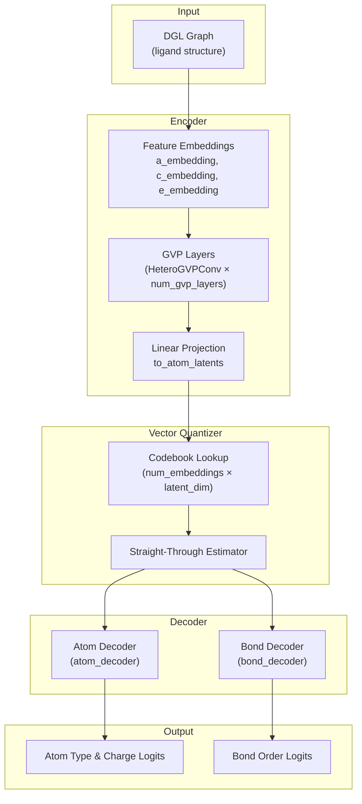
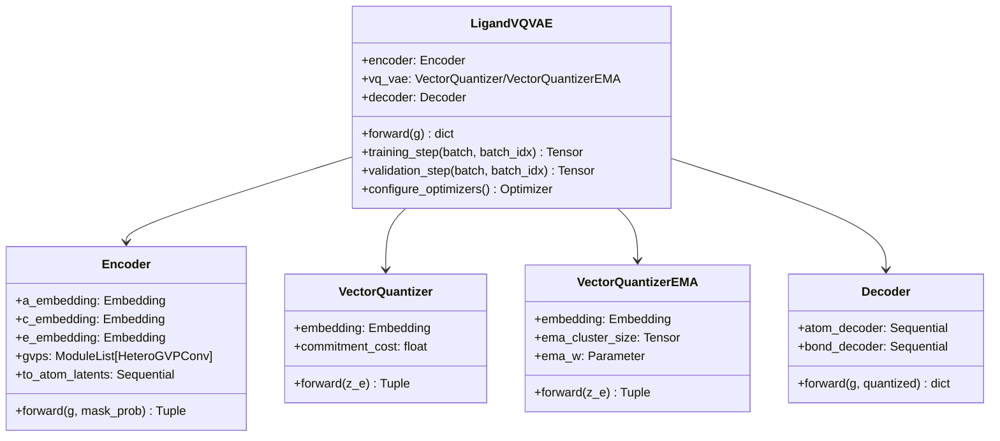
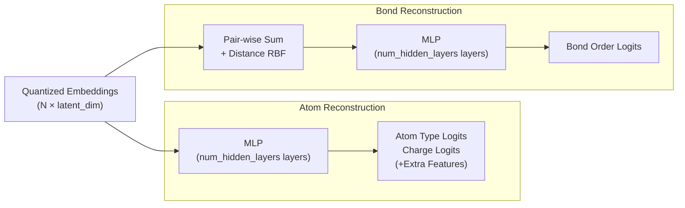
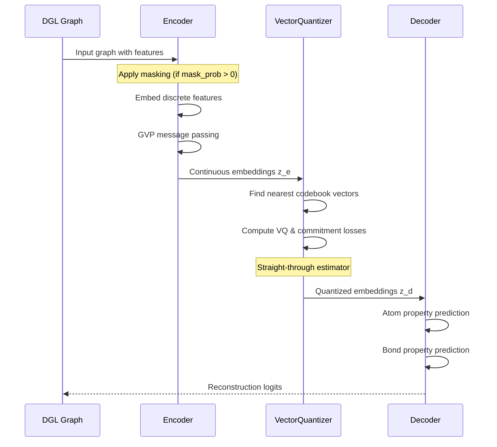

# Ligand Encoder (VQ-VAE)

<details>
<summary>Relevant source files</summary>

The following files were used as context for generating this wiki page:

- [configs/ligand_encoder/vqvae.yaml](configs/ligand_encoder/vqvae.yaml)
- [notebooks/ligand_viewer.ipynb](notebooks/ligand_viewer.ipynb)
- [omtra/models/ligand_encoder/vq.py](omtra/models/ligand_encoder/vq.py)

</details>


## Purpose and Scope

The Ligand Encoder is a Vector-Quantized Variational AutoEncoder (VQ-VAE) that learns discrete representations of ligand molecules. This component provides an alternative approach to ligand representation learning that can be used for pre-training, data augmentation, or as an auxiliary task during OMTRA training. This page describes the VQ-VAE architecture, training process, and configuration.

**Note:** This page covers the VQ-VAE component specifically. For information about the main OMTRA generative model, see [OMTRA Generative Model](#4.1). For general molecular featurization, see [Molecular Featurization (MolXACE)](#6.3).

## Overview

The Ligand Encoder implements a VQ-VAE architecture that learns to compress ligand molecular structures into discrete latent codes. Unlike continuous autoencoders, VQ-VAE uses a learned codebook of discrete vectors, enabling the model to:

- Learn semantically meaningful discrete representations of molecular substructures
- Provide a form of regularization through quantization
- Enable interpretable clustering of molecular features
- Potentially serve as a discrete prior for generation tasks

The VQ-VAE consists of three main components working together: an `Encoder` that maps molecules to continuous embeddings, a `VectorQuantizer` that discretizes these embeddings using a learned codebook, and a `Decoder` that reconstructs the original molecule from the quantized representation.

**Sources:** [omtra/models/ligand_encoder/vq.py:1-600]()

## Architecture Overview



**Diagram: VQ-VAE Architecture Pipeline**

The architecture processes ligands through three stages: encoding to continuous embeddings, quantization to discrete codes, and decoding back to molecular properties.

**Sources:** [omtra/models/ligand_encoder/vq.py:362-543]()

## Core Components

### LigandVQVAE Class

The `LigandVQVAE` class is the main PyTorch Lightning module that orchestrates training and inference:



**Diagram: Class Structure**

**Sources:** [omtra/models/ligand_encoder/vq.py:362-600]()

### Encoder

The encoder transforms a ligand graph into continuous latent embeddings using GVP layers:

| Component | Description | Configuration |
|-----------|-------------|---------------|
| `a_embedding` | Atom type embeddings | `num_embeddings=len(lig_atom_type_map)+mask_token` |
| `c_embedding` | Charge embeddings | `num_embeddings=len(charge_map)+mask_token` |
| `e_embedding` | Bond order embeddings | `num_embeddings=len(bond_type_map)` |
| `extra_feats_embedding` | Optional extra feature embeddings | Conditional on `use_extra_feats` |
| `gvps` | GVP message passing layers | `num_gvp_layers` iterations |
| `to_atom_latents` | Project to latent space | Output: `latent_dim` dimensions |

**Masking:** The encoder supports random masking of atom features during training (controlled by `mask_prob`) to encourage robustness and prevent overfitting.

**Sources:** [omtra/models/ligand_encoder/vq.py:19-149]()

### Vector Quantizer

Two quantizer variants are available:

#### Standard VectorQuantizer

Uses gradient-based updates with a commitment loss:

- **Codebook:** `num_embeddings × latent_dim` learnable vectors
- **Lookup:** Finds nearest codebook vector via L2 distance
- **Loss:** `vq_loss + commitment_cost * commitment_loss`
- **Gradient Flow:** Straight-through estimator (STE)

#### VectorQuantizerEMA

Uses exponential moving average for codebook updates:

- **EMA Updates:** Codebook vectors updated via running statistics
- **Cluster Size:** Tracks usage frequency with Laplace smoothing
- **Loss:** Only commitment loss (no VQ loss)
- **Advantages:** More stable training, better codebook utilization

The straight-through estimator enables gradient flow:
```python
quantized = z_e + (quantized - z_e).detach()
```

**Sources:** [omtra/models/ligand_encoder/vq.py:152-269]()

### Decoder

The decoder reconstructs molecular properties from quantized embeddings:



**Diagram: Decoder Architecture**

For bond prediction, the decoder:
1. Computes pair-wise features: `quantized[i] + quantized[j]`
2. Concatenates with RBF-encoded distances
3. Passes through bond decoder MLP

**Sources:** [omtra/models/ligand_encoder/vq.py:271-359]()

## Training Process

### Forward Pass



**Diagram: Training Forward Pass**

**Sources:** [omtra/models/ligand_encoder/vq.py:481-543]()

### Loss Functions

The total loss combines multiple components:

| Loss Type | Formula | Purpose | Weight |
|-----------|---------|---------|--------|
| VQ Loss | `MSE(quantized, z_e.detach())` | Codebook learning | 1.0 |
| Commitment Loss | `MSE(quantized.detach(), z_e)` | Encoder commitment | `commitment_cost` |
| Atom Type Loss | `CrossEntropy(logits['atom_type'], targets)` | Type reconstruction | 1.0 |
| Atom Charge Loss | `CrossEntropy(logits['atom_charge'], targets)` | Charge reconstruction | 1.0 |
| Bond Order Loss | `CrossEntropy(logits['bond_order'], targets)` | Bond reconstruction | 1.0 |
| Zero Bond Loss | `CrossEntropy(logits['bond_order'][zero_idx], ...)` | Non-bond pairs | `e_zero_cost` |
| Extra Features Loss | `CrossEntropy(logits[feat], targets)` | Optional features | `extra_feats_cost` |

**Note:** When using EMA quantizer, VQ loss is omitted (codebook updated via EMA).

**Sources:** [omtra/models/ligand_encoder/vq.py:469-593]()

### Metrics Tracked

During training and validation:

```python
{
    'vq+commitment_loss': ...,
    'a_recon_loss': ...,
    'c_recon_loss': ...,
    'e_non_zero_recon_loss': ...,
    'e_zero_recon_loss': ...,
    'a_accuracy': ...,
    'c_accuracy': ...,
    'e_accuracy': ...,
    'e_non_zero_accuracy': ...,
    'perplexity': ...,
    'num_unique_codes': ...
}
```

**Perplexity:** Measures codebook utilization (higher = better usage diversity)
**Num Unique Codes:** Counts distinct codebook vectors used in batch

**Sources:** [omtra/models/ligand_encoder/vq.py:518-541]()

## Configuration

The VQ-VAE is configured via YAML files:

### Core Parameters

| Parameter | Default | Description |
|-----------|---------|-------------|
| `scalar_size` | 128 | GVP scalar feature dimension |
| `vector_size` | 4 | GVP vector feature dimension |
| `num_gvp_layers` | 3 | Number of GVP layers in encoder |
| `latent_dim` | 8 | Latent embedding dimension |
| `num_embeddings` | 100 | Codebook size |

### Decoder Configuration

| Parameter | Default | Description |
|-----------|---------|-------------|
| `num_decod_hiddens` | 128 | Atom decoder hidden dimension |
| `num_bond_decod_hiddens` | 128 | Bond decoder hidden dimension |
| `num_hidden_layers` | 3 | MLP depth in decoders |

### Training Configuration

| Parameter | Default | Description |
|-----------|---------|-------------|
| `commitment_cost` | 0.25 | Weight for commitment loss |
| `mask_prob` | 0.0 | Atom masking probability |
| `use_ema` | True | Use EMA for codebook updates |
| `decay` | 0.99 | EMA decay rate |
| `e_zero_cost` | 1.0 | Weight for zero-bond loss |

### Feature Configuration

| Parameter | Default | Description |
|-----------|---------|-------------|
| `a_embed_dim` | 16 | Atom type embedding dimension |
| `c_embed_dim` | 8 | Charge embedding dimension |
| `e_embed_dim` | 8 | Bond order embedding dimension |
| `use_extra_feats` | False | Include additional atom features |
| `extra_feats_cost` | 1.0 | Weight for extra feature losses |

**Sources:** [configs/ligand_encoder/vqvae.yaml:1-33]()

## Usage Example

### Training

From the notebook, the VQ-VAE is used standalone for ligand representation learning:

```python
# Load model from checkpoint
model = LigandVQVAE.load_from_checkpoint(checkpoint_path)

# Get codebook indices for a ligand
z_e, mask = model.encoder(g)
_, z_d, codebook_indices, perplexity, num_unique = model.vq_vae(z_e)

# codebook_indices: discrete codes for each atom
# Can be used for clustering, analysis, or discrete priors
```

### Visualization

The notebook demonstrates visualizing molecules with atoms colored by their codebook assignments, enabling interpretation of what discrete codes represent.

**Sources:** [notebooks/ligand_viewer.ipynb:1-400]()

## Integration with OMTRA

While the VQ-VAE is a standalone component, it can potentially be integrated with OMTRA in several ways:

1. **Pre-training:** Learn initial ligand representations
2. **Auxiliary Loss:** Add VQ commitment loss during OMTRA training
3. **Discrete Priors:** Use learned codes as categorical priors
4. **Data Augmentation:** Reconstruct molecules with slight variations

The configuration shows an optional `og_run_dir` parameter suggesting checkpointing and potential reuse in the main OMTRA training pipeline.

**Sources:** [omtra/models/ligand_encoder/vq.py:388-394]()

## Checkpointing

The VQ-VAE implements custom checkpointing logic:

```python
def manual_checkpoint(self, batch_idx: int):
    if batch_idx % self.checkpoint_interval == 0 and batch_idx != 0:
        # Keep only k_checkpoints most recent
        # Save to checkpoints/batch_{batch_idx}.ckpt
```

This maintains a rolling window of `k_checkpoints` most recent checkpoints, saving every `checkpoint_interval` batches.

**Sources:** [omtra/models/ligand_encoder/vq.py:448-467]()

---