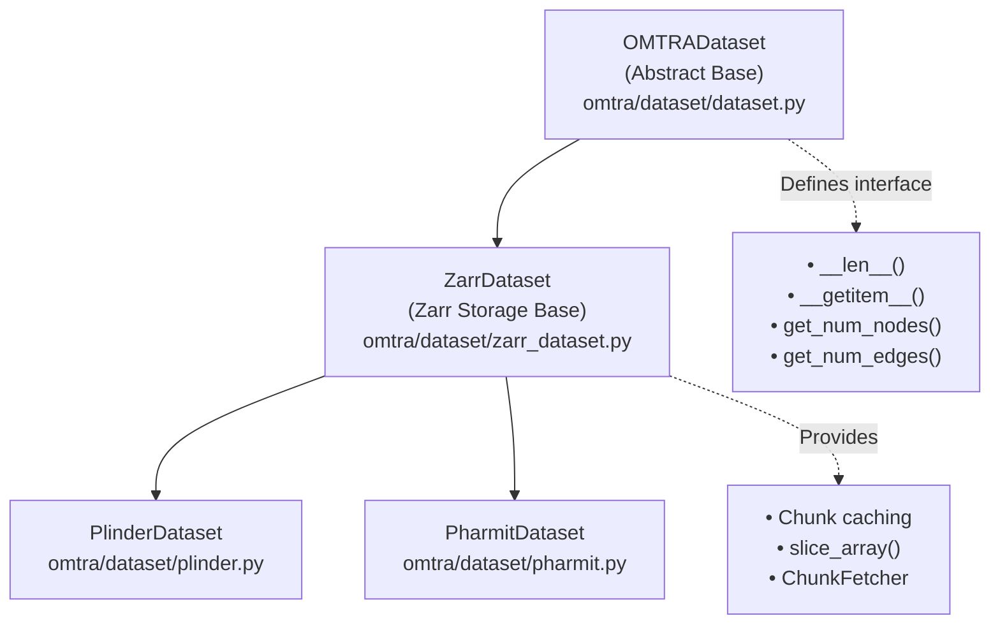
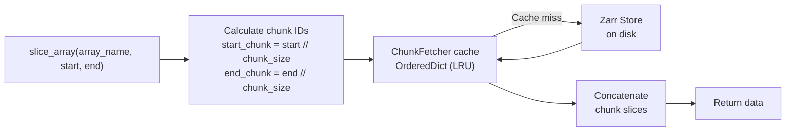
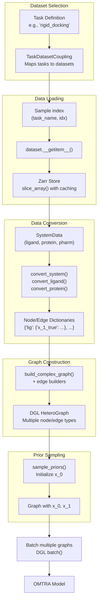
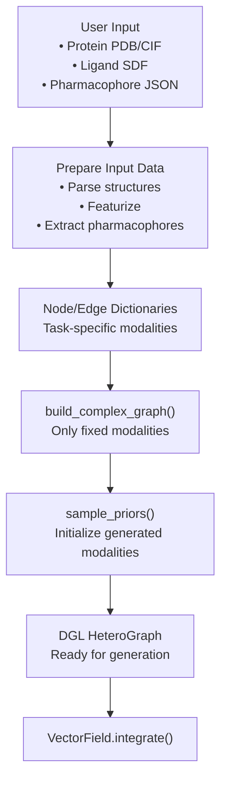

# Datasets and Data Loading

<details>
<summary>Relevant source files</summary>

The following files were used as context for generating this wiki page:

- [notebooks/working_with_graphs.ipynb](notebooks/working_with_graphs.ipynb)
- [notebooks/zarr_dev.ipynb](notebooks/zarr_dev.ipynb)
- [notebooks/zarr_memory_investigation.ipynb](notebooks/zarr_memory_investigation.ipynb)
- [omtra/dataset/dataset.py](omtra/dataset/dataset.py)
- [omtra/dataset/pharmit.py](omtra/dataset/pharmit.py)
- [omtra/dataset/plinder.py](omtra/dataset/plinder.py)
- [omtra/dataset/zarr_dataset.py](omtra/dataset/zarr_dataset.py)
- [omtra/tasks/tasks.py](omtra/tasks/tasks.py)

</details>


## Purpose and Scope

This page provides an overview of the dataset and data loading system in OMTRA. It covers the architecture of dataset classes, the Zarr-based storage system, and how data flows from disk into training and sampling pipelines. For detailed information about specific components, see:

- **Dataset overview and interfaces**: [Dataset Overview](#5.1)
- **Plinder dataset specifics**: [Plinder Dataset](#5.2)
- **Pharmit dataset specifics**: [Pharmit Dataset](#5.3)
- **Zarr storage internals**: [Zarr Storage System](#5.4)
- **Graph construction process**: [Graph Construction](#5.5)
- **Data processing pipelines**: [Data Processing Pipelines](#6)

---

## System Overview

OMTRA uses a multi-dataset training approach where different datasets provide different types of molecular data. The system is designed around three key principles:

1. **Efficient storage**: Large molecular datasets are stored in Zarr format with chunk-based caching to minimize disk I/O
2. **Task-driven loading**: Datasets adapt what data they load based on the `Task` definition (which modalities are fixed vs. generated)
3. **Heterogeneous graphs**: All data is converted to DGL heterogeneous graphs with multiple node and edge types

The two primary datasets are:
- **PlinderDataset**: Protein-ligand complexes from the Plinder database, including pocket structures, non-polymer entities (NPNDEs), and optional apo/predicted structures
- **PharmitDataset**: Ligand conformers and associated pharmacophore features from the Pharmit database

Sources: [omtra/dataset/plinder.py:1-1000](), [omtra/dataset/pharmit.py:1-287](), [omtra/dataset/dataset.py:1-56]()

---

## Dataset Architecture

### Class Hierarchy



**Dataset Class Hierarchy and Responsibilities**

Sources: [omtra/dataset/dataset.py:7-56](), [omtra/dataset/zarr_dataset.py:14-117]()

### OMTRADataset Interface

The `OMTRADataset` abstract base class defines the contract all datasets must fulfill:

| Method | Return Type | Purpose |
|--------|-------------|---------|
| `name()` | `str` | Unique dataset identifier (e.g., "plinder", "pharmit") |
| `__len__()` | `int` | Number of molecular systems in dataset |
| `__getitem__(index)` | `dgl.DGLHeteroGraph` | Retrieve a single graph by index |
| `get_num_nodes(task, start_idx, end_idx)` | `torch.Tensor` or `dict` | Count nodes for batch size estimation |
| `get_num_edges(task, start_idx, end_idx)` | `torch.Tensor` | Count edges for batch size estimation |

Sources: [omtra/dataset/dataset.py:7-56]()

---

## Zarr Storage System

### Storage Structure

Datasets store molecular data in **Zarr stores** - hierarchical, chunked array storage systems optimized for parallel I/O. Each dataset has a directory structure like:

```
processed_data/
├── train.zarr/
│   ├── ligand/
│   │   ├── coords          # (N_atoms, 3) positions
│   │   ├── atom_types      # (N_atoms,) atom type indices
│   │   ├── atom_charges    # (N_atoms,) formal charges
│   │   ├── bond_types      # (N_bonds,) bond order indices
│   │   └── bond_indices    # (N_bonds, 2) edge connectivity
│   ├── pocket/
│   │   ├── coords
│   │   ├── atom_names
│   │   └── ...
│   └── pharmacophore/
└── val.zarr/
```

Sources: [omtra/dataset/zarr_dataset.py:18-43](), [notebooks/zarr_dev.ipynb:286-359]()

### Chunk-Based Caching

The `ZarrDataset` class implements a `ChunkFetcher` to cache frequently accessed Zarr chunks in memory:



**Zarr Chunk Fetching and Caching Mechanism**

The `ChunkFetcher` maintains an LRU cache (default size: 4 chunks) to minimize disk reads. When data is requested via `slice_array()`, the system:

1. Computes which chunks are touched by the slice
2. Checks if chunks are in cache
3. Loads missing chunks from disk
4. Evicts least-recently-used chunks if cache is full
5. Concatenates and returns the requested slice

This is crucial for performance since molecular systems often have varying sizes, and sequential access patterns are common during training.

Sources: [omtra/dataset/zarr_dataset.py:44-117]()

---

## Dataset Classes

### PlinderDataset

The `PlinderDataset` provides protein-ligand complex data with rich structural information:

**Key Data Components:**
- **Ligand**: Coordinates, atom types, charges, bonds (MolXACE representation)
- **Receptor/Pocket**: Full protein structure and binding pocket atoms
- **NPNDEs**: Non-polymer entities (cofactors, ions, covalently bound ligands)
- **Pharmacophores**: Interaction features with type, position, and direction vectors
- **Linked structures**: Optional apo or predicted structures for flexible docking tasks

**Main Methods:**

| Method | Purpose |
|--------|---------|
| `get_system(index, ...)` | Load all data for a single system from Zarr arrays |
| `convert_system(...)` | Convert `SystemData` to graph dictionaries |
| `convert_ligand(...)` | Convert ligand to MolXACE, handle fake atoms, add to graph |
| `convert_protein(...)` | Extract pocket atoms, build residue-level representation |
| `convert_pharmacophore(...)` | Sample and convert pharmacophore features |
| `convert_npndes(...)` | Aggregate non-polymer entities |
| `__getitem__(index)` | Full pipeline: load → convert → build graph → sample priors |

The `__getitem__` method is task-aware: it only loads and converts data for modalities that are present in the requested task.

Sources: [omtra/dataset/plinder.py:53-1705]()

### PharmitDataset

The `PharmitDataset` provides ligand-only data, primarily used for training ligand generation and pharmacophore modeling:

**Key Data Components:**
- **Ligand**: Positions, atom types, charges, bonds, optional extra atom features
- **Pharmacophore**: Randomly sampled subset of pharmacophore points (1 to `max_pharms_sampled`)

**Simplified Architecture:**
- Fewer node types (only `lig` and `pharm`)
- No protein data
- Faster loading for ligand-centric tasks

The dataset supports both standard atom typing (separate atom type and charge) and condensed atom typing (combined representation).

Sources: [omtra/dataset/pharmit.py:24-287]()

---

## Data Flow: Training Pipeline



**Data Flow from Storage to Model During Training**

The training data flow proceeds through several stages:

1. **Task Selection**: The `MultiTaskSampler` selects a task and dataset based on configured probabilities
2. **Index Generation**: The sampler generates a `(task_name, index)` tuple
3. **Data Loading**: `__getitem__()` calls `get_system()` which uses `slice_array()` to efficiently load data from Zarr
4. **Conversion**: Raw data is converted to dictionaries of tensors organized by node/edge type
5. **Graph Building**: `build_complex_graph()` creates a DGL heterograph with task-specific edges
6. **Prior Sampling**: Initial states `x_0` are sampled according to task-specific prior configurations
7. **Batching**: Multiple graphs are batched together using DGL's batching mechanism

Sources: [omtra/dataset/plinder.py:1000-1170](), [omtra/dataset/pharmit.py:74-231](), [omtra/data/graph:1-100]()

---

## Data Flow: Sampling/Inference Pipeline

During sampling, the data flow is similar but with key differences:



**Sampling Data Preparation Flow**

Key differences from training:
- Input comes from user-provided files, not Zarr datasets
- Only **fixed modalities** are loaded from input (e.g., protein structure for docking)
- **Generated modalities** are initialized from priors (e.g., ligand structure sampled from noise)
- No batching of multiple systems (typically one system at a time)

Sources: [routines/sample.py:1-500]() (not provided but referenced in diagrams)

---

## Task-Driven Data Loading

Datasets are **task-aware**: they only load and process data required by the task definition.

### Example: Rigid Docking Task

```python
# From omtra/tasks/tasks.py
@register_task("rigid_docking")
class RigidDocking(Task):
    groups_fixed = ["ligand_identity", "protein_identity", "protein_structure"]
    groups_generated = ["ligand_structure"]
```

When loading data for this task, the dataset will:
- ✅ Load ligand atom types and charges (ligand_identity)
- ✅ Load protein sequence and structure (protein_identity, protein_structure)
- ✅ Load pocket definition
- ❌ Skip pharmacophore data (not in `groups_fixed` or `groups_generated`)
- ❌ Skip apo/predicted structures (not needed)

This conditional loading significantly reduces I/O and memory usage.

Sources: [omtra/tasks/tasks.py:33-44](), [omtra/dataset/plinder.py:172-430]()

### Modality Groups

Tasks organize molecular features into **modality groups**:

| Modality Group | Description | Example Features |
|----------------|-------------|------------------|
| `ligand_identity` | Ligand atom types, topology | Atom types, charges, bond types |
| `ligand_structure` | Ligand 3D coordinates | Atom positions |
| `protein_identity` | Protein sequence | Residue types, atom names |
| `protein_structure` | Protein 3D coordinates | Atom/residue positions |
| `pharmacophore` | Interaction features | Pharmacophore types, positions, vectors |

A task specifies which groups are **fixed** (provided as input) and which are **generated** (predicted by the model).

Sources: [omtra/tasks/modalities.py:1-100]() (not provided but referenced), [omtra/tasks/tasks.py:1-226]()

---

## Key Design Decisions

### 1. Zarr Over HDF5/Other Formats

**Why Zarr?**
- Chunked storage enables efficient partial reads
- Built-in compression reduces disk usage
- Simple directory-based format (easier debugging)
- Good Python ecosystem support

Trade-off: Requires careful chunk size tuning for optimal performance.

Sources: [omtra/dataset/zarr_dataset.py:14-43]()

### 2. Heterogeneous Graphs Over Homogeneous

**Why DGL HeteroGraphs?**
- Different node types (ligand atoms, protein atoms, residues, pharmacophores) have different features
- Different edge types (covalent bonds, spatial proximity, ligand-protein interactions) require different processing
- Enables task-specific edge construction

Trade-off: More complex graph construction code.

Sources: [omtra/data/graph:1-100]() (referenced in code)

### 3. Sparse Graph Representation

Molecular graphs are stored using **edge index tensors** `(2, E)` rather than adjacency matrices `(N, N)`:

- Memory: O(E) vs O(N²)
- For typical molecules with N=50 atoms and ~50 bonds: ~50x memory savings
- Enables efficient batching of variable-size graphs

Sources: [notebooks/working_with_graphs.ipynb:176-305]()

### 4. Chunk-Based Caching

The `ChunkFetcher` caches Zarr chunks in an LRU fashion:

**Benefits:**
- Reduces redundant disk reads during sequential access
- Configurable cache size (default: 4 chunks)
- Automatic eviction of least-recently-used chunks

**Cache Size Selection:**
- Too small: Frequent cache misses, poor performance
- Too large: Excessive memory usage
- Default (4) balances these concerns for typical molecular datasets

Sources: [omtra/dataset/zarr_dataset.py:88-117]()

---

## MolXACE Representation

Ligands are represented using the **MolXACE** format - a standardized molecular representation:

| Component | Shape | Description |
|-----------|-------|-------------|
| `x` | `(N, 3)` | 3D coordinates |
| `a` | `(N,)` | Atom types (element + hybridization) |
| `c` | `(N,)` | Formal charges |
| `e` | `(E,)` | Bond orders (single=1, double=2, triple=3) |
| `edge_idxs` | `(2, E)` | Bond connectivity |

Optional extra features:
- `impl_H`: Implicit hydrogen count
- `aro`: Aromaticity flag
- `hyb`: Hybridization state
- `ring`: Ring membership
- `chiral`: Chirality tag

**Condensed Atom Typing:** For some tasks, atom type and charge are combined into a single `cond_a` feature using a learned vocabulary.

Sources: [omtra/data/xace_ligand.py:1-100]() (not provided but referenced), [omtra/dataset/plinder.py:681-736](), [omtra/data/condensed_atom_typing.py:1-100]() (not provided but referenced)

---

## Graph Lookup Tables

Zarr datasets use **lookup tables** to map system indices to data slices:

```python
# Example from plinder.py
system_info = self.system_lookup[self.system_lookup["system_idx"] == index].iloc[0]

lig_atom_start = int(system_info["lig_atom_start"])
lig_atom_end = int(system_info["lig_atom_end"])

coords = self.slice_array("ligand/coords", lig_atom_start, lig_atom_end)
```

**Lookup Table Structure:**

| Column | Type | Purpose |
|--------|------|---------|
| `system_idx` | int | Unique system identifier |
| `lig_atom_start` | int | Start index in concatenated atom array |
| `lig_atom_end` | int | End index (exclusive) |
| `lig_bond_start` | int | Start index in bond array |
| `lig_bond_end` | int | End index (exclusive) |
| `pocket_start` | int | Start index for pocket atoms |
| ... | ... | Similar for other data types |

This enables O(1) lookup of variable-size molecular data from concatenated arrays.

Sources: [omtra/dataset/plinder.py:87-88](), [omtra/dataset/plinder.py:172-430](), [notebooks/zarr_dev.ipynb:262-283]()

---

## Summary

The OMTRA data loading system is designed for:

1. **Efficiency**: Zarr storage with chunk caching minimizes I/O
2. **Flexibility**: Task-driven loading adapts to different training objectives
3. **Scalability**: Sparse graph representations handle variable-size molecules
4. **Multi-dataset training**: Unified interface supports Plinder and Pharmit datasets

The key abstraction is the `(task_name, index) → DGLHeteroGraph` mapping, which encapsulates all the complexity of data loading, conversion, and graph construction into a simple interface for training and sampling routines.

For implementation details, see the child pages: [Dataset Overview](#5.1), [Plinder Dataset](#5.2), [Pharmit Dataset](#5.3), [Zarr Storage System](#5.4), and [Graph Construction](#5.5).

---