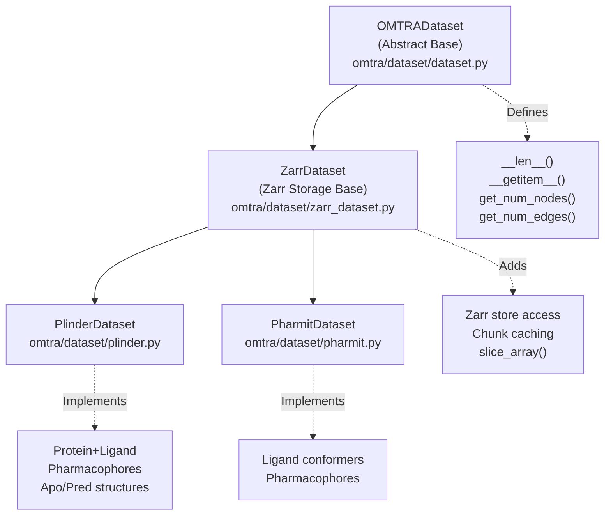
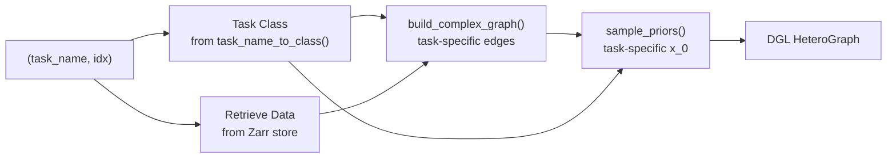
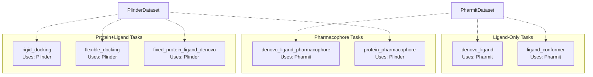
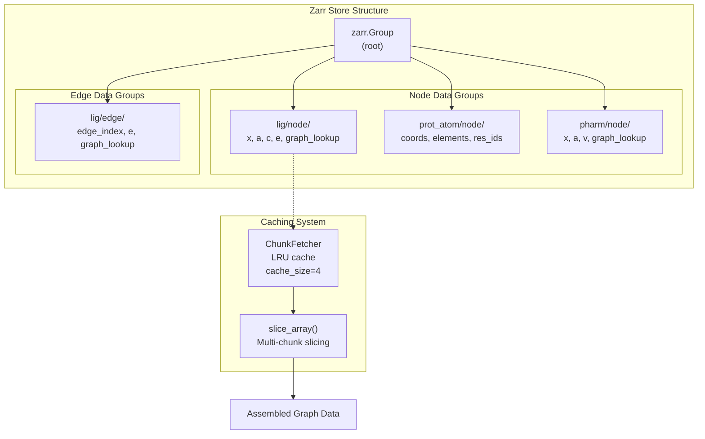
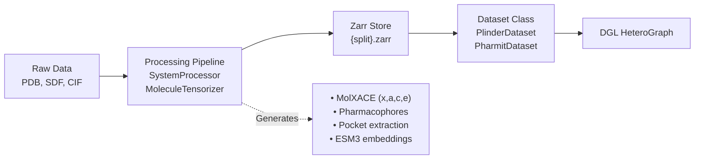
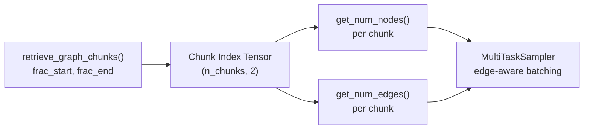

# Dataset Overview

Relevant source files

The following files were used as context for generating this wiki page:

- [notebooks/working_with_graphs.ipynb](notebooks/working_with_graphs.ipynb)
- [notebooks/zarr_dev.ipynb](notebooks/zarr_dev.ipynb)
- [notebooks/zarr_memory_investigation.ipynb](notebooks/zarr_memory_investigation.ipynb)
- [omtra/dataset/dataset.py](omtra/dataset/dataset.py)
- [omtra/dataset/pharmit.py](omtra/dataset/pharmit.py)
- [omtra/dataset/plinder.py](omtra/dataset/plinder.py)
- [omtra/dataset/zarr_dataset.py](omtra/dataset/zarr_dataset.py)
- [omtra/tasks/tasks.py](omtra/tasks/tasks.py)

This page provides a high-level overview of the dataset system in OMTRA, including the available datasets, storage architecture, and access patterns. For detailed information about specific datasets, see [Plinder Dataset](#5.2), [Pharmit Dataset](#5.3), [Zarr Storage System](#5.4), and [Graph Construction](#5.5).

## Purpose and Scope

OMTRA uses two primary datasets for training multi-task generative models:
- **Plinder**: Protein-ligand complexes with structural information
- **Pharmit**: Ligand-only conformer data with pharmacophore annotations

All datasets inherit from a common interface and use Zarr-based storage for efficient chunk-cached access to large-scale molecular data. Datasets return DGL heterogeneous graphs that encode molecular structure according to task-specific requirements.

## Dataset Class Hierarchy

**Dataset Class Hierarchy**

Sources: [omtra/dataset/dataset.py:1-56](), [omtra/dataset/zarr_dataset.py:1-117](), [omtra/dataset/plinder.py:1-53](), [omtra/dataset/pharmit.py:1-24]()

## Available Datasets

| Dataset | Data Type | Node Types | Key Features | Storage Format |
|---------|-----------|------------|--------------|----------------|
| **Plinder** | Protein-ligand complexes | `lig`, `prot_atom`, `prot_res`, `npnde`, `pharm` | Holo/Apo/Pred structures, pockets, covalent bonds, pharmacophores | Zarr (by system) |
| **Pharmit** | Ligand conformers | `lig`, `pharm` | Small molecule conformers, pharmacophore features | Zarr (by molecule) |

Both datasets support:
- Multiple training splits (`train`, `val`, `test`)
- Chunk-based caching for efficient disk access
- Task-specific graph construction
- Prior sampling for generative modeling

Sources: [omtra/dataset/plinder.py:53-104](), [omtra/dataset/pharmit.py:24-55]()

## Task-Based Data Access

OMTRA datasets are accessed using `(task_name, idx)` tuples rather than simple integer indices. This design allows:
1. Task-specific feature generation (fixed vs. generated modalities)
2. Conditional path sampling based on task requirements
3. Prior distribution selection per task
4. Dynamic graph structure based on task needs

**Task-Based Dataset Access Pattern**

Sources: [omtra/dataset/plinder.py:965-1032](), [omtra/dataset/pharmit.py:74-231](), [omtra/tasks/tasks.py:1-226]()

### Example Tasks and Dataset Usage

**Task-Dataset Coupling Examples**

Sources: [omtra/tasks/tasks.py:13-183]()

## Dataset Interface

All datasets implement the `OMTRADataset` abstract interface:

| Method | Purpose | Returns |
|--------|---------|---------|
| `__len__()` | Number of examples in dataset | `int` |
| `__getitem__((task, idx))` | Retrieve graph for task/index | `dgl.DGLHeteroGraph` |
| `get_num_nodes(task, start, end)` | Count nodes in index range | `torch.Tensor` or `dict` |
| `get_num_edges(task, start, end)` | Estimate edges in index range | `torch.Tensor` |
| `name` (property) | Dataset identifier | `str` ("plinder" or "pharmit") |

Sources: [omtra/dataset/dataset.py:7-56]()

## Zarr-Based Storage Architecture

Both Plinder and Pharmit datasets use Zarr for efficient storage and retrieval:

**Zarr Storage and Caching Architecture**

Key features:
- **Chunked arrays**: Data split into chunks (e.g., 500 graphs per chunk)
- **LRU caching**: Recently accessed chunks kept in memory
- **Multi-chunk slicing**: `slice_array()` efficiently retrieves data spanning multiple chunks
- **Graph lookup tables**: Map graph indices to node/edge data ranges

Sources: [omtra/dataset/zarr_dataset.py:14-117]()

## Data Processing Pipeline

**Data Flow from Raw Files to Graphs**

The processing pipeline converts raw molecular data into Zarr stores during preprocessing. At training/inference time, datasets read from Zarr and construct task-specific DGL graphs.

Sources: [omtra/dataset/plinder.py:172-430](), [omtra/dataset/pharmit.py:74-231]()

## Output Format: DGL Heterographs

All datasets return `dgl.DGLHeteroGraph` objects with:

**Node Types**:
- `lig`: Ligand atoms
- `prot_atom`: Protein atoms
- `prot_res`: Protein residues (backbone)
- `npnde`: Non-polymer/non-drug entities (cofactors, ions)
- `pharm`: Pharmacophore points

**Node Features** (task-dependent):
- `x_1_true`: 3D coordinates
- `a_1_true`: Atom/residue types
- `c_1_true`: Charges (ligand atoms)
- `v_1_true`: Direction vectors (pharmacophores)
- Prior samples: `x_0`, `a_0`, etc.

**Edge Types** (task-dependent):
- `lig_to_lig`: Chemical bonds
- `prot_atom_to_prot_atom`: Protein contacts
- `lig_to_prot_atom`: Ligand-protein interactions
- `pharm_to_lig`: Pharmacophore-ligand relationships
- Covalent edges: Special handling for covalent bonds

Sources: [omtra/data/graph.py]() (referenced in build_complex_graph calls), [omtra/dataset/plinder.py:902-963]()

## Key Dataset Properties

### PlinderDataset Specific

| Property | Description |
|----------|-------------|
| `link_version` | Specifies Plinder database linking version |
| `system_lookup` | DataFrame mapping system indices to data ranges |
| `npnde_lookup` | DataFrame for non-polymer entities |
| `weighted_sampling` | Optional cluster-based sampling (controlled by `pskip_factor`) |
| `fake_atom_p` | Probability of adding fake atoms for de novo generation |

Sources: [omtra/dataset/plinder.py:54-104]()

### PharmitDataset Specific

| Property | Description |
|----------|-------------|
| `max_pharms_sampled` | Max pharmacophore points per molecule (default: 8) |
| `n_categories_dict` | Vocabulary sizes for categorical features |
| `graphs_per_chunk` | Number of graphs per Zarr chunk |

Sources: [omtra/dataset/pharmit.py:24-55]()

## Chunk-Based Batching

Datasets support efficient batching aligned with Zarr chunk boundaries:

**Chunk-Based Batch Construction**

This enables:
- Distributed training across chunk ranges
- Memory-efficient batch construction
- Edge-aware batching (keep batches under max edge count)

Sources: [omtra/dataset/pharmit.py:237-287](), [omtra/dataset/zarr_dataset.py:37-38]()

## Integration with Training

Datasets integrate with the training system through:

1. **MultiTaskDataModule**: Combines multiple datasets with task-specific sampling
2. **TaskDatasetCoupling**: Maps tasks to datasets and sampling probabilities
3. **MultiTaskSampler**: Creates batches respecting edge budgets and chunk boundaries
4. **Prior sampling**: Each `__getitem__` call samples priors based on task configuration

For more details on training integration, see [Multi-Task Learning](#7.3).

Sources: [omtra/dataset/plinder.py:965-1032](), [omtra/dataset/pharmit.py:74-231]()

---