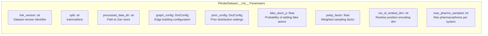
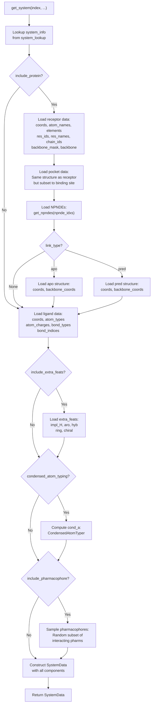
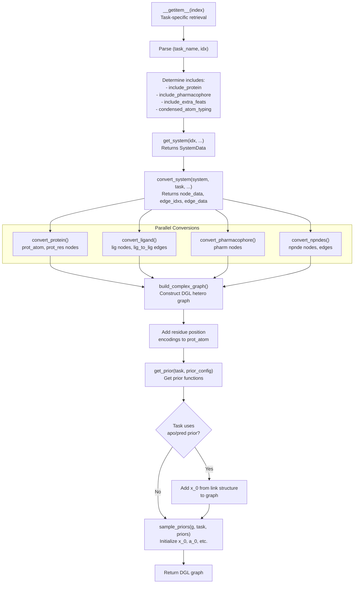
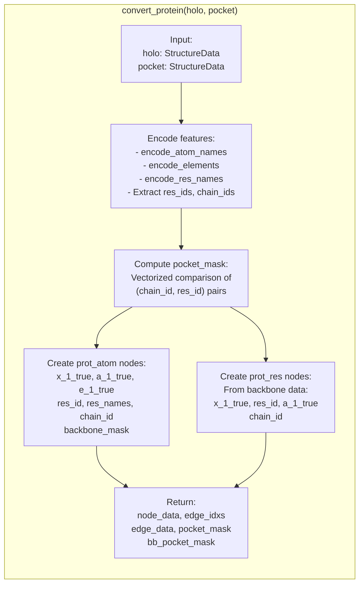
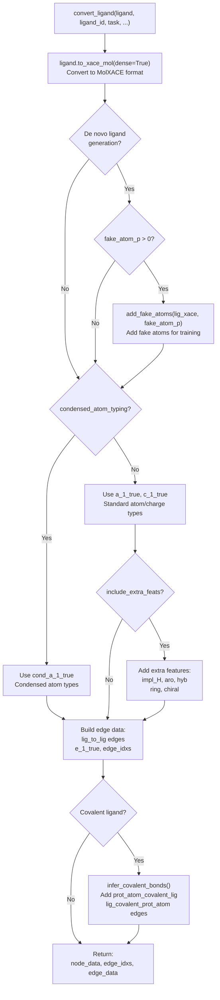
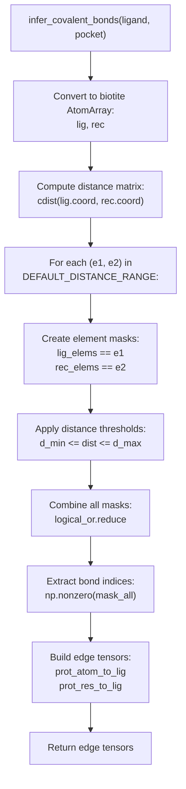
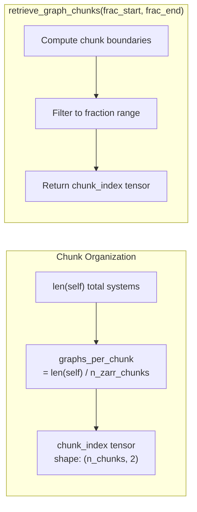

# Plinder Dataset

<details>
<summary>Relevant source files</summary>

The following files were used as context for generating this wiki page:

- [omtra/dataset/pharmit.py](omtra/dataset/pharmit.py)
- [omtra/dataset/plinder.py](omtra/dataset/plinder.py)
- [omtra/tasks/tasks.py](omtra/tasks/tasks.py)

</details>


The Plinder dataset provides protein-ligand complex data for training and evaluation of OMTRA models. It extends the `ZarrDataset` base class to load preprocessed molecular systems from Plinder database snapshots stored in Zarr format. The dataset handles retrieval and conversion of protein structures, ligands, pharmacophores, and non-polymer non-drug entities (NPNDEs) into DGL heterogeneous graphs suitable for flow matching training.

For information about the Pharmit dataset (ligand-only data), see [Pharmit Dataset](#5.3). For details about the underlying Zarr storage mechanism, see [Zarr Storage System](#5.4). For the data processing pipeline that creates the Zarr stores, see [Plinder Processing Pipeline](#6.1).

## Dataset Organization

The `PlinderDataset` class loads data from a Zarr store that organizes molecular systems hierarchically. Each system contains a protein-ligand complex with associated metadata and optional linked structures (apo/predicted).

### Zarr Storage Layout

```mermaid
graph TB
    subgraph "Zarr Root Structure"
        Root["Zarr Root"]
        
        subgraph "Receptor Data"
            RecCoords["receptor/coords"]
            RecAtomNames["receptor/atom_names"]
            RecElements["receptor/elements"]
            RecResIds["receptor/res_ids"]
            RecResNames["receptor/res_names"]
            RecChainIds["receptor/chain_ids"]
            RecBackboneMask["receptor/backbone_mask"]
            RecBBCoords["receptor/backbone_coords"]
            RecBBResIds["receptor/backbone_res_ids"]
            RecBBResNames["receptor/backbone_res_names"]
            RecBBChainIds["receptor/backbone_chain_ids"]
        end
        
        subgraph "Ligand Data"
            LigCoords["ligand/coords"]
            LigAtomTypes["ligand/atom_types"]
            LigAtomCharges["ligand/atom_charges"]
            LigBondTypes["ligand/bond_types"]
            LigBondIndices["ligand/bond_indices"]
            LigExtraFeats["ligand/extra_feats"]
        end
        
        subgraph "Pocket Data"
            PocketCoords["pocket/coords"]
            PocketAtomNames["pocket/atom_names"]
            PocketElements["pocket/elements"]
            PocketResIds["pocket/res_ids"]
            PocketResNames["pocket/res_names"]
            PocketChainIds["pocket/chain_ids"]
            PocketBackboneMask["pocket/backbone_mask"]
            PocketBBCoords["pocket/backbone_coords"]
            PocketBBResIds["pocket/backbone_res_ids"]
            PocketBBResNames["pocket/backbone_res_names"]
            PocketBBChainIds["pocket/backbone_chain_ids"]
        end
        
        subgraph "Pharmacophore Data"
            PharmCoords["pharmacophore/coords"]
            PharmTypes["pharmacophore/types"]
            PharmVectors["pharmacophore/vectors"]
            PharmInteractions["pharmacophore/interactions"]
        end
        
        subgraph "NPNDE Data"
            NPNDECoords["npnde/coords"]
            NPNDEAtomTypes["npnde/atom_types"]
            NPNDEAtomCharges["npnde/atom_charges"]
            NPNDEBondTypes["npnde/bond_types"]
            NPNDEBondIndices["npnde/bond_indices"]
        end
        
        subgraph "Link Data"
            ApoCoords["apo/coords"]
            ApoBBCoords["apo/backbone_coords"]
            PredCoords["pred/coords"]
            PredBBCoords["pred/backbone_coords"]
        end
        
        subgraph "Metadata"
            SystemLookup["attrs['system_lookup']"]
            NPNDELookup["attrs['npnde_lookup']"]
        end
    end
    
    Root --> RecCoords
    Root --> LigCoords
    Root --> PocketCoords
    Root --> PharmCoords
    Root --> NPNDECoords
    Root --> ApoCoords
    Root --> SystemLookup
```



**Sources:** [omtra/dataset/plinder.py:53-119]()

### System and NPNDE Lookups

The dataset maintains two pandas DataFrames for efficient indexing:

| Lookup Table | Purpose | Key Columns |
|--------------|---------|-------------|
| `system_lookup` | Maps system indices to data ranges in Zarr arrays | `system_idx`, `system_id`, `ligand_id`, `rec_start`, `rec_end`, `lig_atom_start`, `lig_atom_end`, `pocket_start`, `pocket_end`, `pharm_start`, `pharm_end`, `link_type`, `cluster_id`, `p_skip` |
| `npnde_lookup` | Maps NPNDE indices to data ranges | `npnde_idx`, `npnde_id`, `ccd`, `atom_start`, `atom_end`, `bond_start`, `bond_end`, `linkages` |

**Sources:** [omtra/dataset/plinder.py:87-93]()

## PlinderDataset Class

### Constructor Parameters



**Sources:** [omtra/dataset/plinder.py:54-86]()

### Encoding Dictionaries

The dataset maintains several encoding dictionaries for categorical features:

```python
# Protein atom feature encodings
encode_element: Dict[str, int]  # Element symbol → index
encode_residue: Dict[str, int]  # Residue name → index
encode_atom: Dict[str, int]     # Atom name → index

# Ligand charge encoding
charge_map_tensor: torch.Tensor  # Sorted charge values for searchsorted
```

**Sources:** [omtra/dataset/plinder.py:95-100]()

## Data Retrieval Methods

### System Retrieval Workflow



**Sources:** [omtra/dataset/plinder.py:172-430]()

### Key Retrieval Methods

| Method | Purpose | Returns |
|--------|---------|---------|
| `get_system(index, ...)` | Retrieves complete system data | `SystemData` |
| `get_npndes(npnde_idxs)` | Loads non-polymer entities by indices | `Dict[str, LigandData]` |
| `slice_array(path, start, end)` | Efficiently slices Zarr arrays (from parent class) | `np.ndarray` |

**Sources:** [omtra/dataset/plinder.py:121-166](), [omtra/dataset/plinder.py:172-430]()

## Conversion to Graph Format

The dataset converts raw molecular data into DGL heterogeneous graphs through a series of conversion methods.

### Conversion Pipeline



**Sources:** [omtra/dataset/plinder.py:968-1043]()

### Protein Conversion

The `convert_protein()` method processes protein structures into graph node and edge data:



**Sources:** [omtra/dataset/plinder.py:492-581]()

### Ligand Conversion

The `convert_ligand()` method handles ligand data with support for fake atoms and condensed atom typing:



**Sources:** [omtra/dataset/plinder.py:667-736]()

### Pharmacophore Conversion

The `convert_pharmacophore()` method handles pharmacophore feature data:

**Sources:** [omtra/dataset/plinder.py:877-900]()

### NPNDE Conversion

The `convert_npndes()` method processes multiple non-polymer entities, combining them into unified graph components:

**Sources:** [omtra/dataset/plinder.py:738-875]()

## Feature Encoding

### Categorical Feature Encoding

The dataset encodes various categorical features into integer indices:

```mermaid
graph TB
    subgraph "Atom Name Encoding"
        AtomNames["atom_names: np.ndarray"]
        UniqueAtoms["Find unique atom names"]
        LookupAtom["Map via encode_atom dict"]
        EncodedAtoms["Return encoded indices"]
        
        AtomNames --> UniqueAtoms
        UniqueAtoms --> LookupAtom
        LookupAtom --> EncodedAtoms
    end
    
    subgraph "Element Encoding"
        Elements["elements: np.ndarray"]
        UniqueElems["Find unique elements"]
        LookupElem["Map via encode_element dict"]
        EncodedElems["Return encoded indices"]
        
        Elements --> UniqueElems
        UniqueElems --> LookupElem
        LookupElem --> EncodedElems
    end
    
    subgraph "Residue Name Encoding"
        ResNames["res_names: np.ndarray"]
        UniqueRes["Find unique residue names"]
        LookupRes["Map via encode_residue dict<br/>with aa_substitutions fallback"]
        EncodedRes["Return encoded indices"]
        
        ResNames --> UniqueRes
        UniqueRes --> LookupRes
        LookupRes --> EncodedRes
    end
    
    subgraph "Charge Encoding"
        Charges["charges: torch.Tensor"]
        Searchsorted["torch.searchsorted<br/>on charge_map_tensor"]
        EncodedCharges["Return charge token indices"]
        
        Charges --> Searchsorted
        Searchsorted --> EncodedCharges
    end
```



**Sources:** [omtra/dataset/plinder.py:432-474](), [omtra/dataset/plinder.py:583-584]()

### Vectorized Encoding Methods

| Method | Purpose | Implementation |
|--------|---------|----------------|
| `encode_atom_names()` | Maps atom names to indices | Vectorized unique + dict lookup |
| `encode_elements()` | Maps element symbols to indices | Vectorized unique + dict lookup |
| `encode_res_names()` | Maps residue names to indices | Vectorized unique + dict lookup with substitutions |
| `encode_charges()` | Maps charge values to token indices | `torch.searchsorted` on sorted charge array |

**Sources:** [omtra/dataset/plinder.py:432-474](), [omtra/dataset/plinder.py:583-584]()

## Advanced Features

### Weighted Sampling

The dataset supports weighted sampling to balance training across clusters:

```python
# Enabled when pskip_factor > 0 and split == 'train'
weighted_sampling = pskip_factor > 0.0 and split == 'train'

# p_skip values computed per system based on cluster frequency
p_skip = 1 - freq_min / freq_system
p_skip = p_skip * pskip_factor
```

The `compute_pskip()` function calculates skip probabilities based on cluster frequencies, allowing underrepresented clusters to be sampled more frequently.

**Sources:** [omtra/dataset/plinder.py:80-93](), [omtra/dataset/plinder.py:1186-1219]()

### Fake Atoms

When `fake_atom_p > 0`, the dataset adds "fake" atoms to ligands during training to help the model learn to handle variable-sized molecules:

```python
if self.fake_atom_p > 0 and denovo_ligand:
    if condensed_atom_typing:
        cond_a_typer = self.get_condensed_atom_typer()
        lig_xace = add_fake_atoms(lig_xace, self.fake_atom_p, cond_a_typer)
    else:
        lig_xace = add_fake_atoms(lig_xace, fake_atom_p=self.fake_atom_p)
```

Fake atoms are added only for de novo ligand generation tasks and are accounted for in node count estimates.

**Sources:** [omtra/dataset/plinder.py:685-690](), [omtra/dataset/plinder.py:1133-1136]()

### Pharmacophore Sampling

To manage computational costs, the dataset randomly samples a subset of interacting pharmacophores per system:

```python
pharm_sample_size = np.random.randint(1, min(self.max_pharms_sampled, len(interacting_pharms)) + 1)
pharm_sample = np.random.choice(interacting_pharms, size=pharm_sample_size, replace=False)
```

Only pharmacophores with `interactions == True` are considered for sampling.

**Sources:** [omtra/dataset/plinder.py:394-414]()

### Condensed Atom Typing

The dataset supports condensed atom typing, which combines atom type and charge information into a single categorical feature:

```python
if condensed_atom_typing:
    cond_a_typer = self.get_condensed_atom_typer()
    ligand.atom_cond_a = torch.from_numpy(
        cond_a_typer.feats_to_cond_a(ligand.atom_types, ligand.atom_charges, lig_extra_feats)
    ).long()
```

This is enabled when `"ligand_identity_condensed"` is in the task's `groups_present`.

**Sources:** [omtra/dataset/plinder.py:359-366](), [omtra/dataset/plinder.py:169-170](), [omtra/dataset/plinder.py:687-688]()

### Covalent Bond Inference

For covalently bound ligands and NPNDEs, the dataset infers bonds to protein atoms:



**Sources:** [omtra/dataset/plinder.py:586-665]()

## Residue Position Encoding

The dataset computes sinusoidal position encodings for protein residues:

```python
# Standardize residue IDs within each chain
residue_idxs = self.standardize_residue_ids(prot_res_ids, prot_chain_ids)

# Create sinusoidal encodings
protein_position_encodings = residue_sinusoidal_encoding(residue_idxs, self.res_id_embed_dim)

# Add to graph
g.nodes["prot_atom"].data["pos_enc_1_true"] = protein_position_encodings
```

The `standardize_residue_ids()` method normalizes residue IDs within each chain to start from 0.

**Sources:** [omtra/dataset/plinder.py:1009-1018](), [omtra/dataset/plinder.py:1170-1184]()

## Chunking and Batch Loading

The dataset supports efficient chunked loading for distributed training:



The `get_num_nodes()` method provides node count estimates for efficient batch construction without loading actual data.

**Sources:** [omtra/dataset/plinder.py:106-116](), [omtra/dataset/plinder.py:1045-1066](), [omtra/dataset/plinder.py:1068-1146]()

### Node Count Estimation

```python
def get_num_nodes(self, task: Task, start_idx, end_idx, per_ntype=False):
    # Estimate node counts for each type
    lig_counts = lig_atom_end - lig_atom_start
    prot_atom_counts = pocket_end - pocket_start
    prot_res_counts = pocket_bb_end - pocket_bb_start
    npnde_counts = sum(npnde_atom_end - npnde_atom_start for each npnde)
    pharm_counts = expected_value(random.randint(1, max_pharms_sampled))
    
    # Adjust for fake atoms if enabled
    if self.fake_atom_p > 0:
        lig_counts += (fake_atom_p/2) * lig_counts
```

**Sources:** [omtra/dataset/plinder.py:1068-1146]()

## Data Structure Classes

The dataset uses data classes from `omtra.data.plinder` to represent molecular systems:

| Class | Purpose | Key Attributes |
|-------|---------|----------------|
| `SystemData` | Complete protein-ligand system | `system_id`, `ligand`, `receptor`, `pocket`, `pharmacophore`, `npndes`, `link` |
| `StructureData` | Protein structure | `coords`, `atom_names`, `elements`, `res_ids`, `res_names`, `chain_ids`, `backbone` |
| `BackboneData` | Backbone atoms only | `coords`, `res_ids`, `res_names`, `chain_ids` |
| `LigandData` | Ligand/NPNDE molecule | `coords`, `atom_types`, `atom_charges`, `bond_types`, `bond_indices`, `linkages` |
| `PharmacophoreData` | Pharmacophore features | `coords`, `types`, `vectors`, `interactions` |

**Sources:** [omtra/dataset/plinder.py:26-32]()

## Usage Example

```python
from omtra.dataset.plinder import PlinderDataset
from omegaconf import DictConfig

# Initialize dataset
dataset = PlinderDataset(
    link_version="2024_06_v2",
    split="train",
    processed_data_dir="/path/to/zarr",
    graph_config=graph_cfg,
    prior_config=prior_cfg,
    fake_atom_p=0.1,
    pskip_factor=0.5,
    max_pharms_sampled=8,
)

# Get a graph for a specific task
task_name = "rigid_docking"
idx = 42
graph = dataset[(task_name, idx)]

# Graph is a DGL heterograph with:
# - Node types: lig, prot_atom, prot_res, npnde, pharm (task-dependent)
# - Node features: x_1_true, a_1_true, etc. (target values)
#                  x_0, a_0, etc. (prior samples)
# - Edge types: lig_to_lig, prot_atom_to_lig, etc. (task-dependent)
# - Edge features: e_1_true, etc.
```

**Sources:** [omtra/dataset/plinder.py:53-119](), [omtra/dataset/plinder.py:968-1043]()

---