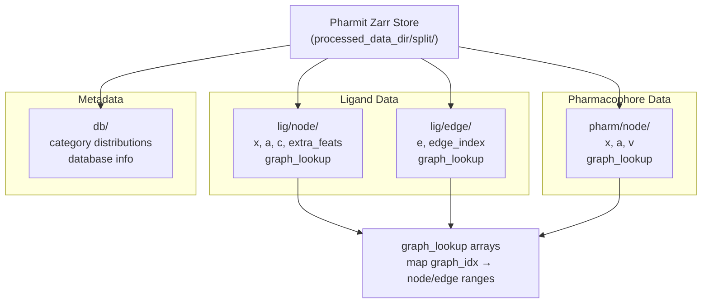
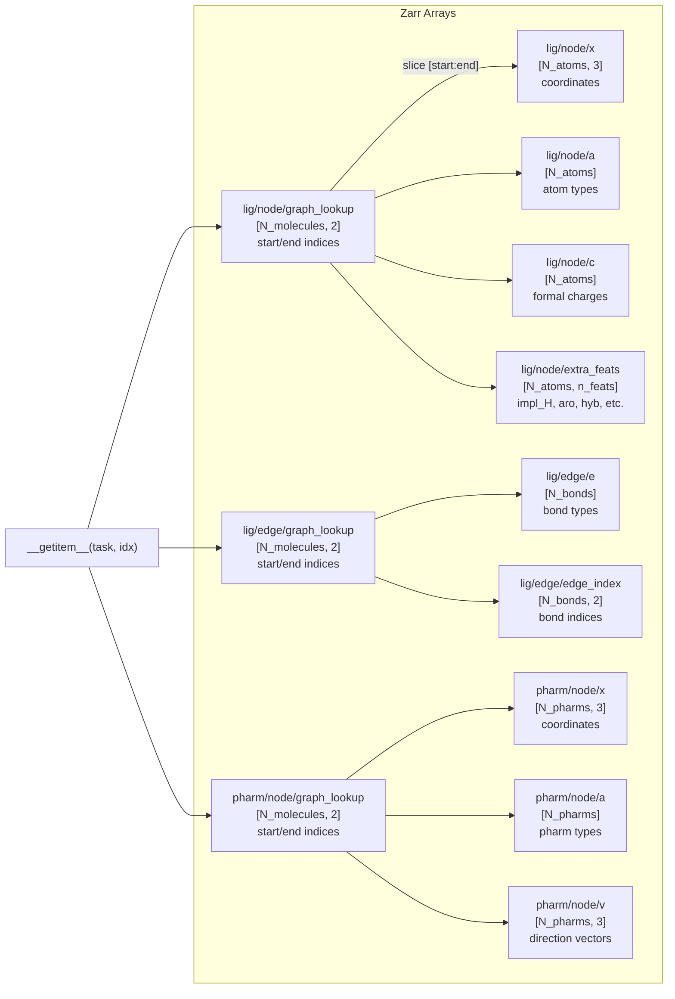
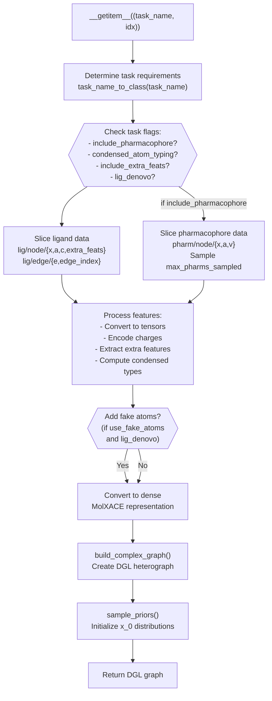
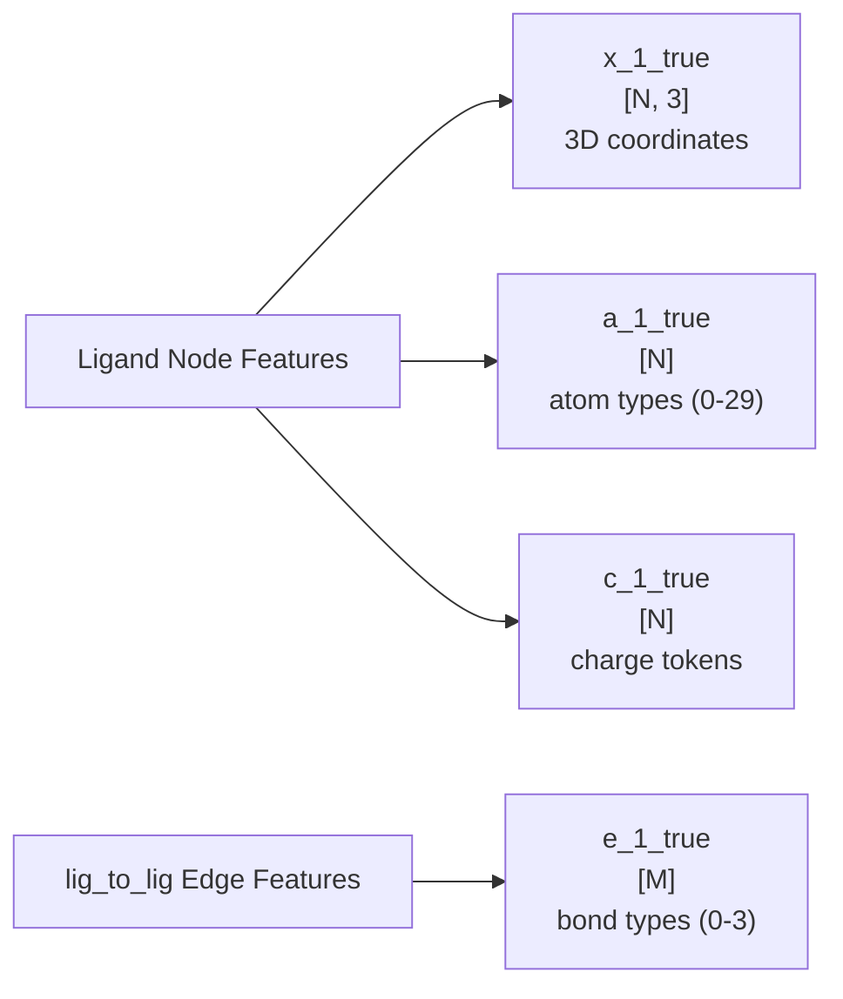
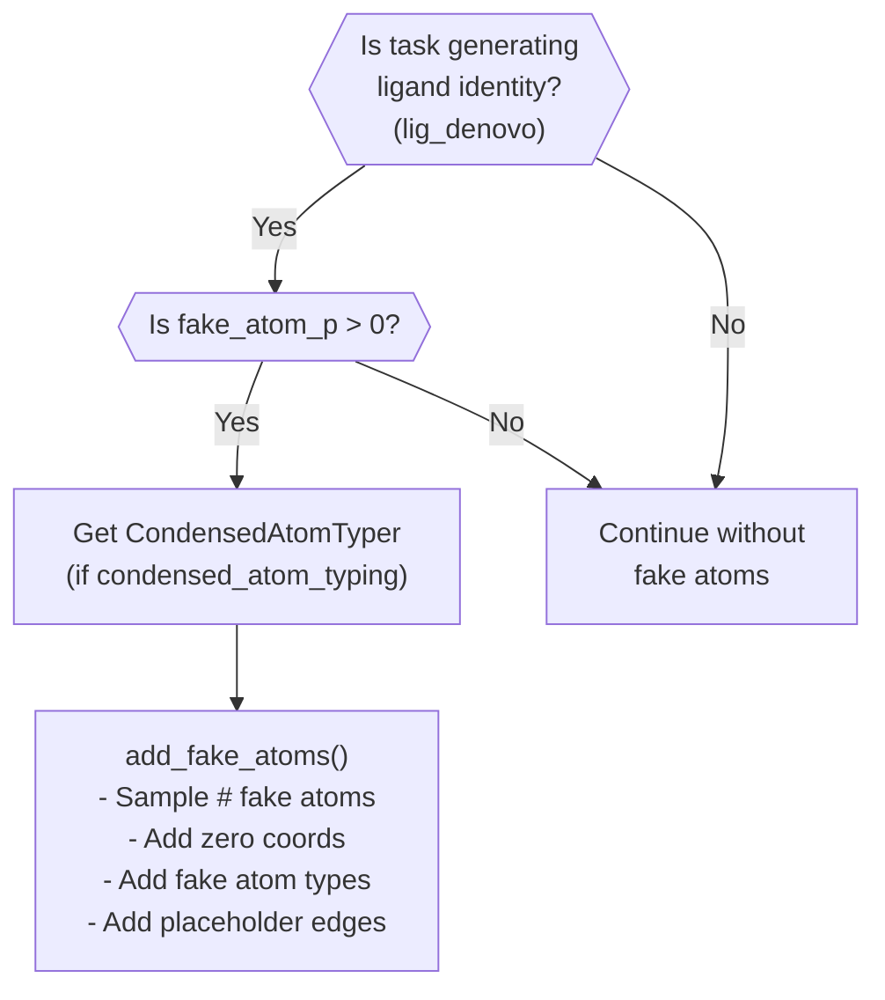
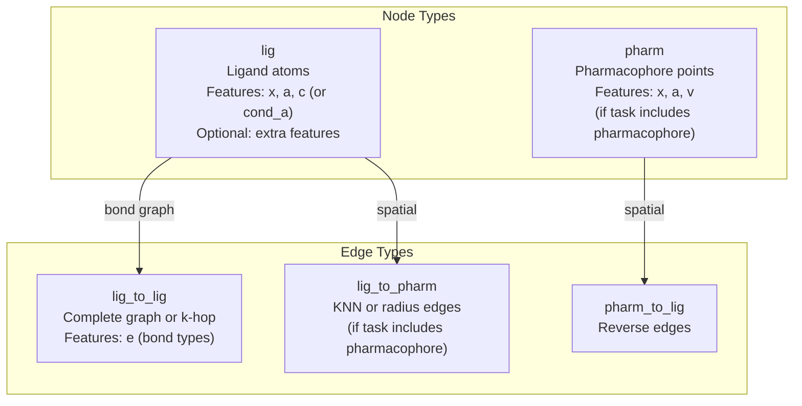
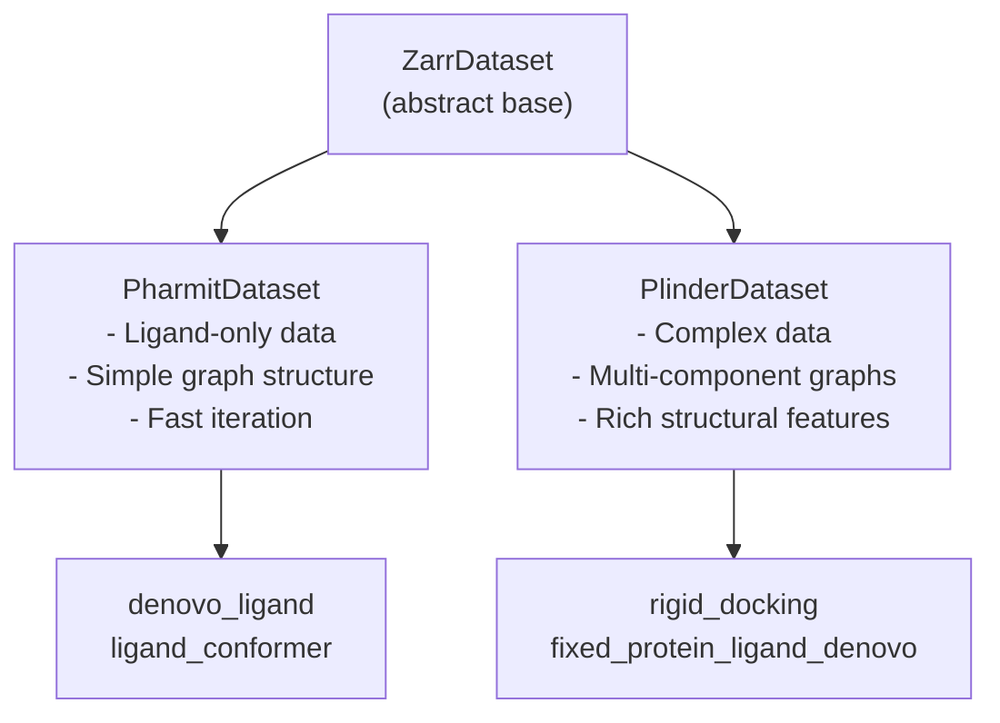

# Pharmit Dataset

<details>
<summary>Relevant source files</summary>

The following files were used as context for generating this wiki page:

- [omtra/dataset/pharmit.py](omtra/dataset/pharmit.py)
- [omtra/dataset/plinder.py](omtra/dataset/plinder.py)
- [omtra/tasks/tasks.py](omtra/tasks/tasks.py)

</details>


The Pharmit dataset provides ligand conformer structures and their associated pharmacophore features for training OMTRA models on ligand-only and pharmacophore-guided generation tasks. Unlike the Plinder dataset which focuses on protein-ligand complexes (see [5.2](#5.2)), Pharmit contains standalone ligand molecules with optional pharmacophore annotations, making it suitable for tasks like de novo ligand generation and conformer sampling.

For information about how Pharmit data is processed and converted to Zarr format, see [6.2](#6.2). For details on the underlying Zarr storage system, see [5.4](#5.4).

---

## Overview

The `PharmitDataset` class ([omtra/dataset/pharmit.py:24-287]()) provides access to preprocessed ligand and pharmacophore data stored in Zarr format. It handles:

- **Ligand structures**: Atomic coordinates, atom types, charges, bond information
- **Pharmacophore features**: Optional pharmacophore points with types and direction vectors
- **Graph construction**: Conversion of molecular data to DGL heterogeneous graphs
- **Feature augmentation**: Fake atoms, condensed atom typing, and extra atom features
- **Efficient data access**: Chunk-based loading from Zarr storage

**Dataset Organization**



**Sources**: [omtra/dataset/pharmit.py:24-287](), [omtra/dataset/zarr_dataset.py]()

---

## Dataset Initialization

The `PharmitDataset` class inherits from `ZarrDataset` and requires configuration for graph construction and prior sampling.

**Constructor Parameters**

| Parameter | Type | Description |
|-----------|------|-------------|
| `split` | str | Dataset split: "train", "val", or "test" |
| `processed_data_dir` | str | Path to processed Zarr data directory |
| `graph_config` | DictConfig | Graph construction configuration (edge types, builders) |
| `prior_config` | DictConfig | Prior distribution configuration for modalities |
| `fake_atom_p` | float | Probability of adding fake atoms (default: 0.0) |
| `max_pharms_sampled` | int | Maximum pharmacophores to sample per molecule (default: 8) |

**Category Mappings**

The dataset maintains category count dictionaries for categorical features ([omtra/dataset/pharmit.py:44-51]()):

```python
self.n_categories_dict = {
    'lig_a': len(lig_atom_type_map),        # Atom types (e.g., 30)
    'lig_c': len(charge_map),               # Formal charges
    'lig_cond_a': num_condensed_atom_types, # Condensed atom types
    'lig_e': 4,                             # Bond types (none, single, double, triple)
    'lig_e_condensed': 4,
    'pharm_a': len(ph_idx_to_type),         # Pharmacophore types
}
```

**Sources**: [omtra/dataset/pharmit.py:24-51](), [omtra/constants.py]()

---

## Zarr Storage Layout

Pharmit data is organized hierarchically in Zarr arrays with graph lookup indices for efficient random access.

**Storage Structure Diagram**



**Graph Lookup Mechanism**

Each molecule in the dataset has an index `idx`. The `graph_lookup` arrays map from molecule index to contiguous ranges in the node/edge arrays ([omtra/dataset/pharmit.py:91-92]()):

```python
start_idx, end_idx = self.slice_array('lig/node/graph_lookup', idx)
start_idx, end_idx = int(start_idx), int(end_idx)
```

This allows efficient slicing of all features for a specific molecule without loading the entire dataset.

**Sources**: [omtra/dataset/pharmit.py:89-126](), [omtra/dataset/zarr_dataset.py]()

---

## Data Loading Pipeline

The `__getitem__` method orchestrates the complete data loading and graph construction pipeline.

**Loading Process Flow**



**Key Steps**

1. **Task Analysis** ([omtra/dataset/pharmit.py:74-87]()): Determine which data components are needed based on the task's `groups_present` and `groups_generated`.

2. **Ligand Loading** ([omtra/dataset/pharmit.py:89-126]()): Slice coordinate, atom type, charge, and bond data using graph lookup indices.

3. **Feature Processing** ([omtra/dataset/pharmit.py:97-116]()): 
   - Load extra features if requested
   - Compute condensed atom types if required
   - Convert numpy arrays to torch tensors

4. **Pharmacophore Loading** ([omtra/dataset/pharmit.py:195-217]()): If task includes pharmacophores, randomly sample up to `max_pharms_sampled` pharmacophore points.

5. **Fake Atom Augmentation** ([omtra/dataset/pharmit.py:139-143]()): Add fake atoms with probability `fake_atom_p` if generating ligands de novo.

6. **Graph Construction** ([omtra/dataset/pharmit.py:219-225]()): Build DGL heterogeneous graph with appropriate edge types.

7. **Prior Sampling** ([omtra/dataset/pharmit.py:227-229]()): Initialize `x_0` distributions for flow matching.

**Sources**: [omtra/dataset/pharmit.py:74-231]()

---

## Feature Representations

### Ligand Features

The dataset supports three feature representation modes controlled by task configuration.

**Standard Mode** (default)



Implementation: [omtra/dataset/pharmit.py:176-183]()

**Extra Features Mode** (`ligand_identity_extra`)

Adds additional atom-level features:
- `impl_H_1_true`: Implicit hydrogen count
- `aro_1_true`: Aromaticity flag
- `hyb_1_true`: Hybridization state
- `ring_1_true`: Ring membership
- `chiral_1_true`: Chirality information

Implementation: [omtra/dataset/pharmit.py:96-106, 156-167]()

**Condensed Atom Typing Mode** (`ligand_identity_condensed`)

Combines atom type, charge, and extra features into a single condensed atom type token ([omtra/dataset/pharmit.py:107-116]()):

```python
cond_a_typer = self.get_condensed_atom_typer()
xace_dict['cond_a'] = cond_a_typer.feats_to_cond_a(
    xace_dict['a'], xace_dict['c'], extra_feats
)
```

This reduces the number of discrete tokens the model must predict, simplifying the generation process.

**Sources**: [omtra/dataset/pharmit.py:89-183](), [omtra/data/condensed_atom_typing.py]()

### Pharmacophore Features

When `'pharmacophore' in task.groups_present`, pharmacophore data is loaded and randomly sampled ([omtra/dataset/pharmit.py:195-217]()):

**Pharmacophore Node Features**

| Feature | Shape | Description |
|---------|-------|-------------|
| `x_1_true` | [N_pharm, 3] | 3D coordinates of pharmacophore points |
| `a_1_true` | [N_pharm] | Pharmacophore type (donor, acceptor, aromatic, etc.) |
| `v_1_true` | [N_pharm, 3] | Direction vectors for oriented features |

**Sampling Strategy**

Pharmacophores are randomly sampled to limit graph size ([omtra/dataset/pharmit.py:205-206]()):

```python
pharm_sample_size = np.random.randint(1, min(self.max_pharms_sampled, len(pharm_idxs)) + 1)
pharm_sample = np.random.choice(pharm_idxs, size=pharm_sample_size, replace=False)
```

This means each molecule gets between 1 and `max_pharms_sampled` (default: 8) pharmacophore points during training, introducing stochasticity and preventing overfitting to specific pharmacophore arrangements.

**Sources**: [omtra/dataset/pharmit.py:195-217](), [omtra/data/pharmacophores.py]()

---

## Fake Atoms Feature

Fake atoms are placeholder atoms added during training to help the model learn to handle variable-sized molecules and improve generation quality.

**Fake Atom Addition Process**



**Implementation**

For standard atom typing ([omtra/dataset/pharmit.py:143]()):
```python
xace_ligand = add_fake_atoms(xace_ligand, self.fake_atom_p)
```

For condensed atom typing ([omtra/dataset/pharmit.py:141-142]()):
```python
cond_a_typer = self.get_condensed_atom_typer()
xace_ligand = add_fake_atoms(xace_ligand, self.fake_atom_p, cond_a_typer)
```

Fake atoms affect node count calculations ([omtra/dataset/pharmit.py:274-276]()):
```python
if ntype == 'lig' and self.use_fake_atoms:
    mean_fake_atoms = self.fake_atom_p/2 * ntype_node_counts
    ntype_node_counts = ntype_node_counts + mean_fake_atoms.astype(int)
```

**Sources**: [omtra/dataset/pharmit.py:36-37, 139-143, 274-276](), [omtra/data/xace_ligand.py]()

---

## Graph Construction

Pharmit data is converted to DGL heterogeneous graphs compatible with OMTRA's VectorField architecture.

**Graph Structure**



**Graph Building Call**

The graph is constructed using the `build_complex_graph` function ([omtra/dataset/pharmit.py:219-225]()):

```python
g = build_complex_graph(
    node_data=g_node_data,      # Dict[ntype, Dict[feat_name, Tensor]]
    edge_idxs=g_edge_idxs,      # Dict[etype, Tensor[2, M]]
    edge_data=g_edge_data,      # Dict[etype, Dict[feat_name, Tensor]]
    task=task_class,            # Task object defining fixed/generated modalities
    graph_config=self.graph_config,  # Edge builder configurations
)
```

Edge types and builders are determined by the `graph_config` based on the task. For ligand-only tasks, this typically creates a complete `lig_to_lig` graph with bond features. When pharmacophores are present, spatial edges connect ligands to pharmacophores.

**Sources**: [omtra/dataset/pharmit.py:154-225](), [omtra/data/graph.py]()

---

## Dataset Properties

The `PharmitDataset` class provides several properties for multi-worker data loading and batching.

**Size Properties**

| Property | Description | Implementation |
|----------|-------------|----------------|
| `__len__()` | Total number of molecules | `root['lig/node/graph_lookup'].shape[0]` |
| `n_zarr_chunks` | Number of Zarr storage chunks | `shape[0] // chunks[0]` |
| `graphs_per_chunk` | Average graphs per chunk | `len(self) // n_zarr_chunks` |

**Node Count Estimation**

The `get_num_nodes` method estimates node counts for efficient batch construction ([omtra/dataset/pharmit.py:262-287]()):

```python
def get_num_nodes(self, task: Task, start_idx, end_idx, per_ntype=False):
    # Returns node counts for graphs [start_idx:end_idx]
    # Accounts for fake atoms and pharmacophore sampling
```

This is used by the `MultiTaskSampler` to construct batches with approximately equal numbers of total nodes, balancing memory usage across GPUs.

**Chunk Retrieval**

For distributed training, the dataset can be split into chunks ([omtra/dataset/pharmit.py:237-260]()):

```python
def retrieve_graph_chunks(self, frac_start: float, frac_end: float):
    # Returns chunk index tensor for distributed workers
    # Each worker processes a fraction of the dataset
```

**Sources**: [omtra/dataset/pharmit.py:56-68, 233-287]()

---

## Task Integration

The Pharmit dataset is designed to work with multiple task types, as specified in the task's modality groups.

**Task Compatibility Matrix**

| Task | Fixed Modalities | Generated Modalities | Uses Pharmit |
|------|------------------|----------------------|--------------|
| `denovo_ligand` | None | ligand_identity, ligand_structure | ✓ |
| `ligand_conformer` | ligand_identity | ligand_structure | ✓ |
| `denovo_ligand_pharmacophore` | None | ligand_identity, ligand_structure, pharmacophore | ✓ |
| `denovo_ligand_from_pharmacophore` | pharmacophore | ligand_identity, ligand_structure | ✓ |
| `rigid_docking` | ligand_identity, protein_* | ligand_structure | ✗ (uses Plinder) |

**Task Detection Logic**

The dataset detects task requirements from modality groups ([omtra/dataset/pharmit.py:74-87]()):

```python
task_class: Task = task_name_to_class(task_name)

include_pharmacophore = 'pharmacophore' in task_class.groups_present
lig_denovo = any(group in task_class.groups_generated 
                 for group in ['ligand_identity', 'ligand_identity_condensed'])
include_extra_feats = 'ligand_identity_extra' in task_class.groups_present
condensed_atom_typing = 'ligand_identity_condensed' in task_class.groups_present
```

This allows the same dataset class to support diverse generation tasks by loading only the necessary features.

**Sources**: [omtra/dataset/pharmit.py:74-87](), [omtra/tasks/tasks.py:13-162]()

---

## Comparison with Plinder Dataset

The Pharmit and Plinder datasets serve complementary roles in OMTRA training.

**Key Differences**

| Aspect | PharmitDataset | PlinderDataset |
|--------|----------------|----------------|
| **Primary Data** | Ligand conformers | Protein-ligand complexes |
| **Node Types** | `lig`, `pharm` | `lig`, `prot_atom`, `prot_res`, `npnde`, `pharm` |
| **Tasks** | Ligand generation, conformer sampling | Docking, structure prediction, pocket design |
| **Protein Data** | None | Full receptor, pocket, optional apo/pred structures |
| **Covalent Bonds** | Not applicable | Inferred for covalent ligands |
| **Prior Sources** | Gaussian, CTMC | Target-dependent, apo-conditioned |
| **Dataset Size** | Larger (millions of conformers) | Smaller (curated complexes) |

**Architectural Similarity**

Both datasets inherit from `ZarrDataset` and follow the same general pattern:



**Dataset Selection**

The `MultiTaskDataModule` automatically selects the appropriate dataset for each task based on the `TaskDatasetCoupling` configuration (see [7.3](#7.3)).

**Sources**: [omtra/dataset/pharmit.py:24-287](), [omtra/dataset/plinder.py:53-1185]()

---

## Example Usage

**Standalone Usage**

```python
from omegaconf import OmegaConf
from omtra.dataset.pharmit import PharmitDataset

# Load configurations
graph_config = OmegaConf.load('configs/graph_config.yaml')
prior_config = OmegaConf.load('configs/prior_config.yaml')

# Initialize dataset
dataset = PharmitDataset(
    split='train',
    processed_data_dir='/path/to/pharmit/processed',
    graph_config=graph_config,
    prior_config=prior_config,
    fake_atom_p=0.1,           # 10% fake atoms
    max_pharms_sampled=8,       # Up to 8 pharmacophores
)

# Load a sample
task_name = 'denovo_ligand'
idx = 42
graph = dataset[(task_name, idx)]

# Graph contains:
# - graph.nodes['lig'].data['x_1_true']: ligand coordinates
# - graph.nodes['lig'].data['a_1_true']: atom types
# - graph.nodes['lig'].data['x_0']: prior samples
# - graph.edges['lig_to_lig'].data['e_1_true']: bond types
```

**Within MultiTaskDataModule**

The dataset is typically instantiated automatically by the training system (see [7.3](#7.3)):

```python
# In config.yaml
data:
  datasets:
    pharmit:
      processed_data_dir: /data/pharmit/processed
      fake_atom_p: 0.1
      max_pharms_sampled: 8
```

The `MultiTaskSampler` then handles batch construction across multiple tasks and datasets.

**Sources**: [omtra/dataset/pharmit.py:24-231](), [configs/config.yaml]()

---