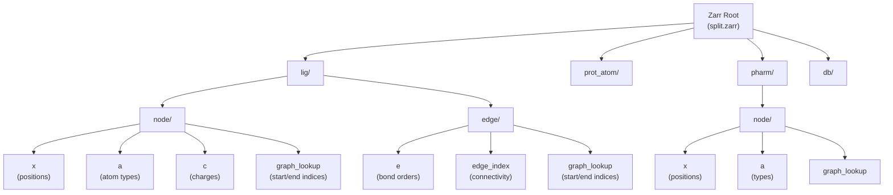
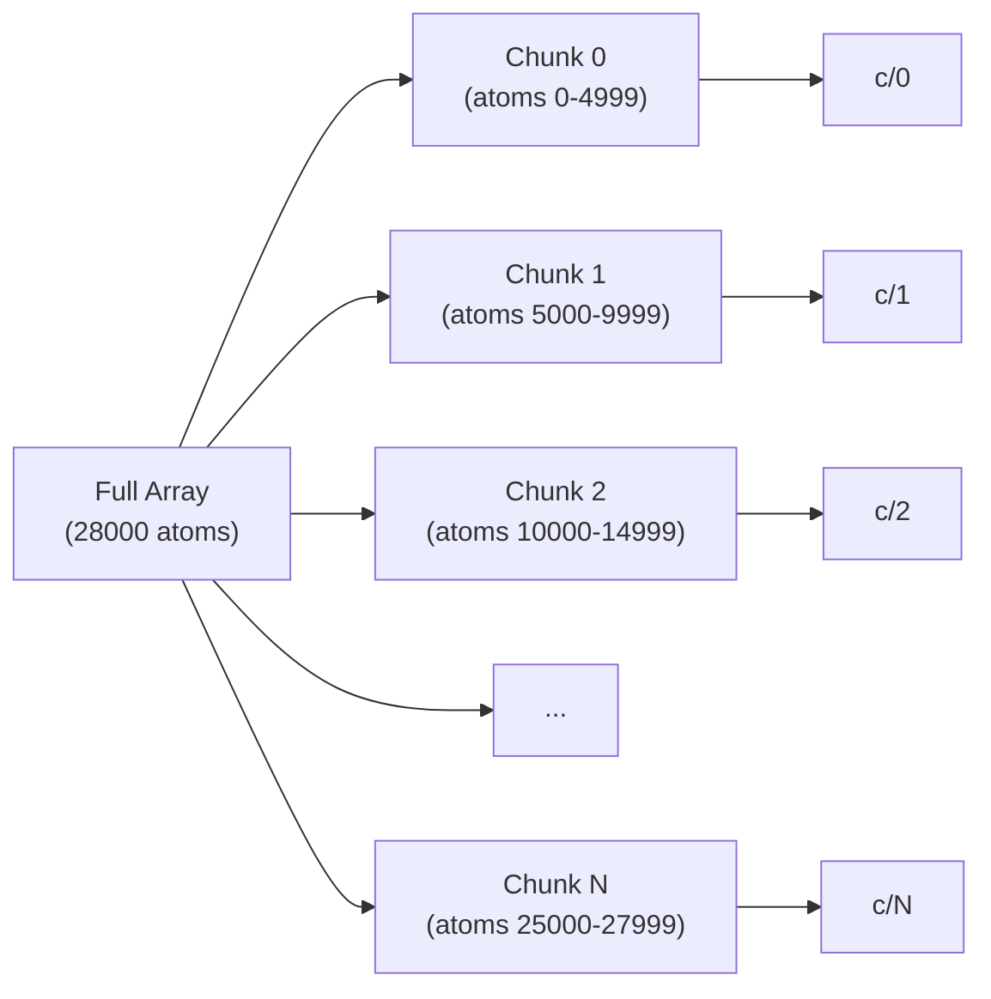
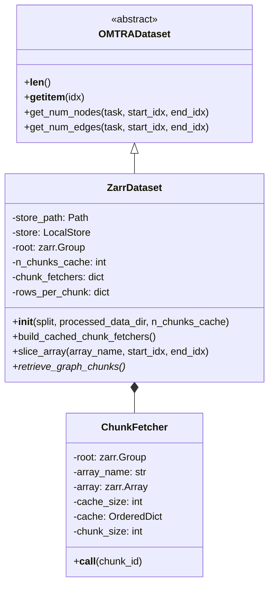
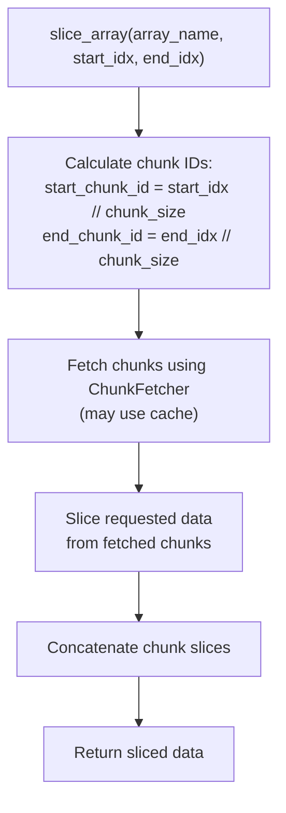
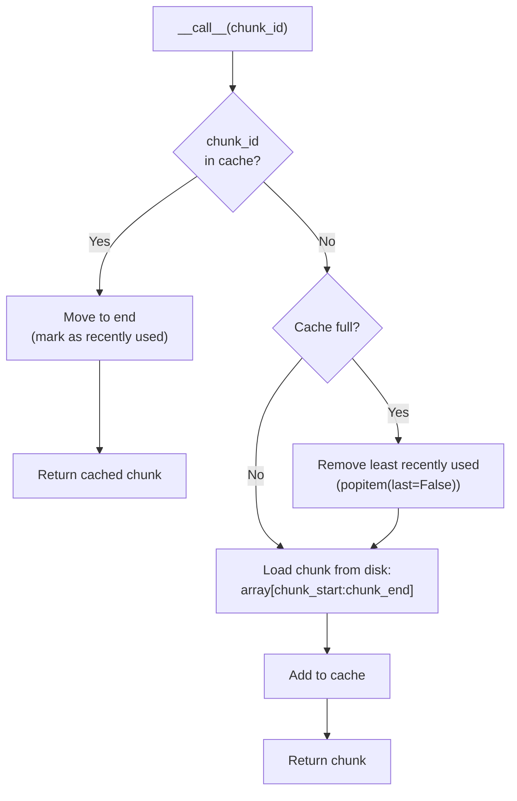
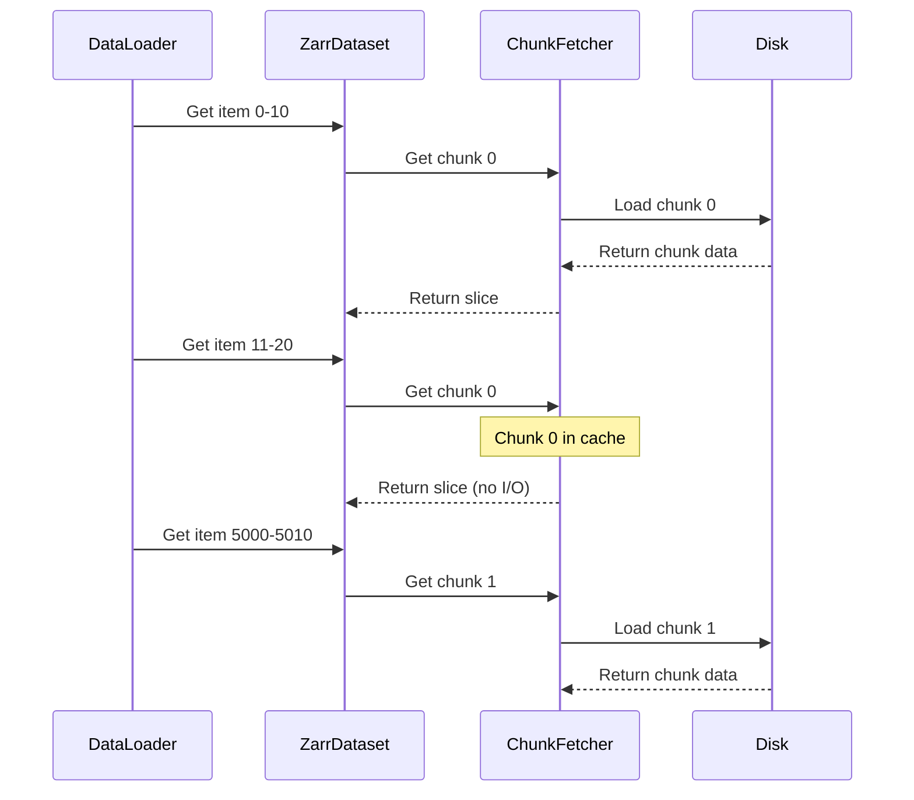

# Zarr Storage System

<details>
<summary>Relevant source files</summary>

The following files were used as context for generating this wiki page:

- [notebooks/working_with_graphs.ipynb](notebooks/working_with_graphs.ipynb)
- [notebooks/zarr_dev.ipynb](notebooks/zarr_dev.ipynb)
- [notebooks/zarr_memory_investigation.ipynb](notebooks/zarr_memory_investigation.ipynb)
- [omtra/dataset/dataset.py](omtra/dataset/dataset.py)
- [omtra/dataset/zarr_dataset.py](omtra/dataset/zarr_dataset.py)

</details>


This page describes the Zarr-based storage system used by OMTRA for efficient storage and retrieval of large molecular datasets. For information about how datasets use Zarr storage, see [Dataset Overview](#5.1). For details on how raw data is processed into Zarr format, see [Plinder Processing Pipeline](#6.1) and [Pharmit Processing Pipeline](#6.2).

## Purpose and Scope

The Zarr storage system provides a scalable, chunk-cached data storage layer that enables OMTRA to efficiently handle large molecular datasets during training and inference. This system:

- Stores preprocessed molecular data in a compressed, chunked array format
- Implements intelligent chunk caching to minimize disk I/O
- Organizes heterogeneous graph data (nodes, edges, features) in a hierarchical structure
- Supports read-only concurrent access for multi-process data loading

## What is Zarr?

Zarr is a format for storing chunked, compressed N-dimensional arrays. In OMTRA, Zarr provides several key advantages:

- **Chunked storage**: Data is divided into fixed-size chunks that can be read independently
- **Compression**: Reduces disk space requirements for large datasets
- **Hierarchical organization**: Supports nested groups similar to HDF5
- **Partial reads**: Only requested data chunks are loaded into memory
- **Concurrent access**: Multiple processes can read from the same store simultaneously

The main challenge with Zarr is that without caching, each data access may trigger disk I/O, even for small slices. OMTRA addresses this with a custom chunk caching layer.

**Sources:** [omtra/dataset/zarr_dataset.py:1-117](), [notebooks/zarr_dev.ipynb:1-617]()

## Zarr Store Hierarchical Structure

OMTRA organizes Zarr stores in a hierarchical structure that mirrors the heterogeneous graph representation of molecular systems.

### Typical Store Organization



Each node type (`lig`, `prot_atom`, `pharm`) has:
- `node/` group containing node features
- `edge/` group containing edge features (for applicable types)
- `graph_lookup` arrays mapping dataset indices to array slices

**Sources:** [notebooks/zarr_dev.ipynb:289-359](), [omtra/dataset/zarr_dataset.py:20-34]()

### Graph Lookup Arrays

The `graph_lookup` arrays are critical for batch data retrieval. Each row contains `[start_idx, end_idx]` pairs that indicate where a particular graph's data begins and ends in the concatenated arrays.

| Graph Index | Start Index | End Index |
|-------------|-------------|-----------|
| 0           | 0           | 14        |
| 1           | 14          | 27        |
| 2           | 27          | 35        |
| ...         | ...         | ...       |

This allows retrieving the data for graph `i` by slicing `array[start_idx:end_idx]`.

**Sources:** [notebooks/zarr_dev.ipynb:241-283]()

## Chunk-Based Storage

### Chunking Strategy

Zarr arrays are divided into chunks along the first dimension (the sample/row dimension). The chunk size is a critical parameter that balances:

- **Memory usage**: Larger chunks require more memory when loaded
- **I/O efficiency**: Larger chunks reduce the number of disk reads
- **Access patterns**: Chunk size should align with typical access patterns

OMTRA typically uses chunk sizes that align with batch boundaries to minimize cross-chunk reads during training.



The chunk size calculation considers the average number of nodes/edges per graph:

```
nodes_per_chunk = graphs_per_chunk × mean_nodes_per_graph
edges_per_chunk = graphs_per_chunk × mean_edges_per_graph
```

**Sources:** [notebooks/zarr_dev.ipynb:298-359]()

### Compression

Zarr supports various compression codecs. OMTRA typically uses `ZstdCodec` for a good balance of compression ratio and speed:

```python
# Example from creating a zarr array
zarr.create_array(
    shape=(n_rows, n_features),
    chunks=(chunk_size, n_features),
    dtype='f4',
    compressors=(ZstdCodec(level=0),)
)
```

**Sources:** [notebooks/zarr_dev.ipynb:63-75]()

## ZarrDataset Implementation

### Class Structure



**Sources:** [omtra/dataset/zarr_dataset.py:14-87](), [omtra/dataset/dataset.py:7-56]()

### Initialization

The `ZarrDataset` class initializes by:

1. Opening the zarr store in read-only mode: [omtra/dataset/zarr_dataset.py:21-27]()
2. Building cached chunk fetchers for all arrays: [omtra/dataset/zarr_dataset.py:28-29]()
3. Recording chunk sizes for efficient indexing: [omtra/dataset/zarr_dataset.py:31-33]()

Key parameters:
- `split`: Dataset split ('train', 'val', 'test')
- `processed_data_dir`: Directory containing the zarr store
- `n_chunks_cache`: Number of chunks to cache per array (default: 4)

**Sources:** [omtra/dataset/zarr_dataset.py:18-34]()

### Array Slicing

The `slice_array` method implements efficient chunk-cached array access:



The method handles three cases:
1. **Single chunk**: Data lies entirely within one chunk
2. **First chunk**: Data starts mid-chunk
3. **Last chunk**: Data ends mid-chunk
4. **Middle chunks**: Complete chunks between first and last

**Sources:** [omtra/dataset/zarr_dataset.py:50-86]()

## Chunk Caching Mechanism

### ChunkFetcher Class

The `ChunkFetcher` implements an LRU (Least Recently Used) cache for zarr chunks:



The cache is implemented using Python's `OrderedDict`:
- Recently accessed chunks are moved to the end
- When cache is full, the first item (least recently used) is removed
- This ensures frequently accessed chunks remain in memory

**Sources:** [omtra/dataset/zarr_dataset.py:88-117]()

### Cache Configuration

The cache size (`n_chunks_cache`) determines how many chunks per array are kept in memory. For example, with `n_chunks_cache=4`:

| Array | Chunk Size | Cached Chunks | Memory Usage (approx) |
|-------|------------|---------------|----------------------|
| `lig/node/x` | 5000 × 3 | 4 | ~240 KB (float32) |
| `lig/node/a` | 5000 | 4 | ~80 KB (int64) |
| `lig/edge/e` | 2000 | 4 | ~64 KB (int64) |

Total cache memory scales linearly with the number of arrays and cache size.

**Sources:** [omtra/dataset/zarr_dataset.py:89-95]()

## Data Access Patterns

### Sequential Access

When iterating through a dataset sequentially, the chunk cache ensures each chunk is loaded only once:



**Sources:** [omtra/dataset/zarr_dataset.py:50-86]()

### Random Access

For random access patterns, the cache maintains the most recently accessed chunks, reducing repeated disk reads for "hot" data regions.

### Multi-Array Access

Each dataset item typically requires accessing multiple arrays (positions, atom types, charges, edges, etc.). The `ChunkFetcher` maintains separate caches for each array, ensuring efficient access across all data modalities.

**Sources:** [omtra/dataset/zarr_dataset.py:44-47]()

## Performance Characteristics

### Memory vs I/O Trade-off

Without caching, Zarr loads chunks on every access, leading to:
- **Constant memory usage**: No chunks retained after access
- **High I/O**: Each access may trigger disk read
- **Bandwidth bottleneck**: Disk I/O becomes the limiting factor

With chunk caching:
- **Bounded memory usage**: Controlled by `n_chunks_cache × chunk_size`
- **Reduced I/O**: Frequently accessed chunks served from memory
- **Better throughput**: CPU can process data faster than disk can provide it

**Sources:** [notebooks/zarr_memory_investigation.ipynb:1-267]()

### Chunk Boundary Alignment

Performance is optimal when batch boundaries align with chunk boundaries. When a batch spans multiple chunks:

1. First chunk: Partial read from end of chunk
2. Middle chunks: Full chunk reads
3. Last chunk: Partial read from start of chunk

The chunk size should be chosen based on typical batch sizes and data distribution.

**Sources:** [notebooks/zarr_dev.ipynb:298-329](), [notebooks/zarr_memory_investigation.ipynb:143-213]()

### Concurrent Access

Zarr stores support concurrent read access, making them suitable for multi-process data loading. Each process maintains its own cache, and the read-only nature prevents race conditions:

```python
store = zarr.storage.LocalStore(str(zarr_store_path), read_only=True)
```

**Sources:** [omtra/dataset/zarr_dataset.py:26]()

---

**Key Takeaways:**

- Zarr provides efficient, chunked storage for OMTRA's molecular datasets
- The `ZarrDataset` class implements chunk caching to minimize disk I/O
- Hierarchical organization mirrors the heterogeneous graph structure
- Graph lookup arrays enable efficient batch retrieval
- Chunk size and cache size are tunable parameters that affect performance
- The system supports concurrent multi-process data loading

---