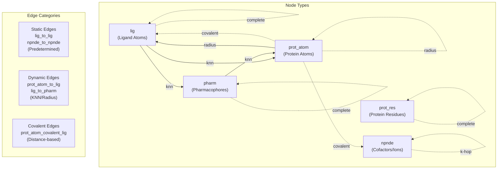
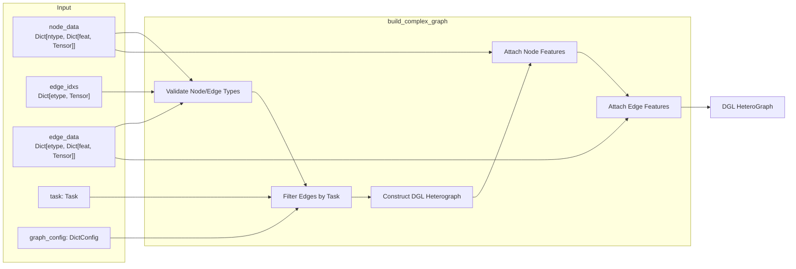
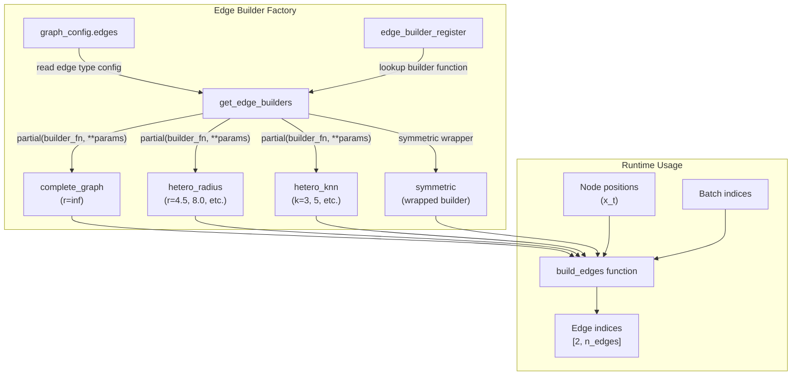
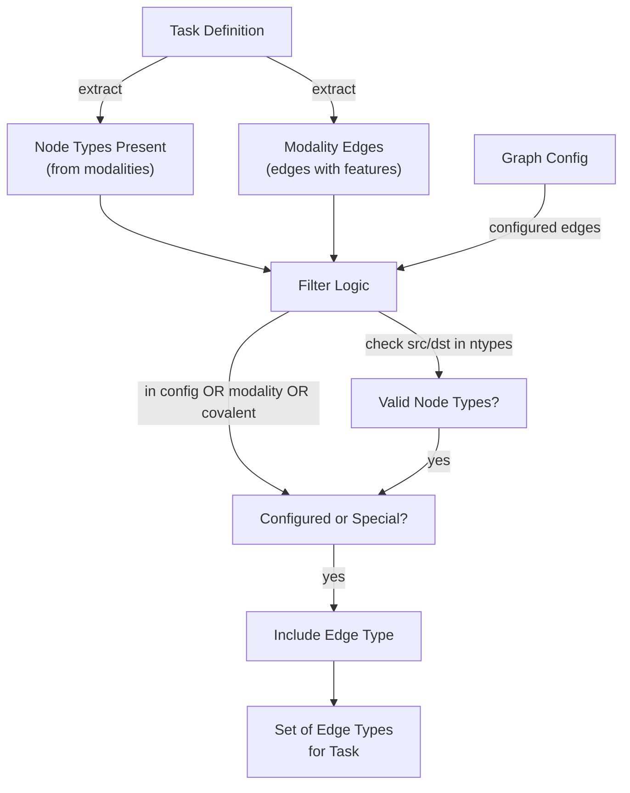
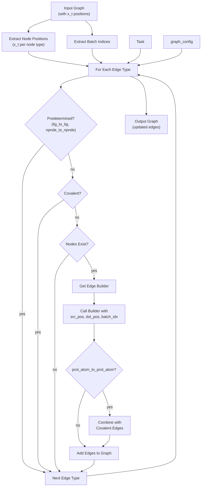
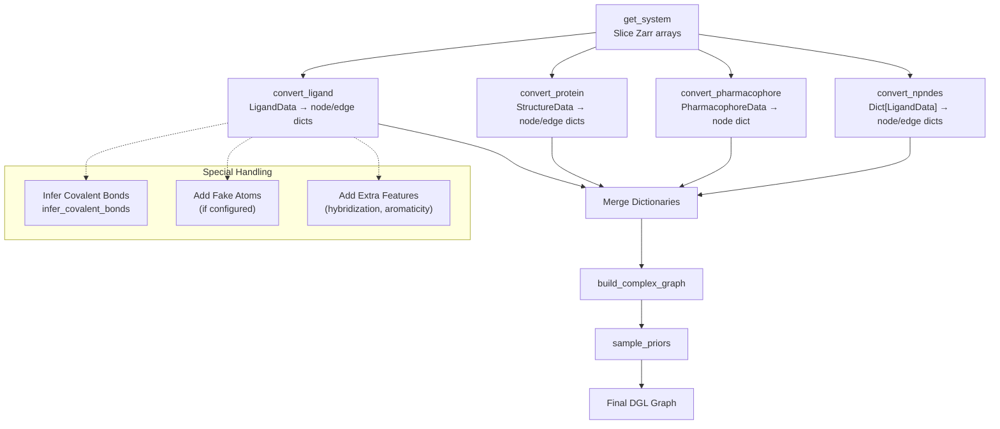
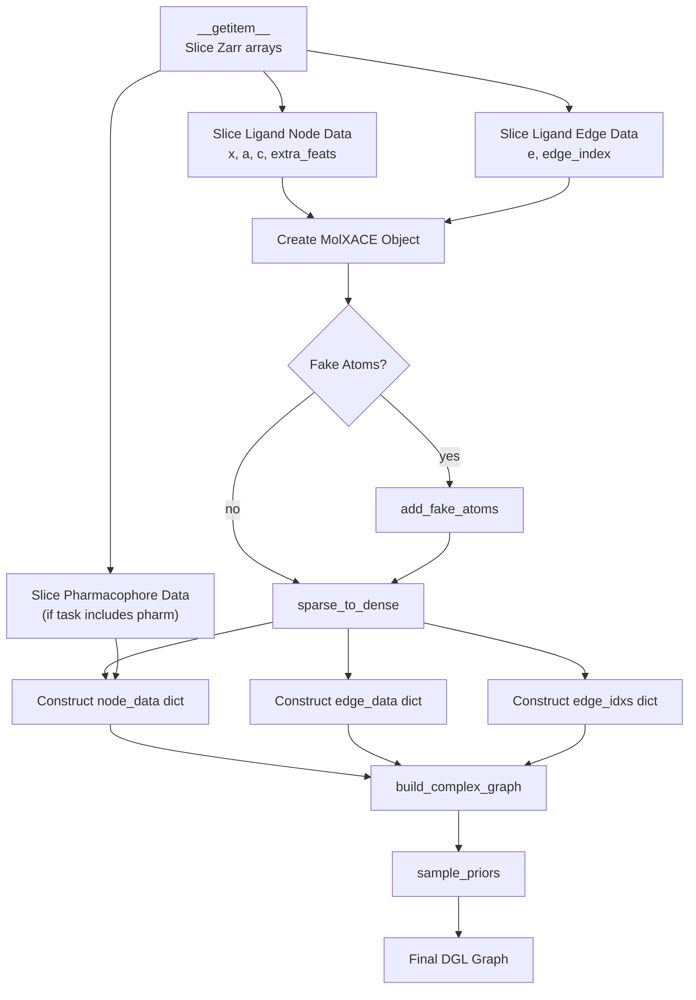

# Graph Construction

<details>
<summary>Relevant source files</summary>

The following files were used as context for generating this wiki page:

- [configs/graph/default.yaml](configs/graph/default.yaml)
- [omtra/data/graph/__init__.py](omtra/data/graph/__init__.py)
- [omtra/data/graph/edge_builders.py](omtra/data/graph/edge_builders.py)
- [omtra/data/graph/edge_factory.py](omtra/data/graph/edge_factory.py)
- [omtra/data/graph/register.py](omtra/data/graph/register.py)
- [omtra/dataset/pharmit.py](omtra/dataset/pharmit.py)
- [omtra/dataset/plinder.py](omtra/dataset/plinder.py)
- [omtra/priors/prior_factory.py](omtra/priors/prior_factory.py)
- [omtra/priors/priors.py](omtra/priors/priors.py)
- [omtra/priors/sample.py](omtra/priors/sample.py)
- [omtra/tasks/tasks.py](omtra/tasks/tasks.py)
- [omtra/tasks/utils.py](omtra/tasks/utils.py)

</details>


## Purpose and Scope

This page describes how raw molecular data is converted into DGL heterogeneous graphs, which serve as the primary data structure for OMTRA's neural network operations. Graph construction involves defining node types, edge types, and their features, as well as implementing both static (predetermined) and dynamic (computed on-the-fly) edge building strategies.

For information about the molecular featurization that produces the raw node features, see [Molecular Featurization (MolXACE)](#6.3). For details on how tasks determine which graph components are included, see [Tasks and Modalities](#3.1).

---

## Graph Structure Overview

OMTRA uses DGL heterogeneous graphs with multiple node and edge types to represent protein-ligand complexes, pharmacophores, and their relationships.

### Node Types

Five node types are supported in the system:

| Node Type | Entity | Description |
|-----------|--------|-------------|
| `lig` | Ligand atoms | Atoms belonging to the primary ligand molecule |
| `prot_atom` | Protein atoms | All-atom representation of the protein |
| `prot_res` | Protein residues | Coarse-grained backbone representation (Cα atoms) |
| `pharm` | Pharmacophore points | Functional group features with direction vectors |
| `npnde` | Non-polymer entities | Cofactors, ions, or covalently-bound molecules |

**Sources:** [omtra/data/graph/__init__.py:13]()

### Edge Types

Edges fall into three categories:

**1. Self-Edges** (within node type):
- `lig_to_lig`: Ligand molecular bonds
- `prot_atom_to_prot_atom`: Protein atomic interactions
- `prot_res_to_prot_res`: Residue-level interactions
- `pharm_to_pharm`: Pharmacophore interactions
- `npnde_to_npnde`: Non-polymer entity bonds

**2. Cross-Edges** (between node types):
- `lig_to_prot_atom`, `prot_atom_to_lig`: Ligand-protein atomic interactions
- `lig_to_pharm`, `pharm_to_lig`: Ligand-pharmacophore associations
- `prot_atom_to_pharm`, `pharm_to_prot_atom`: Protein-pharmacophore interactions
- Additional permutations for all node type pairs

**3. Covalent Edges** (special chemical bonds):
- `prot_atom_covalent_lig`: Covalent protein-ligand bonds
- `prot_atom_covalent_npnde`: Covalent protein-cofactor bonds
- `prot_res_covalent_lig`, `prot_res_covalent_npnde`: Residue-level covalent edges
- Bidirectional versions: `lig_covalent_prot_atom`, etc.

**Sources:** [omtra/data/graph/__init__.py:14-36]()



**Diagram:** Node and Edge Type Hierarchy

**Sources:** [omtra/data/graph/__init__.py:13-36](), [configs/graph/default.yaml:1-80]()

---

## Core Construction Function

### `build_complex_graph`

The primary graph construction function is `build_complex_graph`, which assembles heterogeneous graphs from structured node and edge data.



**Diagram:** Graph Construction Pipeline

**Sources:** [omtra/data/graph/__init__.py:74-155]()

#### Function Signature

```python
def build_complex_graph(
    node_data: Dict[str, Dict[str, torch.Tensor]],
    edge_idxs: Dict[str, torch.Tensor],
    edge_data: Dict[str, Dict[str, torch.Tensor]],
    task=None,
    graph_config=None,
) -> dgl.DGLHeteroGraph
```

#### Input Format

**`node_data`**: Dictionary mapping node type to feature dictionaries
```python
{
    'lig': {
        'x_1_true': torch.Tensor,  # [n_atoms, 3] coordinates
        'a_1_true': torch.Tensor,  # [n_atoms] atom types
        'c_1_true': torch.Tensor,  # [n_atoms] charges
    },
    'prot_atom': {
        'x_1_true': torch.Tensor,
        'a_1_true': torch.Tensor,
        'res_id': torch.Tensor,
        # ...
    },
    # ...
}
```

**`edge_idxs`**: Dictionary mapping edge type to index tensors (shape `[2, n_edges]`)
```python
{
    'lig_to_lig': torch.Tensor,  # [2, n_bonds] - molecular bonds
    'prot_atom_covalent_lig': torch.Tensor,  # [2, n_cov] - covalent bonds
    # ...
}
```

**`edge_data`**: Dictionary mapping edge type to feature dictionaries
```python
{
    'lig_to_lig': {
        'e_1_true': torch.Tensor,  # [n_bonds] bond types
    },
}
```

**Sources:** [omtra/data/graph/__init__.py:74-80]()

#### Construction Logic

1. **Validation** [omtra/data/graph/__init__.py:83-95]()
   - Verify all node types are in the allowed set
   - Verify all edge types are in the allowed set
   - Check that edge data matches edge indices

2. **Node Count Determination** [omtra/data/graph/__init__.py:98-103]()
   - Extract number of nodes per type from feature tensor shapes
   - Set count to 0 for missing node types

3. **Edge Filtering** [omtra/data/graph/__init__.py:106-119]()
   - If `task` and `graph_config` provided, call `get_edges_for_task` to filter edges
   - Otherwise, include all edge types
   - Create edge construction dictionary with canonical edge type tuples

4. **Special Handling** [omtra/data/graph/__init__.py:122-137]()
   - Protein covalent bonds: Use radius graph (r=2.1Å) if `cov_prot_edges=True`
   - Stored as `prot_atom_covalent_prot_atom` for later use

5. **Graph Construction** [omtra/data/graph/__init__.py:143]()
   - Call `dgl.heterograph()` with edge dictionary and node counts

6. **Feature Attachment** [omtra/data/graph/__init__.py:146-153]()
   - Add node features to graph
   - Add edge features to graph

**Sources:** [omtra/data/graph/__init__.py:74-155]()

---

## Edge Construction Strategies

Edges are constructed using two fundamentally different approaches: **static** (predetermined from data) and **dynamic** (computed from spatial relationships).

### Static Edges

Static edges are predetermined during data preprocessing and stored directly in the dataset.

| Edge Type | Source | Description |
|-----------|--------|-------------|
| `lig_to_lig` | Molecular topology | Chemical bonds from RDKit/SDF files |
| `npnde_to_npnde` | Molecular topology | Chemical bonds in cofactors/ions |
| Covalent edges | Distance inference | Protein-ligand/cofactor covalent bonds |

Static edges are provided directly in the `edge_idxs` dictionary passed to `build_complex_graph`.

**Sources:** [omtra/dataset/plinder.py:719-735](), [omtra/dataset/pharmit.py:185-192]()

### Dynamic Edge Builders

Dynamic edges are computed on-the-fly based on spatial proximity. Three main builder types are registered:

#### Complete Graph Builder

Connects all nodes within the same type (excluding self-loops).

```python
@register_edge_builder("complete")
def complete_graph(src_pos, dst_pos, src_batch_idx, dst_batch_idx):
    edge_idxs = hetero_radius(src_pos, dst_pos, src_batch_idx, dst_batch_idx, r=float("Inf"))
    return edge_idxs
```

**Usage:** `lig_to_lig`, `pharm_to_pharm` (when not predetermined)

**Sources:** [omtra/data/graph/edge_builders.py:13-16]()

#### Radius Graph Builder

Connects nodes within a specified distance threshold.

```python
@register_edge_builder("radius")
def hetero_radius(src_pos, dst_pos, src_batch_idx, dst_batch_idx, r, max_num_neighbors=1000):
    edge_idxs = tc.radius(x=dst_pos, y=src_pos, batch_x=dst_batch_idx, batch_y=src_batch_idx, r=r, max_num_neighbors=max_num_neighbors)
    return edge_idxs
```

**Usage:** `prot_atom_to_prot_atom` (r=4.5Å), `prot_atom_to_lig` (r=8Å)

**Sources:** [omtra/data/graph/edge_builders.py:18-21]()

#### KNN Graph Builder

Connects each node to its k-nearest neighbors.

```python
@register_edge_builder("knn")
def hetero_knn(src_pos, dst_pos, src_batch_idx, dst_batch_idx, k):
    edge_idxs = tc.knn(x=dst_pos, y=src_pos, batch_x=dst_batch_idx, batch_y=src_batch_idx, k=k)
    return edge_idxs
```

**Usage:** `lig_to_prot_atom` (k=5), `pharm_to_prot_atom` (k=5), `lig_to_pharm` (k=3)

**Sources:** [omtra/data/graph/edge_builders.py:23-26]()

#### Symmetric Edge Builder

Creates the reverse direction of an edge using the inverse builder.

```python
@register_edge_builder("symmetric")
def symmetric(builder_fn, src_pos, dst_pos, src_batch_idx, dst_batch_idx):
    edge_idxs = builder_fn(dst_pos, src_pos, dst_batch_idx, src_batch_idx)
    return edge_idxs[[1,0]]
```

**Usage:** Automatically creates inverse edges for symmetric edge types like `pharm_to_lig` from `lig_to_pharm`.

**Sources:** [omtra/data/graph/edge_builders.py:28-31]()



**Diagram:** Edge Builder Factory and Runtime Usage

**Sources:** [omtra/data/graph/edge_factory.py:7-31](), [omtra/tasks/utils.py:16-63]()

---

## Task-Specific Edge Filtering

The `get_edges_for_task` function filters the complete set of possible edges based on what node types and modalities are present in a given task.

### Filtering Logic



**Diagram:** Task-Based Edge Filtering

**Sources:** [omtra/data/graph/__init__.py:45-72]()

### Filter Rules

1. **Node Type Requirement**: Both source and destination node types must be present in the task's modalities
2. **Configuration Requirement**: Edge must be either:
   - Explicitly listed in `graph_config.edges`
   - A modality edge (has features being predicted)
   - A covalent edge (special handling)
   - Listed in `symmetric_etypes` (creates inverse edge)

**Example:**

For `rigid_docking` task:
- Modalities present: `lig`, `prot_atom`, `prot_res`
- Edges included: `lig_to_lig`, `lig_to_prot_atom`, `prot_atom_to_lig`, `prot_atom_to_prot_atom`, covalent edges
- Edges excluded: Any involving `pharm` or `npnde`

**Sources:** [omtra/data/graph/__init__.py:45-72](), [omtra/tasks/tasks.py:33-44]()

---

## Configuration System

Graph construction behavior is controlled by a YAML configuration file that specifies edge types, builder methods, and parameters.

### Default Configuration Structure

```yaml
edges:
  lig_to_lig:
    type: complete
  
  prot_atom_to_prot_atom:
    type: radius
    params:
      r: 4.5
  
  prot_atom_to_lig:
    type: radius
    params:
      r: 8
  
  lig_to_prot_atom:
    type: knn
    params:
      k: 5
  
  lig_to_pharm:
    type: knn
    params:
      k: 3
  
  pharm_to_pharm:
    type: complete

symmetric_etypes:
  - lig_to_pharm
  - npnde_to_pharm
  - lig_to_npnde
  - prot_atom_to_npnde

cov_prot_edges: true
```

### Configuration Parameters

| Parameter | Type | Description |
|-----------|------|-------------|
| `edges.{etype}.type` | string | Builder type: `complete`, `knn`, `radius`, `khop` |
| `edges.{etype}.params` | dict | Builder-specific parameters (k, r, etc.) |
| `symmetric_etypes` | list | Edge types that should have inverse edges created |
| `cov_prot_edges` | bool | Whether to infer protein covalent bonds |

**Sources:** [configs/graph/default.yaml:1-80]()

---

## Runtime Edge Computation

While `build_complex_graph` creates the initial graph structure, many edges are recomputed during model execution because node positions change during the flow matching process.

### The `build_edges` Function

Located in `omtra/tasks/utils.py`, this function dynamically rebuilds edges based on current node positions.



**Diagram:** Runtime Edge Rebuilding Process

**Sources:** [omtra/tasks/utils.py:16-63]()

### When Edges are Rebuilt

Dynamic edges are rebuilt:
1. **After Prior Sampling**: Initial positions from prior distributions [omtra/tasks/utils.py:16-63]()
2. **During VectorField Integration**: At each timestep as positions evolve
3. **After Self-Conditioning**: When using self-conditioning refinement

Predetermined edges (`lig_to_lig`, `npnde_to_npnde`) and covalent edges are never rebuilt.

**Sources:** [omtra/tasks/utils.py:27-34]()

### Covalent Edge Combination

For `prot_atom_to_prot_atom` edges, covalent bonds are combined with spatial edges to preserve chemical connectivity:

```python
def get_combined_edges(g, new_edge_idxs: torch.Tensor):
    cov_edge_idxs = torch.stack(g.edges(etype='prot_atom_covalent_prot_atom'), dim=0)
    edges = torch.cat([cov_edge_idxs, new_edge_idxs], dim=1)
    edges_t = edges.t()
    unique_edges_t = torch.unique(edges_t, dim=0)
    return unique_edges_t.t()
```

This ensures that covalently bonded atoms remain connected even if they're beyond the spatial radius threshold.

**Sources:** [omtra/tasks/utils.py:94-106]()

---

## Dataset-Specific Construction

Both Plinder and Pharmit datasets implement graph construction, but with different data sources and complexities.

### Plinder Dataset Construction

The Plinder dataset constructs graphs representing protein-ligand complexes with optional pharmacophores and non-polymer entities.



**Diagram:** Plinder Graph Construction Flow

**Sources:** [omtra/dataset/plinder.py:172-430](), [omtra/dataset/plinder.py:902-972]()

#### Key Steps

1. **System Retrieval** [omtra/dataset/plinder.py:172-430]()
   - Load receptor, ligand, pocket, pharmacophore, and npnde data from Zarr
   - Filter pocket residues based on proximity to ligand

2. **Ligand Conversion** [omtra/dataset/plinder.py:667-736]()
   - Convert to MolXACE representation
   - Add fake atoms if configured for de novo generation
   - Encode atom types, charges, bond types
   - Infer covalent bonds to protein

3. **Protein Conversion** [omtra/dataset/plinder.py:492-581]()
   - Create `prot_atom` nodes with all-atom features
   - Create `prot_res` nodes with backbone (Cα) coordinates
   - Encode elements, residues, chain IDs
   - Apply pocket mask to filter residues

4. **Pharmacophore Conversion** [omtra/dataset/plinder.py:877-900]()
   - Sample subset of interacting pharmacophores (up to `max_pharms_sampled`)
   - Create `pharm` nodes with coordinates, types, direction vectors

5. **NPnDE Conversion** [omtra/dataset/plinder.py:738-875]()
   - Combine all non-polymer entities
   - Apply k-hop edge expansion
   - Infer covalent bonds to protein

6. **Graph Construction** [omtra/dataset/plinder.py:959-961]()
   - Call `build_complex_graph` with merged dictionaries

7. **Prior Sampling** [omtra/dataset/plinder.py:964-965]()
   - Sample initial states for generated modalities

**Sources:** [omtra/dataset/plinder.py:74-972]()

### Pharmit Dataset Construction

The Pharmit dataset is simpler, containing only ligand and (optionally) pharmacophore data.



**Diagram:** Pharmit Graph Construction Flow

**Sources:** [omtra/dataset/pharmit.py:74-231]()

#### Key Steps

1. **Data Slicing** [omtra/dataset/pharmit.py:89-125]()
   - Use `graph_lookup` arrays to find node/edge ranges for each molecule
   - Slice `x`, `a`, `c`, `e`, `edge_index` arrays

2. **Extra Features** [omtra/dataset/pharmit.py:96-115]()
   - Optionally load hybridization, aromaticity, ring membership, chirality
   - Or convert to condensed atom typing

3. **MolXACE Creation** [omtra/dataset/pharmit.py:137-147]()
   - Construct MolXACE object from sliced arrays
   - Add fake atoms if configured
   - Convert from sparse to dense representation

4. **Pharmacophore Sampling** [omtra/dataset/pharmit.py:195-217]()
   - Sample 1 to `max_pharms_sampled` pharmacophore points
   - Create node features for sampled points

5. **Graph Construction** [omtra/dataset/pharmit.py:219-225]()
   - Assemble dictionaries for `node_data`, `edge_idxs`, `edge_data`
   - Call `build_complex_graph`

6. **Prior Sampling** [omtra/dataset/pharmit.py:228-229]()
   - Sample initial states for generated modalities

**Sources:** [omtra/dataset/pharmit.py:74-231]()

---

## Summary

Graph construction in OMTRA follows a consistent pattern:

1. **Data Preparation**: Datasets convert molecular data into node/edge dictionaries
2. **Static Edges**: Predetermined edges (molecular bonds, covalent bonds) are included directly
3. **Graph Assembly**: `build_complex_graph` validates inputs and creates a DGL heterograph
4. **Dynamic Edges**: Spatial edges are computed at runtime based on node positions
5. **Task Filtering**: Only edges relevant to the current task are included
6. **Prior Sampling**: Initial states are sampled for modalities being generated

This flexible architecture allows the same graph construction code to handle diverse tasks ranging from ligand-only conformer generation to complex protein-ligand-pharmacophore modeling.

**Sources:** [omtra/data/graph/__init__.py:74-155](), [omtra/dataset/plinder.py:74-972](), [omtra/dataset/pharmit.py:74-231](), [omtra/tasks/utils.py:16-63]()

---