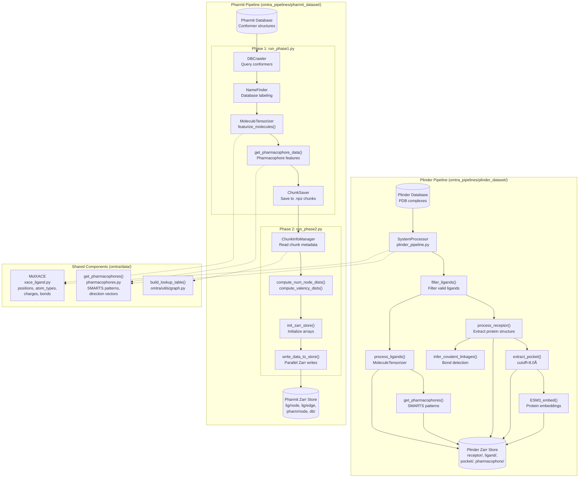
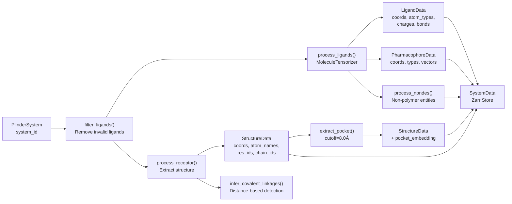
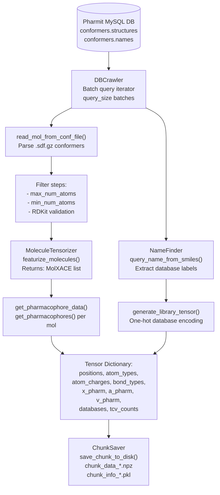
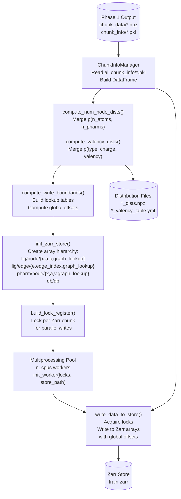
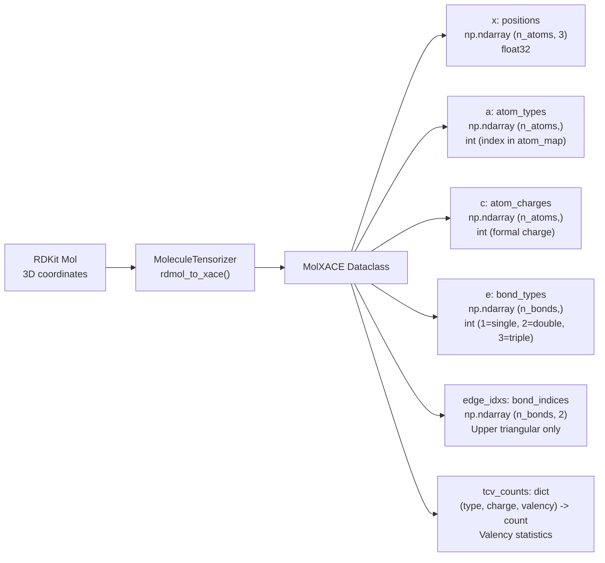
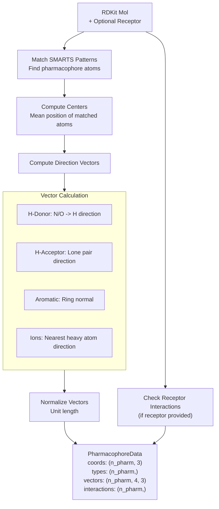
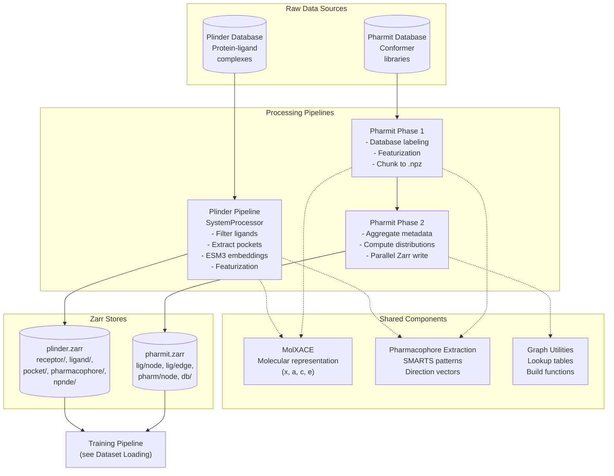

# Data Processing Pipelines

Relevant source files

The following files were used as context for generating this wiki page:

- [omtra/data/xace_ligand.py](omtra/data/xace_ligand.py)
- [omtra/utils/misc.py](omtra/utils/misc.py)
- [omtra_pipelines/pharmit_dataset/guts/phase1.py](omtra_pipelines/pharmit_dataset/guts/phase1.py)
- [omtra_pipelines/pharmit_dataset/guts/phase2.py](omtra_pipelines/pharmit_dataset/guts/phase2.py)
- [omtra_pipelines/pharmit_dataset/readme.md](omtra_pipelines/pharmit_dataset/readme.md)
- [omtra_pipelines/pharmit_dataset/run_phase1.py](omtra_pipelines/pharmit_dataset/run_phase1.py)
- [omtra_pipelines/pharmit_dataset/run_phase2.py](omtra_pipelines/pharmit_dataset/run_phase2.py)
- [omtra_pipelines/plinder_dataset/plinder_pipeline.py](omtra_pipelines/plinder_dataset/plinder_pipeline.py)
- [omtra_pipelines/plinder_dataset/plinder_tutorial.ipynb](omtra_pipelines/plinder_dataset/plinder_tutorial.ipynb)

## Purpose and Scope

This document describes the data processing pipelines that transform raw molecular datasets into the Zarr-based storage format used by OMTRA for training. Two main pipelines are implemented: the **Plinder pipeline** for processing protein-ligand complexes and the **Pharmit pipeline** for processing ligand-only conformer libraries.

For information about how the processed data is loaded during training, see [Datasets and Data Loading](#5). For details on the specific dataset classes that read from Zarr stores, see [Zarr Storage System](#5.4). For graph construction from the processed data, see [Graph Construction](#5.5).

---

## Overview

The data processing pipelines convert raw structural data into featurized representations suitable for graph neural network training. Both pipelines share common molecular featurization components but differ in their data sources and processing stages.

| Pipeline | Input Source | Key Processing Steps | Output |
|----------|-------------|---------------------|---------|
| **Plinder** | Protein-ligand complexes from PDB | Ligand filtering, pocket extraction, covalent bond inference, pharmacophore generation, ESM3 embeddings | `receptor/`, `ligand/`, `pocket/`, `pharmacophore/`, `npnde/` Zarr arrays |
| **Pharmit** | Conformer database | Database labeling, molecular featurization, pharmacophore generation, aggregation | `lig/node`, `lig/edge`, `pharm/node`, `db/` Zarr arrays |

**Shared Components:**
- **MolXACE**: Molecular representation encoding positions (x), atom types (a), charges (c), and bond orders (e)
- **Pharmacophore Extraction**: SMARTS-based pattern matching to identify interaction features with direction vectors
- **Graph Preparation**: Utilities for creating lookup tables and organizing data for efficient graph construction

Sources: [omtra_pipelines/plinder_dataset/plinder_pipeline.py](), [omtra_pipelines/pharmit_dataset/run_phase1.py](), [omtra_pipelines/pharmit_dataset/run_phase2.py](), [omtra/data/xace_ligand.py]()

---

## Pipeline Architecture

Sources: [omtra_pipelines/plinder_dataset/plinder_pipeline.py:67-793](), [omtra_pipelines/pharmit_dataset/run_phase1.py](), [omtra_pipelines/pharmit_dataset/run_phase2.py](), [omtra/data/xace_ligand.py:108-153]()

---

## Plinder Processing Pipeline

The Plinder pipeline processes protein-ligand complex structures from the Plinder database. The main processing class is `SystemProcessor` in [omtra_pipelines/plinder_dataset/plinder_pipeline.py:67-793]().

### Key Processing Steps

**SystemProcessor Constructor Parameters:**
- `system_id`: Plinder system identifier
- `ligand_atom_map`: Atom types for ligands (default: `lig_atom_type_map`)
- `npnde_atom_map`: Atom types for non-polymer entities (default: `npnde_atom_type_map`)
- `pocket_cutoff`: Distance cutoff for pocket extraction (default: 8.0 Å)
- `link_type`: Optional linked structure type (`"apo"`, `"pred"`, or `None`)

**Processing Workflow:**
1. **Ligand Filtering** [plinder_pipeline.py:712-741](): Loads ligand molecules and filters based on quality criteria
2. **Receptor Processing** [plinder_pipeline.py:141-176](): Extracts protein structure, checks backbone atom ordering
3. **Pocket Extraction** [plinder_pipeline.py:654-710](): Identifies residues within cutoff distance of ligand
4. **ESM3 Embedding** [plinder_pipeline.py:593-652](): Generates protein sequence embeddings for pockets
5. **Ligand Featurization** [plinder_pipeline.py:412-495](): Converts RDKit molecules to MolXACE format
6. **Pharmacophore Generation** [plinder_pipeline.py:458-481](): Identifies interaction features
7. **Covalent Bond Inference** [plinder_pipeline.py:377-410](): Detects protein-ligand covalent bonds

Sources: [omtra_pipelines/plinder_dataset/plinder_pipeline.py:67-793](), [omtra/data/xace_ligand.py:108-153](), [omtra/data/pharmacophores.py]()

---

## Pharmit Processing Pipeline

The Pharmit pipeline processes conformer libraries in a two-phase approach: featurization and aggregation.

### Phase 1: Featurization

Phase 1 processes conformer files in batches, generating molecular features and saving them to compressed `.npz` chunks. This phase is implemented in [omtra_pipelines/pharmit_dataset/run_phase1.py]().

**Key Classes and Functions:**

- **`DBCrawler`** [guts/phase1.py:175-237](): Iterates over database in batches using cursor-based pagination
- **`NameFinder`** [guts/phase1.py:103-172](): Queries molecule names from database to extract source labels (e.g., PubChem, ZINC)
- **`process_batch()`** [run_phase1.py:65-162](): Main processing function applied to each batch
- **`ChunkSaver`** [guts/phase1.py:350-531](): Manages chunk storage with automatic offloading when threshold exceeded

**Chunk Data Structure:**

Each `.npz` chunk contains:
- `lig_x`: Atom positions (float32)
- `lig_a`: Atom types (int8)
- `lig_c`: Atom charges (int8)
- `lig_e`: Bond types (int8)
- `lig_edge_idx`: Bond indices (int32)
- `node_lookup`: Graph lookup table (int64, shape: [n_mols, 2])
- `edge_lookup`: Edge lookup table (int64, shape: [n_mols, 2])
- `pharm_x`, `pharm_a`, `pharm_v`: Pharmacophore data
- `pharm_lookup`: Pharmacophore lookup table
- `database`: Database one-hot encoding

Each `.pkl` chunk info file contains:
- `n_mols`, `n_atoms`, `n_edges`, `n_pharm`: Counts
- `p_atoms`: Distribution of atoms per molecule
- `p_pharms_given_atoms`: Conditional distribution p(n_pharms | n_atoms)
- `tcv_counts`: Type-charge-valency statistics

Sources: [omtra_pipelines/pharmit_dataset/run_phase1.py](), [omtra_pipelines/pharmit_dataset/guts/phase1.py]()

### Phase 2: Aggregation

Phase 2 reads all chunk metadata, computes global distributions, and writes data to a unified Zarr store with parallel writes. This phase is implemented in [omtra_pipelines/pharmit_dataset/run_phase2.py]().

**Key Processing Steps:**

1. **Metadata Aggregation** [guts/phase2.py:18-204](): 
   - `ChunkInfoManager` reads all chunk info files into a DataFrame
   - Computes global distributions for p(n_atoms, n_pharms) and p(type, charge, valency)

2. **Boundary Computation** [guts/phase2.py:149-187]():
   - Calculates start/end indices for each chunk in the global Zarr arrays
   - Computes offset values to convert local indices to global indices

3. **Zarr Store Initialization** [guts/phase2.py:253-312]():
   - Creates hierarchical array structure with appropriate chunk sizes
   - Arrays automatically chunked for efficient access

4. **Parallel Writing** [run_phase2.py:79-179]():
   - Each worker acquires locks for affected Zarr chunks
   - Writes data with computed global offsets
   - Lock ordering prevents deadlocks

**Zarr Array Structure:**

| Array Path | Shape | Dtype | Chunk Size | Description |
|------------|-------|-------|------------|-------------|
| `lig/node/x` | `(n_atoms, 3)` | float32 | `(nodes_per_chunk, 3)` | Atom positions |
| `lig/node/a` | `(n_atoms,)` | int8 | `(nodes_per_chunk,)` | Atom types |
| `lig/node/c` | `(n_atoms,)` | int8 | `(nodes_per_chunk,)` | Atom charges |
| `lig/node/graph_lookup` | `(n_graphs, 2)` | int64 | `(graphs_per_chunk, 2)` | Node index ranges per graph |
| `lig/edge/e` | `(n_edges,)` | int8 | `(edges_per_chunk,)` | Bond types |
| `lig/edge/edge_index` | `(n_edges, 2)` | int32 | `(edges_per_chunk, 2)` | Bond connectivity |
| `lig/edge/graph_lookup` | `(n_graphs, 2)` | int64 | `(graphs_per_chunk, 2)` | Edge index ranges per graph |
| `pharm/node/x` | `(n_pharms, 3)` | float32 | `(pharm_per_chunk, 3)` | Pharmacophore positions |
| `pharm/node/a` | `(n_pharms,)` | int8 | `(pharm_per_chunk,)` | Pharmacophore types |
| `pharm/node/v` | `(n_pharms, 4, 3)` | float32 | `(pharm_per_chunk, 4, 3)` | Direction vectors |
| `pharm/node/graph_lookup` | `(n_graphs, 2)` | int64 | `(graphs_per_chunk, 2)` | Pharm index ranges per graph |
| `db/db` | `(n_graphs, 14)` | bool | `(graphs_per_chunk, 14)` | Database one-hot labels |

Sources: [omtra_pipelines/pharmit_dataset/run_phase2.py](), [omtra_pipelines/pharmit_dataset/guts/phase2.py]()

---

## Molecular Featurization (MolXACE)

The `MolXACE` data structure and `MoleculeTensorizer` class provide the core molecular featurization used by both pipelines. This representation is defined in [omtra/data/xace_ligand.py]().

### MolXACE Data Structure

**MolXACE Fields:**
- **`x`**: Atom positions from conformer (float32, shape: [n_atoms, 3])
- **`a`**: Atom types mapped to integer indices (int8)
- **`c`**: Formal atom charges (int8)
- **`e`**: Bond orders for upper-triangular edges (int8)
- **`edge_idxs`**: Bond connectivity, upper-triangular portion only (int32, shape: [n_bonds, 2])
- **`tcv_counts`**: Dictionary mapping (type_idx, charge, valency) tuples to occurrence counts

**Featurization Process** [xace_ligand.py:155-231]():

1. **Sanitization & Kekulization**: Standardize molecule representation
2. **Hydrogen Removal**: Remove explicit hydrogens unless `explicit_hydrogens=True`
3. **Position Extraction**: Get 3D coordinates from conformer
4. **Atom Featurization**: Map atom symbols to integer indices, extract formal charges
5. **Bond Extraction**: Build adjacency matrix, extract upper-triangular portion
6. **Valency Computation**: Calculate atom valencies and collect statistics
7. **Validation**: Check for invalid patterns (e.g., trivalent oxygen)

**MoleculeTensorizer** [xace_ligand.py:108-153]():
- Parallelizes featurization across multiple molecules
- Collects failure modes and statistics
- Returns: `(valid_molecules, failed_idxs, failure_counts, tcv_counts)`

**Common Failure Modes:**
- `"sanitization/kekulization"`: RDKit cannot process molecule
- `"multiple fragments"`: Molecule contains disconnected components
- `"positions"`: No 3D conformer available
- `"atom map"`: Atom type not in `atom_map`
- `"trivalent oxygen"`: Invalid valency detected

Sources: [omtra/data/xace_ligand.py:22-232]()

---

## Pharmacophore Extraction

Pharmacophore features are extracted using SMARTS pattern matching to identify interaction points and compute direction vectors. The main function is `get_pharmacophores()` in [omtra/data/pharmacophores.py]().

### Pharmacophore Types and SMARTS Patterns

| Type | Description | Example SMARTS |
|------|-------------|----------------|
| **Aromatic** | Aromatic ring centers | `a1aaaaa1`, `a1aaaa1` |
| **HydrogenDonor** | H-bond donors | `[!#6;!H0]`, `[#7&!H0]` |
| **HydrogenAcceptor** | H-bond acceptors | `[!$([#6,F,Cl,Br,I,o,s,nX3,#7v5,#15v5,#16v4,#16v6,*+1,*+2,*+3])]` |
| **Hydrophobic** | Hydrophobic features | `a1aaaaa1`, alkyl carbons |
| **PositiveIon** | Positive charges | `[+,+2,+3,+4]` |
| **NegativeIon** | Negative charges | `[-,-2,-3,-4]` |
| **LumpedHydrophobe** | Hydrophobic clusters | Combined hydrophobic atoms |

### Direction Vector Computation

**Direction Vector Details:**

Each pharmacophore center can have up to 4 direction vectors [pharmacophores.py]:
- **Hydrogen Donors**: Vector from heavy atom toward hydrogen
- **Hydrogen Acceptors**: Vector along lone pair direction (computed from geometry)
- **Aromatic Rings**: Vector perpendicular to ring plane
- **Ions**: Vector toward nearest heavy atom
- **Hydrophobic**: No specific direction (zero vectors)

**Interaction Detection** (when receptor provided):
- For each pharmacophore, checks if corresponding atoms are within 4.5 Å of receptor atoms
- Sets `interactions[i] = True` if interaction detected
- Used to filter pharmacophores that are actually engaging with the binding pocket

**Output Structure:**
- `coords`: Pharmacophore center positions (float32, shape: [n_pharm, 3])
- `types`: Pharmacophore type indices (int8, shape: [n_pharm])
- `vectors`: Direction vectors (float32, shape: [n_pharm, 4, 3])
- `interactions`: Boolean interaction flags (bool, shape: [n_pharm])

Sources: [omtra/data/pharmacophores.py](), [omtra_pipelines/plinder_dataset/plinder_pipeline.py:458-481](), [omtra_pipelines/pharmit_dataset/guts/phase1.py:288-318]()

---

## Data Processing Workflow Summary

**Key Differences Between Pipelines:**

| Aspect | Plinder | Pharmit |
|--------|---------|---------|
| **Processing Model** | Single-pass per system | Two-phase (featurize → aggregate) |
| **Parallelization** | System-level parallelization | Batch-level (Phase 1) + chunk-level (Phase 2) |
| **Additional Features** | Protein structures, pockets, ESM3 embeddings | Database labels, valency distributions |
| **Primary Use Case** | Protein-ligand tasks | Ligand-only generation |
| **Covalent Handling** | Detects and records covalent bonds | Not applicable |

Sources: [omtra_pipelines/plinder_dataset/plinder_pipeline.py](), [omtra_pipelines/pharmit_dataset/run_phase1.py](), [omtra_pipelines/pharmit_dataset/run_phase2.py](), [omtra/data/xace_ligand.py]()

---