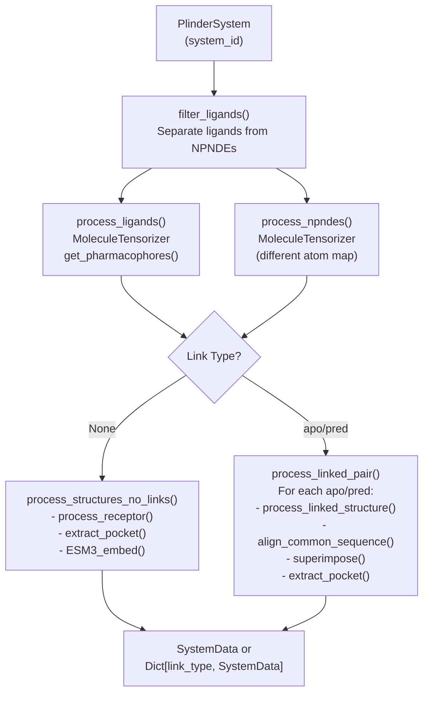
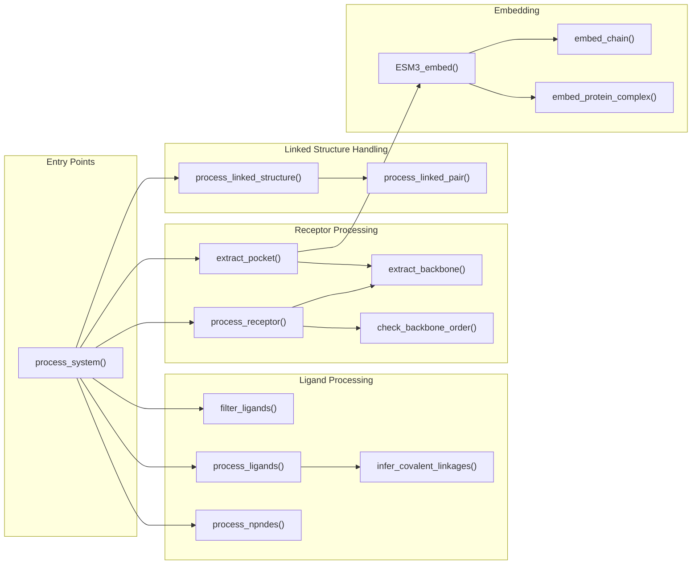
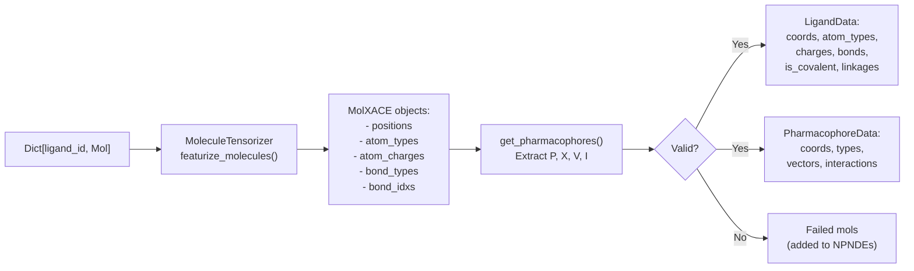
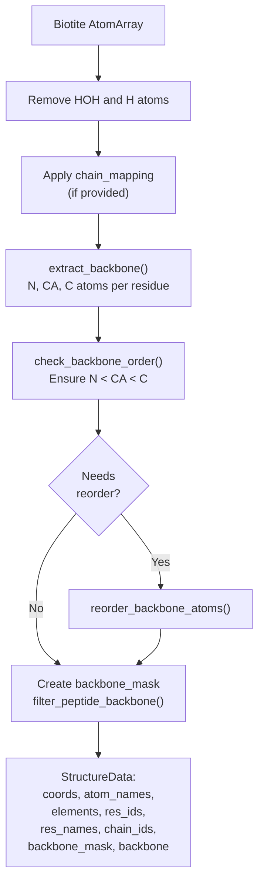
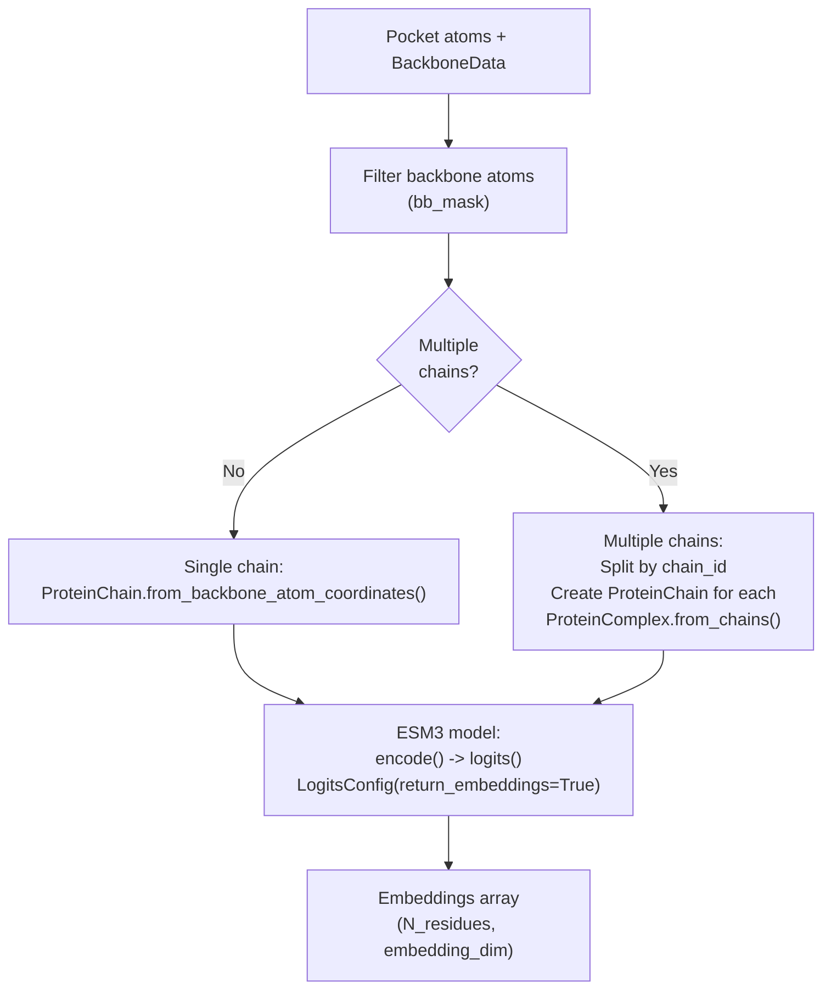
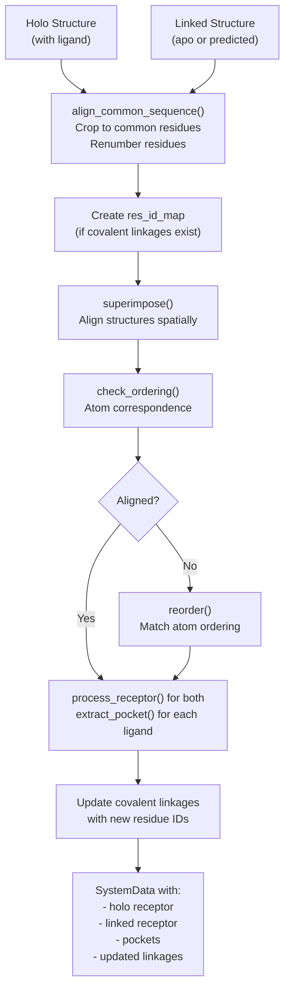

# Plinder Processing Pipeline

Relevant source files

The following files were used as context for generating this wiki page:

- [omtra_pipelines/plinder_dataset/plinder_pipeline.py](omtra_pipelines/plinder_dataset/plinder_pipeline.py)
- [omtra_pipelines/plinder_dataset/plinder_tutorial.ipynb](omtra_pipelines/plinder_dataset/plinder_tutorial.ipynb)

## Purpose and Scope

This page describes the Plinder processing pipeline, which transforms raw protein-ligand complexes from the Plinder database into featurized data stored in Zarr format for training. The pipeline is implemented in `omtra_pipelines/plinder_dataset/plinder_pipeline.py` and centered around the `SystemProcessor` class.

For information about the Plinder dataset interface used during training, see [Plinder Dataset](#5.2). For details on molecular featurization (MolXACE representation), see [Molecular Featurization (MolXACE)](#6.3). For pharmacophore extraction details, see [Pharmacophore Extraction](#6.4).

## Overview

The Plinder processing pipeline converts each Plinder system into structured `SystemData` objects containing:
- **Receptor structures**: full protein and extracted pockets
- **Ligand data**: coordinates, atom types, charges, and bonds in MolXACE format
- **Pharmacophore features**: interaction points and direction vectors
- **ESM3 embeddings**: protein sequence embeddings for pocket residues
- **Linked structures**: aligned apo or predicted structures (optional)
- **Covalent linkages**: inferred or annotated covalent bonds between ligand and protein

Sources: [omtra_pipelines/plinder_dataset/plinder_pipeline.py:1-147]()

## Processing Flow

Sources: [omtra_pipelines/plinder_dataset/plinder_pipeline.py:743-1146]()

## SystemProcessor Class

### Initialization

The `SystemProcessor` class is initialized for a single Plinder system with the following configuration:

| Parameter | Type | Default | Description |
|-----------|------|---------|-------------|
| `system_id` | str | Required | Plinder system identifier |
| `link_type` | Optional[str] | None | Type of linked structure: "apo", "pred", or None |
| `ligand_atom_map` | List[str] | `lig_atom_type_map` | Atom type vocabulary for ligands |
| `npnde_atom_map` | List[str] | `npnde_atom_type_map` | Atom type vocabulary for NPNDEs |
| `pocket_cutoff` | float | 8.0 | Distance cutoff (Å) for pocket extraction |
| `n_cpus` | int | 1 | Number of CPUs for tensorization |
| `raw_data` | str | (path) | Root directory of raw Plinder data |

The class instantiates:
- `MoleculeTensorizer` instances for ligands and NPNDEs with different atom maps
- A `PlinderSystem` object for accessing raw structure files
- A `PDBWriter` for optionally saving extracted pockets

Sources: [omtra_pipelines/plinder_dataset/plinder_pipeline.py:67-95]()

### Key Methods

Sources: [omtra_pipelines/plinder_dataset/plinder_pipeline.py:67-1147]()

## Ligand Filtering and Processing

### Ligand Filtering

The `filter_ligands()` method separates ligands into two categories using a pre-computed parquet file:

1. **Ligands**: Molecules to be used as training targets
2. **NPNDEs**: Non-protein, non-drug entities (cofactors, ions, etc.) treated as context

The filtering is based on external criteria stored in `plinder_filtered.parquet`, which categorizes each ligand by `ligand_type`.

Sources: [omtra_pipelines/plinder_dataset/plinder_pipeline.py:712-741]()

### Ligand Tensorization

The `process_ligands()` method converts RDKit molecules to MolXACE format:

**Validation checks:**
- Tensorization success (valid molecular structure)
- Finite pharmacophore vectors
- Matching counts between pharmacophore centers and interactions

Sources: [omtra_pipelines/plinder_dataset/plinder_pipeline.py:412-495]()

### NPNDE Processing

NPNDEs are processed similarly to ligands but with a different atom type map. Failed ligands are automatically moved to the NPNDE category.

Sources: [omtra_pipelines/plinder_dataset/plinder_pipeline.py:497-549]()

### Covalent Linkage Inference

The `infer_covalent_linkages()` method detects covalent bonds between ligands and proteins:

1. Loads system and receptor structures with bond information from CIF files
2. Computes all pairwise distances between ligand and receptor atoms
3. Checks if distances fall within element-specific bond distance ranges
4. Records linkages in format: `{res_id}:{res_name}:{chain}:{atom_name}__{res_id}:{res_name}:{chain}:{atom_name}`

These linkages are later updated to account for residue renumbering during structure alignment.

Sources: [omtra_pipelines/plinder_dataset/plinder_pipeline.py:377-410]()

## Receptor and Pocket Processing

### Receptor Processing

The `process_receptor()` method extracts protein structure information:

**BackboneData structure:**
- `coords`: (N_residues, 3, 3) array for N, CA, C atoms
- `res_ids`: Residue sequence IDs
- `res_names`: Three-letter residue names
- `chain_ids`: Chain identifiers

Sources: [omtra_pipelines/plinder_dataset/plinder_pipeline.py:141-176](), [omtra_pipelines/plinder_dataset/plinder_pipeline.py:96-139]()

### Pocket Extraction

The `extract_pocket()` method identifies residues near the ligand:

1. Create a cell list for efficient spatial queries with `pocket_cutoff` (default 8.0 Å)
2. Find all receptor atoms within cutoff distance of any ligand atom
3. Extract complete residues containing these atoms
4. Extract backbone atoms and create `BackboneData`
5. Generate ESM3 embeddings for the pocket sequence
6. Return `StructureData` with `pocket_embedding` field

Sources: [omtra_pipelines/plinder_dataset/plinder_pipeline.py:654-710]()

### ESM3 Embedding Generation

The pipeline generates ESM3 embeddings for pocket sequences:

The embeddings are generated using ESM3-open model with the `LogitsConfig` set to return embeddings only.

Sources: [omtra_pipelines/plinder_dataset/plinder_pipeline.py:593-652](), [omtra_pipelines/plinder_dataset/plinder_pipeline.py:568-590]()

## Linked Structure Processing

### Linked Structure Workflow

When `link_type` is "apo" or "pred", the pipeline processes linked structures that provide alternative protein conformations:

Sources: [omtra_pipelines/plinder_dataset/plinder_pipeline.py:304-375]()

### Residue ID Mapping

For systems with covalent linkages, residue IDs must be tracked through the alignment and renumbering process:

1. `align_common_sequence(renumber_residues=False)` creates a mapping from original to renumbered IDs
2. The mapping is stored in `res_id_map[chain_id][original_id] = new_id`
3. Covalent linkage strings are parsed and updated with new residue IDs
4. Format: `{auth_resid}:{resname}:{chain}:{seq_resid}:{atom_name}__{...}`

Sources: [omtra_pipelines/plinder_dataset/plinder_pipeline.py:318-330](), [omtra_pipelines/plinder_dataset/plinder_pipeline.py:845-971]()

## Data Structures

### SystemData Output

Each processed system produces one or more `SystemData` objects:

| Field | Type | Description |
|-------|------|-------------|
| `system_id` | str | Plinder system identifier |
| `ligand_id` | str | Specific ligand identifier (instance.asym_id) |
| `receptor` | StructureData | Full protein structure |
| `ligand` | LigandData | Target ligand in MolXACE format |
| `pharmacophore` | PharmacophoreData | Pharmacophore features |
| `pocket` | StructureData | Extracted pocket with ESM3 embeddings |
| `npndes` | Dict[str, LigandData] | Other ligands/cofactors as context |
| `link_type` | Optional[str] | "apo" or "pred" if applicable |
| `link_id` | Optional[str] | Identifier of linked structure |
| `link` | Optional[StructureData] | Linked structure (apo/pred) |

Sources: [omtra_pipelines/plinder_dataset/plinder_pipeline.py:973-986]()

### StructureData

| Field | Type | Description |
|-------|------|-------------|
| `cif` | str | Relative path to source CIF file |
| `coords` | np.ndarray | (N_atoms, 3) atomic coordinates |
| `atom_names` | np.ndarray | Atom names (e.g., "CA", "N") |
| `elements` | np.ndarray | Element symbols |
| `res_ids` | np.ndarray | Residue sequence IDs |
| `res_names` | np.ndarray | Residue names (3-letter codes) |
| `chain_ids` | np.ndarray | Chain identifiers |
| `backbone_mask` | np.ndarray | Boolean mask for backbone atoms |
| `backbone` | BackboneData | Structured backbone atom data |
| `pocket_embedding` | Optional[np.ndarray] | ESM3 embeddings (pockets only) |

Sources: [omtra_pipelines/plinder_dataset/plinder_pipeline.py:141-176]()

### LigandData

| Field | Type | Description |
|-------|------|-------------|
| `sdf` | str | Relative path to source SDF file |
| `ccd` | str | Chemical Component Dictionary code |
| `coords` | np.ndarray | (N_atoms, 3) atomic positions |
| `atom_types` | np.ndarray | Integer atom type indices |
| `atom_charges` | np.ndarray | Formal charges |
| `bond_types` | np.ndarray | Integer bond type indices |
| `bond_indices` | np.ndarray | (N_bonds, 2) bond connectivity |
| `is_covalent` | bool | Whether ligand is covalently bound |
| `linkages` | Optional[List[str]] | Covalent linkage specifications |

Sources: [omtra_pipelines/plinder_dataset/plinder_pipeline.py:483-493]()

### PharmacophoreData

| Field | Type | Description |
|-------|------|-------------|
| `coords` | np.ndarray | (N_pharm, 3) pharmacophore center positions |
| `types` | np.ndarray | Pharmacophore feature type indices |
| `vectors` | np.ndarray | (N_pharm, 3) direction vectors |
| `interactions` | np.ndarray | Interaction type labels |

Sources: [omtra_pipelines/plinder_dataset/plinder_pipeline.py:479-481]()

## Processing Modes

### Mode 1: No Linked Structures

When `link_type=None`, the pipeline processes only the holo structure:

1. Process holo receptor
2. Extract pocket for each ligand
3. Generate ESM3 embeddings for each pocket
4. Create one `SystemData` per ligand
5. Other ligands in the system become NPNDEs for each target

Sources: [omtra_pipelines/plinder_dataset/plinder_pipeline.py:988-1066]()

### Mode 2: With Linked Structures (Apo)

When `link_type="apo"`, the pipeline processes each apo structure:

1. For each apo structure ID:
   - Align and crop common sequence with holo
   - Superimpose structures spatially
   - Process both holo and apo receptors
   - Extract pockets from holo structure
   - Update covalent linkages with new residue numbering
2. Return nested dictionary: `{link_type: {link_id: [SystemData]}}`

Sources: [omtra_pipelines/plinder_dataset/plinder_pipeline.py:1105-1123]()

### Mode 3: With Linked Structures (Pred)

When `link_type="pred"`, similar to apo mode but uses predicted structures.

Sources: [omtra_pipelines/plinder_dataset/plinder_pipeline.py:1124-1140]()

## Error Handling and Logging

The pipeline includes extensive error handling and logging:

| Scenario | Action |
|----------|--------|
| Failed ligand tensorization | Move to NPNDEs, log warning |
| Non-finite pharmacophore vectors | Skip ligand, report to `bad_mol_reporter` |
| Pharmacophore count mismatch | Skip ligand, report to `bad_mol_reporter` |
| No pocket extracted | Remove ligand from processing |
| Backbone atom ordering issues | Attempt reordering, fail if impossible |
| Structure alignment failure | Skip linked structure pair |
| Atom ordering mismatch | Attempt reordering using atom keys |
| Covalent linkage update failure | Skip linked structure pair |
| No ligands remaining | Return None for entire system |

All processing steps are logged at DEBUG, INFO, or WARNING levels using the logger configured in [omtra_pipelines/plinder_dataset/utils.py]().

Sources: [omtra_pipelines/plinder_dataset/plinder_pipeline.py:43-45](), [omtra_pipelines/plinder_dataset/plinder_pipeline.py:429-477]()

## Integration with Zarr Storage

The output of the processing pipeline (SystemData objects) is subsequently written to Zarr arrays. Each field becomes an array in the Zarr store:

- `receptor/coords`, `receptor/atom_names`, etc.
- `ligand/coords`, `ligand/atom_types`, etc.
- `pocket/coords`, `pocket/pocket_embedding`, etc.
- `pharmacophore/coords`, `pharmacophore/types`, etc.
- `npnde/coords`, `npnde/atom_types`, etc. (if present)

For details on the Zarr storage format and how it enables efficient data loading, see [Zarr Storage System](#5.4).

Sources: Based on overall architecture diagrams and data flow.

---