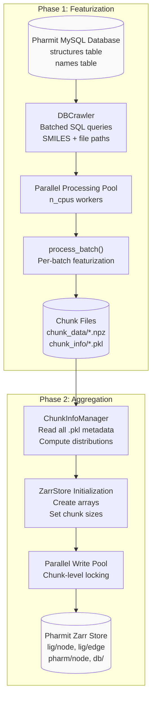
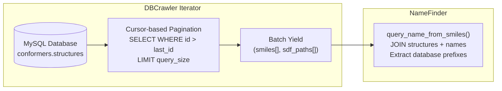
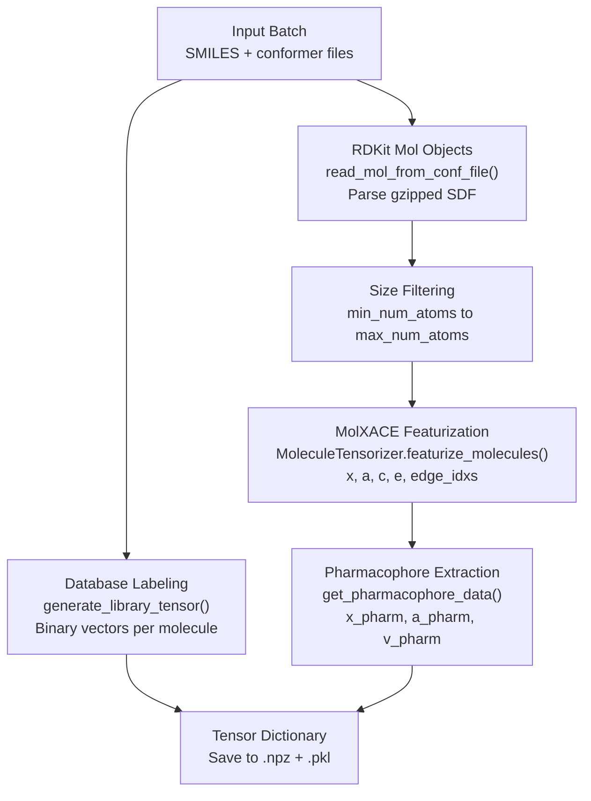
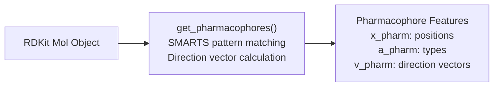
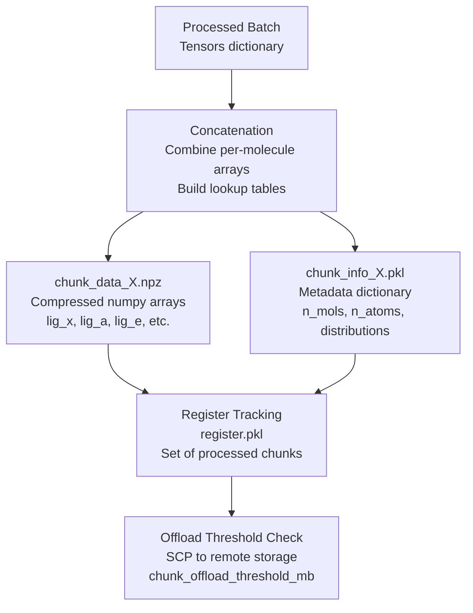
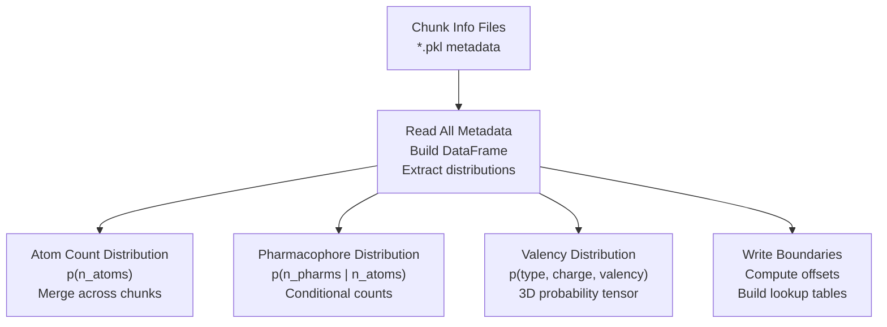
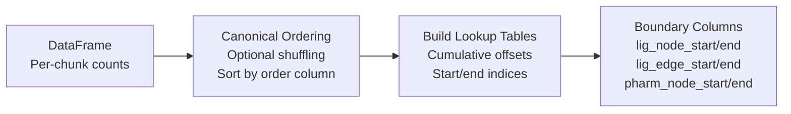
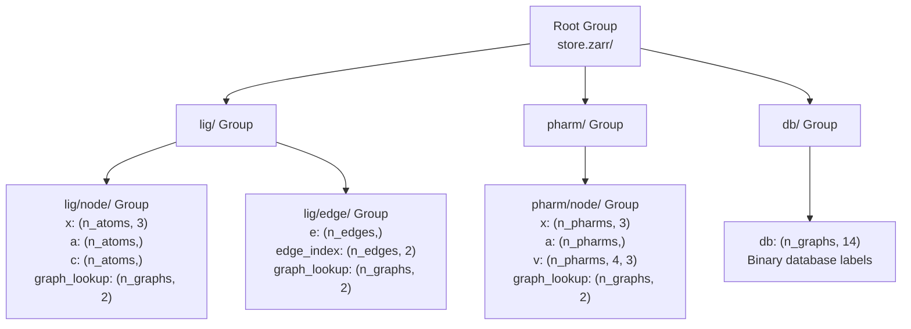
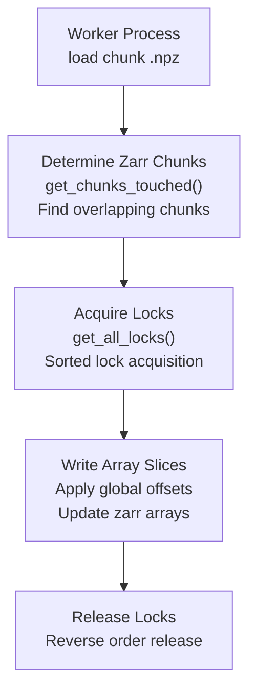
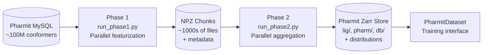

# Pharmit Processing Pipeline

<details>
<summary>Relevant source files</summary>

The following files were used as context for generating this wiki page:

- [omtra/data/pharmit_pharmacophores.py](omtra/data/pharmit_pharmacophores.py)
- [omtra/data/xace_ligand.py](omtra/data/xace_ligand.py)
- [omtra/utils/misc.py](omtra/utils/misc.py)
- [omtra_pipelines/pharmit_dataset/guts/phase1.py](omtra_pipelines/pharmit_dataset/guts/phase1.py)
- [omtra_pipelines/pharmit_dataset/guts/phase2.py](omtra_pipelines/pharmit_dataset/guts/phase2.py)
- [omtra_pipelines/pharmit_dataset/readme.md](omtra_pipelines/pharmit_dataset/readme.md)
- [omtra_pipelines/pharmit_dataset/run_phase1.py](omtra_pipelines/pharmit_dataset/run_phase1.py)
- [omtra_pipelines/pharmit_dataset/run_phase2.py](omtra_pipelines/pharmit_dataset/run_phase2.py)

</details>


## Purpose and Scope

The Pharmit Processing Pipeline transforms raw molecular conformer data from the Pharmit database into a chunked Zarr storage format suitable for training OMTRA models. The pipeline consists of two distinct phases: Phase 1 featurizes molecules into numpy arrays and saves them as compressed chunks, while Phase 2 aggregates these chunks into a unified Zarr store with computed distributions.

This pipeline processes ligand-only data with associated pharmacophore features and database source labels. For protein-ligand complex processing, see [Plinder Processing Pipeline](#6.1). For details on the resulting dataset interface, see [Pharmit Dataset](#5.3). For the underlying Zarr storage system, see [Zarr Storage System](#5.4).

---

## Pipeline Architecture

The Pharmit processing pipeline is organized as a two-phase ETL (Extract-Transform-Load) system that processes millions of molecular conformers efficiently using parallel processing and chunked storage.

### Two-Phase Design



**Sources:** [omtra_pipelines/pharmit_dataset/run_phase1.py:1-289](), [omtra_pipelines/pharmit_dataset/run_phase2.py:1-288]()

---

## Phase 1: Featurization

Phase 1 extracts molecules from the Pharmit database, featurizes them, and saves the results as compressed numpy chunks. The script is executed via `run_phase1.py`.

### Database Crawling

The `DBCrawler` class connects to the Pharmit MySQL database and iterates through the `structures` table in batches:



| Component | Purpose | Key Methods |
|-----------|---------|-------------|
| `DBCrawler` | Iterates through structures table in batches | `__iter__()`, `_fetch_next_batch()` |
| `NameFinder` | Queries database source labels from SMILES | `query_name_from_smiles()`, `extract_prefixes()` |
| `PharmitDBConnector` | Base class managing MySQL connection | `__init__()` |

**Sources:** [omtra_pipelines/pharmit_dataset/guts/phase1.py:175-237](), [omtra_pipelines/pharmit_dataset/guts/phase1.py:103-172]()

### Batch Processing Workflow

Each batch of conformers undergoes a multi-step featurization process in `process_batch()`:



**Sources:** [omtra_pipelines/pharmit_dataset/run_phase1.py:65-162](), [omtra_pipelines/pharmit_dataset/guts/phase1.py:288-318]()

### MolXACE Featurization

The `MoleculeTensorizer` converts RDKit molecules to the MolXACE representation:

| Field | Description | Data Type |
|-------|-------------|-----------|
| `x` | 3D atomic positions | `(N_atoms, 3)` float32 |
| `a` | Atom type indices | `(N_atoms,)` int8 |
| `c` | Formal charges | `(N_atoms,)` int8 |
| `e` | Bond orders | `(N_edges,)` int8 |
| `edge_idxs` | Bond connectivity (upper triangular) | `(N_edges, 2)` int32 |
| `tcv_counts` | Type-charge-valency statistics | dict |

The featurization process includes:
1. **Sanitization and Kekulization** - Ensures valid molecular representation
2. **Hydrogen removal** - Implicit hydrogens only (unless `explicit_hydrogens=True`)
3. **Fragment filtering** - Rejects multi-fragment molecules
4. **Atom type mapping** - Maps atoms to predefined vocabulary
5. **Adjacency extraction** - Upper-triangular bond matrix
6. **Valency computation** - For distribution tracking

**Sources:** [omtra/data/xace_ligand.py:155-231](), [omtra/data/xace_ligand.py:108-152]()

### Pharmacophore Generation

Pharmacophores are extracted using the `get_pharmacophore_data()` function, which calls `get_pharmacophores()` from the core pharmacophore module:



Failed pharmacophore extractions are logged and the molecule is excluded from the batch. Non-finite values in direction vectors also trigger molecule rejection.

**Sources:** [omtra_pipelines/pharmit_dataset/guts/phase1.py:288-318]()

### Database Labeling

The `generate_library_tensor()` function creates a binary indicator matrix showing which databases each molecule appears in:

```python
# Example: molecule appears in CHEMBL and ZINC
databases[i] = [1, 0, 0, 1, 0, 0, 0, 0, 0, 0, 0, 0, 0, 1]
#              [C, CD, CS, Z, CSF, MCL, MP, NSC, PC, MCU, LN, LNL, ZI, Other]
```

Database prefixes are extracted from molecule names using regex pattern matching. Molecules without recognized database prefixes are assigned to an "Other" category.

**Sources:** [omtra_pipelines/pharmit_dataset/guts/phase1.py:545-584]()

### Chunk Storage Strategy

The `ChunkSaver` class manages efficient storage of processed batches:



**Chunk Data Structure:**
- `lig_x`, `lig_a`, `lig_c`: Ligand node features (positions, types, charges)
- `lig_e`, `lig_edge_idx`: Ligand edge features (bond orders, connectivity)
- `node_lookup`, `edge_lookup`: Graph boundaries per molecule
- `pharm_x`, `pharm_a`, `pharm_v`: Pharmacophore features
- `pharm_lookup`: Pharmacophore node boundaries
- `database`: Binary database labels

**Chunk Metadata:**
- `n_mols`, `n_atoms`, `n_edges`, `n_pharm`: Counts
- `p_atoms`: Distribution of atom counts `(unique_values, counts)`
- `p_pharms_given_atoms`: Conditional pharmacophore distribution
- `tcv_counts`: Type-charge-valency statistics

**Sources:** [omtra_pipelines/pharmit_dataset/guts/phase1.py:350-531]()

### Parallel Execution

Phase 1 supports multiprocessing via `run_parallel()` with worker pool initialization:

```python
# Worker initialization loads a global NameFinder instance
def worker_initializer(spoof_db):
    global name_finder
    name_finder = NameFinder(spoof_db=spoof_db)
```

The pool uses `apply_async()` with callbacks to save chunks and update progress. A `max_pending` parameter controls backpressure to prevent memory overflow.

**Sources:** [omtra_pipelines/pharmit_dataset/run_phase1.py:186-235]()

---

## Phase 2: Aggregation

Phase 2 reads all chunk metadata, computes global distributions, and writes data to a unified Zarr store. The script is executed via `run_phase2.py`.

### Metadata Aggregation

The `ChunkInfoManager` reads all `.pkl` files from Phase 1 and computes aggregate statistics:



**Key Distribution Outputs:**

| Distribution | Purpose | Format |
|--------------|---------|--------|
| `p_ap` | Joint atom/pharmacophore count distribution | `(n_atom_vals, n_pharm_vals)` array |
| `p_ap_atoms_space` | Support for atom counts | `(n_unique_atom_counts,)` |
| `p_ap_pharms_space` | Support for pharmacophore counts | `(n_unique_pharm_counts,)` |
| `p_tcv` | Type-charge-valency probabilities | `(n_types, n_charges, n_valencies)` |
| `p_tcv_*_space` | Support sets for each dimension | Lists of observed values |

**Sources:** [omtra_pipelines/pharmit_dataset/guts/phase2.py:18-205]()

### Write Boundary Computation

The `compute_write_boundaries()` method calculates where each chunk's data should be written in the final Zarr arrays:



Each chunk receives six boundary pairs (start/end indices) for:
- Ligand node data
- Ligand edge data  
- Pharmacophore node data
- Ligand node graph lookup
- Ligand edge graph lookup
- Pharmacophore node graph lookup

Plus offset values used to convert local indices to global indices.

**Sources:** [omtra_pipelines/pharmit_dataset/guts/phase2.py:149-187]()

### Zarr Store Initialization

The `init_zarr_store()` function creates the hierarchical Zarr structure:



**Chunk Size Heuristics:**
- `nodes_per_chunk = n_atoms // n_chunks`
- `edges_per_chunk = n_edges // n_chunks`
- `graphs_per_chunk = n_mols // n_chunks`

**Sources:** [omtra_pipelines/pharmit_dataset/guts/phase2.py:253-312]()

### Parallel Writing with Locking

The `write_data_to_store()` function writes chunk data to Zarr with chunk-level locking to prevent race conditions:



The locking mechanism uses a `global_lock_register` dictionary mapping array names to lists of `Lock` objects, one per Zarr chunk. The `get_all_locks()` context manager acquires locks in sorted order to prevent deadlocks.

**Sources:** [omtra_pipelines/pharmit_dataset/run_phase2.py:79-179](), [omtra_pipelines/pharmit_dataset/run_phase2.py:57-77]()

### Distribution File Output

In addition to the Zarr store, Phase 2 saves distribution files:

```python
# Saved as {store_name}_dists.npz
np.savez(hist_file, 
         **chunk_info_manager.n_nodes_dist_info,  # p_ap, p_ap_atoms_space, etc.
         **chunk_info_manager.valency_dist_info)  # p_tcv, p_tcv_*_space

# Saved as {store_name}_valency_table.yml
# Dictionary: {atom_symbol: {charge: [valencies]}}
yaml.dump(chunk_info_manager.valency_table, f)
```

These files are used during sampling to match the training distribution.

**Sources:** [omtra_pipelines/pharmit_dataset/run_phase2.py:254-262]()

---

## Execution and Configuration

### Phase 1 Command-Line Arguments

| Argument | Default | Description |
|----------|---------|-------------|
| `--output_dir` | `./outputs/phase1` | Directory for chunk output |
| `--batch_size` | 50 | Conformers per batch |
| `--n_cpus` | 2 | Number of parallel workers |
| `--n_chunks` | 10 | Max chunks to process (testing) |
| `--max_num_atoms` | 120 | Maximum atoms per molecule |
| `--min_num_atoms` | 4 | Minimum atoms per molecule |
| `--chunk_offload_threshold` | 2000 | MB before offloading to remote storage |
| `--overwrite` | False | Remove existing output directory |
| `--spoof_db` | False | Use fake DB for offline development |

**Example Usage:**
```bash
python run_phase1.py \
  --output_dir=./outputs/phase1 \
  --batch_size=100 \
  --n_cpus=20 \
  --chunk_offload_threshold=5000
```

**Sources:** [omtra_pipelines/pharmit_dataset/run_phase1.py:28-63]()

### Phase 2 Command-Line Arguments

| Argument | Default | Description |
|----------|---------|-------------|
| `--output_dir` | `./outputs/` | Directory containing phase1 chunks |
| `--store_dir` | None | Custom directory for Zarr store |
| `--store_name` | `store.zarr` | Name of Zarr store |
| `--n_cpus` | 1 | Number of parallel writers |
| `--n_chunks_zarr` | 1000 | Number of Zarr chunks |
| `--n_chunks_process` | None | Limit chunks processed (debugging) |
| `--overwrite` | False | Overwrite existing store |
| `--seed` | 42 | Random seed for shuffling |

**Example Usage:**
```bash
python run_phase2.py \
  --store_dir=/data/pharmit \
  --store_name=train.zarr \
  --n_chunks_zarr=4000 \
  --n_cpus=10
```

**Sources:** [omtra_pipelines/pharmit_dataset/run_phase2.py:28-43]()

### Data Flow Summary



**Sources:** [omtra_pipelines/pharmit_dataset/readme.md:1-19]()

---

## Error Handling and Validation

### Molecule Rejection Criteria

Molecules are rejected during Phase 1 for the following reasons:

| Failure Mode | Check Location | Action |
|--------------|----------------|--------|
| Sanitization/kekulization failure | `rdmol_to_xace()` | Skip molecule |
| Multiple fragments | Fragment count check | Skip molecule |
| Missing positions | Conformer extraction | Skip molecule |
| Unknown atom type | Atom map lookup | Skip molecule |
| Trivalent oxygen | Valency validation | Skip molecule |
| Pharmacophore extraction failure | `get_pharmacophore_data()` | Skip molecule |
| Non-finite direction vectors | Vector validation | Skip molecule, report to `bad_mols/` |
| Size constraints | `min_num_atoms` to `max_num_atoms` | Skip molecule |

Failed molecules are tracked via `failed_idxs` lists and excluded from database label arrays to maintain alignment.

**Sources:** [omtra/data/xace_ligand.py:155-231](), [omtra_pipelines/pharmit_dataset/guts/phase1.py:288-318]()

### Bad Molecule Reporting

When pharmacophore extraction fails with non-finite values, the molecule is saved for debugging:

```python
bad_mol_reporter(mol, note="Pharmacophore vectors contain non-finite values")
# Creates ./bad_mols/mol_{uuid}.sdf and error_{uuid}.txt
```

**Sources:** [omtra/utils/misc.py:30-40](), [omtra_pipelines/pharmit_dataset/guts/phase1.py:307-311]()

---