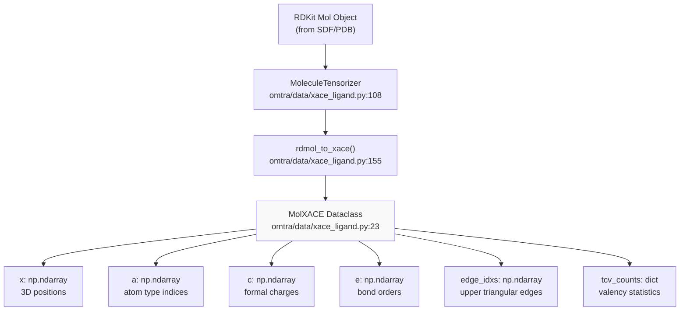
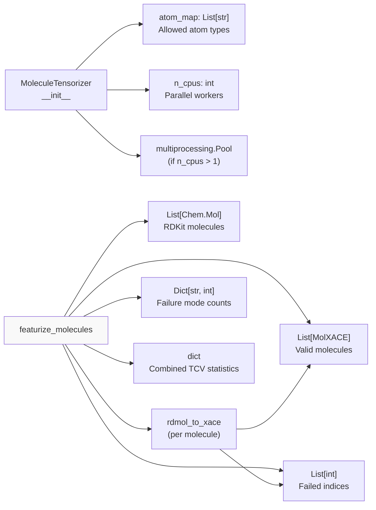
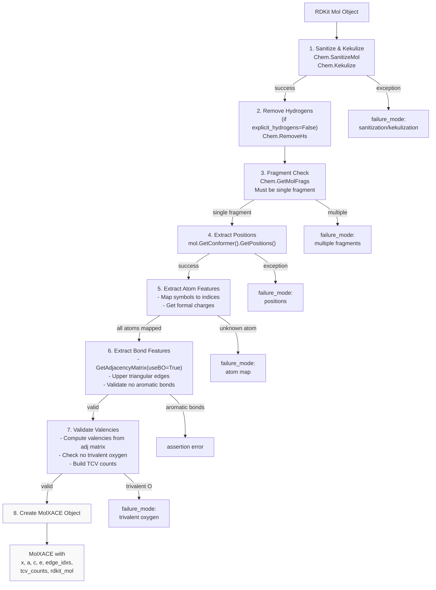
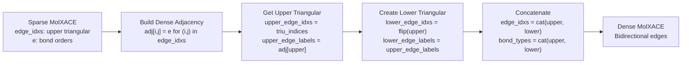
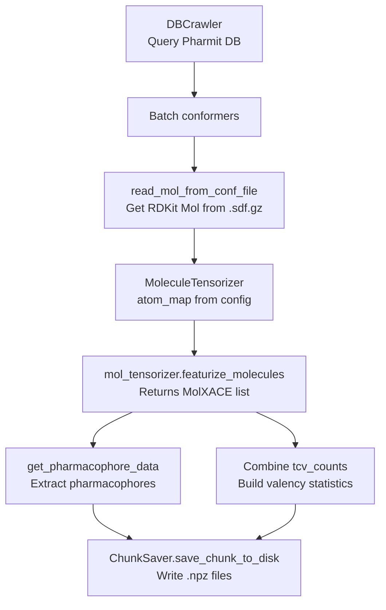
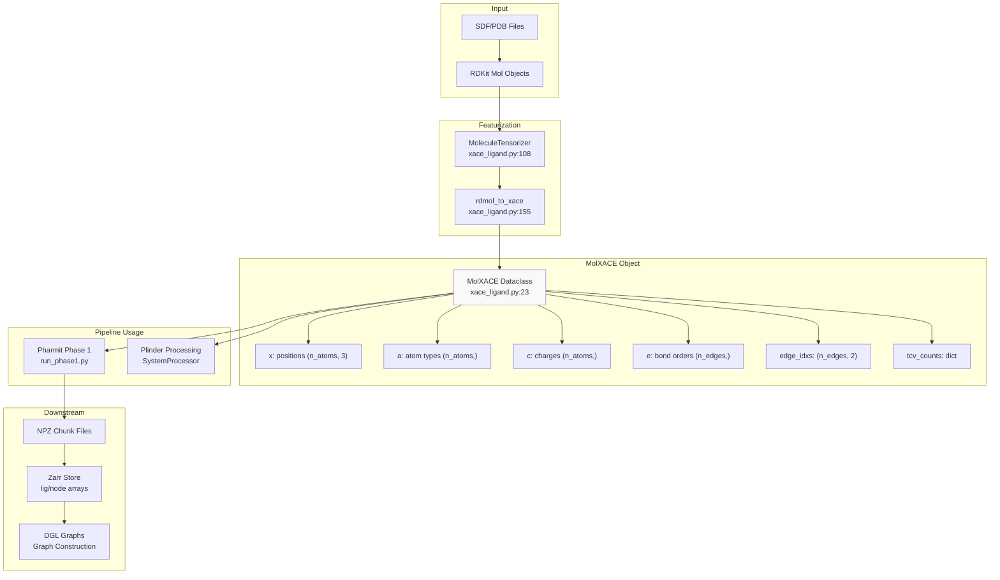

# Molecular Featurization (MolXACE)

<details>
<summary>Relevant source files</summary>

The following files were used as context for generating this wiki page:

- [omtra/data/xace_ligand.py](omtra/data/xace_ligand.py)
- [omtra/utils/misc.py](omtra/utils/misc.py)
- [omtra_pipelines/pharmit_dataset/guts/phase1.py](omtra_pipelines/pharmit_dataset/guts/phase1.py)
- [omtra_pipelines/pharmit_dataset/guts/phase2.py](omtra_pipelines/pharmit_dataset/guts/phase2.py)
- [omtra_pipelines/pharmit_dataset/readme.md](omtra_pipelines/pharmit_dataset/readme.md)
- [omtra_pipelines/pharmit_dataset/run_phase1.py](omtra_pipelines/pharmit_dataset/run_phase1.py)
- [omtra_pipelines/pharmit_dataset/run_phase2.py](omtra_pipelines/pharmit_dataset/run_phase2.py)

</details>


## Purpose and Scope

This page documents the **MolXACE** molecular representation and the **MoleculeTensorizer** system used to convert RDKit molecules into tensor-based features for graph neural networks. MolXACE is a core data structure throughout OMTRA that encodes molecular geometry, atom types, charges, and bond orders in a format suitable for flow matching and GNN processing.

For information about how MolXACE data is integrated into heterogeneous graphs, see [Graph Construction](#5.5). For pharmacophore extraction that runs alongside molecular featurization, see [Pharmacophore Extraction](#6.4).

**Sources:** [omtra/data/xace_ligand.py:1-232]()

---

## Overview

**MolXACE** stands for **Mol**ecular representation with **X** (positions), **A** (atom types), **C** (charges), and **E** (edges/bonds). It is a standardized data structure that represents molecules as:
- 3D atomic coordinates
- Categorical atom type indices
- Integer formal charges
- Bond order labels
- Optional auxiliary features (aromaticity, hybridization, ring membership, chirality)

The primary interface for creating MolXACE objects is the `MoleculeTensorizer` class, which converts RDKit `Mol` objects into this representation with built-in validation, error tracking, and parallel processing support.



**Sources:** [omtra/data/xace_ligand.py:22-41](), [omtra/data/xace_ligand.py:108-153]()

---

## The MolXACE Data Structure

The `MolXACE` dataclass is defined at [omtra/data/xace_ligand.py:22-41]() and contains the following fields:

| Field | Type | Shape | Description |
|-------|------|-------|-------------|
| `x` | `np.ndarray` or `torch.Tensor` | `(n_atoms, 3)` | 3D atomic coordinates in Angstroms |
| `a` | `np.ndarray` or `torch.Tensor` | `(n_atoms,)` | Atom type indices (mapped via `atom_map`) |
| `c` | `np.ndarray` or `torch.Tensor` | `(n_atoms,)` | Formal charges (integers) |
| `e` | `np.ndarray` or `torch.Tensor` | `(n_edges,)` | Bond orders: 1=single, 2=double, 3=triple |
| `edge_idxs` | `np.ndarray` or `torch.Tensor` | `(n_edges, 2)` | Edge indices (sparse, upper triangular) |
| `impl_H` | `np.ndarray` or `torch.Tensor` (optional) | `(n_atoms,)` | Implicit hydrogen count |
| `aro` | `np.ndarray` or `torch.Tensor` (optional) | `(n_atoms,)` | Aromaticity flag |
| `hyb` | `np.ndarray` or `torch.Tensor` (optional) | `(n_atoms,)` | Hybridization state |
| `ring` | `np.ndarray` or `torch.Tensor` (optional) | `(n_atoms,)` | Ring membership flag |
| `chiral` | `np.ndarray` or `torch.Tensor` (optional) | `(n_atoms,)` | Chirality tag |
| `cond_a` | `np.ndarray` or `torch.Tensor` (optional) | `(n_atoms,)` | Condensed atom type indices (alternative to `a`, `c`) |
| `rdkit_mol` | `Chem.Mol` (optional) | - | Original RDKit molecule object |
| `tcv_counts` | `dict` (optional) | - | Type-Charge-Valency distribution `{(type, charge, valency): count}` |
| `failure_mode` | `str` (optional) | - | Error description if conversion failed |

**Key Methods:**
- `to_torch()` [omtra/data/xace_ligand.py:42-46]() - Converts numpy arrays to PyTorch tensors
- `sparse_to_dense()` [omtra/data/xace_ligand.py:48-105]() - Converts sparse edge representation to full adjacency

**Sources:** [omtra/data/xace_ligand.py:22-106]()

---

## Atom Type Mapping

Atom types are encoded as integer indices via a predefined atom map. The standard atom map used throughout OMTRA is defined in `omtra/constants.py` as:

```python
lig_atom_type_map = ["C", "H", "N", "O", "F", "P", "S", "Cl", "Br", "I", "B"]
```

During conversion, each atom symbol is looked up in this map to obtain its index. Molecules containing atoms not in the map will fail with `failure_mode="atom map"`.

**Special atom types:**
- Standard atoms: indices 0-10 (C, H, N, etc.)
- Fake atoms (used for denoising): index `len(lig_atom_type_map)` (11)
- Condensed atom types: defined by `CondensedAtomTyper` (alternative typing scheme)

**Sources:** [omtra/data/xace_ligand.py:186-191](), [omtra/constants.py]()

---

## MoleculeTensorizer Class

The `MoleculeTensorizer` class [omtra/data/xace_ligand.py:108-153]() provides the main interface for batch conversion of RDKit molecules to MolXACE format.



**Constructor:**
```python
MoleculeTensorizer(atom_map: List[str], n_cpus=1)
```

**Main Method:**
```python
featurize_molecules(molecules: List[Chem.Mol]) -> Tuple[List[MolXACE], List[int], Dict, dict]
```

Returns:
1. `valid_molecules`: List of successfully converted MolXACE objects
2. `failed_idxs`: Indices of molecules that failed conversion
3. `failure_counts`: Dictionary mapping failure modes to counts
4. `tcv_counts`: Combined type-charge-valency statistics across all valid molecules

**Sources:** [omtra/data/xace_ligand.py:108-153]()

---

## Molecular Conversion Pipeline

The `rdmol_to_xace` function [omtra/data/xace_ligand.py:155-231]() performs the detailed conversion from RDKit molecule to MolXACE:



**Sources:** [omtra/data/xace_ligand.py:155-231]()

---

## Detailed Conversion Steps

### 1. Sanitization and Kekulization

[omtra/data/xace_ligand.py:157-171]()

The molecule is sanitized and kekulized to ensure a valid chemical structure with explicit single/double/triple bonds (no aromatic bond types):

```python
Chem.SanitizeMol(molecule)
Chem.Kekulize(molecule, clearAromaticFlags=True)
```

If `explicit_hydrogens=False` (default), hydrogens are removed and the molecule is re-kekulized.

### 2. Fragment Validation

[omtra/data/xace_ligand.py:173-175]()

Molecules must be single fragments (no disconnected components):

```python
num_fragments = len(Chem.GetMolFrags(molecule, sanitizeFrags=False))
if num_fragments > 1:
    return MolXACE(failure_mode="multiple fragments")
```

### 3. Position Extraction

[omtra/data/xace_ligand.py:177-181]()

3D coordinates are extracted from the conformer:

```python
positions = molecule.GetConformer().GetPositions()  # shape: (n_atoms, 3)
```

### 4. Atom Feature Extraction

[omtra/data/xace_ligand.py:183-193]()

For each atom, the symbol is mapped to an index and the formal charge is extracted:

```python
atom_types[i] = atom_map_dict[atom.GetSymbol()]  # raises KeyError if not in map
atom_charges[i] = atom.GetFormalCharge()  # integer formal charge
```

### 5. Bond Feature Extraction

[omtra/data/xace_ligand.py:195-208]()

The adjacency matrix is used to extract bond orders and edge indices:

```python
adj = Chem.rdmolops.GetAdjacencyMatrix(molecule, useBO=True)
edge_index = np.nonzero(np.triu(adj))  # upper triangular only
bond_idxs = np.stack(edge_index, axis=-1)  # shape: (n_edges, 2)
bond_types = adj[bond_idxs[:, 0], bond_idxs[:, 1]].astype(np.int32)
```

**Important:** Aromatic bonds (bond order 1.5) are explicitly disallowed and will cause an assertion error at [omtra/data/xace_ligand.py:198-199]().

### 6. Valency Computation and TCV Counts

[omtra/data/xace_ligand.py:210-221]()

Valencies are computed by summing bond orders, and the type-charge-valency (TCV) distribution is tracked:

```python
valencies = np.sum(adj, axis=1)  # sum of bond orders per atom

# Check for invalid valencies (e.g., trivalent oxygen)
if np.any((atom_types == atom_map_dict["O"]) & (valencies == 3)):
    return MolXACE(failure_mode="trivalent oxygen")

# Build TCV counts: {(type_idx, charge, valency): count}
tcv = np.stack([atom_types, atom_charges, valencies], axis=1)
unique_valencies, counts = np.unique(tcv, axis=0, return_counts=True)
tcv_counts = {tuple(row): count for row, count in zip(unique_valencies, counts)}
```

**Sources:** [omtra/data/xace_ligand.py:155-231]()

---

## Edge Representation: Sparse vs Dense

MolXACE uses a **sparse upper-triangular representation** by default to save memory. The `edge_idxs` array stores only the upper-triangular edges, and `e` stores the corresponding bond orders.

### Sparse Representation

Default format returned by `rdmol_to_xace`:
- `edge_idxs`: shape `(n_edges, 2)`, contains `(i, j)` pairs where `i < j`
- `e`: shape `(n_edges,)`, bond orders for upper-triangular edges only

### Dense Representation

The `sparse_to_dense()` method [omtra/data/xace_ligand.py:48-105]() creates bidirectional edges:



The dense representation duplicates edges in both directions: for each edge `(i, j)` with bond order `b`, there are edges `(i, j, b)` and `(j, i, b)`.

**Sources:** [omtra/data/xace_ligand.py:48-105]()

---

## Type-Charge-Valency (TCV) Statistics

The `tcv_counts` dictionary tracks the distribution of atom types, charges, and valencies in the molecule:

```python
tcv_counts = {
    (type_idx, charge, valency): count,
    ...
}
```

**Example:**
```python
{
    (0, 0, 4): 5,   # 5 neutral carbon atoms with valency 4
    (2, 0, 3): 2,   # 2 neutral nitrogen atoms with valency 3
    (3, -1, 1): 1,  # 1 negatively charged oxygen with valency 1
}
```

### Combining TCV Counts

When processing batches, the `combine_tcv_counts` utility [omtra/utils/misc.py:23-28]() merges statistics across multiple molecules:

```python
combined = combine_tcv_counts([mol1.tcv_counts, mol2.tcv_counts, ...])
# Returns: defaultdict(int) with summed counts
```

This information is used in the Pharmit pipeline to:
1. Compute dataset-wide valency distributions
2. Generate prior distributions for sampling
3. Validate generated molecules

**Sources:** [omtra/data/xace_ligand.py:210-221](), [omtra/utils/misc.py:23-28](), [omtra_pipelines/pharmit_dataset/guts/phase2.py:49-92]()

---

## Failure Modes and Error Handling

MolXACE conversion can fail for several reasons. Failed molecules return a `MolXACE` object with `failure_mode` set and other fields as `None`.

### Failure Mode Taxonomy

| Failure Mode | Cause | Line Reference |
|--------------|-------|----------------|
| `"sanitization/kekulization"` | RDKit sanitization or kekulization failed | [omtra/data/xace_ligand.py:160-162]() |
| `"kekulization"` | Post-hydrogen-removal kekulization failed | [omtra/data/xace_ligand.py:168-171]() |
| `"multiple fragments"` | Molecule has disconnected fragments | [omtra/data/xace_ligand.py:173-175]() |
| `"positions"` | No conformer or position extraction failed | [omtra/data/xace_ligand.py:177-181]() |
| `"atom map"` | Atom symbol not in the provided `atom_map` | [omtra/data/xace_ligand.py:186-191]() |
| `"trivalent oxygen"` | Oxygen atom with valency 3 detected | [omtra/data/xace_ligand.py:214-215]() |

### Failure Tracking in Pipelines

When using `MoleculeTensorizer.featurize_molecules()`, failures are tracked:

```python
valid_molecules, failed_idxs, failure_counts, tcv_counts = tensorizer.featurize_molecules(molecules)

# failure_counts example:
# {
#     "atom map": 5,
#     "multiple fragments": 2,
#     "sanitization/kekulization": 1
# }
```

Failed molecules are logged and can be saved using `bad_mol_reporter()` [omtra/utils/misc.py:30-40](), which writes the molecule to an SDF file with error traceback for debugging.

**Sources:** [omtra/data/xace_ligand.py:123-153](), [omtra/utils/misc.py:30-40]()

---

## Advanced Features

### Adding Fake Atoms

The `add_fake_atoms` function [omtra/data/xace_ligand.py:233-270]() adds random "fake" atoms to molecules for denoising training:

```python
mol = add_fake_atoms(mol, fake_atom_p=0.1, cond_a_typer=typer)
```

- Randomly selects up to `ceil(n_atoms * fake_atom_p)` fake atoms
- Places them near randomly chosen "anchor" atoms with Gaussian noise
- Assigns fake atom type index: `len(lig_atom_type_map)` (or condensed fake type if using `cond_a`)
- Fake atoms have zero charge and no bonds

**Usage:** This is used during training to teach the model to remove spurious atoms.

### K-Hop Edge Augmentation

The `add_k_hop_edges` function [omtra/data/xace_ligand.py:275-329]() adds edges between atoms separated by `k` bonds:

```python
x, a, c, e, edge_idxs = add_k_hop_edges(x, a, c, e, edge_idxs, k=2)
```

- Uses DGL's `khop_graph` to find k-hop neighbors
- Adds edges with bond order 0 (non-bonded)
- Useful for message passing over longer-range interactions

### Condensed Atom Typing

Instead of separate `a` (type) and `c` (charge) arrays, molecules can use `cond_a` (condensed atom type) which encodes both type and charge in a single index via `CondensedAtomTyper`.

This is used when the `cond_a` field is set [omtra/data/xace_ligand.py:36]().

**Sources:** [omtra/data/xace_ligand.py:233-329]()

---

## Usage in Data Pipelines

### Pharmit Pipeline (Phase 1)

[omtra_pipelines/pharmit_dataset/run_phase1.py:65-163]()

The Pharmit processing pipeline uses `MoleculeTensorizer` to convert conformer structures:



Key steps:
1. Read molecules from compressed SDF files
2. Filter by number of atoms (min/max thresholds)
3. Featurize with `MoleculeTensorizer`
4. Remove failed molecules
5. Extract pharmacophores
6. Save to `.npz` chunks with TCV statistics

**Sources:** [omtra_pipelines/pharmit_dataset/run_phase1.py:65-163](), [omtra_pipelines/pharmit_dataset/guts/phase1.py:288-318]()

### Pharmit Pipeline (Phase 2)

[omtra_pipelines/pharmit_dataset/guts/phase2.py:49-92]()

Phase 2 aggregates TCV statistics across all chunks to build dataset-wide distributions:

```python
# Combine TCV counts from all chunks
tcv_counts = combine_tcv_counts([chunk.tcv_counts for chunk in chunks])

# Build probability distribution p(type, charge, valency)
tcv_support = np.array(list(tcv_counts.keys()))
t_space = np.unique(tcv_support[:, 0])  # atom types observed
c_space = np.unique(tcv_support[:, 1])  # charges observed  
v_space = np.unique(tcv_support[:, 2])  # valencies observed

p_tcv = normalize(counts_to_3d_array(tcv_counts, t_space, c_space, v_space))
```

This distribution is saved to the Zarr store and used for:
- Prior sampling during generation
- Validation of generated molecules
- Dataset statistics reporting

**Sources:** [omtra_pipelines/pharmit_dataset/guts/phase2.py:49-92]()

### Plinder Pipeline

The Plinder pipeline similarly uses `MoleculeTensorizer` within `SystemProcessor` to convert ligands from protein-ligand complexes. The process is analogous but includes additional protein-specific processing.

**Sources:** [omtra_pipelines/plinder_dataset]() (referenced in high-level diagrams)

---

## Integration with Graph Construction

MolXACE objects are converted to DGL graph nodes in the graph construction pipeline. The `x`, `a`, `c`, `e`, and `edge_idxs` fields become node and edge features in heterogeneous graphs.

For details on how MolXACE data flows into graph structures, see [Graph Construction](#5.5).

**Graph node features:**
- `lig` node type gets `x`, `a`, `c` features
- `lig_to_lig` edges get `e` (bond order) features
- Edge construction uses `edge_idxs` or builds edges spatially

---

## Summary Diagram: End-to-End Flow



**Sources:** [omtra/data/xace_ligand.py:1-329](), [omtra_pipelines/pharmit_dataset/run_phase1.py:1-289](), [omtra_pipelines/pharmit_dataset/guts/phase2.py:1-315]()

---