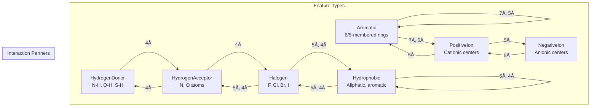
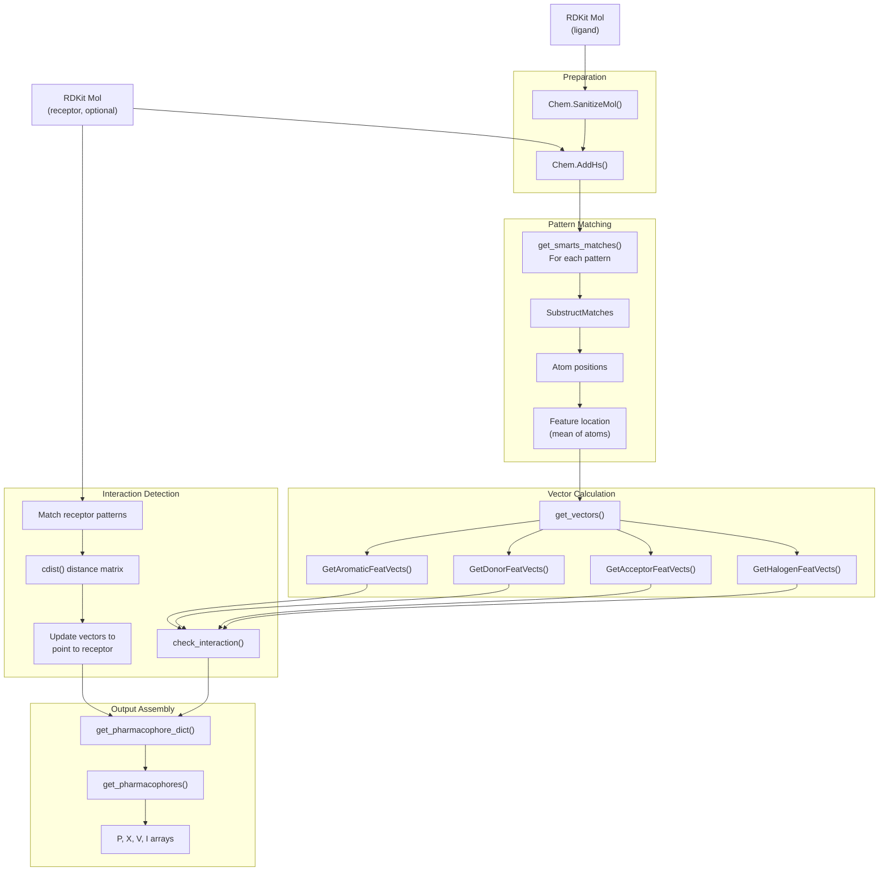
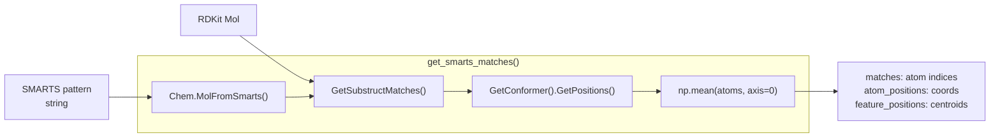
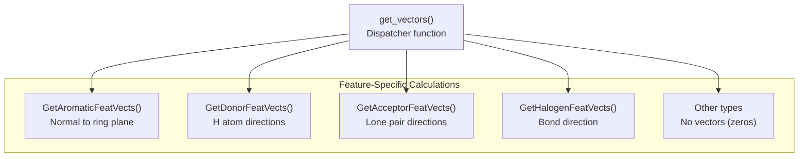
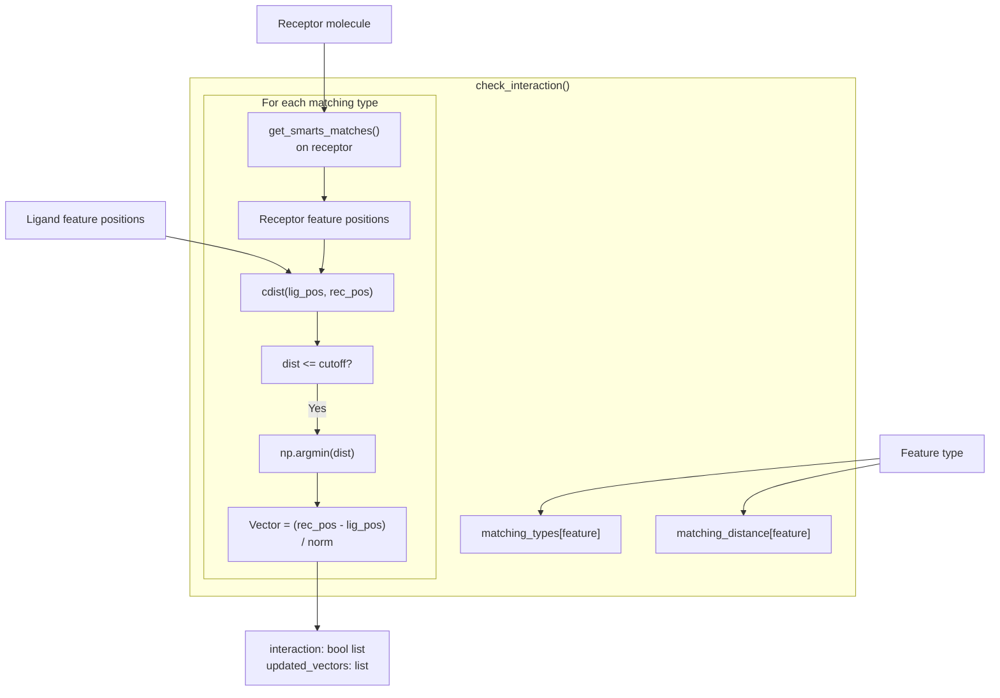
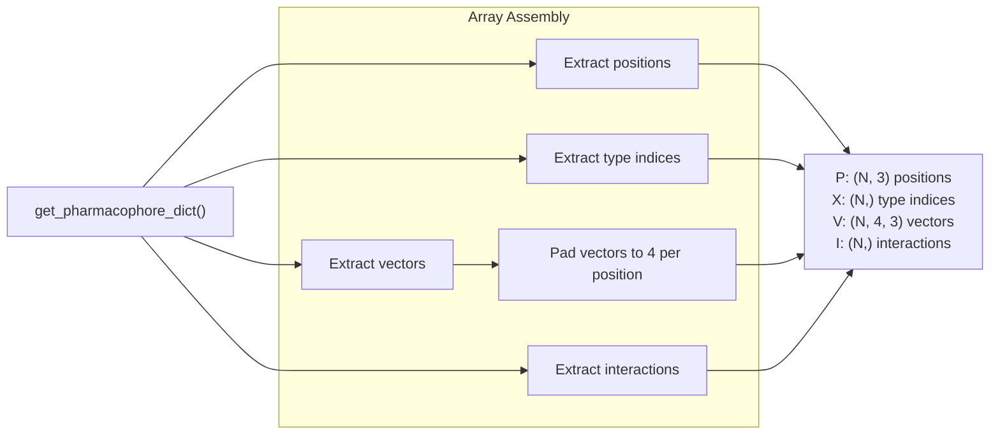

# Pharmacophore Extraction

<details>
<summary>Relevant source files</summary>

The following files were used as context for generating this wiki page:

- [omtra/data/pharmacophores.py](omtra/data/pharmacophores.py)
- [omtra/data/pharmit_pharmacophores.py](omtra/data/pharmit_pharmacophores.py)
- [omtra/data/pharmvec.py](omtra/data/pharmvec.py)
- [omtra/scripts/visualize_pharms.py](omtra/scripts/visualize_pharms.py)

</details>


## Purpose and Scope

This document describes the pharmacophore extraction system in OMTRA, which identifies chemical features (pharmacophores) in molecules and computes their spatial direction vectors. Pharmacophores are abstract representations of molecular features that are important for molecular recognition and binding, such as hydrogen bond donors/acceptors, aromatic rings, and hydrophobic regions.

The extraction process converts RDKit molecules into pharmacophore representations consisting of:
- Feature positions (3D coordinates)
- Feature types (aromatic, donor, acceptor, etc.)
- Direction vectors (indicating preferred interaction directions)
- Interaction flags (whether features interact with a receptor, if provided)

For information about how pharmacophore data is used in graph construction, see [Graph Construction](#5.5). For details on how pharmacophores are stored in datasets, see [Plinder Dataset](#5.2) and [Pharmit Dataset](#5.3).

**Sources:** [omtra/data/pharmacophores.py:1-208]()

---

## Pharmacophore Feature Types

The system identifies seven pharmacophore feature types using SMARTS pattern matching. Each type has associated patterns, matching partners, and distance cutoffs for interaction detection.

### Feature Type Definitions



**Sources:** [omtra/data/pharmacophores.py:9-54]()

### SMARTS Patterns

The system uses multiple SMARTS patterns per feature type to capture different chemical environments:

| Feature Type | Number of Patterns | Key Examples |
|--------------|-------------------|--------------|
| Aromatic | 2 | `"a1aaaaa1"` (6-membered), `"a1aaaa1"` (5-membered) |
| PositiveIon | 3 | `"[+,+2,+3,+4]"`, guanidinium, imidazole |
| NegativeIon | 2 | `"[-,-2,-3,-4]"`, carboxylate |
| HydrogenAcceptor | 2 | Nitrogen and oxygen acceptors |
| HydrogenDonor | 3 | N-H, O-H, S-H groups |
| Hydrophobic | 6 | Aromatic rings, aliphatic chains, sulfur |
| Halogen | 4 | F, Cl, Br, I bonded to carbon |

**Sources:** [omtra/data/pharmacophores.py:9-34]()

---

## Extraction Pipeline

The pharmacophore extraction process follows a multi-step pipeline from RDKit molecule to final arrays:



**Sources:** [omtra/data/pharmacophores.py:56-208]()

---

## SMARTS Pattern Matching

The `get_smarts_matches()` function identifies all occurrences of a SMARTS pattern in a molecule and computes the centroid of matched atoms.

### Implementation Details



The function returns:
- `matches`: List of tuples containing atom indices for each match
- `atom_positions`: List of arrays containing 3D coordinates of matched atoms
- `feature_positions`: List of 3D centroids (one per match)

**Sources:** [omtra/data/pharmacophores.py:56-73]()

---

## Direction Vector Calculation

Direction vectors indicate the preferred orientation for interaction with each pharmacophore feature. The calculation method varies by feature type.

### Vector Calculation Functions



**Sources:** [omtra/data/pharmacophores.py:75-94](), [omtra/data/pharmvec.py:1-169]()

### Aromatic Vectors

For aromatic rings, the system computes the normal vector to the ring plane and returns both directions:

1. Compute two edge vectors from ring centroid to atoms
2. Calculate cross product to get normal
3. Normalize and return both `normal` and `-normal`

**Sources:** [omtra/data/pharmvec.py:4-20]()

### Hydrogen Donor Vectors

For donor features, vectors point along N-H, O-H, or S-H bonds:

1. Find hydrogen neighbors of the donor atom
2. For each hydrogen, compute vector from donor to hydrogen
3. Normalize and return list of vectors (one per H atom)

**Sources:** [omtra/data/pharmvec.py:23-42]()

### Hydrogen Acceptor Vectors

Acceptor vectors are more complex and depend on hybridization:

| Atom Type | Hybridization | Vector Calculation |
|-----------|--------------|-------------------|
| Oxygen (sp2) | 2 neighbors | Two lone pair vectors at 120° |
| Oxygen (sp3) | 1 neighbor | Two lone pair vectors at tetrahedral angles |
| Other | Any | Average of reversed bond vectors |

**Sources:** [omtra/data/pharmvec.py:45-134]()

### Halogen Vectors

For halogen atoms, the vector points opposite to the C-X bond:

1. Get the heavy atom neighbor (carbon)
2. Compute vector from carbon to halogen
3. Reverse and normalize

**Sources:** [omtra/data/pharmvec.py:135-168]()

---

## Interaction Detection

When a receptor is provided, the `check_interaction()` function determines whether ligand pharmacophores interact with matching receptor features and updates vectors to point toward interaction partners.



The function returns:
- `interaction`: Boolean list indicating which features interact
- `updated_vectors`: New vectors pointing to closest receptor partner (or `None` if no interaction)

**Sources:** [omtra/data/pharmacophores.py:96-125]()

---

## Main Extraction Functions

### get_pharmacophore_dict()

The `get_pharmacophore_dict()` function produces a structured dictionary with all pharmacophore information:

```python
{
    'FeatureName': {
        'P': [(x, y, z), ...],      # Positions
        'V': [[(vx, vy, vz), ...], ...],  # Vectors (multiple per position)
        'I': [True/False, ...]      # Interaction flags (only if receptor provided)
    },
    ...
}
```

**Workflow:**

1. Initialize empty dictionary for all feature types
2. Sanitize molecule and add hydrogens
3. For each feature type and SMARTS pattern:
   - Get matches and compute positions
   - Calculate direction vectors
4. If receptor provided:
   - Check interactions for each feature
   - Update vectors for interacting features
5. Return dictionary

**Sources:** [omtra/data/pharmacophores.py:127-173]()

### get_pharmacophores()

The `get_pharmacophores()` function converts the dictionary to numpy arrays suitable for model input:



**Output Arrays:**

| Array | Shape | Description |
|-------|-------|-------------|
| `P` | `(num_pharm, 3)` | 3D positions of pharmacophore centers |
| `X` | `(num_pharm,)` | Integer type indices (via `ph_type_to_idx`) |
| `V` | `(num_pharm, 4, 3)` | Direction vectors (padded to 4 per center) |
| `I` | `(num_pharm,)` | Interaction flags (only if receptor provided) |

**Edge Cases:**
- If no pharmacophores found, returns empty arrays with correct shapes
- Vectors are padded with zeros to ensure uniform shape (4 vectors per center)
- Maximum of 4 vectors per pharmacophore center enforced

**Sources:** [omtra/data/pharmacophores.py:175-208]()

---

## Type Index Mapping

Pharmacophore types are converted to integer indices for model input using constants defined in `omtra/constants.py`:

```python
ph_type_to_idx = {
    'Aromatic': 0,
    'HydrogenDonor': 1,
    'HydrogenAcceptor': 2,
    'PositiveIon': 3,
    'NegativeIon': 4,
    'Hydrophobic': 5,
    'Halogen': 6
}

ph_idx_to_type = {v: k for k, v in ph_type_to_idx.items()}
```

**Sources:** [omtra/data/pharmacophores.py:5](), [omtra/constants.py]()

---

## Alternative Extraction: Pharmit

An alternative extraction method using the external `pharmit` command-line tool is available in `omtra/data/pharmit_pharmacophores.py`. This method:

1. Writes molecule to SDF file
2. Calls `pharmit pharma -in <sdf> -out <json>`
3. Parses JSON output to extract positions and types
4. Returns only position and type arrays (no vectors)

This approach is simpler but provides less detailed directional information compared to the SMARTS-based extraction.

**Sources:** [omtra/data/pharmit_pharmacophores.py:1-27]()

---

## Visualization

The `omtra/scripts/visualize_pharms.py` script provides PyMOL visualization of pharmacophores and their direction vectors:

### Features

- Loads molecule and displays pharmacophore centers as colored spheres
- Renders direction vectors as arrows/cones
- Each pharmacophore type mapped to a unique pseudo-element for coloring
- Vector length scaled for visibility

### Usage

```python
# In PyMOL:
run visualize_pharms.py
show_pharmvecs /path/to/ligand.sdf
```

The script:
1. Calls `get_pharmacophores()` to extract features
2. Converts pharmacophores to XYZ format with pseudo-elements
3. Creates PyMOL CGO objects for arrows representing vectors
4. Displays both the molecule and pharmacophore overlay

**Sources:** [omtra/scripts/visualize_pharms.py:1-115]()

---

## Integration with Data Processing

Pharmacophore extraction is integrated into both major data processing pipelines:

### Plinder Pipeline

In the Plinder processing pipeline (`omtra_pipelines/plinder_dataset/`), pharmacophores are extracted for both ligand and receptor:
- Called during `SystemProcessor` execution
- Stored in Zarr arrays under `pharmacophore/` group
- Interaction detection enabled (receptor provided)

For details, see [Plinder Processing Pipeline](#6.1).

### Pharmit Pipeline

In the Pharmit processing pipeline (`omtra_pipelines/pharmit_dataset/`), pharmacophores are extracted for conformers:
- Called during Phase 1 featurization
- Stored in Zarr arrays under `pharm/` group
- Ligand-only extraction (no receptor)

For details, see [Pharmit Processing Pipeline](#6.2).

**Sources:** Based on high-level system architecture diagrams

---

## Summary

The pharmacophore extraction system provides:

1. **Seven pharmacophore types** identified via SMARTS patterns
2. **Direction vectors** computed using geometry-specific algorithms
3. **Interaction detection** when receptor structure is available
4. **Standardized output** as numpy arrays for model consumption
5. **Visualization tools** for validation and debugging

The extracted pharmacophore representations serve as additional geometric constraints during molecular generation, helping guide the model to produce chemically and biologically relevant structures.

---