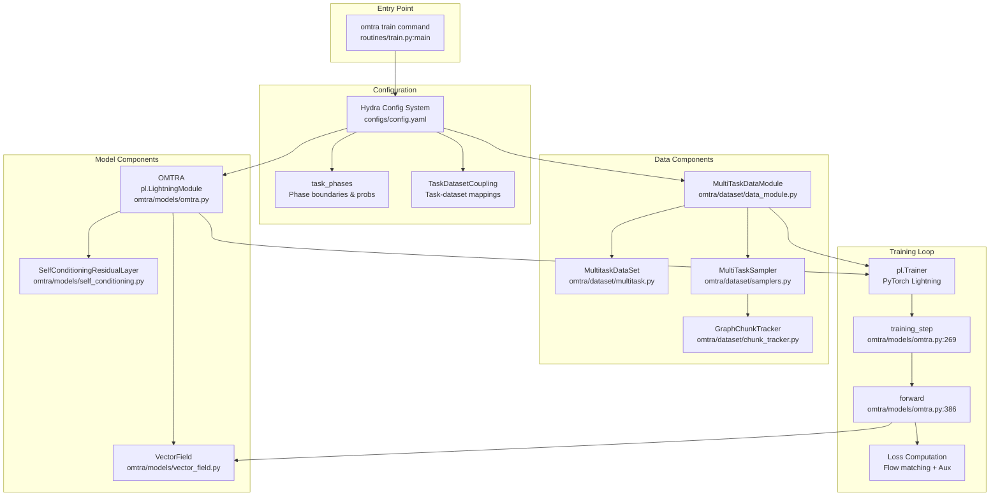
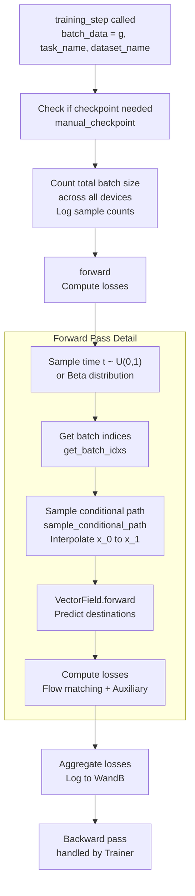
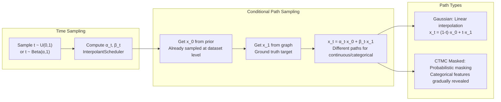
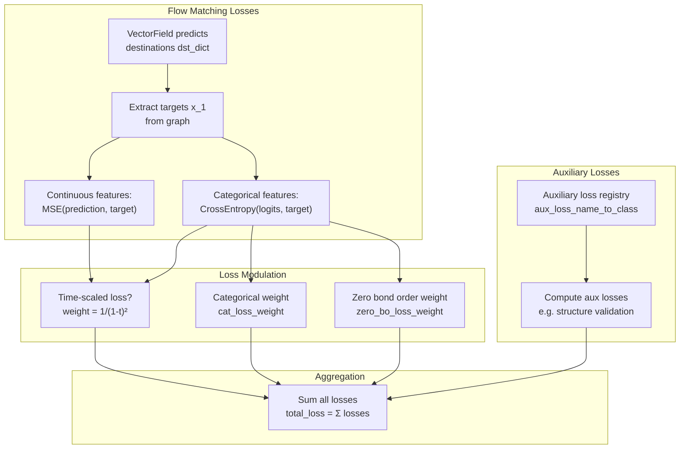
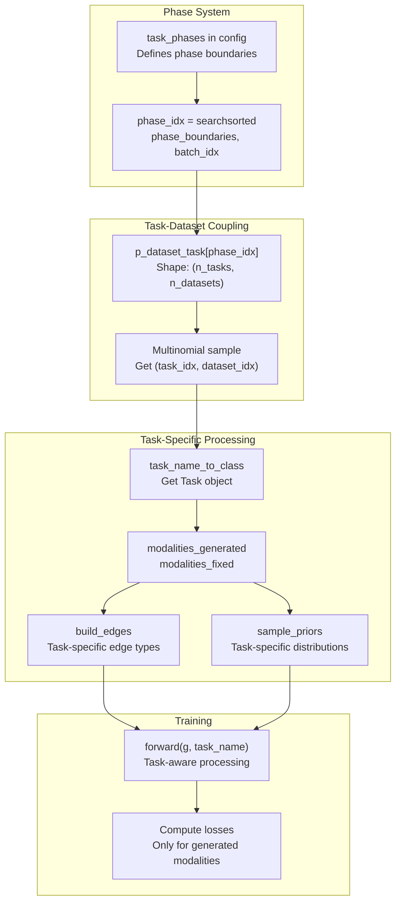

# Training

<details>
<summary>Relevant source files</summary>

The following files were used as context for generating this wiki page:

- [configs/config.yaml](configs/config.yaml)
- [omtra/dataset/chunk_tracker.py](omtra/dataset/chunk_tracker.py)
- [omtra/dataset/data_module.py](omtra/dataset/data_module.py)
- [omtra/dataset/multitask.py](omtra/dataset/multitask.py)
- [omtra/dataset/samplers.py](omtra/dataset/samplers.py)
- [omtra/models/omtra.py](omtra/models/omtra.py)
- [omtra/models/self_conditioning.py](omtra/models/self_conditioning.py)
- [omtra/models/vector_field.py](omtra/models/vector_field.py)
- [routines/train.py](routines/train.py)

</details>


This page provides a comprehensive guide to training OMTRA models. It covers the training pipeline architecture, data flow, key components, and the mechanics of multi-task learning. For detailed information on specific aspects, see:
- Configuration details: [Configuration System](#7.2)
- Multi-task sampling and balancing: [Multi-Task Learning](#7.3)  
- Loss function specifics: [Loss Functions and Objectives](#7.4)

For information about the datasets used during training, see [Datasets and Data Loading](#5).

## Starting Training

Training is initiated through the `omtra` CLI or directly via the training script:

```bash
# Using the CLI
omtra train \
    --config-name config \
    name=my_training_run \
    max_steps=100000 \
    edges_per_batch=300000

# Or directly
python routines/train.py \
    name=my_training_run \
    max_steps=100000
```

The training script [routines/train.py:55-191]() orchestrates the entire training process:

1. Loads configuration via Hydra
2. Initializes the data module
3. Loads or creates the model
4. Configures logging (WandB)
5. Sets up PyTorch Lightning trainer
6. Runs training loop

**Sources:** [routines/train.py:55-191]()

## Training Pipeline Architecture



**Sources:** [routines/train.py:55-191](), [omtra/models/omtra.py:55-186](), [omtra/dataset/data_module.py:15-143]()

## Training Step Workflow

Each training iteration follows this sequence:



**Key methods:**

| Method | Location | Purpose |
|--------|----------|---------|
| `training_step` | [omtra/models/omtra.py:269-322]() | Main training step, called by PyTorch Lightning |
| `forward` | [omtra/models/omtra.py:386-516]() | Samples time, applies conditional path, computes losses |
| `sample_conditional_path` | [omtra/models/omtra.py:542-600]() | Interpolates between x_0 and x_1 at time t |
| `manual_checkpoint` | [omtra/models/omtra.py:201-224]() | Saves checkpoints at intervals |

**Sources:** [omtra/models/omtra.py:269-516]()

## Data Flow Through Training

```mermaid
graph LR
    subgraph "Batch Construction"
        Phase["Determine current phase<br/>based on batch_idx"]
        SampleTD["Sample task & dataset<br/>according to p_dataset_task"]
        ChunkSelect["Select graph chunk<br/>ChunkTracker"]
        LoadGraphs["Load graphs from Zarr<br/>adaptive_batch_loader"]
        Batch["Batch into DGL graph<br/>dgl.batch"]
    end
    
    subgraph "Processing"
        PriorSample["Sample x_0 from priors<br/>for generated modalities"]
        TimeInterp["Interpolate to x_t<br/>x_t = α_t·x_0 + β_t·x_1"]
        BuildEdges["Build task-specific edges<br/>build_edges"]
        GNN["VectorField GNN<br/>Predict destinations"]
        Loss["Compute losses<br/>Compare predictions to x_1"]
    end
    
    Phase --> SampleTD
    SampleTD --> ChunkSelect
    ChunkSelect --> LoadGraphs
    LoadGraphs --> Batch
    
    Batch --> PriorSample
    PriorSample --> TimeInterp
    TimeInterp --> BuildEdges
    BuildEdges --> GNN
    GNN --> Loss
```



### Batch Construction Details

The `MultiTaskSampler` [omtra/dataset/samplers.py:14-180]() constructs batches:

1. **Phase determination**: Current batch index determines which phase (and thus which task-dataset probabilities) to use
2. **Task-dataset sampling**: Sample (task, dataset) pair according to `p_dataset_task[phase_idx]`
3. **Chunk selection**: `GraphChunkTracker` manages chunks from the Zarr store
4. **Adaptive loading**: `adaptive_batch_loader` [omtra/dataset/chunk_tracker.py:72-144]() selects graphs until `edges_per_batch` limit is reached
5. **Batching**: Graphs are batched using `dgl.batch` in the collate function

**Sources:** [omtra/dataset/samplers.py:14-180](), [omtra/dataset/chunk_tracker.py:8-145]()

## Key Training Components

### OMTRA Model Class

The `OMTRA` class [omtra/models/omtra.py:55-1002]() is a PyTorch Lightning module that encapsulates:

| Component | Attribute | Purpose |
|-----------|-----------|---------|
| Task-dataset coupling | `td_coupling` | Defines valid task-dataset pairs and probabilities |
| Vector field | `vector_field` | GNN that predicts trajectory destinations |
| Interpolant scheduler | `interpolant_scheduler` | Computes α_t and β_t for conditional paths |
| Loss functions | `loss_fn_dict` | MSE for continuous, CrossEntropy for categorical |
| Auxiliary losses | `aux_loss_fn_dict` | Additional regularization losses |
| Optimizer config | `optimizer_cfg` | Adam optimizer configuration |

**Initialization parameters:**

```python
OMTRA(
    task_phases: DictConfig,              # Phase definitions
    task_dataset_coupling: DictConfig,    # Task-dataset mappings
    dists_file: str,                      # Path to distribution files
    graph_config: DictConfig,             # Graph construction config
    conditional_paths: DictConfig,        # Conditional path functions
    optimizer: DictConfig,                # Optimizer settings
    vector_field: DictConfig,             # VectorField architecture
    aux_losses: DictConfig,               # Auxiliary loss configs
    prior_config: DictConfig,             # Prior configurations
    time_scaled_loss: bool = False,       # Enable time-weighted losses
    train_t_dist: str = 'uniform',        # Time sampling distribution
    ...
)
```

**Sources:** [omtra/models/omtra.py:55-186]()

### MultiTaskDataModule

The `MultiTaskDataModule` [omtra/dataset/data_module.py:15-143]() manages all data loading:

```python
MultiTaskDataModule(
    dataset_config: DictConfig,           # Per-dataset configurations
    task_phases: DictConfig,              # Phase boundaries
    dataset_task_coupling: DictConfig,    # Task-dataset probs
    graph_config: DictConfig,             # Graph construction
    prior_config: DictConfig,             # Prior sampling
    edges_per_batch: int,                 # Batch size constraint
    num_workers: int = 0,                 # DataLoader workers
    max_steps: int = None,                # Training duration
    fake_atom_p: float = 0.0,            # Fake atom probability
)
```

**Responsibilities:**
- Creates separate train and validation datasets
- Instantiates `MultiTaskSampler` for each split
- Configures DataLoaders with appropriate workers and batching

**Sources:** [omtra/dataset/data_module.py:15-143]()

### VectorField GNN

The `VectorField` [omtra/models/vector_field.py:40-831]() performs the core denoising:

| Component | Purpose |
|-----------|---------|
| Token embeddings | Embed categorical features (atom types, charges, bond orders) |
| Scalar embedding | Initial node feature embedding |
| Edge embedding | Initial edge feature embedding |
| Conv layers | `HeteroGVPConv` layers for message passing |
| Node position updaters | `NodePositionUpdate` modules for coordinate refinement |
| Edge updaters | `EdgeUpdate` modules for edge feature refinement |
| Output heads | Predict final states for each modality |

**Forward pass sequence:**
1. Embed input features (categorical → tokens, continuous → scalars)
2. Build task-specific edges
3. Apply self-conditioning (if enabled)
4. Iterate through GNN layers with interleaved position updates
5. Apply output heads to generate predictions

**Sources:** [omtra/models/vector_field.py:40-731]()

## Time Sampling and Conditional Paths

Training samples time points and interpolates between x_0 (prior) and x_1 (target):



**Time distributions:**

| Distribution | Configuration | Use Case |
|--------------|---------------|----------|
| Uniform | `train_t_dist: 'uniform'` | Equal weighting across all time points |
| Beta | `train_t_dist: 'beta'`, `t_alpha: 1.8` | More samples near t=1 (challenging regions) |

**Conditional path functions** are modality-specific and defined in `omtra/models/conditional_paths/`. The `InterpolantScheduler` [omtra/models/interpolant_scheduler.py]() computes α_t and β_t for each modality.

**Sources:** [omtra/models/omtra.py:177-185](), [omtra/models/omtra.py:542-600](), [omtra/models/omtra.py:387-388]()

## Loss Computation

The forward pass computes multiple losses that are aggregated:



### Loss Configuration

Losses are configured in the model initialization:

```python
# Main loss functions (per modality)
self.loss_fn_dict = nn.ModuleDict({
    "lig_x": nn.MSELoss(reduction="mean"),           # Positions
    "lig_a": nn.CrossEntropyLoss(reduction="mean"),  # Atom types
    "lig_c": nn.CrossEntropyLoss(reduction="mean"),  # Charges
    "lig_e": nn.CrossEntropyLoss(                    # Bond orders
        weight=zero_bo_weights,
        reduction="mean"
    ),
    ...
})

# Auxiliary losses
self.aux_loss_fn_dict = nn.ModuleDict({
    "structure_loss": StructureLoss(...),
    ...
})
```

**Loss computation details** [omtra/models/omtra.py:454-514]():

1. For each modality being generated, compute loss between prediction and target
2. Apply time scaling if `time_scaled_loss=True`: weight = 1/(1-t)²
3. Apply categorical weight if categorical feature
4. Compute auxiliary losses for applicable tasks
5. Sum all losses to get total loss

**Masking for categorical features:** During training, some categorical features may already be unmasked at time t. These are set to `ignore_index=-100` so they don't contribute to loss [omtra/models/omtra.py:436-442]().

**Sources:** [omtra/models/omtra.py:226-266](), [omtra/models/omtra.py:454-514]()

## Multi-Task Training Mechanics

Multi-task training allows a single model to learn multiple generation tasks simultaneously:



### TaskDatasetCoupling

The `TaskDatasetCoupling` object [omtra/load/conf.py]() defines:

- `task_space`: List of task names (e.g., `["denovo_ligand", "fixed_protein_ligand"]`)
- `dataset_space`: List of dataset names (e.g., `["plinder", "pharmit"]`)
- `p_dataset_task`: Probability tensor of shape `(n_phases, n_tasks, n_datasets)`
- `phase_durations`: Number of steps per phase

**Example configuration:**

```yaml
task_phases:
  phase_1:
    duration: 50000
    tasks:
      denovo_ligand:
        datasets:
          pharmit: 0.7
          plinder: 0.3
  phase_2:
    duration: 50000
    tasks:
      fixed_protein_ligand:
        datasets:
          plinder: 1.0
```

This creates a training schedule where the first 50k steps sample mostly from `denovo_ligand` task, then switch to `fixed_protein_ligand`.

**Sources:** [omtra/dataset/samplers.py:58-77](), [omtra/load/conf.py]()

## Checkpointing and Logging

### Manual Checkpointing

OMTRA implements custom checkpointing [omtra/models/omtra.py:201-224]():

- Saves checkpoint every `checkpoint_interval` steps (default: 1000)
- Keeps only `k_checkpoints` most recent checkpoints (default: 20)
- Saves to `{run_dir}/checkpoints/batch_{batch_idx}.ckpt`

### WandB Logging

Training metrics are logged to Weights & Biases:

```python
# Per-step metrics
self.log_dict({
    "lig_x_train_loss": loss_x,
    "lig_a_train_loss": loss_a,
    ...
}, on_step=True)

# Sample counts per task-dataset pair
self.log(
    f"{task_name}_{dataset_name}_sample_count",
    self.sample_counts[(task_name, dataset_name)],
    rank_zero_only=True
)
```

**Resume information** is saved to `resume_info.yaml` [routines/train.py:128-136]() containing:
- `run_id`: WandB run identifier
- `name`: Human-readable run name
- `url`: Link to WandB dashboard

**Sources:** [omtra/models/omtra.py:201-224](), [omtra/models/omtra.py:280-320](), [routines/train.py:113-143]()

## Validation During Training

Validation is performed periodically using `validation_step` [omtra/models/omtra.py:324-383]():

1. **Sample generation**: Generate molecules using `self.sample()`
   - For unconditional tasks: generate `2*batch_size` samples
   - For conditional tasks: generate 2 replicates per input
2. **Evaluation**: Run configured evaluation functions (if `eval_config` provided)
3. **Logging**: Log evaluation metrics to WandB

**Validation frequency** is controlled by the `val_check_interval` in the trainer configuration.

**Sources:** [omtra/models/omtra.py:324-383]()

## Configuration Summary

Key training hyperparameters from [configs/config.yaml:1-42]():

| Parameter | Default | Description |
|-----------|---------|-------------|
| `max_steps` | 1000 | Total training steps |
| `edges_per_batch` | 300000 | Maximum edges per batch |
| `num_workers` | 2 | DataLoader workers |
| `fake_atom_p` | 0.3 | Fraction of fake atoms to add |
| `distort_p` | 0.2 | Probability of coordinate distortion |
| `lr_warmup_steps` | 0 | Learning rate warmup duration |
| `train_t_dist` | 'uniform' | Time sampling distribution |
| `time_scaled_loss` | False | Enable time-weighted losses |
| `cat_loss_weight` | 1.0 | Weight for categorical losses |
| `zero_bo_loss_weight` | 1.0 | Weight for zero bond order class |

**Sources:** [configs/config.yaml:1-42](), [omtra/models/omtra.py:56-186]()

---