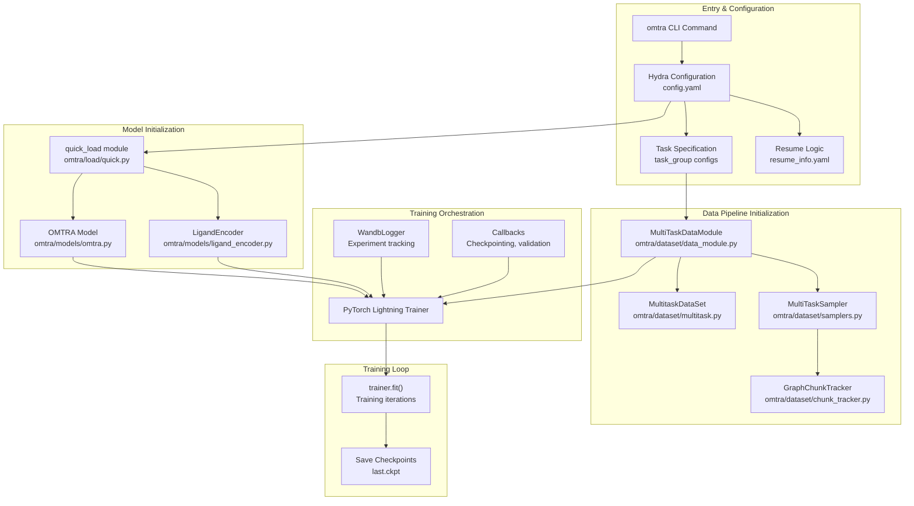
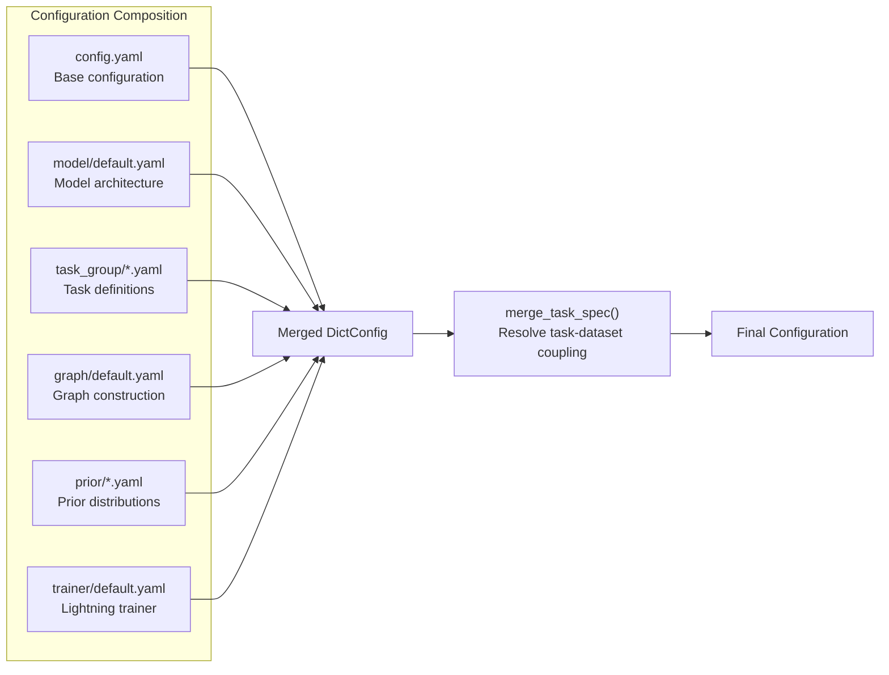
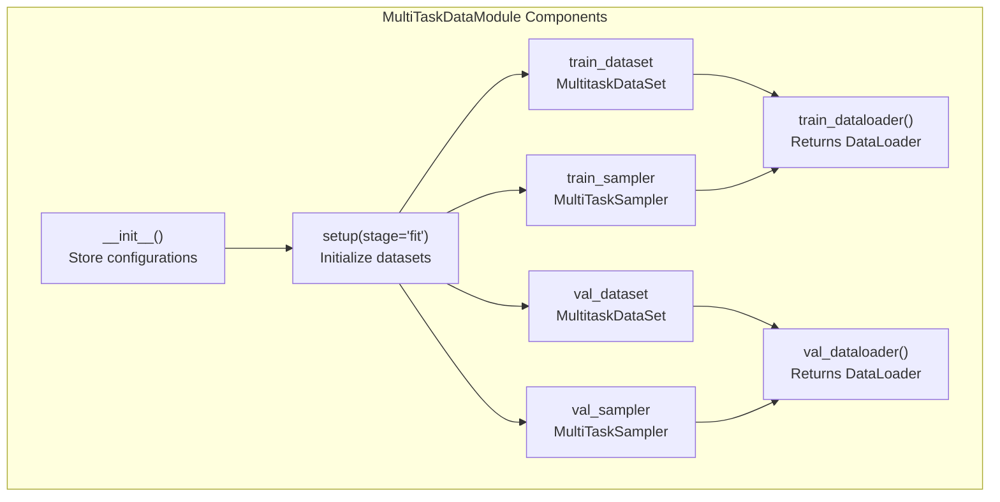
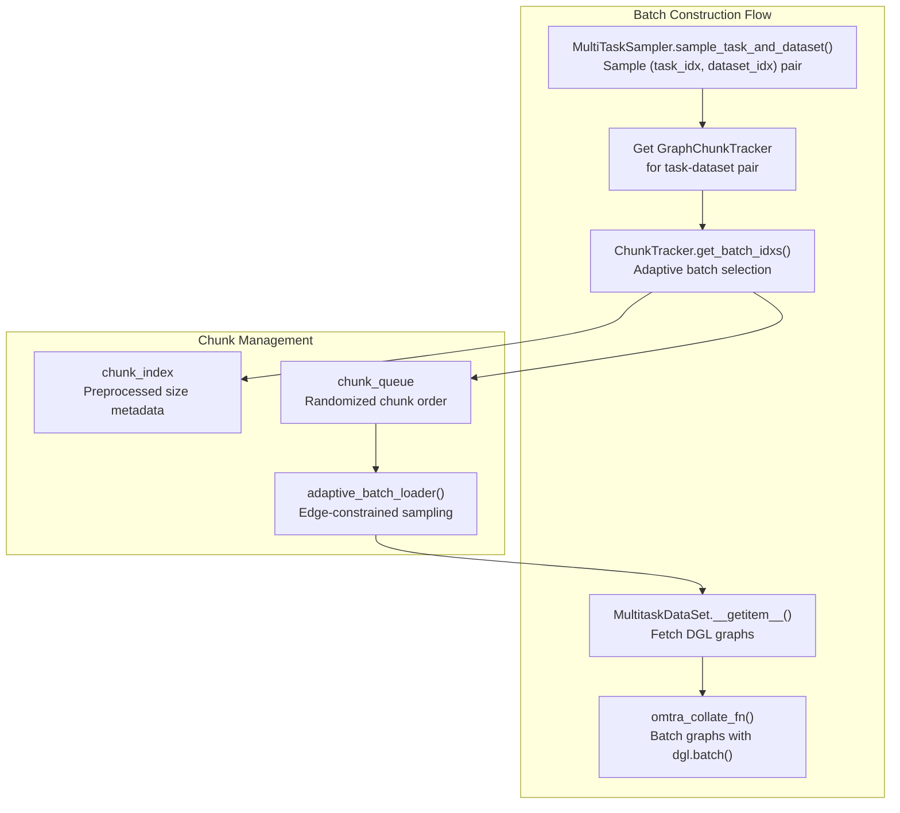
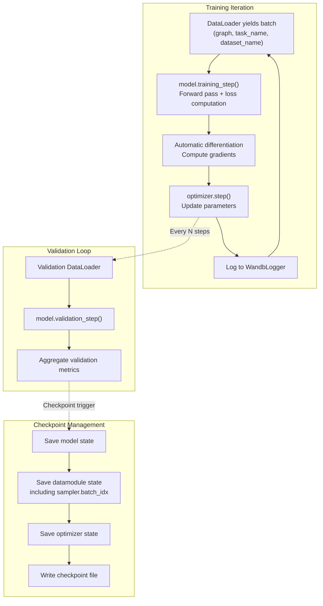
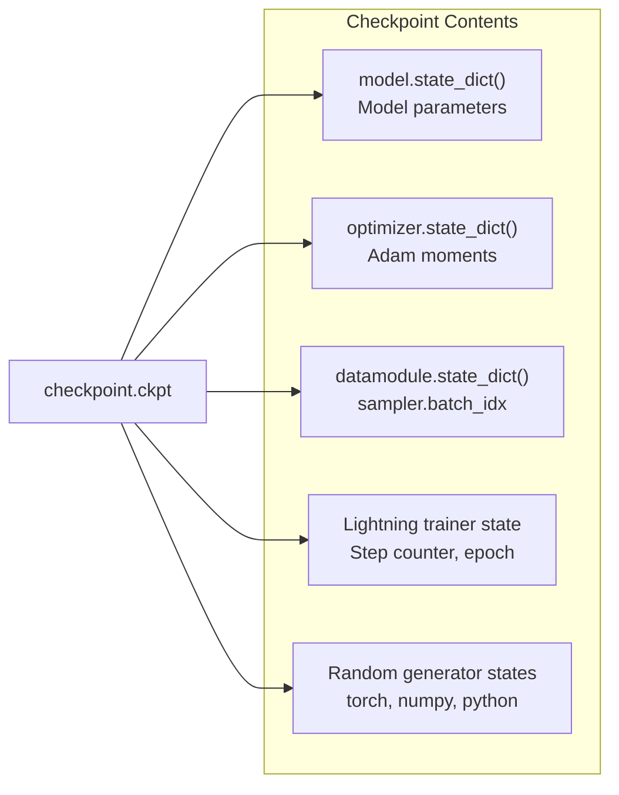
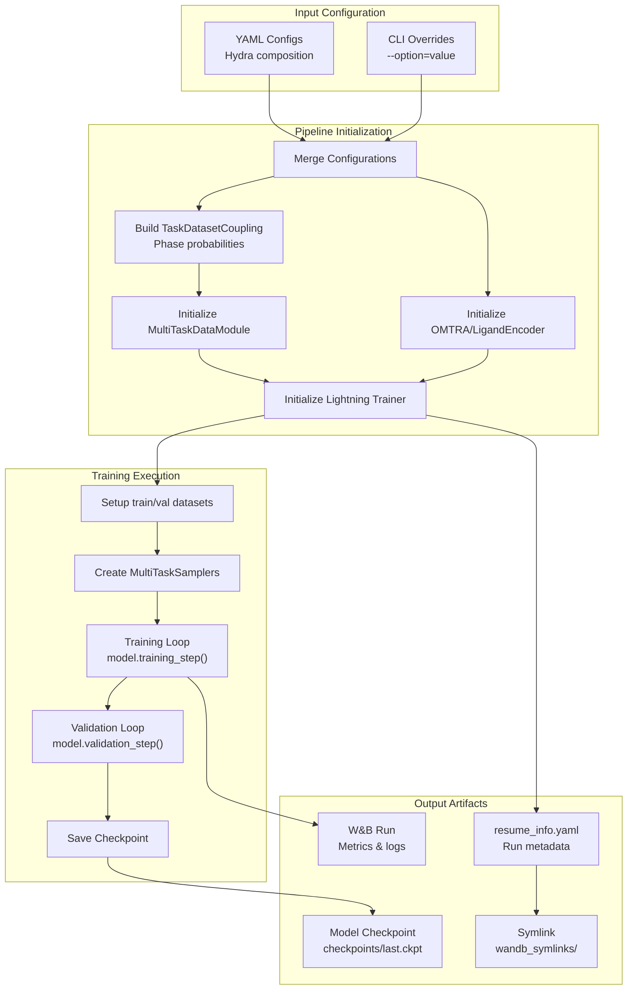

# Training Pipeline Overview

<details>
<summary>Relevant source files</summary>

The following files were used as context for generating this wiki page:

- [configs/config.yaml](configs/config.yaml)
- [omtra/dataset/chunk_tracker.py](omtra/dataset/chunk_tracker.py)
- [omtra/dataset/data_module.py](omtra/dataset/data_module.py)
- [omtra/dataset/multitask.py](omtra/dataset/multitask.py)
- [omtra/dataset/samplers.py](omtra/dataset/samplers.py)
- [routines/train.py](routines/train.py)

</details>


This document provides a high-level overview of the OMTRA training pipeline, describing how the system orchestrates multi-task learning across multiple datasets. For specific details about configuration options, see [Configuration System](#7.2). For details about multi-task learning mechanics, see [Multi-Task Learning](#7.3). For loss computation details, see [Loss Functions and Objectives](#7.4).

## Purpose and Scope

The training pipeline coordinates the following responsibilities:

- Loading and validating Hydra configuration files
- Initializing datasets, samplers, and data loaders for multi-task learning
- Constructing the OMTRA model or ligand encoder based on training mode
- Managing PyTorch Lightning training with distributed support
- Handling checkpoint creation, resumption, and logging to Weights & Biases
- Coordinating task-dataset coupling across training phases

This page focuses on the orchestration and data flow. Model architecture details are covered in [Model Architecture](#4), and dataset-specific processing is covered in [Data Processing Pipelines](#6).

## Training Entry Point

Training begins with the `omtra` CLI command, which invokes [routines/train.py:169-195](). The main entry point uses Hydra for configuration composition:

```python
@hydra.main(version_base="1.3", config_path="../configs", config_name="config")
def main(cfg: DictConfig):
    # Handle resumption or fresh training
    # Merge task specifications
    # Call train(cfg)
```

The training script supports two primary modes specified in the configuration:

| Mode | Purpose | Model Type |
|------|---------|------------|
| `omtra` | Train the full generative model | `OMTRA` class with flow matching |
| `ligand_encoder` | Train only the VQ-VAE encoder | `LigandEncoder` class |

**Sources:** [routines/train.py:55-91](), [configs/config.yaml:15]()

## Training Pipeline Architecture



**Sources:** [routines/train.py:1-195](), [omtra/dataset/data_module.py:1-143]()

## Core Training Components

### Configuration Loading

The training script uses Hydra's composition system to merge multiple configuration files:



Key configuration parameters in [configs/config.yaml:1-42]():

| Parameter | Purpose | Default |
|-----------|---------|---------|
| `mode` | Training mode (omtra/ligand_encoder) | `omtra` |
| `seed` | Random seed for reproducibility | `42` |
| `edges_per_batch` | Maximum edges per training batch | `300000` |
| `num_workers` | DataLoader worker processes | `2` |
| `max_steps` | Total training steps | `1000` |
| `fake_atom_p` | Probability bound for fake atom augmentation | `0.3` |
| `plinder_pskip_factor` | Plinder cluster-weighted sampling | `0.0` |

**Sources:** [configs/config.yaml:1-42](), [omtra/load/conf.py]()

### Data Module Initialization

The `MultiTaskDataModule` is a PyTorch Lightning data module that manages all aspects of data loading:



The data module initialization in [omtra/dataset/data_module.py:17-46]() requires:

- `dataset_config`: Paths and settings for individual datasets (Plinder, Pharmit, etc.)
- `task_phases`: Phase-based probability distributions over tasks
- `dataset_task_coupling`: Which datasets can serve which tasks
- `graph_config`: Graph construction parameters
- `prior_config`: Prior distribution specifications
- `edges_per_batch`: Batch size constraint
- `max_steps`: Number of training steps (used by sampler)

**Sources:** [omtra/dataset/data_module.py:15-80](), [routines/train.py:73]()

### Model Instantiation

Model loading is handled by the `quick_load` module based on training mode:

```python
# For OMTRA training mode
if mode == 'omtra':
    if partial_ckpt:
        model = quick_load.omtra_from_partial_checkpoint(cfg, partial_ckpt)
    else:
        model = quick_load.omtra_from_config(cfg)

# For ligand encoder training mode  
elif mode == 'ligand_encoder':
    model = quick_load.lig_encoder_from_config(cfg)
```

The model initialization validates that:
- If using latent ligand generation, a `ligand_encoder_checkpoint` is specified
- All modality configurations are consistent with the selected tasks
- Prior distributions are properly configured for all generated modalities

**Sources:** [routines/train.py:76-90]()

## Multi-Task Data Loading Pipeline

The data loading pipeline implements efficient multi-task sampling with edge-aware batching:



### Task and Dataset Sampling

At each training step, the `MultiTaskSampler` determines which task and dataset to sample from based on the current training phase:

1. **Phase Determination**: Check `batch_idx` against `phase_boundaries` to find current phase [omtra/dataset/samplers.py:58-76]()
2. **Probability Matrix**: Use `p_dataset_task[phase_idx]` to get task-dataset probabilities for current phase
3. **Multinomial Sampling**: Draw a single (task, dataset) pair from the flattened probability distribution
4. **Distributed Broadcasting**: If distributed training, rank 0 broadcasts the sampled pair to all workers

### Adaptive Batch Loading

The `GraphChunkTracker` implements edge-aware batch construction to maximize GPU utilization:

| Component | Purpose | Key Method |
|-----------|---------|------------|
| `chunk_index` | Precomputed graph size metadata | `retrieve_graph_chunks()` |
| `chunk_queue` | Randomized chunk traversal order | `reset_queue()` |
| `adaptive_batch_loader` | Edge-constrained graph selection | Returns indices fitting in budget |

The adaptive loader [omtra/dataset/chunk_tracker.py:72-144]():
1. Shuffles graph indices within the current chunk
2. Applies optional weighted sampling based on `pskip` probabilities
3. Computes cumulative edge counts until `edges_per_batch` is reached
4. Returns the prefix of indices that fit within the budget
5. Implements fallback logic for edge cases (too-large graphs, excessive skipping)

**Sources:** [omtra/dataset/samplers.py:14-180](), [omtra/dataset/chunk_tracker.py:8-144]()

## Training Loop Execution

The training loop is orchestrated by PyTorch Lightning's `Trainer`:



### Training Step Components

Within each training iteration, the OMTRA model:

1. **Time Sampling**: Samples time `t` from uniform or custom distribution
2. **Conditional Path**: Interpolates between prior `x_0` and data `x_1` to get `x_t`
3. **VectorField Forward**: Predicts destination `x_1` from noisy input
4. **Loss Computation**: Calculates flow matching loss and auxiliary objectives
5. **Gradient Accumulation**: Accumulates gradients for optimizer step

The training step is implemented in the model's `training_step()` method, which receives:
- `batch`: A batched DGL heterograph with all modalities
- `task_name`: The task being trained (e.g., "denovo_ligand")
- `dataset_name`: The source dataset (e.g., "pharmit", "plinder")

**Sources:** [omtra/models/omtra.py]()

### Validation Strategy

Validation sampling differs from training:

1. **Uniform Task Distribution**: The `val_sampler` uses a uniform distribution over all tasks being trained [omtra/dataset/data_module.py:62-69]()
2. **Fixed Max Steps**: Validation runs for the same number of steps as training
3. **Metrics Aggregation**: Validation metrics are logged separately per task

**Sources:** [omtra/dataset/data_module.py:109-120]()

## Checkpoint and Resumption

OMTRA implements comprehensive checkpoint management for resumption:

### Fresh Training Run

For a new training run [routines/train.py:106-143]():

1. Generate a unique `run_id` using `wandb.util.generate_id()`
2. Initialize `WandbLogger` with configuration and run_id
3. Create `resume_info.yaml` containing run_id, name, and URL
4. Create symlink in `symlink_dir` pointing to Hydra output directory

### Resuming Training

To resume training [routines/train.py:92-109]():

1. Load `resume_info.yaml` from the original run directory
2. Extract the original `run_id`
3. Set `wandb_config.resume = 'must'` to resume the W&B run
4. Load original configuration and apply CLI overrides
5. Pass `ckpt_path` to `trainer.fit()`

The checkpoint contains:
- Model weights and architecture
- Optimizer state
- Datamodule state (including `sampler.batch_idx`)
- Training step counter
- Random generator states

**Checkpoint State Dictionary Structure:**



The datamodule state dict is critical for exact resumption [omtra/dataset/data_module.py:122-133]():

```python
def state_dict(self):
    return {
        'train_sampler_state': self.train_sampler.state_dict(),
        'val_sampler_state': self.val_sampler.state_dict()
    }
```

The sampler's `batch_idx` determines which training phase is active, ensuring the resumed run continues with the correct task-dataset distribution.

**Sources:** [routines/train.py:92-167](), [omtra/dataset/data_module.py:122-133](), [omtra/dataset/samplers.py:174-180]()

## Distributed Training Support

The training pipeline supports distributed data parallel (DDP) training:

### Sampler Synchronization

The `MultiTaskSampler` ensures all workers sample the same task-dataset pair [omtra/dataset/samplers.py:123-146]():

1. Rank 0 samples the (task_idx, dataset_idx) pair
2. Broadcast tensors to all ranks using `torch.distributed.broadcast()`
3. Each worker uses its own dataset fraction (`frac_start`, `frac_end`)
4. Workers independently construct batches from their assigned data fraction

### Worker Initialization

Each DataLoader worker is initialized with [omtra/dataset/data_module.py:141-143]():

```python
def worker_init_fn(worker_id):
    mp.set_start_method("spawn", force=True)
```

This ensures proper multiprocessing context isolation.

### Distributed Configuration

Distributed training is enabled via trainer configuration:

| Parameter | Purpose | 
|-----------|---------|
| `strategy` | Set to `DDPStrategy` for distributed |
| `devices` | Number of GPUs to use |
| `num_nodes` | Number of compute nodes |

**Sources:** [omtra/dataset/samplers.py:32-56](), [omtra/dataset/samplers.py:123-146]()

## Training Configuration Summary

The following table summarizes key training parameters and their locations:

| Parameter | Config Location | Default | Purpose |
|-----------|----------------|---------|---------|
| `mode` | `config.yaml` | `omtra` | Training mode selection |
| `seed` | `config.yaml` | `42` | Random seed |
| `max_steps` | `config.yaml` | `1000` | Training duration |
| `edges_per_batch` | `config.yaml` | `300000` | Batch size constraint |
| `num_workers` | `config.yaml` | `2` | DataLoader workers |
| `fake_atom_p` | `config.yaml` | `0.3` | Fake atom augmentation |
| `task_phases` | `task_group/*.yaml` | Varies | Phase-based task scheduling |
| `dataset_task_coupling` | `task_group/*.yaml` | Varies | Task-dataset associations |
| `learning_rate` | `model/default.yaml` | Varies | Optimizer learning rate |
| `max_epochs` | `trainer/default.yaml` | Varies | Maximum epochs (if used) |

**Sources:** [configs/config.yaml:1-42]()

## Training Pipeline Data Flow

The complete data flow from configuration to trained model:



**Sources:** [routines/train.py:1-195](), [omtra/dataset/data_module.py:1-143](), [omtra/dataset/samplers.py:1-180]()

---