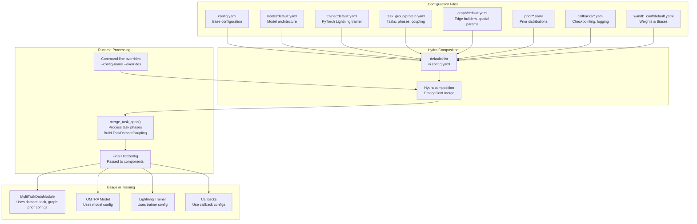
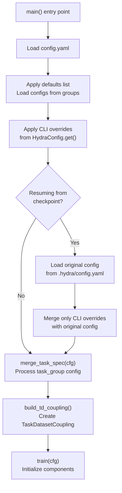
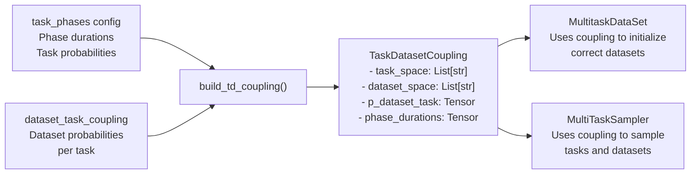
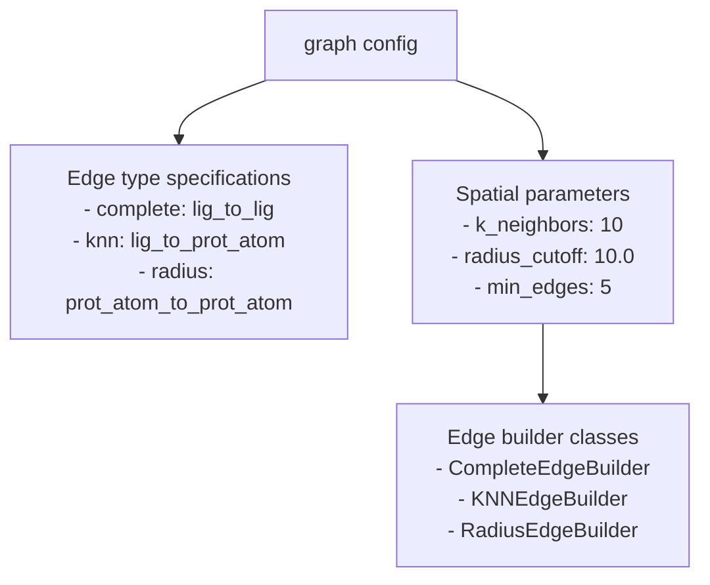
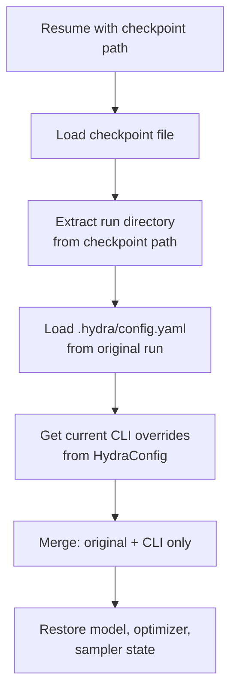
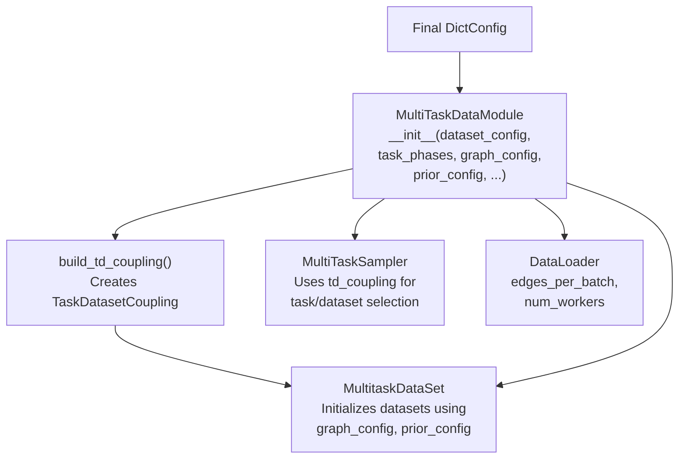

# Configuration System

<details>
<summary>Relevant source files</summary>

The following files were used as context for generating this wiki page:

- [configs/config.yaml](configs/config.yaml)
- [omtra/dataset/chunk_tracker.py](omtra/dataset/chunk_tracker.py)
- [omtra/dataset/data_module.py](omtra/dataset/data_module.py)
- [omtra/dataset/multitask.py](omtra/dataset/multitask.py)
- [omtra/dataset/samplers.py](omtra/dataset/samplers.py)
- [routines/train.py](routines/train.py)

</details>


## Purpose and Scope

This document describes OMTRA's configuration system, which uses [Hydra](https://hydra.cc/) for structured, composable configuration management. It covers the base configuration file structure, configuration groups, how to set hyperparameters, and the multi-task configuration system that enables training on multiple tasks and datasets simultaneously.

For information about specific task definitions and modalities, see [Tasks and Modalities](#3.1). For details on the training pipeline itself, see [Training Pipeline Overview](#7.1). For multi-task learning mechanics during training, see [Multi-Task Learning](#7.3).

---

## Configuration Architecture Overview



**Sources:** [configs/config.yaml:1-42](), [routines/train.py:169-191]()

---

## Base Configuration File

The main configuration file is `config.yaml`, which uses Hydra's defaults system to compose configuration from multiple sources.

### Defaults List

```yaml
defaults:
  - _self_
  - model: default
  - ligand_encoder: none
  - trainer: default
  - task_group: protein
  - graph: default
  - prior: 
    - conformer_indep
    - denovo_permute
  - callbacks: no_checkpoint
  - wandb_conf: default
  - eval: default
```

The `defaults` list specifies which configuration files to merge. Each entry corresponds to a subdirectory under `configs/` containing YAML files:

| Configuration Group | File Location | Purpose |
|---------------------|---------------|---------|
| `model` | `configs/model/` | Model architecture parameters |
| `ligand_encoder` | `configs/ligand_encoder/` | VQ-VAE encoder configuration |
| `trainer` | `configs/trainer/` | PyTorch Lightning trainer settings |
| `task_group` | `configs/task_group/` | Task phases and dataset coupling |
| `graph` | `configs/graph/` | Graph construction parameters |
| `prior` | `configs/prior/` | Prior distribution configurations |
| `callbacks` | `configs/callbacks/` | Training callbacks |
| `wandb_conf` | `configs/wandb_conf/` | Weights & Biases logging |
| `eval` | `configs/eval/` | Evaluation settings |

**Sources:** [configs/config.yaml:1-13]()

### Global Parameters

The base configuration file defines global parameters used throughout training:

```yaml
mode: omtra              # Training mode: 'omtra' or 'ligand_encoder'
seed: 42                 # Random seed
name: i_forgot_to_name_my_run  # Run name for logging

# Batch and data loading
edges_per_batch: 300000  # Maximum edges per batch
num_workers: 2           # DataLoader worker processes
max_steps: 1000          # Total training steps

# Data augmentation
fake_atom_p: 0.3         # Upper bound on fraction of fake atoms
distort_p: 0.2           # Upper bound on fraction of atoms distorted

# Plinder-specific
plinder_pskip_factor: 0.0  # Weighted sampling factor (0=no weighting, 1=uniform)
res_id_embed_dim: 64       # Residue ID embedding dimension

# Dataset paths
pharmit_path: ${omtra_root:}/data/pharmit
plinder_path: ${omtra_root:}/data/plinder
crossdocked_path: ${omtra_root:}/data/crossdocked/internal_split0

# Output management
symlink_dir: ./wandb_symlinks
```

**Sources:** [configs/config.yaml:15-42]()

---

## Hydra Integration

### Configuration Resolution

OMTRA uses Hydra 1.3 for configuration management. The entry point is decorated with `@hydra.main`:

```python
@hydra.main(version_base="1.3", config_path="../configs", config_name="config")
def main(cfg: DictConfig):
    # cfg is composed from all defaults + CLI overrides
```

**Sources:** [routines/train.py:169-170]()

### Custom Resolvers

OMTRA registers a custom OmegaConf resolver `omtra_root` to enable path interpolation:

```python
OmegaConf.register_new_resolver("omtra_root", omtra_root, replace=True)
```

This allows configuration values like `${omtra_root:}/data/pharmit` to resolve to absolute paths based on the package root.

**Sources:** [routines/train.py:37]()

### Output Directory Structure

Hydra automatically creates output directories for each run:

```yaml
hydra:
  run:
    dir: ./outputs/${now:%Y-%m-%d}/${name}_${now:%Y-%m-%d_%H-%M-%f}
```

This creates timestamped directories like:
```
outputs/
  2024-01-15/
    my_experiment_2024-01-15_14-30-123456/
      .hydra/
        config.yaml          # Resolved configuration
        hydra.yaml           # Hydra runtime config
        overrides.yaml       # CLI overrides
      checkpoints/           # Model checkpoints
      resume_info.yaml       # WandB run ID for resuming
```

**Sources:** [configs/config.yaml:39-42](), [routines/train.py:107-143]()

---

## Configuration Composition Flow



**Sources:** [routines/train.py:169-191](), [omtra/load/conf.py]() (referenced but not provided)

---

## Multi-Task Configuration System

The multi-task configuration system is the most complex part of OMTRA's configuration. It defines which tasks the model trains on, how they're phased during training, and how tasks are coupled with datasets.

### Task Group Configuration

Task groups are defined in `configs/task_group/` and specify:
1. **task_phases**: Training phases with different task probabilities
2. **dataset_task_coupling**: Which datasets can be used for which tasks
3. **dataset_config**: Dataset-specific parameters

Example structure (conceptual):

```yaml
task_phases:
  phases:
    - name: "phase_0"
      duration: 500  # steps
      tasks:
        denovo_ligand: 0.5
        fixed_protein_ligand: 0.3
        rigid_docking: 0.2
    - name: "phase_1"
      duration: 500
      tasks:
        denovo_ligand: 0.2
        fixed_protein_ligand: 0.5
        rigid_docking: 0.3

dataset_task_coupling:
  denovo_ligand:
    pharmit: 0.7
    plinder: 0.3
  fixed_protein_ligand:
    plinder: 1.0
  rigid_docking:
    plinder: 1.0
```

### TaskDatasetCoupling Class

The `merge_task_spec` function processes the task group configuration into a `TaskDatasetCoupling` object:



The `p_dataset_task` tensor has shape `(n_phases, n_tasks, n_datasets)` and represents the probability of sampling each (task, dataset) pair in each phase:

```python
# Example: 2 phases, 3 tasks, 2 datasets
p_dataset_task[phase_idx, task_idx, dataset_idx] = probability
```

**Sources:** [omtra/load/conf.py]() (referenced), [omtra/dataset/multitask.py:17-41](), [omtra/dataset/samplers.py:33-41]()

### Phase Progression

During training, the sampler determines the current phase based on `batch_idx`:

```python
phase_durations = self.td_coupling.phase_durations  # e.g., [500, 500]
phase_boundaries = phase_durations.cumsum(dim=0)    # [500, 1000]
phase_idx = torch.searchsorted(phase_boundaries, self.batch_idx, right=True).item()
```

At batch 0-499: phase_idx = 0  
At batch 500-999: phase_idx = 1

**Sources:** [omtra/dataset/samplers.py:61-63]()

---

## Configuration Groups in Detail

### Model Configuration

Model configurations define the architecture of the OMTRA model and VectorField:

| Parameter | Purpose | Typical Values |
|-----------|---------|----------------|
| `n_recycles` | GNN recycle iterations | 1-5 |
| `hidden_dim` | Hidden layer dimensions | 256, 512 |
| `n_layers` | Number of GNN layers | 3-6 |
| `self_conditioning` | Enable self-conditioning | true/false |
| `ligand_encoder_checkpoint` | Path to pre-trained encoder | `null` or path |

**Sources:** Referenced but config file not provided

### Trainer Configuration

PyTorch Lightning trainer parameters:

| Parameter | Purpose |
|-----------|---------|
| `accelerator` | Hardware type ('gpu', 'cpu') |
| `devices` | Number of devices |
| `max_steps` | Maximum training steps |
| `val_check_interval` | Validation frequency |
| `gradient_clip_val` | Gradient clipping threshold |
| `precision` | Training precision ('32', '16-mixed') |

**Sources:** [routines/train.py:152-156]()

### Graph Configuration

Graph construction parameters:



**Sources:** Referenced in [omtra/dataset/multitask.py:34]()

### Prior Configuration

Prior configurations specify initial distributions for sampling `x_0`:

```yaml
prior:
  - conformer_indep      # Independent conformer-based priors
  - denovo_permute       # Permutation-based priors for de novo generation
```

Each prior configuration file defines:
- Distribution type (gaussian, ctmc_masked, etc.)
- Per-modality settings
- Training vs. inference behavior

For details on prior distributions, see [Prior Distributions](#8.2).

**Sources:** [configs/config.yaml:8-10](), [omtra/dataset/multitask.py:35]()

---

## Command-Line Overrides

Hydra supports hierarchical configuration overrides via command line:

```bash
# Override top-level parameters
omtra train name=my_experiment max_steps=5000 seed=123

# Override nested parameters using dot notation
omtra train model.n_recycles=3 trainer.max_steps=10000

# Select different configuration group
omtra train task_group=protein_ligand

# Multiple overrides
omtra train edges_per_batch=500000 num_workers=4 fake_atom_p=0.5
```

### Override Syntax

| Pattern | Example | Effect |
|---------|---------|--------|
| `key=value` | `seed=42` | Set top-level parameter |
| `group=choice` | `model=large` | Select from config group |
| `nested.key=value` | `model.n_layers=6` | Override nested parameter |
| `+key=value` | `+new_param=10` | Add new parameter |
| `~key` | `~callbacks` | Remove configuration group |

**Sources:** [routines/train.py:183-185]()

---

## Configuration for Resuming Training

When resuming from a checkpoint, OMTRA preserves the original configuration:



The resume logic ensures that only explicitly provided CLI overrides modify the configuration, preventing unintended changes:

```python
if resume:
    ckpt_path = Path(cfg.checkpoint)
    run_dir = ckpt_path.parent.parent
    original_cfg_path = run_dir / ".hydra/config.yaml"
    original_cfg = OmegaConf.load(original_cfg_path)
    overrides = HydraConfig.get().overrides.task
    cli_cfg = OmegaConf.from_dotlist(overrides)
    cfg = OmegaConf.merge(original_cfg, cli_cfg)
```

### Resume Metadata

OMTRA stores resume information in `resume_info.yaml`:

```yaml
run_id: abc123def456      # WandB run ID
name: protein_docking_001 # Run name
url: https://wandb.ai/... # WandB URL
```

This enables:
1. Resuming WandB logging to the same run
2. Creating symlinks for easy run lookup
3. Tracking run lineage

**Sources:** [routines/train.py:176-186](), [routines/train.py:93-144]()

---

## Configuration Usage in Data Loading

The configuration flows through the data loading pipeline:



Key configuration parameters used in data loading:

| Component | Configuration Used |
|-----------|-------------------|
| `MultitaskDataSet` | `graph_config`, `prior_config`, `single_dataset_configs`, `fake_atom_p` |
| `MultiTaskSampler` | `td_coupling`, `edges_per_batch`, `max_steps` |
| `DataLoader` | `num_workers`, `edges_per_batch`, `pin_memory` |

**Sources:** [omtra/dataset/data_module.py:15-46](), [omtra/dataset/multitask.py:17-38](), [omtra/dataset/samplers.py:14-30]()

---

## Best Practices

### Configuration Organization

1. **Use task groups** for logical groupings of related experiments
2. **Create custom model configs** for architecture variants
3. **Keep dataset paths** in environment variables or top-level config
4. **Version control** your custom configs in `configs/` subdirectories

### Experiment Management

```bash
# Name your runs meaningfully
omtra train name=protein_docking_v2_large_batch edges_per_batch=500000

# Use WandB tags via config
omtra train wandb_conf.tags='[experiment,baseline]'

# Symlinks enable easy lookup
ls wandb_symlinks/
# → protein_docking_v2_abc123/
```

### Multi-Phase Training Strategy

Configure task phases to implement curriculum learning:

- **Phase 0**: Focus on simpler tasks (de novo generation)
- **Phase 1**: Introduce conditional tasks (fixed protein)
- **Phase 2**: Add complex tasks (flexible docking)

**Sources:** [routines/train.py:139-143]()

---

## Common Configuration Patterns

### Single Task Training

```yaml
task_phases:
  phases:
    - name: "single_task"
      duration: 1000
      tasks:
        denovo_ligand: 1.0

dataset_task_coupling:
  denovo_ligand:
    pharmit: 1.0
```

### Curriculum Learning

```yaml
task_phases:
  phases:
    - name: "warmup"
      duration: 200
      tasks:
        denovo_ligand: 1.0
    - name: "main"
      duration: 800
      tasks:
        denovo_ligand: 0.3
        fixed_protein_ligand: 0.4
        rigid_docking: 0.3
```

### Dataset Balancing

```yaml
dataset_task_coupling:
  rigid_docking:
    plinder: 0.8    # More high-quality Plinder data
    crossdocked: 0.2  # Some CrossDocked for diversity
```

**Sources:** Configuration patterns derived from [omtra/dataset/samplers.py:58-77]()

---