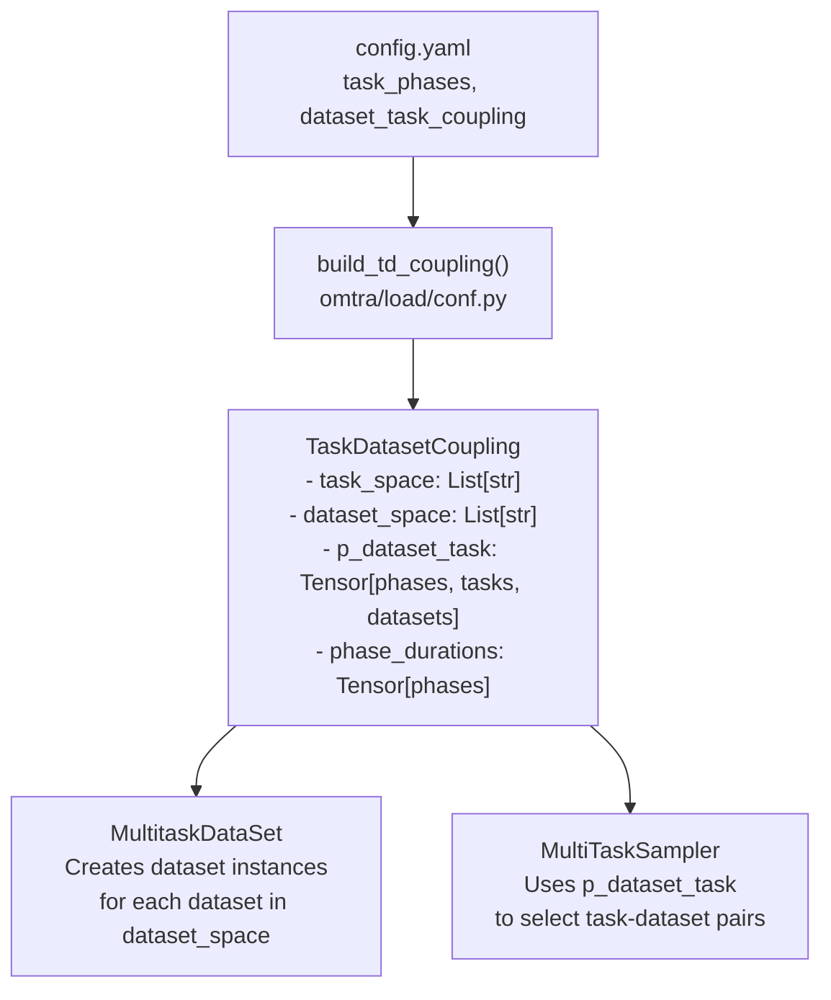
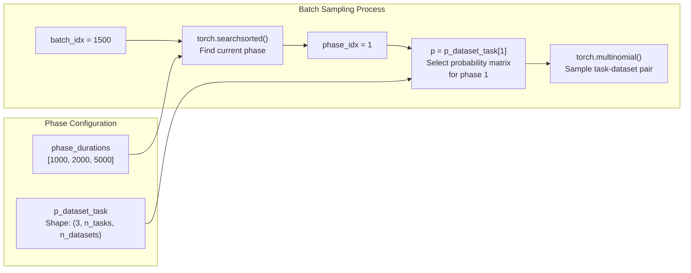
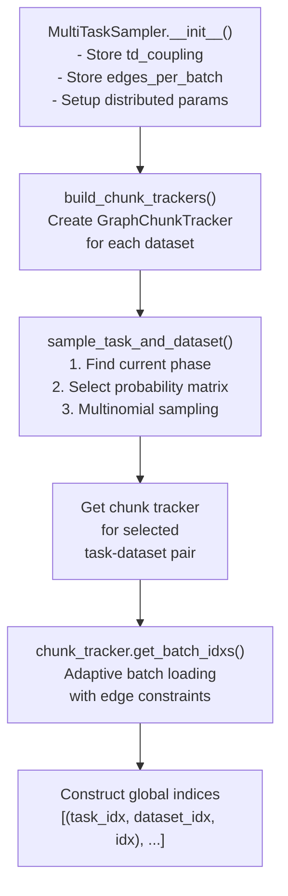
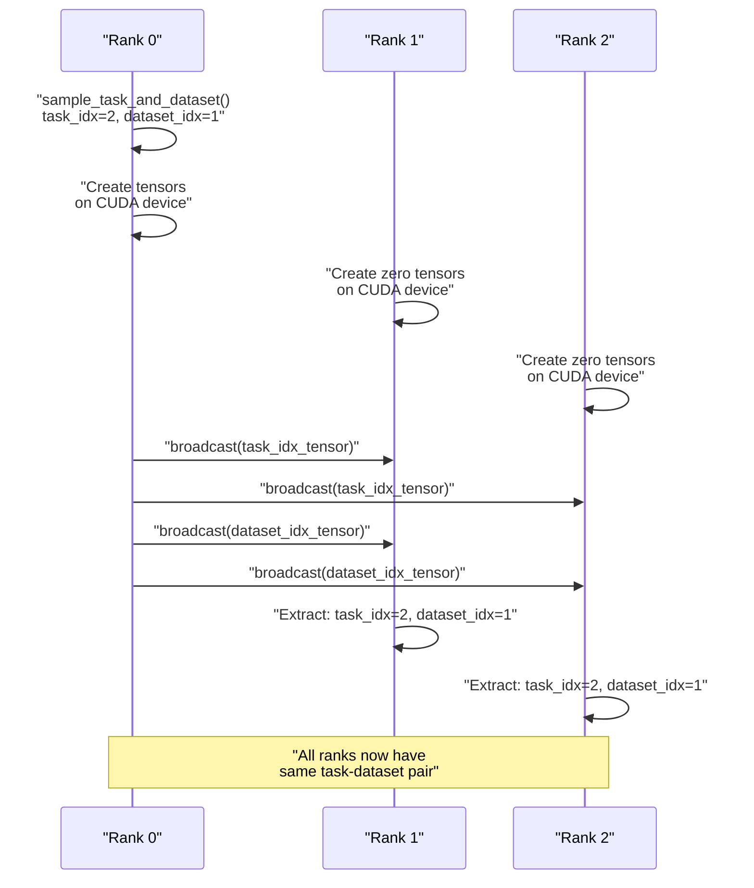
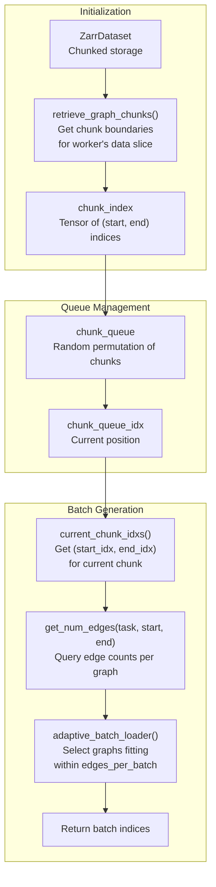
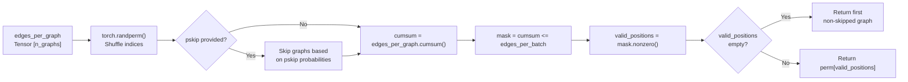
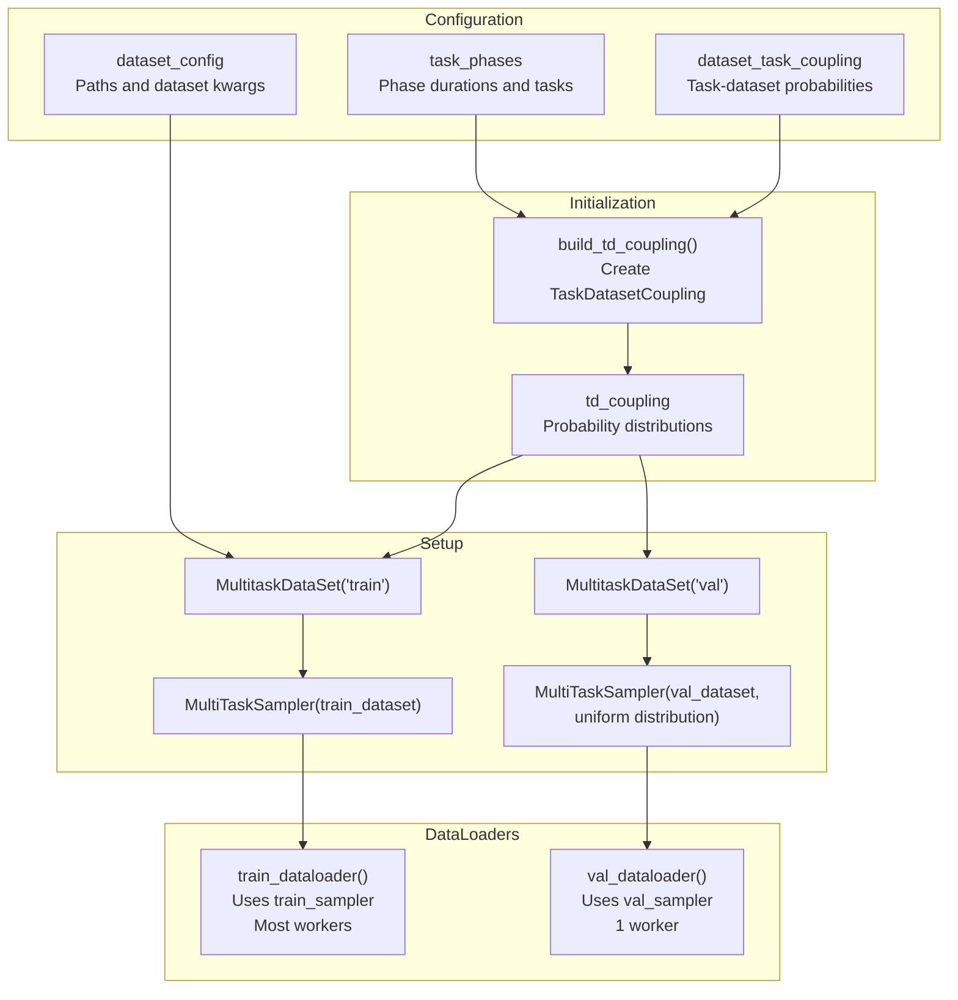

# Multi-Task Learning

<details>
<summary>Relevant source files</summary>

The following files were used as context for generating this wiki page:

- [configs/config.yaml](configs/config.yaml)
- [omtra/dataset/chunk_tracker.py](omtra/dataset/chunk_tracker.py)
- [omtra/dataset/data_module.py](omtra/dataset/data_module.py)
- [omtra/dataset/multitask.py](omtra/dataset/multitask.py)
- [omtra/dataset/samplers.py](omtra/dataset/samplers.py)
- [routines/train.py](routines/train.py)

</details>


## Purpose and Scope

This page describes how OMTRA trains a single model on multiple tasks and datasets simultaneously. It covers the `TaskDatasetCoupling` system that defines task-dataset probability distributions across training phases, the `MultiTaskSampler` that selects tasks and constructs batches, and the `GraphChunkTracker` that performs edge-aware batching for efficient GPU utilization.

For information about individual task definitions and modalities, see [Tasks and Modalities](#3.1). For dataset implementations, see [Dataset Overview](#5.1). For the overall training pipeline, see [Training Pipeline Overview](#7.1).

---

## Overview

OMTRA employs a multi-task learning strategy where a single `VectorField` model is trained on multiple molecular generation tasks (e.g., de novo ligand generation, flexible docking, rigid docking) using data from multiple datasets (Plinder, Pharmit, CrossDocked). This approach enables:

- **Shared representation learning**: The model learns generalizable molecular features across tasks
- **Flexible task mixing**: Different tasks can be emphasized at different training phases
- **Efficient data utilization**: Multiple datasets contribute to a single model
- **Dataset-task coupling**: Each task can sample from one or more datasets with configurable probabilities

The multi-task training system consists of three main components:

| Component | Class | Purpose |
|-----------|-------|---------|
| Task-Dataset Coupling | `TaskDatasetCoupling` | Defines which tasks use which datasets and with what probability at each training phase |
| Multi-Task Sampler | `MultiTaskSampler` | Samples task-dataset pairs and constructs batches |
| Chunk Tracker | `GraphChunkTracker` | Performs edge-aware batching for efficient GPU memory usage |

**Sources:** [omtra/dataset/multitask.py:13-122](), [omtra/dataset/samplers.py:14-180](), [omtra/dataset/data_module.py:15-143]()

---

## Task-Dataset Coupling

### The TaskDatasetCoupling Class

The `TaskDatasetCoupling` class ([omtra/load/conf.py]()) defines a probability tensor that controls which task-dataset pairs are sampled during training. This tensor has shape `(n_phases, n_tasks, n_datasets)` and evolves over training to emphasize different tasks at different stages.



**Sources:** [configs/config.yaml:1-42](), [omtra/load/conf.py](), [omtra/dataset/data_module.py:43]()

### Phase-Based Training Schedule

Training is divided into phases, each with a duration (number of batches) and a specific probability distribution over task-dataset pairs. This allows curriculum learning where early phases might focus on simpler tasks while later phases introduce more complex ones.

The phase system works as follows:

1. **Phase boundaries**: The `phase_durations` tensor defines how many batches each phase lasts
2. **Phase detection**: At each batch, the current phase is determined by comparing `batch_idx` to cumulative phase boundaries
3. **Probability selection**: The probability tensor for the current phase is used to sample the next task-dataset pair



**Sources:** [omtra/dataset/samplers.py:58-77]()

### Probability Distribution Structure

The `p_dataset_task` tensor defines sampling probabilities with the following structure:

- **Dimensions**: `(n_phases, n_tasks, n_datasets)`
- **Values**: Non-negative floats that sum to 1 when flattened across tasks and datasets (for each phase)
- **Zero entries**: Indicate task-dataset pairs that are never sampled in that phase

For example, a phase might have:
```
Task A, Dataset 1: 0.3
Task A, Dataset 2: 0.1
Task B, Dataset 1: 0.4
Task B, Dataset 2: 0.2
```

This means Task B with Dataset 1 is sampled 40% of the time during this phase.

**Sources:** [omtra/dataset/samplers.py:38-39](), [omtra/dataset/samplers.py:58-77]()

---

## Multi-Task Sampling

### The MultiTaskSampler

The `MultiTaskSampler` is a PyTorch `Sampler` that produces batches of global indices `(task_idx, dataset_idx, local_idx)` for the `MultitaskDataSet`. It handles:

- Task-dataset pair selection based on phase-dependent probabilities
- Distributed coordination (ensuring all workers sample the same task-dataset pair)
- Chunk tracker management for each dataset
- Edge-aware batch construction to maximize GPU utilization



**Key Implementation Details:**

| Method | Location | Purpose |
|--------|----------|---------|
| `__init__` | [omtra/dataset/samplers.py:16-56]() | Initialize sampler with coupling and batch size |
| `sample_task_and_dataset` | [omtra/dataset/samplers.py:58-77]() | Select next task-dataset pair based on current phase |
| `build_chunk_trackers` | [omtra/dataset/samplers.py:79-121]() | Create chunk trackers for each dataset |
| `get_td_pair_distributed` | [omtra/dataset/samplers.py:123-146]() | Coordinate task-dataset selection across workers |
| `__iter__` | [omtra/dataset/samplers.py:148-169]() | Main sampling loop |

**Sources:** [omtra/dataset/samplers.py:14-180]()

### Distributed Coordination

In distributed training, all workers must sample the same task-dataset pair to construct a consistent batch. This is achieved through broadcasting:

1. **Rank 0 samples**: The process with `rank=0` samples the task-dataset pair using `torch.multinomial`
2. **Broadcasting**: The selected indices are broadcast to all other ranks using `torch.distributed.broadcast`
3. **Synchronization**: All workers then construct batches from the same task-dataset pair



**Sources:** [omtra/dataset/samplers.py:123-146]()

### Chunk Tracker Assignment

The sampler creates `GraphChunkTracker` instances for each dataset, with special handling for Plinder which may have multiple link versions:

- **Pharmit/CrossDocked**: One tracker per dataset, shared by all tasks
- **Plinder**: One tracker per link version (e.g., `holo`, `apo_exp`, `apo_pred`), since different tasks require different protein structures

Each task-dataset pair `(task_idx, dataset_idx)` is mapped to a specific `chunk_tracker_idx` via the `td_pair_to_chunk_tracker_id` dictionary.

**Sources:** [omtra/dataset/samplers.py:79-121]()

---

## Batch Construction

### GraphChunkTracker

The `GraphChunkTracker` manages efficient batch construction from Zarr datasets. It ensures:

- **Memory efficiency**: Batches stay within the `edges_per_batch` limit
- **Chunk-based loading**: Graphs from the same Zarr chunk are loaded together for I/O efficiency
- **Randomization**: Chunks are processed in random order each epoch



**Sources:** [omtra/dataset/chunk_tracker.py:8-70]()

### Edge-Aware Batching

The `adaptive_batch_loader` function selects a subset of graphs from a chunk such that the total number of edges stays within the `edges_per_batch` limit. This is critical for GPU memory management.

**Algorithm:**

1. **Shuffle**: Randomly permute graph indices within the chunk
2. **Query sizes**: Retrieve edge counts for each graph (from cached metadata)
3. **Optional weighting**: Apply skip probabilities for category-based sampling
4. **Cumulative sum**: Compute running total of edges
5. **Threshold**: Select graphs where cumulative edges ≤ `max_nodes` (parameter name is legacy, actually refers to edges)
6. **Fallback**: If no graphs fit, include at least the first graph



**Sources:** [omtra/dataset/chunk_tracker.py:72-144]()

### Weighted Sampling

Some datasets (e.g., Plinder) support weighted sampling to balance representation across protein families or clusters. The `pskip` parameter (skip probability) controls this:

- **Higher pskip**: Graph is more likely to be skipped
- **Lower pskip**: Graph is more likely to be included
- **Dynamic adjustment**: If too many graphs are skipped and batch size is artificially small, pskip values are reduced by 3% and sampling is retried

This mechanism is used with Plinder's `plinder_pskip_factor` configuration to achieve more uniform sampling over protein clusters.

**Sources:** [omtra/dataset/chunk_tracker.py:61-66](), [omtra/dataset/chunk_tracker.py:136-141](), [configs/config.yaml:27]()

---

## Training Integration

### MultiTaskDataModule

The `MultiTaskDataModule` is a PyTorch Lightning `LightningDataModule` that integrates the multi-task sampling system into the training loop.



**Key Methods:**

| Method | Location | Purpose |
|--------|----------|---------|
| `__init__` | [omtra/dataset/data_module.py:17-46]() | Store configuration and build task-dataset coupling |
| `setup` | [omtra/dataset/data_module.py:48-80]() | Create datasets and samplers for training/validation |
| `train_dataloader` | [omtra/dataset/data_module.py:93-106]() | Create training DataLoader with multi-task sampler |
| `val_dataloader` | [omtra/dataset/data_module.py:109-120]() | Create validation DataLoader with uniform sampling |
| `state_dict` / `load_state_dict` | [omtra/dataset/data_module.py:122-133]() | Save/restore sampler state for checkpointing |

**Sources:** [omtra/dataset/data_module.py:15-143]()

### Validation Sampling

Validation uses a modified version of the task-dataset coupling:

1. **Sum over phases**: Collapse the phase dimension of `p_dataset_task` by summing over all phases
2. **Uniform over active tasks**: Create a uniform distribution over all task-dataset pairs that have non-zero probability in any training phase
3. **No phase progression**: Validation sampler doesn't progress through phases

This ensures validation evaluates the model on all tasks it's being trained on, regardless of which phase training is currently in.

**Sources:** [omtra/dataset/data_module.py:62-69]()

### State Management

Both the `MultiTaskDataModule` and `MultiTaskSampler` implement `state_dict()` and `load_state_dict()` methods to support checkpoint resumption. The key state is:

- **batch_idx**: Current training step, used to determine the current phase
- **chunk_queue_idx**: Position in the chunk queue (not saved, reconstructed on resume)

When resuming from a checkpoint, the sampler restores `batch_idx` to continue the phase schedule correctly.

**Sources:** [omtra/dataset/data_module.py:122-133](), [omtra/dataset/samplers.py:174-180]()

### Worker Configuration

The data module allocates workers strategically:

- **Training**: Gets `max(1, num_workers - 1)` workers to maximize throughput
- **Validation**: Gets at most 1 worker since validation is less frequent
- **Persistent workers**: Enabled if `num_workers > 0` to avoid respawning
- **Prefetch factor**: Set to 5 for training to keep GPU fed

**Sources:** [omtra/dataset/data_module.py:93-120]()

---

## Collation and Graph Batching

The `omtra_collate_fn` collates samples from `MultitaskDataSet.__getitem__` into a single batch:

```python
def omtra_collate_fn(batch):
    graphs, task_names, dataset_names = zip(*batch)
    g = dgl.batch(graphs)
    return g, task_names[0], dataset_names[0]
```

Since all graphs in a batch come from the same task-dataset pair (ensured by `MultiTaskSampler`), it extracts the first `task_name` and `dataset_name` as representative of the entire batch.

The `dgl.batch()` function merges multiple `DGLHeteroGraph` objects into a single batched graph with:
- Node features stacked along the batch dimension
- Graph-level information stored in `g.batch_num_nodes()` and `g.batch_num_edges()`

**Sources:** [omtra/dataset/data_module.py:135-138]()

---