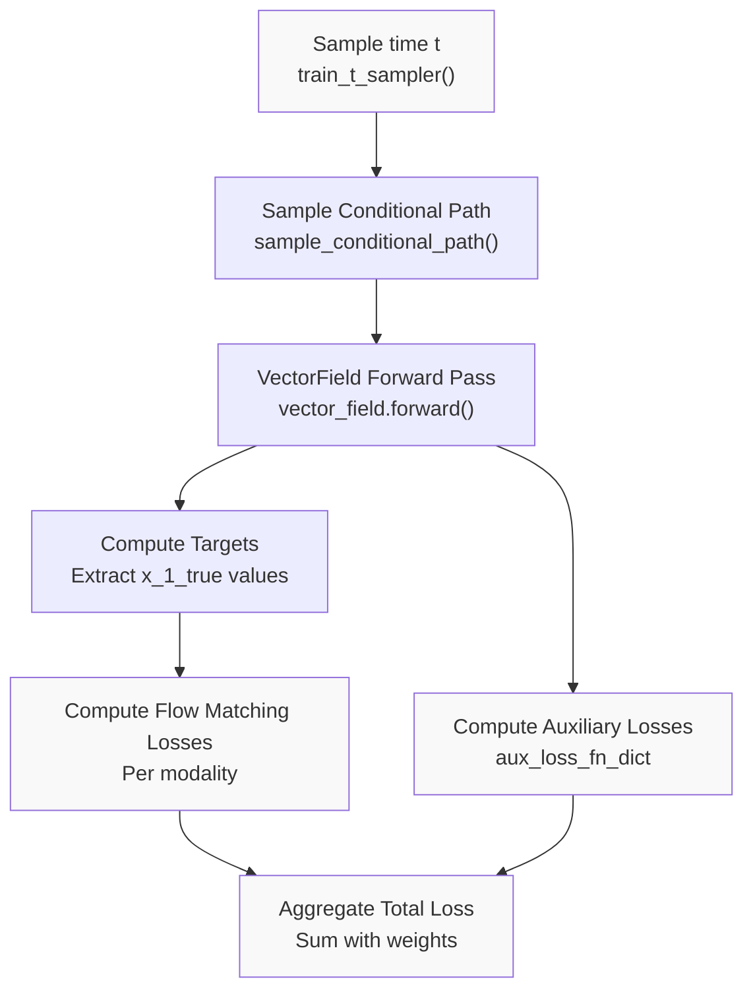
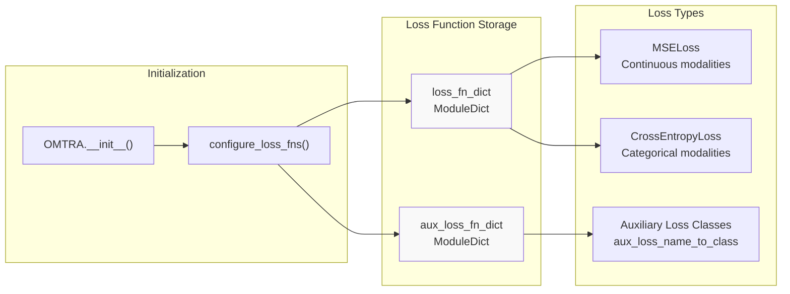
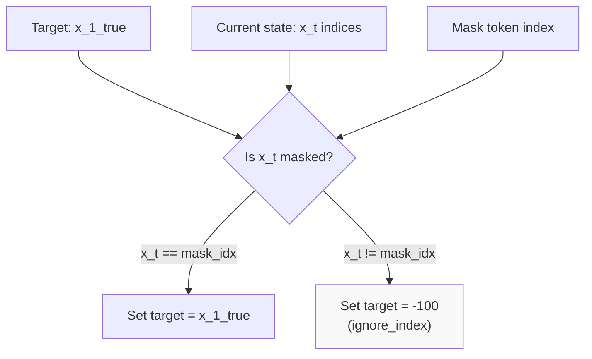
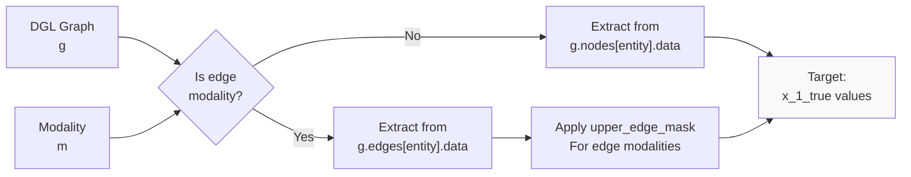
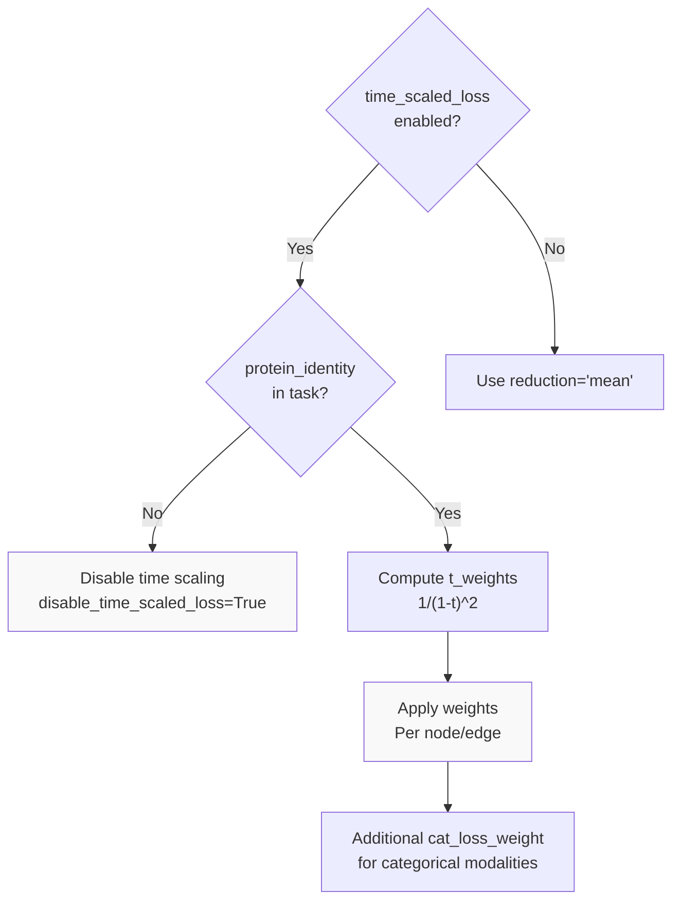
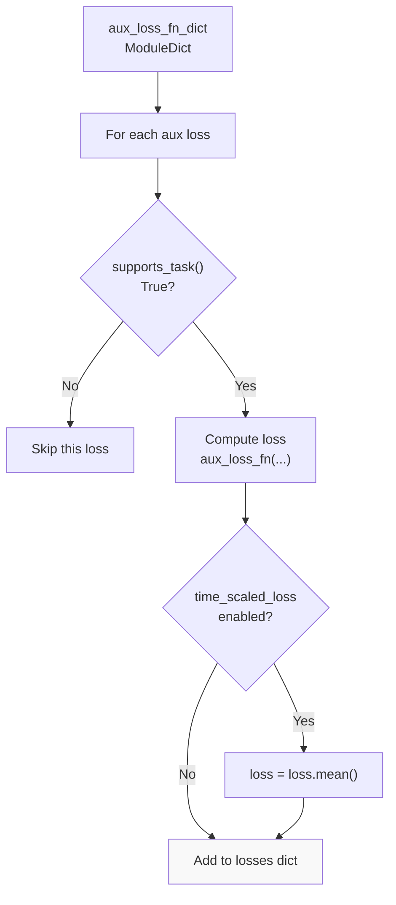
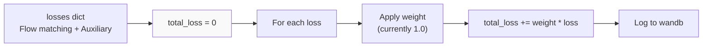
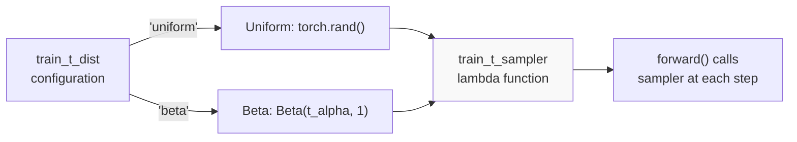
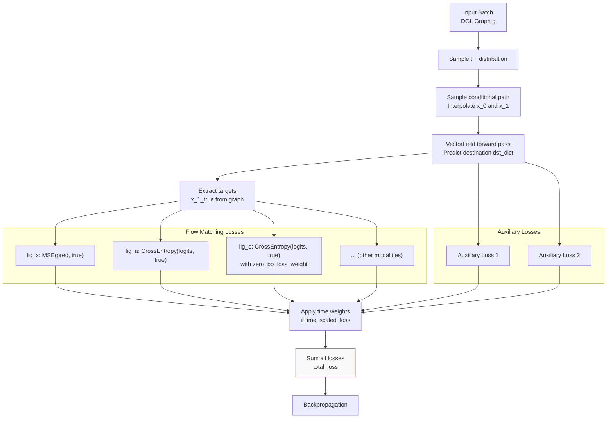

# Loss Functions and Objectives

<details>
<summary>Relevant source files</summary>

The following files were used as context for generating this wiki page:

- [omtra/models/omtra.py](omtra/models/omtra.py)
- [omtra/models/self_conditioning.py](omtra/models/self_conditioning.py)
- [omtra/models/vector_field.py](omtra/models/vector_field.py)

</details>


This page describes the loss functions and training objectives used in OMTRA. It covers how flow matching losses are computed for different modalities, time-scaled loss weighting, auxiliary losses, and how losses are aggregated during training. For information about how the model predicts trajectory destinations, see [VectorField Architecture](#4.2). For details on how tasks define which modalities are generated, see [Tasks and Modalities](#3.1).

## Purpose and Scope

OMTRA uses a flow matching objective to train the generative model. This involves computing losses that measure how well the model predicts trajectory destinations for both continuous features (positions, vectors) and categorical features (atom types, bond orders, charges). The system supports:

- **Flow matching losses** for all modalities being generated
- **Time-scaled loss weighting** to handle the non-uniform difficulty of predicting at different timepoints
- **Auxiliary losses** for additional constraints and regularization
- **Flexible loss weighting** through configuration parameters

This page focuses on the loss computation machinery in `omtra/models/omtra.py`. The actual neural network predictions are covered in [VectorField Architecture](#4.2).

## Loss System Overview

The OMTRA training loop computes multiple losses for each batch and aggregates them into a single total loss. The loss computation pipeline consists of several stages:



**Sources:** [omtra/models/omtra.py:269-322]()

### Loss Function Configuration

Loss functions are configured in the `OMTRA.__init__` method and stored in two `ModuleDict` instances:

| Loss Dictionary | Purpose | Configured By |
|----------------|---------|---------------|
| `loss_fn_dict` | Flow matching losses for each modality | `configure_loss_fns()` |
| `aux_loss_fn_dict` | Auxiliary losses for additional constraints | `aux_losses` config parameter |



**Sources:** [omtra/models/omtra.py:226-266]()

## Flow Matching Losses

Flow matching losses measure how well the model predicts the trajectory destination `x_1` given the current state `x_t` at time `t`. Different loss functions are used based on whether the modality is continuous or categorical.

### Continuous Modalities

For continuous modalities (positions, vectors), the model uses **Mean Squared Error (MSE)** loss:

```
L_continuous = MSE(predicted_x_1, true_x_1)
```

Continuous modalities include:
- `lig_x`, `prot_atom_x`, `pharm_x`: Node positions
- `pharm_v`: Pharmacophore direction vectors

**Sources:** [omtra/models/omtra.py:258]()

### Categorical Modalities

For categorical modalities (atom types, bond orders, charges), the model uses **Cross-Entropy** loss:

```
L_categorical = CrossEntropy(predicted_logits, true_category)
```

Categorical modalities include:
- `lig_a`, `lig_cond_a`: Ligand atom types
- `lig_c`: Ligand formal charges
- `lig_e`, `lig_e_condensed`: Bond orders
- `pharm_a`: Pharmacophore types

#### Special Handling for Masked Tokens

For categorical features, the loss ignores positions where the feature is already unmasked in `x_t`:



This ensures the loss only penalizes predictions on masked positions, not on positions that are already determined.

**Sources:** [omtra/models/omtra.py:432-442]()

#### Bond Order Loss Weighting

For bond order modalities (`lig_e`, `lig_e_condensed`), the "no bond" class (index 0) can be weighted differently using `zero_bo_loss_weight`:

```python
weights = torch.ones(n_categories, dtype=torch.float)
weights[0] = self.zero_bo_loss_weight  # Downweight "no bond" class
```

This helps balance the loss when most edges correspond to no bonds.

**Sources:** [omtra/models/omtra.py:246-250]()

### Target Computation

Before computing losses, the system extracts target values from the graph:



For continuous modalities, the target is simply `x_1_true`. For categorical modalities, targets are set to `-100` (ignore index) for positions already unmasked in `x_t`.

**Sources:** [omtra/models/omtra.py:423-442]()

## Time-Scaled Loss

Time-scaled loss addresses the fact that predicting trajectories is harder near `t=1` (endpoint) than near `t=0` (start). The time-scaled weighting scheme upweights losses computed at larger `t` values.

### Time Weight Computation

When `time_scaled_loss=True`, each loss is weighted by:

```
weight(t) = 1 / (1 - t)^2
```

with clamping to prevent extreme values:

```python
t_weights = 1.0 / ((1.0 - t).clamp(min=1e-6)) ** 2
t_weights = torch.clamp(t_weights, max=100.0)
```

**Sources:** [omtra/models/omtra.py:448-451]()

### Application to Losses



The time-scaled loss is **disabled** when:
1. `time_scaled_loss=False` in configuration
2. The task does not include protein identity (to avoid issues with purely ligand-focused tasks)

When enabled, weights are expanded per node or edge:

```python
if modality.graph_entity == "edge":
    mod_weight = t_weights[edge_batch_idxs[entity_name]][upper_edge_mask[entity_name]]
else:
    mod_weight = t_weights[node_batch_idxs[entity_name]]
```

Categorical losses receive an additional multiplicative weight `cat_loss_weight`.

**Sources:** [omtra/models/omtra.py:444-477]()

## Auxiliary Losses

Auxiliary losses provide additional training signals beyond the core flow matching objective. They are configured through the `aux_losses` parameter and registered via `aux_loss_name_to_class`.

### Auxiliary Loss Interface

Each auxiliary loss class must implement:

| Method | Purpose |
|--------|---------|
| `supports_task(task_class)` | Returns whether the loss applies to this task |
| `__call__(g, vf_output, task_class, node_batch_idxs, lig_ue_mask, time_weights)` | Computes the loss |

### Auxiliary Loss Computation



Auxiliary losses can use the `time_weights` parameter for time-scaled weighting if appropriate. When time-scaled loss is disabled, `time_weights=None` is passed.

**Sources:** [omtra/models/omtra.py:500-514]()

## Loss Aggregation and Weighting

After computing all individual losses, they are aggregated into a total loss for backpropagation.

### Aggregation Strategy



The current implementation applies a weight of `1.0` to all losses:

```python
for loss_name, loss_val in losses.items():
    total_loss = total_loss + 1.0 * loss_val
```

The `total_loss_weights` parameter is available for future customization but not currently used.

**Sources:** [omtra/models/omtra.py:299-302]()

### Logged Metrics

The training step logs:

| Metric | Description | Scope |
|--------|-------------|-------|
| `{modality_name}_train_loss` | Individual flow matching loss per modality | Task-specific |
| `{aux_loss_name}_train_loss` | Individual auxiliary loss | Task-specific |
| `{task_name}/train_total_loss` | Sum of all losses | Task-specific |
| `train_total_loss` | Sum of all losses | Global (progress bar) |

All metrics are prefixed with the task name for multi-task training.

**Sources:** [omtra/models/omtra.py:295-320]()

## Training Time Distribution

The time `t` is sampled from a distribution at each training step. The distribution can be configured via `train_t_dist`:

### Uniform Distribution

```python
train_t_dist = "uniform"
t = torch.rand(batch_size, device=device)
```

Samples uniformly from [0, 1].

### Beta Distribution

```python
train_t_dist = "beta"
t = Beta(t_alpha, 1).sample((batch_size,))
```

Uses a Beta distribution with parameters `(t_alpha, 1)`. Higher `t_alpha` values concentrate sampling near `t=1`, emphasizing harder prediction scenarios.



**Sources:** [omtra/models/omtra.py:177-185](), [omtra/models/omtra.py:388]()

## Loss Computation Example

Here's the complete flow for a single training step:



**Sources:** [omtra/models/omtra.py:386-516]()

## Configuration Parameters

The loss system is controlled by several parameters in the OMTRA configuration:

| Parameter | Type | Default | Description |
|-----------|------|---------|-------------|
| `time_scaled_loss` | bool | False | Enable time-scaled loss weighting |
| `cat_loss_weight` | float | 1.0 | Additional weight for categorical losses |
| `zero_bo_loss_weight` | float | 1.0 | Weight for "no bond" class in bond order prediction |
| `total_loss_weights` | dict | {} | Per-loss weights (not currently used) |
| `train_t_dist` | str | 'uniform' | Time distribution: 'uniform' or 'beta' |
| `t_alpha` | float | 1.8 | Alpha parameter for beta time distribution |
| `aux_losses` | dict | {} | Configuration for auxiliary losses |

**Sources:** [omtra/models/omtra.py:66-83]()

---