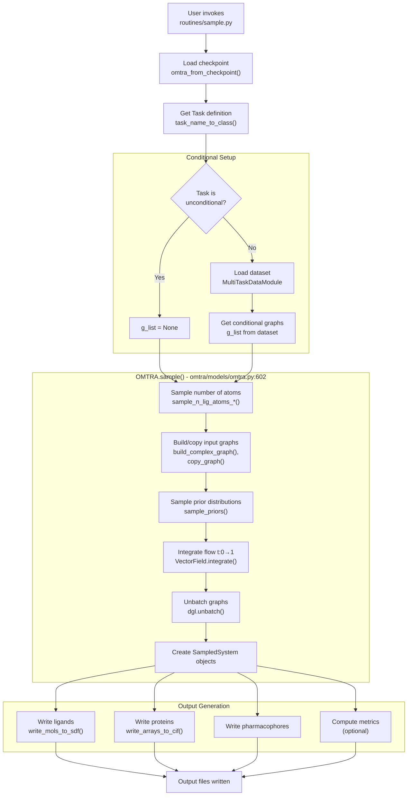
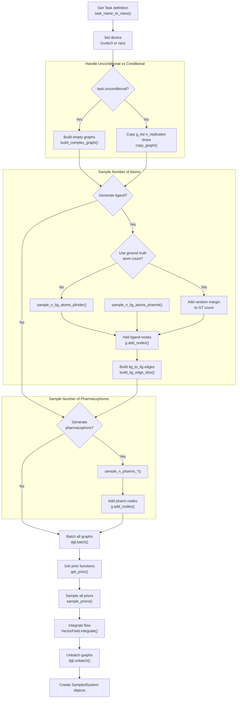
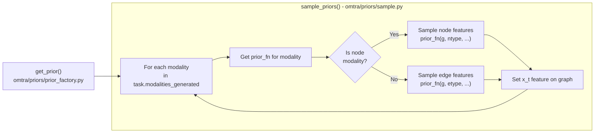
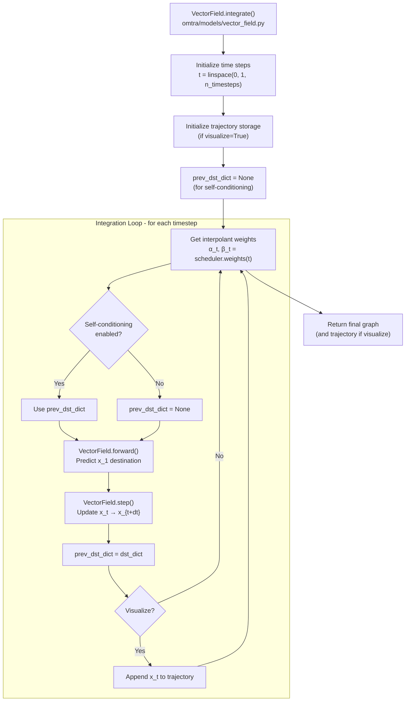
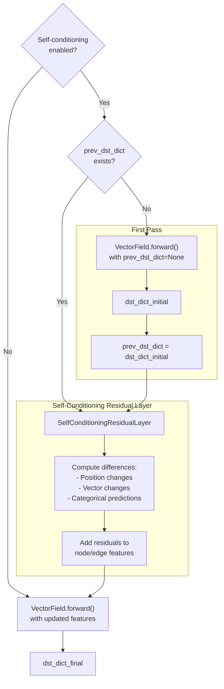
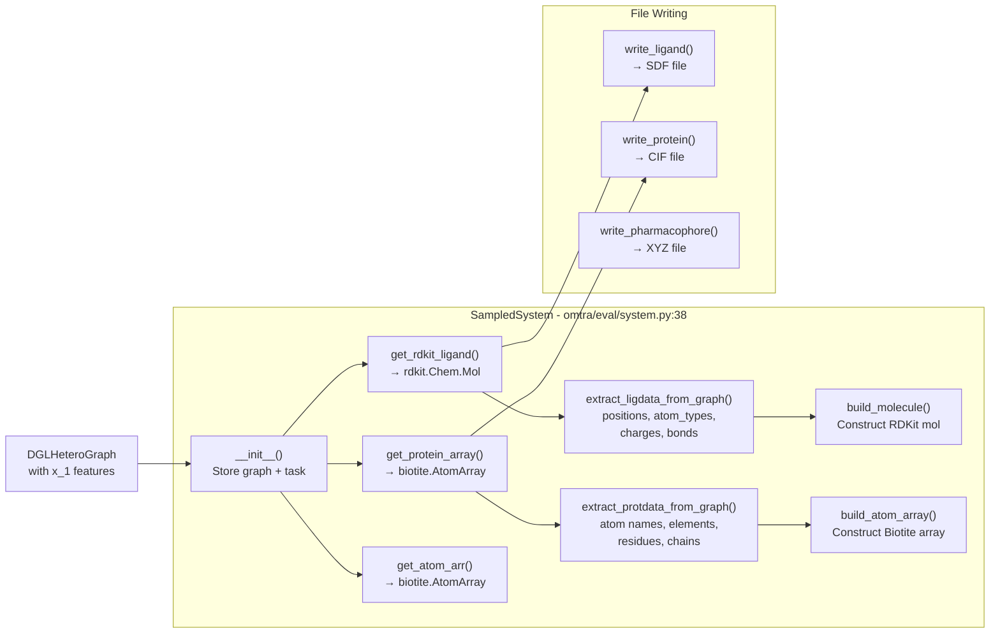

# Sampling and Inference

<details>
<summary>Relevant source files</summary>

The following files were used as context for generating this wiki page:

- [configs/eval/default.yaml](configs/eval/default.yaml)
- [omtra/data/graph/utils.py](omtra/data/graph/utils.py)
- [omtra/eval/evals.py](omtra/eval/evals.py)
- [omtra/eval/system.py](omtra/eval/system.py)
- [omtra/eval/utils.py](omtra/eval/utils.py)
- [omtra/models/omtra.py](omtra/models/omtra.py)
- [omtra/models/self_conditioning.py](omtra/models/self_conditioning.py)
- [omtra/models/vector_field.py](omtra/models/vector_field.py)
- [routines/sample.py](routines/sample.py)

</details>


This page describes how to generate molecules using trained OMTRA models. For information about training models, see [Training](#7). For information about evaluating generated molecules, see [Evaluation](#9).

## Overview

**Sampling** (also called **inference** or **generation**) is the process of using a trained OMTRA model to generate new molecular structures. The generative process uses flow matching: starting from a prior distribution at time `t=0`, the model progressively denoises features over `n_timesteps` integration steps until reaching the final structure at `t=1`.

OMTRA supports multiple generation modes depending on the task:
- **Unconditional generation**: Generate molecules from scratch with no constraints
- **Conditional generation**: Generate molecules conditioned on protein structure, pharmacophores, ligand identity, or combinations thereof

The sampling pipeline consists of:
1. Loading a trained model checkpoint
2. Preparing conditional input graphs (if applicable)
3. Sampling prior distributions for features being generated
4. Integrating the flow from `t=0` to `t=1` using the VectorField
5. Converting generated graphs to molecular file formats
6. (Optional) Computing evaluation metrics

**Sources**: Diagram 3 from high-level overview

---

## Sampling Workflow

The complete sampling workflow follows this sequence:



**Sources**: [routines/sample.py](), [omtra/models/omtra.py:602-887]()

---

## The Sample Script

The primary interface for sampling is [routines/sample.py](), which provides a command-line interface for generating molecules.

### Basic Usage

```bash
# Unconditional generation
omtra sample <checkpoint> --task denovo_ligand --n_samples 100

# Conditional generation from dataset
omtra sample <checkpoint> --task fixed_protein_ligand_denovo_condensed \
    --dataset plinder --n_samples 50 --n_replicates 10

# Custom integration parameters
omtra sample <checkpoint> --task rigid_docking \
    --n_timesteps 500 --stochastic_sampling --noise_scaler 0.5
```

### Key Arguments

| Argument | Type | Default | Description |
|----------|------|---------|-------------|
| `checkpoint` | Path | Required | Path to trained model checkpoint |
| `--task` | str | Required | Task name (e.g., `denovo_ligand`) |
| `--dataset` | str | `pharmit` | Dataset for conditional sampling |
| `--n_samples` | int | 100 | Number of samples (systems for conditional) |
| `--n_replicates` | int | 1 | Replicates per conditional input |
| `--n_timesteps` | int | 250 | Integration steps for flow matching |
| `--output_dir` | Path | Auto | Directory for output files |
| `--stochastic_sampling` | flag | False | Enable stochastic sampling |
| `--noise_scaler` | float | 1.0 | Noise scale for stochastic sampling |
| `--eps` | float | 0.01 | Sg(t) parameter for stochastic sampling |
| `--use_gt_n_lig_atoms` | flag | False | Use ground truth atom counts |
| `--n_lig_atom_margin` | float | 0.075 | Margin for atom count variation |
| `--visualize` | flag | False | Save trajectory for visualization |
| `--metrics` | flag | False | Compute evaluation metrics |

**Sources**: [routines/sample.py:34-157]()

### Script Flow

The script executes the following steps:

1. **Parse arguments**: [routines/sample.py:34-157]()
2. **Load checkpoint**: Uses `omtra_from_checkpoint()` to load trained model [routines/sample.py:282]()
3. **Get task definition**: Retrieves Task class from task name [routines/sample.py:285-286]()
4. **Load conditional data** (if needed): Instantiates datamodule and retrieves graphs [routines/sample.py:298-345]()
5. **Compute centers of mass**: For protein-conditioned tasks [routines/sample.py:348-354]()
6. **Run sampling**: Calls `model.sample()` [routines/sample.py:356-371]()
7. **Write outputs**: Generates SDF/CIF/XYZ files [routines/sample.py:373-481]()
8. **Compute metrics** (optional): Evaluates generated molecules [routines/sample.py:483-498]()

**Sources**: [routines/sample.py:273-500]()

---

## The OMTRA.sample() Method

The core sampling logic resides in `OMTRA.sample()` at [omtra/models/omtra.py:602-887]().

### Method Signature

```python
def sample(
    self,
    task_name: str,
    g_list: Optional[List[dgl.DGLHeteroGraph]] = None,
    n_replicates: int = 1,
    coms: Optional[torch.Tensor] = None,
    unconditional_n_atoms_dist: str = None,
    n_timesteps: int = None,
    device: Optional[torch.device] = None,
    visualize: bool = False,
    extract_latents_for_confidence: bool = False,
    time_spacing: str = "even",
    stochastic_sampling: bool = False,
    noise_scaler: float = 1.0,
    eps: float = 0.01,
    n_lig_atom_margin: Union[float, None] = None,
    n_lig_atoms_mean: Union[float, None] = None,
    n_lig_atoms_std: Union[float, None] = None,
) -> List[SampledSystem]
```

**Sources**: [omtra/models/omtra.py:602-627]()

### Sampling Steps



**Sources**: [omtra/models/omtra.py:602-1004]()

### Key Implementation Details

#### 1. Graph Preparation

For **unconditional tasks**, empty graphs are created:
```python
# omtra/models/omtra.py:662-669
for _ in range(n_replicates):
    g_flat.append(
        build_complex_graph(
            node_data={},
            edge_idxs={},
            edge_data={},
        )
    )
```

For **conditional tasks**, input graphs are replicated:
```python
# omtra/models/omtra.py:673-685
for idx, g_i in enumerate(g_list):
    g_flat.extend(copy_graph(g_i, n_replicates))
    # Compute center of mass for positioning
    if coms is None and protein_present:
        com_i = g_i.nodes["prot_atom"].data["x_1_true"].mean(dim=0)
    ...
```

**Sources**: [omtra/models/omtra.py:656-685]()

#### 2. Sampling Number of Atoms

The number of ligand atoms is sampled based on the task and available conditioning:

```python
# With protein present - omtra/models/omtra.py:738-740
n_lig_atoms = sample_n_lig_atoms_plinder(
    n_prot_atoms=n_prot_atoms, n_pharms=n_pharms
)

# Without protein - omtra/models/omtra.py:772-779
if unconditional_n_atoms_dist == "plinder":
    n_lig_atoms = sample_n_lig_atoms_plinder(n_pharms=n_pharms, n_samples=n_samples)
elif unconditional_n_atoms_dist == "pharmit":
    n_lig_atoms = sample_n_lig_atoms_pharmit(n_pharms=n_pharms, n_samples=n_samples)
```

When using ground truth atom counts with margin:
```python
# omtra/models/omtra.py:723-735
base_n_atoms = torch.tensor([g.num_nodes("lig") for g in g_flat])
base_n_atoms = base_n_atoms - n_fake_atoms_gt
max_margins = torch.clamp(base_n_atoms * n_lig_atom_margin, min=0).int()
margins = torch.stack([torch.randint(0, int(m.item()) + 1, (1,)) for m in max_margins]).squeeze()
offset_sign = torch.randint(0, 2, (len(g_flat),)) * 2 - 1
random_offsets = margins * offset_sign
n_lig_atoms = base_n_atoms + random_offsets
n_lig_atoms = torch.clamp(n_lig_atoms, min=4)
```

**Sources**: [omtra/models/omtra.py:688-783](), [omtra/data/distributions/plinder_dists.py](), [omtra/data/distributions/pharmit_dists.py]()

#### 3. Adding Nodes and Edges

Ligand nodes and fully-connected edges are added:
```python
# omtra/models/omtra.py:794-811
for g_idx, g_i in enumerate(g_flat):
    # Remove existing ligand nodes if present
    if g_i.num_nodes("lig") > 0:
        lig_node_ids = torch.arange(g_i.num_nodes("lig"), device=g_i.device)
        g_i.remove_nodes(lig_node_ids, ntype="lig")
    
    # Add new ligand nodes
    g_i.add_nodes(n_lig_atoms[g_idx].item(), ntype="lig")
    
    # Add lig_to_lig edges (fully connected)
    edge_idxs = build_lig_edge_idxs(n_lig_atoms[g_idx].item()).to(g_i.device)
    g_i.add_edges(u=edge_idxs[0], v=edge_idxs[1], etype="lig_to_lig")
```

**Sources**: [omtra/models/omtra.py:785-852](), [omtra/data/graph/utils.py:141-149]()

---

## Prior Initialization

Before integration begins, all features being generated must be initialized to their prior distributions at `t=0`.

### Prior Sampling Process



**Sources**: [omtra/priors/sample.py](), [omtra/priors/prior_factory.py]()

### Prior Types

OMTRA supports multiple prior distribution types:

| Prior Type | Description | Typical Use |
|------------|-------------|-------------|
| `gaussian` | Gaussian distribution N(μ, σ²) | Continuous features (positions, vectors) |
| `ctmc_masked` | Continuous-time Markov chain with mask token | Categorical features (atom types, charges, bonds) |
| `uniform` | Uniform distribution over valid values | Simple categorical priors |
| `target_dependent` | Prior depends on conditional information | Positions centered near protein |
| `apo_exp` / `apo_pred` | Protein-specific position priors | Ligand positions near binding site |

For detailed information about prior configurations, see [Prior Distributions](#8.2).

### Example: Position Priors

Ligand positions are typically initialized near the protein center of mass:

```python
# Gaussian prior centered at protein COM
# omtra/priors/sample.py - position prior sampling
x_0 = com + torch.randn(n_nodes, 3, device=device) * sigma
```

### Example: Categorical Priors

Categorical features use the mask token as prior:

```python
# CTMC masked prior - all features start masked
# omtra/priors/sample.py - categorical prior sampling
a_0 = torch.full((n_nodes,), mask_token_idx, device=device)
```

**Sources**: [omtra/priors/sample.py](), [omtra/priors/prior_factory.py](), [omtra/models/omtra.py:859-867]()

---

## Integration Process

After initialization, the model integrates the flow from `t=0` to `t=1` using the VectorField.

### VectorField.integrate() Method

The integration loop progressively denoises features:



**Sources**: [omtra/models/vector_field.py]() (method not fully visible in truncated file but referenced in diagram)

### VectorField.forward()

At each timestep, `VectorField.forward()` predicts the destination state `x_1`:

1. **Build edges**: Construct spatial edges based on current positions [omtra/models/vector_field.py:382]()
2. **Embed features**: Convert categorical features to embeddings [omtra/models/vector_field.py:386-488]()
3. **Self-conditioning** (optional): Apply residual updates from previous prediction [omtra/models/vector_field.py:489-541]()
4. **GNN passes**: Run HeteroGVPConv layers to update node/edge features [omtra/models/vector_field.py:543-564]()
5. **Output heads**: Project to predicted destination values [omtra/models/vector_field.py:666-730]()

**Sources**: [omtra/models/vector_field.py:360-564]()

### VectorField.step()

The `step()` method updates features based on predicted destinations:

```python
# Continuous features: interpolate toward destination
x_{t+dt} = x_t + dt * (x_1_pred - x_t) / (1 - t)

# Categorical features: sample with temperature-scaled logits
probs = softmax(logits / temperature(t))
x_{t+dt} = categorical_sample(probs)
```

**Stochastic sampling** adds noise:
```python
# Add Gaussian noise to continuous features
noise = torch.randn_like(x_t) * noise_scaler * sqrt(dt)
x_{t+dt} = x_{t+dt} + noise
```

**Sources**: Referenced in [omtra/models/vector_field.py]() and Diagram 3

---

## Self-Conditioning

Self-conditioning improves sample quality by providing the model with its previous prediction.

### Self-Conditioning Process



**Sources**: [omtra/models/vector_field.py:489-541](), [omtra/models/self_conditioning.py]()

### Residual Computation

The `SelfConditioningResidualLayer` computes residuals based on:

1. **Position changes**: Distance from current to predicted position [omtra/models/self_conditioning.py:111-121]()
2. **Vector changes**: Pairwise distances between predicted and current vectors [omtra/models/self_conditioning.py:123-138]()
3. **Categorical features**: Softmax probabilities of predictions [omtra/models/self_conditioning.py:140-151]()
4. **Edge changes**: Distance changes and bond type predictions [omtra/models/self_conditioning.py:163-188]()

These residuals are concatenated with current features and passed through MLPs to generate feature updates:

```python
# omtra/models/self_conditioning.py:154-161
node_residual_inputs[ntype].append(s_t[ntype])
node_residuals[ntype] = self.residual_generating_fns[ntype](
    torch.cat(node_residual_inputs[ntype], dim=-1)
)

# omtra/models/self_conditioning.py:192-193
node_feats_out[ntype] = s_t[ntype] + node_residuals[ntype]
```

**Sources**: [omtra/models/self_conditioning.py:87-199]()

---

## Output Generation

After integration completes, generated graphs are converted to standard molecular file formats.

### SampledSystem Class

The `SampledSystem` class wraps generated graphs and provides conversion methods:



**Sources**: [omtra/eval/system.py:38-948]()

### Ligand Conversion

Converting ligands to RDKit molecules:

```python
# omtra/eval/system.py:400-406
def get_rdkit_ligand(self, show_fake_atoms=False) -> Union[None, Chem.Mol]:
    ligdata = self.extract_ligdata_from_graph(ctmc_mol=self.ctmc_mol, show_fake_atoms=show_fake_atoms)
    rdkit_mol = self.build_molecule(*ligdata)
    return rdkit_mol
```

The extraction process:
1. Extract node features: positions, atom types, charges [omtra/eval/system.py:528-534]()
2. Extract edge features: bond types, bond indices [omtra/eval/system.py:549-566]()
3. Handle special cases: fake atoms, masked features [omtra/eval/system.py:520-525]()
4. Build RDKit molecule with geometry [omtra/eval/system.py:646-723]()

**Sources**: [omtra/eval/system.py:400-575](), [omtra/eval/system.py:646-723]()

### Protein Conversion

Converting proteins to Biotite AtomArrays:

```python
# omtra/eval/system.py:373-398
def get_protein_array(self, g=None, reference: bool = False, include_bonds: bool = True):
    coords, atom_names, elements, res_ids, res_names, chain_ids, hetero = (
        self.extract_protdata_from_graph(g=g, reference=reference)
    )
    arr = self.build_atom_array(
        coords=coords, atom_name=atom_names, element=elements,
        res_id=res_ids, res_name=res_names, chain_id=chain_ids,
        hetero=hetero, include_bonds=include_bonds
    )
    return arr
```

**Sources**: [omtra/eval/system.py:373-398](), [omtra/eval/system.py:577-621]()

### File Output Functions

Helper functions write molecules to files:

| Function | Output Format | Location |
|----------|--------------|----------|
| `write_mols_to_sdf()` | SDF (Structure Data File) | [omtra/eval/system.py:764-781]() |
| `write_arrays_to_cif()` | mmCIF (Crystallographic Information File) | [omtra/eval/system.py:783-818]() |
| `write_pharmacophore()` | XYZ or mmCIF | [omtra/eval/system.py:846-895]() |

**Example output directory structure**:
```
output_dir/
├── sys_0_gt/
│   ├── ligand.sdf              # Ground truth ligand
│   ├── protein.cif             # Ground truth protein
│   ├── pharmacophore.xyz       # Ground truth pharmacophore
│   └── gen_ligands.sdf         # All generated ligands for system 0
├── sys_1_gt/
│   └── ...
└── <task_name>_metrics.json    # Evaluation metrics (if --metrics)
```

**Sources**: [omtra/eval/system.py:764-895](), [routines/sample.py:382-481]()

---

## Stochastic vs Deterministic Sampling

OMTRA supports both deterministic and stochastic sampling modes.

### Deterministic Sampling (Default)

In deterministic mode, the integration follows the probability flow ODE:

```
dx_t / dt = (x_1_pred - x_t) / (1 - t)
```

This produces a single, reproducible trajectory from prior to final state.

### Stochastic Sampling

Stochastic sampling adds noise at each integration step, following a stochastic differential equation (SDE):

```
dx_t = [(x_1_pred - x_t) / (1 - t)] dt + σ(t) dW
```

Where:
- `σ(t)` is the noise schedule controlled by `--eps`
- `dW` is scaled Gaussian noise controlled by `--noise_scaler`
- Stochastic sampling can improve diversity at the cost of determinism

**Enabling stochastic sampling**:
```bash
omtra sample <checkpoint> --task denovo_ligand \
    --stochastic_sampling --noise_scaler 1.0 --eps 0.01
```

### Implementation

The noise is applied in the integration step function:

```python
# When stochastic_sampling=True
if stochastic_sampling:
    noise = torch.randn_like(x_t) * noise_scaler * sqrt(dt)
    x_t = x_t + noise
```

**Parameters**:
- `--noise_scaler` (default: 1.0): Scales the magnitude of added noise
- `--eps` (default: 0.01): Controls the noise schedule Sg(t)

**Sources**: [routines/sample.py:118-133](), [omtra/models/omtra.py:619-621]()

---

## Visualization Mode

The `--visualize` flag enables trajectory storage for visualization:

```bash
omtra sample <checkpoint> --task denovo_ligand --visualize
```

When enabled:
- **Trajectory storage**: All intermediate states `x_t` are saved [omtra/models/omtra.py:616]()
- **Separate files**: Both trajectory (`_xt.sdf`) and final predictions (`_xhat.sdf`) are written
- **File naming**: For conditional tasks, files are named `sys_{i}_rep_{j}_lig_xt.sdf`

**Output structure with visualization**:
```
output_dir/
└── sys_0_gt/
    ├── sys_0_rep_0_lig_xt.sdf      # Full trajectory (all timesteps)
    ├── sys_0_rep_0_lig_xhat.sdf    # Predicted destinations at each timestep
    ├── sys_0_rep_0_prot_xt.cif     # (if protein generated)
    └── sys_0_rep_0_pharm_xt.cif    # (if pharmacophore generated)
```

The trajectory files can be loaded in molecular visualization software (PyMOL, Chimera, VMD) to animate the generation process.

**Sources**: [routines/sample.py:89-92](), [routines/sample.py:386-481]()

---

## Advanced Features

### Custom Atom Count Distributions

Instead of sampling atom counts from dataset distributions, you can specify custom distributions:

```bash
# Use mean and standard deviation
omtra sample <checkpoint> --task denovo_ligand \
    --n_lig_atoms_mean 25 --n_lig_atoms_std 5
```

This samples atom counts from `N(μ=25, σ=5)` and clamps to minimum 4 atoms.

**Sources**: [routines/sample.py:369-370](), [omtra/models/omtra.py:624-625](), [omtra/models/omtra.py:713-759]()

### System Index Files

For reproducible sampling from specific dataset entries:

```bash
omtra sample <checkpoint> --task rigid_docking \
    --sys_idx_file indices.txt --n_samples 50
```

The `indices.txt` file should contain comma-separated indices:
```
0,15,42,103,207,...
```

**Sources**: [routines/sample.py:77-81](), [routines/sample.py:335-342]()

### Extracting Latents for Confidence

For confidence estimation models, latent features can be extracted:

```python
samples, latents = model.sample(
    task_name=task_name,
    g_list=g_list,
    extract_latents_for_confidence=True,
    ...
)
```

This returns both generated systems and final GNN latent representations.

**Sources**: [omtra/models/omtra.py:617](), [omtra/models/vector_field.py:370]()

---

This completes the documentation of OMTRA's sampling and inference system. For evaluation of generated molecules, see [Evaluation](#9). For customizing prior distributions, see [Prior Distributions](#8.2).

---