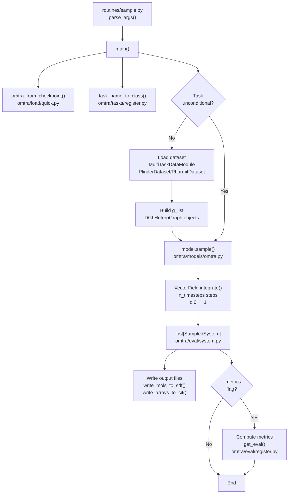
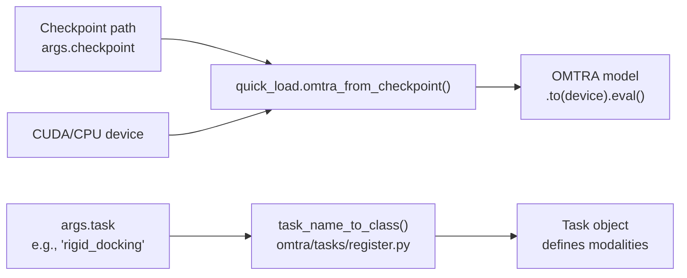
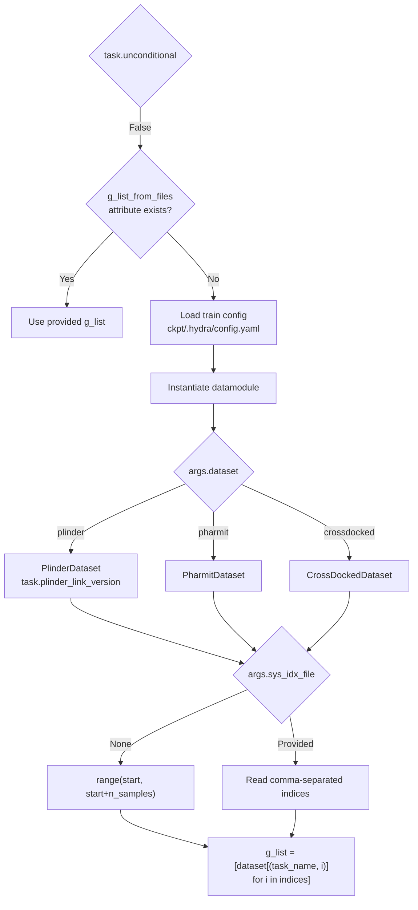
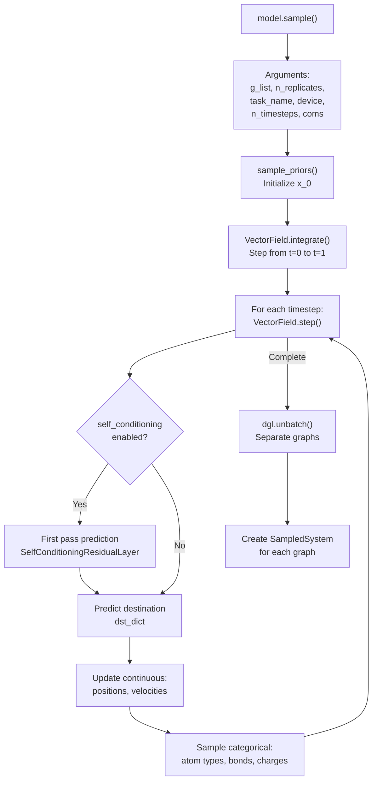
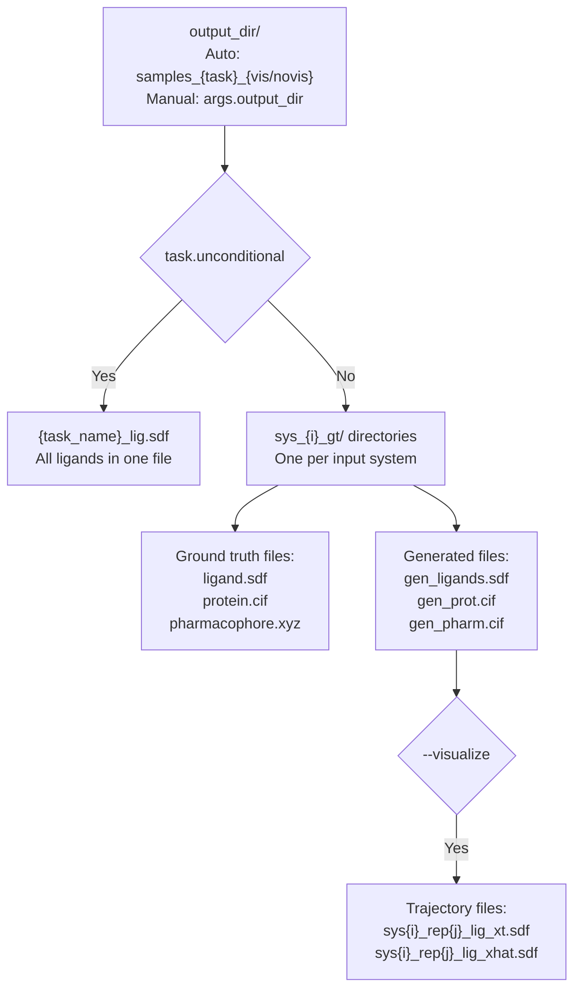
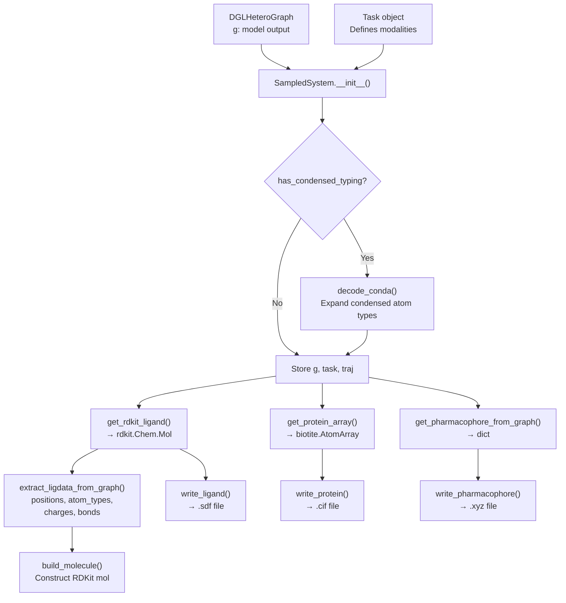
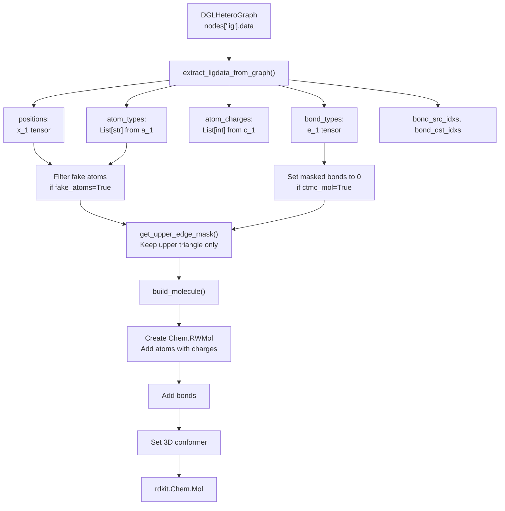
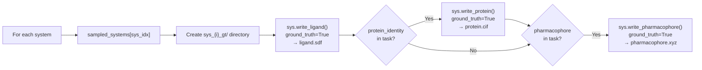

# Sampling Pipeline

<details>
<summary>Relevant source files</summary>

The following files were used as context for generating this wiki page:

- [configs/eval/default.yaml](configs/eval/default.yaml)
- [omtra/data/graph/utils.py](omtra/data/graph/utils.py)
- [omtra/eval/evals.py](omtra/eval/evals.py)
- [omtra/eval/system.py](omtra/eval/system.py)
- [omtra/eval/utils.py](omtra/eval/utils.py)
- [routines/sample.py](routines/sample.py)

</details>


## Purpose and Scope

This document describes the complete sampling (inference) workflow in OMTRA, implemented primarily in [routines/sample.py](). The sampling pipeline generates molecular structures from trained OMTRA models by running the reverse generative process from noise to structured data. It covers input preparation, prior initialization, iterative generation, output file management, and optional evaluation metric computation.

For information about the model architecture that powers this pipeline, see [OMTRA Generative Model](#4.1). For details on prior distributions used during initialization, see [Prior Distributions](#8.2). For information on how to configure conditional inputs, see [Conditional Generation](#8.3). For evaluation of generated samples, see [Built-in Metrics](#9.1).

## Overview

The sampling pipeline executes the following workflow:

1. **Load checkpoint**: Restore a trained OMTRA model from disk
2. **Prepare inputs**: Load conditional data (proteins, pharmacophores, ligands) as DGL graphs or sample from datasets
3. **Initialize priors**: Sample initial states `x_0` from noise distributions
4. **Generate**: Integrate from `t=0` to `t=1` using the VectorField predictor
5. **Post-process**: Convert generated graphs to molecular formats (SDF, CIF, PDB)
6. **Evaluate** (optional): Compute validity, geometry, and task-specific metrics



**Sources**: [routines/sample.py:1-503]()

## Command-Line Interface

The sampling pipeline is invoked via `routines/sample.py` with the following key arguments:

| Argument | Type | Default | Description |
|----------|------|---------|-------------|
| `checkpoint` | Path | Required | Path to model checkpoint file |
| `--task` | str | Required | Task name (e.g., `denovo_ligand`, `rigid_docking`) |
| `--dataset` | str | `pharmit` | Dataset to sample from (`pharmit`, `plinder`, `crossdocked`) |
| `--n_samples` | int | 100 | Number of samples to generate |
| `--n_replicates` | int | 1 | Replicates per conditional input |
| `--n_timesteps` | int | 250 | Integration steps for generation |
| `--output_dir` | Path | Auto-generated | Directory for outputs |
| `--metrics` | bool | False | Compute evaluation metrics |
| `--visualize` | bool | False | Save trajectory frames |
| `--stochastic_sampling` | bool | False | Enable stochastic sampling |

**Sources**: [routines/sample.py:34-157]()

### Argument Parsing

The `parse_args()` function constructs an `ArgumentParser` with all sampling parameters:

```python
# Example invocation
python routines/sample.py /path/to/checkpoint.ckpt \
    --task rigid_docking \
    --dataset plinder \
    --n_samples 50 \
    --n_replicates 5 \
    --n_timesteps 250 \
    --metrics
```

**Sources**: [routines/sample.py:34-157]()

## Workflow Stages

### Stage 1: Model and Task Loading

The `main()` function begins by loading the trained model and task definition:



The model is loaded via `omtra_from_checkpoint()` from [omtra/load/quick.py](), which restores weights and configuration. The task object determines which modalities are fixed versus generated.

**Sources**: [routines/sample.py:273-286]()

### Stage 2: Input Graph Preparation

#### Conditional Tasks

For conditional tasks (where `task.unconditional == False`), the pipeline loads or constructs a list of input graphs `g_list`:



Each graph in `g_list` is a `DGLHeteroGraph` containing the conditional information (protein structure, pharmacophore, reference ligand, etc.) as fixed node/edge features.

**Sources**: [routines/sample.py:288-345]()

#### Unconditional Tasks

For unconditional tasks (e.g., `denovo_ligand`), `g_list` is set to `None` and `n_replicates` is set to `args.n_samples`:

**Sources**: [routines/sample.py:289-291]()

#### Center of Mass Calculation

If the task includes protein structure, the pipeline computes center-of-mass (COM) coordinates to anchor generated molecules:

```python
# Priority: ligand COM > protein atom COM
if 'x_1_true' in g_list[0].nodes['lig'].data:
    coms = [g.nodes['lig'].data['x_1_true'].mean(dim=0) for g in g_list]
elif 'x_1_true' in g_list[0].nodes['prot_atom'].data:
    coms = [g.nodes['prot_atom'].data['x_1_true'].mean(dim=0) for g in g_list]
```

**Sources**: [routines/sample.py:347-354]()

### Stage 3: Generation via model.sample()

The core generation happens in `model.sample()`, which is a method of the `OMTRA` class (see [OMTRA Generative Model](#4.1)):



The integration process moves the system from prior distribution (`t=0`) to the learned data distribution (`t=1`) via intermediate timesteps. At each step, the VectorField predicts the destination and updates features.

**Sources**: [routines/sample.py:356-371]()

### Stage 4: Post-Processing and Output

#### Output Directory Structure

The pipeline creates an organized directory structure for outputs:



**Sources**: [routines/sample.py:373-481]()

#### Sample Naming Convention

For conditional tasks with replicates, the naming follows `sys_{system_idx}_rep_{replicate_idx}`:

```python
def generate_sample_names(n_systems: int, n_replicates: int) -> List[str]:
    return [
        f"sys_{i}_rep_{j}"
        for i in range(n_systems)
        for j in range(n_replicates)
    ]
```

**Sources**: [routines/sample.py:160-175]()

#### Sample Grouping

The `group_samples_by_system()` function reorganizes flat sample lists into per-system groups:

```python
# Input: ['sys_0_rep_0', 'sys_0_rep_1', 'sys_1_rep_0', 'sys_1_rep_1']
# Output: Iterator yielding [rep_0, rep_1] for each system
```

This enables writing all replicates for a system into the same directory.

**Sources**: [routines/sample.py:178-228]()

#### File Writing Functions

Generated molecules are written using format-specific functions:

| Function | Purpose | Output Format |
|----------|---------|---------------|
| `write_mols_to_sdf()` | Write RDKit molecules | `.sdf` |
| `write_arrays_to_cif()` | Write Biotite atom arrays | `.cif` |
| `write_arrays_to_pdb()` | Write Biotite atom arrays | `.pdb` |
| `pharm_to_xyz()` | Write pharmacophore points | `.xyz` |

**Sources**: [omtra/eval/system.py:820-838]()

### Stage 5: Evaluation Metrics (Optional)

When `--metrics` is enabled, the pipeline computes evaluation metrics defined in [configs/eval/default.yaml]():

```mermaid
graph LR
    MetricsFlag["--metrics flag"]
    
    LoadConfig["Load configs/eval/default.yaml"]
    TaskMetrics["Get metrics for task_name"]
    
    Iterate["For each eval_entry"]
    
    GetEval["get_eval(eval_name)<br/>omtra/eval/register.py"]
    EvalFunc["Evaluation function<br/>e.g., validity(), stability()"]
    
    CallEval["eval_func(sampled_systems, params)"]
    
    Aggregate["Aggregate results<br/>into metrics dict"]
    
    WriteJSON["{task_name}_metrics.json"]
    
    MetricsFlag --> LoadConfig
    LoadConfig --> TaskMetrics
    TaskMetrics --> Iterate
    
    Iterate --> GetEval
    GetEval --> EvalFunc
    EvalFunc --> CallEval
    
    CallEval --> Aggregate
    Aggregate --> WriteJSON
```



**Sources**: [routines/sample.py:483-497]()

#### Available Metrics by Task

The evaluation configuration defines task-specific metric sets:

| Task Type | Example Metrics |
|-----------|-----------------|
| `denovo_ligand` | `validity`, `stability`, `reos_and_rings`, `flatness`, `pb_valid_unconditional` |
| `rigid_docking` | `stability`, `intermolecular_distance`, `ligand_rmsd`, `volume_overlap` |
| `ligand_conformer` | `stability`, `ligand_rmsd`, `pb_valid_conformer` |
| `fixed_protein_ligand_denovo` | `validity`, `stability`, `intermolecular_distance`, `volume_overlap` |

**Sources**: [configs/eval/default.yaml:1-684]()

## SampledSystem Class

The `SampledSystem` class bridges DGL graphs to molecular formats (RDKit, Biotite):



**Sources**: [omtra/eval/system.py:38-855]()

### Key Methods

| Method | Return Type | Description |
|--------|-------------|-------------|
| `get_rdkit_ligand()` | `Chem.Mol` | Extract ligand as RDKit molecule |
| `get_rdkit_ref_ligand()` | `Chem.Mol` | Extract ground truth ligand |
| `get_protein_array()` | `biotite.AtomArray` | Extract protein structure |
| `get_pharmacophore_from_graph()` | `dict` | Extract pharmacophore features |
| `build_traj()` | `dict` | Build trajectory frames from `traj` data |
| `write_ligand()` | `None` | Write ligand to SDF file |
| `write_protein()` | `None` | Write protein to CIF file |
| `write_pharmacophore()` | `None` | Write pharmacophore to XYZ file |

**Sources**: [omtra/eval/system.py:400-803]()

### Data Extraction Pipeline

The conversion from DGL graph to molecular formats follows this pipeline:



**Sources**: [omtra/eval/system.py:491-644]()

### Atom Type Mapping

The system uses predefined mappings to convert integer indices to element symbols:

| Mapping | Source | Usage |
|---------|--------|-------|
| `ligand_atom_type_map` | `omtra.constants.lig_atom_type_map` | Ligand elements |
| `protein_atom_type_map` | `omtra.constants.protein_atom_map` | Protein atom names |
| `protein_element_map` | `omtra.constants.protein_element_map` | Protein elements |
| `bond_type_map` | `omtra.constants.bond_type_map` | Bond orders |
| `charge_map` | `omtra.constants.charge_map` | Formal charges |

Special handling for CTMC (masked) atoms:
- Masked atoms: represented as `Se` (appended to atom type map)
- Fake atoms: represented as `Sn` (appended to atom type map)

**Sources**: [omtra/eval/system.py:44-85]()

## Ground Truth Handling

For conditional tasks, the `write_ground_truth()` function saves reference structures alongside generated samples:



This enables side-by-side comparison of generated vs. reference structures for evaluation.

**Sources**: [routines/sample.py:230-271]()

## Trajectory Visualization

When `--visualize` is enabled, the pipeline saves intermediate generation states:

- **`lig_xt.sdf`**: Ligand positions at each timestep (`x_t`)
- **`lig_xhat.sdf`**: Predicted destinations at each timestep (`x̂_1`)

The `SampledSystem.build_traj()` method constructs trajectory frames:

```python
# For each timestep, place trajectory data on dummy graph
for frame_idx in range(n_frames):
    for m_name in self.traj.keys():
        m = name_to_modality(m_name)
        data_src[f"{m.data_key}_1"] = self.traj[m_name][frame_idx]
    
    # Extract and build molecule at this frame
    ligdata = self.extract_ligdata_from_graph(g=g_dummy)
    rdkit_mol = self.build_molecule(*ligdata)
    traj_mols["lig"].append(rdkit_mol)
```

**Sources**: [omtra/eval/system.py:646-707]()

## Stochastic Sampling

Deterministic sampling follows the probability flow ODE. Stochastic sampling adds noise at each step:

| Parameter | Description |
|-----------|-------------|
| `--stochastic_sampling` | Enable stochastic mode |
| `--noise_scaler` | Scale factor for noise (default: 1.0) |
| `--eps` | Sg(t) parameter for noise schedule (default: 0.01) |

Stochastic sampling can improve sample diversity at the cost of determinism.

**Sources**: [routines/sample.py:118-133]()

## Integration with Dataset Priors

For unconditional tasks, the pipeline can use dataset-specific atom count distributions:

```python
model.sample(
    unconditional_n_atoms_dist=args.dataset,  # 'pharmit', 'plinder', etc.
    n_lig_atoms_mean=getattr(args, 'n_lig_atoms_mean', None),
    n_lig_atoms_std=getattr(args, 'n_lig_atoms_std', None)
)
```

The model's `sample_priors()` function uses these to determine the number of atoms to generate.

**Sources**: [routines/sample.py:356-371]()

## Error Handling and Validation

The pipeline includes validation at multiple stages:

1. **Checkpoint existence**: Raises `FileNotFoundError` if checkpoint not found
2. **Graph construction**: Validates node/edge counts match expected structure
3. **Molecule building**: Catches `KekulizeException` and returns `None` for invalid structures
4. **Sanitization**: RDKit molecules are sanitized before evaluation
5. **Empty molecules**: Skipped during metric computation with warnings

**Sources**: [routines/sample.py:276-277](), [omtra/eval/system.py:632-634](), [omtra/eval/utils.py:25-106]()

## Example Workflows

### Unconditional Ligand Generation

```bash
python routines/sample.py checkpoint.ckpt \
    --task denovo_ligand \
    --n_samples 1000 \
    --output_dir outputs/denovo \
    --metrics
```

Output structure:
```
outputs/denovo/
└── denovo_ligand_lig.sdf        # 1000 ligands
└── denovo_ligand_metrics.json   # Validity, stability, etc.
```

### Conditional Docking with Replicates

```bash
python routines/sample.py checkpoint.ckpt \
    --task rigid_docking \
    --dataset plinder \
    --n_samples 10 \
    --n_replicates 50 \
    --n_timesteps 250
```

Output structure:
```
outputs/
├── sys_0_gt/
│   ├── ligand.sdf           # Ground truth
│   ├── protein.cif          # Ground truth
│   └── gen_ligands.sdf      # 50 replicates
├── sys_1_gt/
│   ├── ligand.sdf
│   ├── protein.cif
│   └── gen_ligands.sdf
...
```

### Trajectory Visualization

```bash
python routines/sample.py checkpoint.ckpt \
    --task ligand_conformer \
    --n_samples 5 \
    --n_replicates 1 \
    --visualize
```

Output includes:
```
sys_0_gt/
├── sys_0_rep_0_lig_xt.sdf      # Trajectory positions
├── sys_0_rep_0_lig_xhat.sdf    # Trajectory predictions
```

**Sources**: [routines/sample.py:382-481]()

---