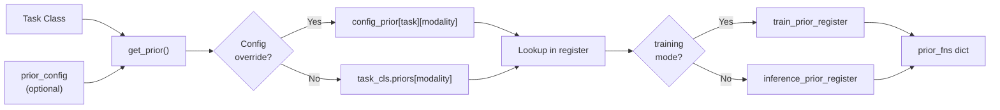
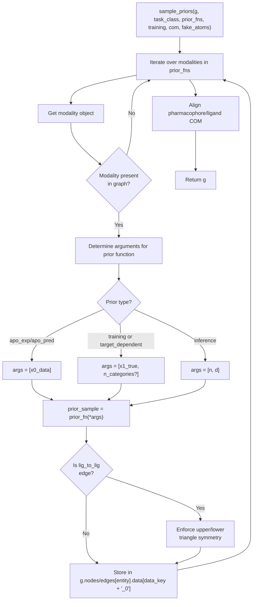
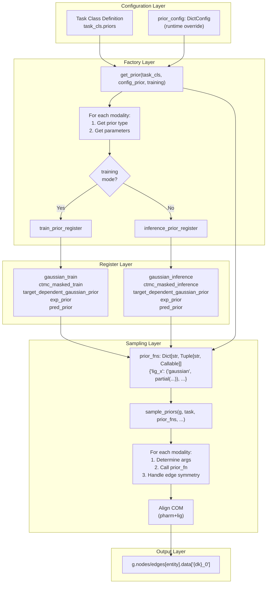
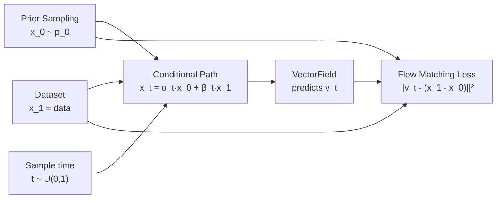
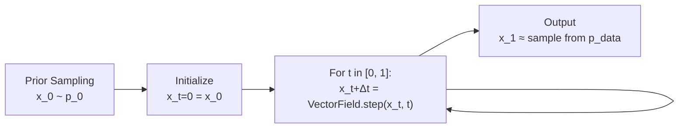

# Prior Distributions

<details>
<summary>Relevant source files</summary>

The following files were used as context for generating this wiki page:

- [configs/graph/default.yaml](configs/graph/default.yaml)
- [omtra/data/graph/__init__.py](omtra/data/graph/__init__.py)
- [omtra/data/graph/edge_builders.py](omtra/data/graph/edge_builders.py)
- [omtra/data/graph/edge_factory.py](omtra/data/graph/edge_factory.py)
- [omtra/data/graph/register.py](omtra/data/graph/register.py)
- [omtra/models/omtra.py](omtra/models/omtra.py)
- [omtra/models/self_conditioning.py](omtra/models/self_conditioning.py)
- [omtra/models/vector_field.py](omtra/models/vector_field.py)
- [omtra/priors/prior_factory.py](omtra/priors/prior_factory.py)
- [omtra/priors/priors.py](omtra/priors/priors.py)
- [omtra/priors/sample.py](omtra/priors/sample.py)
- [omtra/tasks/utils.py](omtra/tasks/utils.py)

</details>


## Purpose and Scope

This page explains the prior distribution system in OMTRA - how initial states (x_0) are sampled for different modalities during training and inference. Priors define the starting point of the generative flow matching trajectory. For information about conditional paths (how to interpolate from x_0 to x_1), see [Flow Matching for Molecules](#3.2). For the complete sampling workflow that uses these priors, see [Sampling Pipeline](#8.1).

## Overview

Prior distributions define the initial state at time t=0 for each modality being generated. During flow matching, the model learns to transform samples from the prior distribution into the target distribution. OMTRA supports multiple prior types:

- **Gaussian**: Random Gaussian noise
- **CTMC Masked**: All categorical tokens set to a special mask token
- **Target-dependent**: Noisy version of the target structure
- **Apo structures**: From experimental or predicted unbound protein structures

The prior type is configured per modality and per task, and can differ between training and inference modes.

## Prior Registration System

### Registration Decorators

OMTRA uses decorators to register prior functions. Each prior type has separate implementations for training and inference.

[omtra/priors/priors.py:11-101]() defines priors using `@register_train_prior` and `@register_inference_prior`:

```python
@register_train_prior("gaussian")
def gaussian_train(x1: torch.Tensor, std: float = 1.0, ...):
    """Generate prior by sampling from Gaussian distribution"""
    
@register_inference_prior("gaussian")
def gaussian_inference(n: int, d: Union[int, List[int]], std: float = 1.0):
    """Generate prior by sampling from Gaussian distribution"""
```

**Key Differences**:
- **Training priors**: Receive the target `x1` and can use it for alignment or other purposes
- **Inference priors**: Receive only size parameters (`n`, `d`) since no target is available

### Prior Factory

[omtra/priors/prior_factory.py:5-33]() provides `get_prior()` which retrieves prior functions for all modalities in a task:

1. Iterates over all modalities being generated by the task
2. Looks up prior type from config (or task default)
3. Retrieves the appropriate function from the register
4. Creates partial functions with configured parameters
5. Returns a dictionary mapping modality names to `(prior_name, prior_fn)` tuples



Sources: [omtra/priors/prior_factory.py:5-33](), [omtra/priors/priors.py:1-102]()

## Available Prior Types

### Gaussian Prior

Samples from a Gaussian distribution centered at zero.

**Training Implementation**: [omtra/priors/priors.py:11-42]()
- Samples `x0 = randn_like(x1) * std`
- Optional optimal transport (OT) alignment to `x1` using rigid body transforms and/or permutation
- Optional translation to match `x1`'s center of mass
- Optional random offset

**Inference Implementation**: [omtra/priors/priors.py:44-53]()
- Samples `x0 = randn(n, d) * std`
- No target data required

**Parameters**:

| Parameter | Type | Default | Description |
|-----------|------|---------|-------------|
| `std` | float | 1.0 | Standard deviation of Gaussian |
| `ot` | bool | False | Enable optimal transport alignment (training only) |
| `rigid_body` | bool | True | Allow rigid body transforms during OT (training only) |
| `permutation` | bool | True | Allow permutation during OT (training only) |
| `translation` | bool | False | Match center of mass to target (training only) |
| `offset_std` | float | 0.0 | Standard deviation of random offset (training only) |

### CTMC Masked Prior

For categorical features, sets all tokens to the mask token (index = `n_categories`) at t=0.

**Training**: [omtra/priors/priors.py:56-64]()
**Inference**: [omtra/priors/priors.py:66-72]()

Returns a tensor of shape `(n,)` filled with the mask token index. During the conditional path, this will be gradually unmasked to reveal the target categorical values.

### Target-Dependent Gaussian

Adds Gaussian noise to the target structure. Useful for refinement or docking tasks where the prior should be close to the target.

[omtra/priors/priors.py:74-82]()

```python
x_0 = x1.clone() + randn_like(x1) * std
```

This prior is the same for both training and inference modes.

### Apo Structure Priors

Use unbound (apo) protein structures as starting points for flexible docking or protein structure generation.

**Apo Experimental** (`apo_exp`): [omtra/priors/priors.py:85-92]()
- Uses experimental apo structure from `x0` data field
- Adds Gaussian noise: `x_0 = x0.clone() + randn_like(x0) * std`

**Apo Predicted** (`apo_pred`): [omtra/priors/priors.py:94-101]()
- Uses AlphaFold-predicted apo structure from `x0` data field
- Adds Gaussian noise: `x_0 = x0.clone() + randn_like(x0) * std`

Both require the dataset to provide the apo structure in the `{data_key}_0` field of the graph.

Sources: [omtra/priors/priors.py:11-101]()

## Prior Sampling Process

### Main Sampling Function

[omtra/priors/sample.py:10-113]() implements `sample_priors()` which orchestrates the entire prior sampling process:



Sources: [omtra/priors/sample.py:10-113]()

### Argument Determination

The arguments passed to the prior function depend on the prior type and mode:

[omtra/priors/sample.py:47-66]()

| Prior Type | Training Args | Inference Args |
|------------|---------------|----------------|
| `apo_exp` / `apo_pred` | `(x0_from_graph,)` | `(x0_from_graph,)` |
| `target_dependent_gaussian` | `(x1_true, n_categories?)` | `(x1_true, n_categories?)` |
| Gaussian / CTMC | `(x1_true, n_categories?)` | `(n, d)` |

For categorical modalities, `n_categories` is adjusted if fake atoms are used:
```python
n_categories + int(modality_has_fake_atoms)
```

### Modality-Specific Handling

**Categorical Modalities**: [omtra/priors/sample.py:38-45]()
- Dimension `d = n_categories`
- Extra category for mask token during training
- Extra category for fake atoms if enabled

**Position Modalities** (data_key = 'x'):
- Dimension `d = 3` (3D coordinates)

**Vector Modalities** (data_key = 'v'):
- Dimension `d = (4, 3)` - hard-coded assumption of 4 pharmacophore vector features with 3D coordinates

### Edge Symmetry Enforcement

For `lig_to_lig` edges with complete graph structure, the upper and lower triangles must be symmetric:

[omtra/priors/sample.py:74-76]()
```python
if modality.entity_name == 'lig_to_lig':
    upper_edge_mask = get_upper_edge_mask(g, modality.entity_name)
    prior_sample[~upper_edge_mask] = prior_sample[upper_edge_mask]
```

Sources: [omtra/priors/sample.py:10-113]()

## Center of Mass Alignment

### Training Mode

When both pharmacophore and ligand structure are being generated during training:

[omtra/priors/sample.py:82-97]()
1. Compute pharmacophore prior COM
2. Compute ligand prior COM  
3. Shift pharmacophore positions to match ligand COM

This ensures the pharmacophore and ligand start in the same region of space.

### Inference Mode

**Ligand Generation**: [omtra/priors/sample.py:99-105]()
- Compute current ligand prior COM
- Shift ligand positions to designated `com` (typically protein binding site center)

**Pharmacophore Generation**: [omtra/priors/sample.py:107-111]()
- Compute current pharmacophore prior COM
- Shift pharmacophore positions to designated `com`

The designated `com` is provided as an argument to `sample_priors()`, typically computed from the protein structure or provided by the user.

Sources: [omtra/priors/sample.py:82-111]()

## Configuration System

### Task-Level Defaults

Each task class defines default priors in its `priors` class attribute:

```python
class DeNovoLigand(Task):
    priors = {
        "lig_x": {"type": "gaussian", "params": {"std": 1.0}},
        "lig_a": {"type": "masked", "params": {}},
        "lig_c": {"type": "masked", "params": {}},
        "lig_e": {"type": "masked", "params": {}},
    }
```

### Runtime Configuration Override

[omtra/priors/prior_factory.py:20-28]() shows the configuration precedence:

1. **First priority**: Runtime override via `config_prior[task_name][modality.name]`
2. **Fallback**: Task default via `task_cls.priors[modality.name]`

The `prior_config` is a `DictConfig` passed to OMTRA model initialization:

[omtra/models/omtra.py:69, 95]()
```python
def __init__(self, ..., prior_config: Optional[DictConfig] = None, ...):
    self.prior_config = prior_config
```

### Example YAML Configuration

```yaml
prior_config:
  denovo_ligand:
    lig_x:
      type: gaussian
      params:
        std: 1.0
    lig_a:
      type: masked
    lig_c:
      type: masked
    lig_e:
      type: masked
  
  flexible_docking:
    lig_x:
      type: target_dependent_gaussian
      params:
        std: 0.5
    prot_atom_x:
      type: apo_pred
      params:
        std: 0.2
```

Sources: [omtra/priors/prior_factory.py:20-28](), [omtra/models/omtra.py:69, 95]()

## Integration with OMTRA Model

### Model Initialization

The OMTRA model stores the prior configuration for later use:

[omtra/models/omtra.py:56-95]()
```python
def __init__(
    self,
    ...,
    prior_config: Optional[DictConfig] = None,
    ...
):
    self.prior_config = prior_config
```

### Sampling Integration

During `OMTRA.sample()`, priors are retrieved and sampled:

[omtra/models/omtra.py:859-867]()
```python
# Get prior functions for this task
prior_fns = get_prior(task, self.prior_config, training=False)

# Sample priors for all modalities
g = sample_priors(
    g, 
    task, 
    prior_fns, 
    training=False, 
    com=com_batch,
    fake_atoms=self.use_fake_atoms
)
```

After sampling, `g` contains `{data_key}_0` fields for all generated modalities.

### Training Integration

During training, the dataset provides graphs with both `{data_key}_0` and `{data_key}_1_true` fields. The forward pass uses these in the conditional path:

[omtra/models/omtra.py:542-590]()
```python
def sample_conditional_path(self, g, task_class, t, ...):
    for modality_name in conditional_path_fns:
        source = data_src[modality.entity_name].data[f"{dk}_0"]  # Prior
        target = data_src[modality.entity_name].data[f"{dk}_1_true"]  # Target
        
        # Interpolate: x_t = alpha_t * x_0 + beta_t * x_1
        data_src[modality.entity_name].data[f"{dk}_t"] = conditional_path_fn(
            source, target, alpha_t_modality, beta_t_modality
        )
```

Sources: [omtra/models/omtra.py:56-95, 542-590, 859-867]()

## Prior Sampling Architecture



Sources: [omtra/priors/prior_factory.py:5-33](), [omtra/priors/sample.py:10-113](), [omtra/priors/priors.py:1-102]()

## Special Cases and Edge Conditions

### Fake Atoms

When `fake_atoms=True` in the model configuration, an additional category is added for categorical ligand features:

[omtra/priors/sample.py:22, 54, 60]()
```python
modality_has_fake_atoms = modality_name in ['lig_a', 'lig_cond_a'] and fake_atoms
# Later...
n_categories + int(modality_has_fake_atoms)
```

This allows the model to represent placeholder "fake" atoms that can be pruned during post-processing.

### Empty Graph Entities

If a modality's entity type has no nodes/edges in the graph, sampling is skipped:

[omtra/priors/sample.py:24-28]()
```python
if modality.is_node and g.num_nodes(modality.entity_name) == 0:
    continue
elif not modality.is_node and g.num_edges(modality.entity_name) == 0:
    continue
```

This commonly occurs when tasks support optional features (e.g., NPNDEs) that aren't present in every training example.

### Apo Structure Data Flow

For apo structure priors, the dataset is responsible for providing the apo structure in the `{data_key}_0` field:

[omtra/priors/sample.py:49]()
```python
if 'apo' in prior_name:
    args = [g_data_loc[modality.entity_name].data[f'{modality.data_key}_0'], ]
```

The dataset classes (Plinder, etc.) populate this field during data loading. See [Plinder Dataset](#5.2) for details.

Sources: [omtra/priors/sample.py:22-28, 49, 54, 60]()

## Relationship to Conditional Paths

Priors and conditional paths work together during flow matching:

1. **Prior** defines the starting distribution at t=0: `x_0 ~ p_0(x)`
2. **Target** is the data distribution at t=1: `x_1 ~ p_data(x)`
3. **Conditional path** interpolates between them: `x_t = α_t·x_0 + β_t·x_1`

The model learns to predict the vector field that pushes `x_t` toward `x_1` along this path.

**Training Flow**:


**Inference Flow**:


For details on conditional path functions, see [Flow Matching for Molecules](#3.2).

Sources: [omtra/models/omtra.py:542-600]()

## Summary Table: Prior Types

| Prior Type | Training | Inference | Use Case | Key Parameters |
|------------|----------|-----------|----------|----------------|
| `gaussian` | `(x1, std, ot, ...)` | `(n, d, std)` | General structure generation | `std`, `ot`, `rigid_body`, `permutation` |
| `masked` | `(x1, n_categories)` | `(n, n_categories)` | Categorical features (atoms, bonds, charges) | None |
| `target_dependent_gaussian` | `(x1, std)` | `(x1, std)` | Refinement, docking near known pose | `std` |
| `apo_exp` | `(x0, std)` | `(x0, std)` | Protein flexibility from experimental structure | `std` |
| `apo_pred` | `(x0, std)` | `(x0, std)` | Protein flexibility from AlphaFold prediction | `std` |

Sources: [omtra/priors/priors.py:11-101]()

---