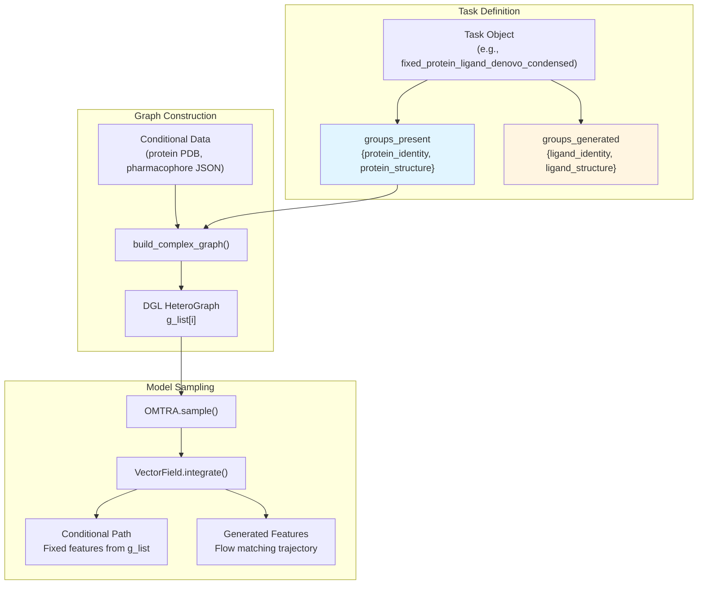
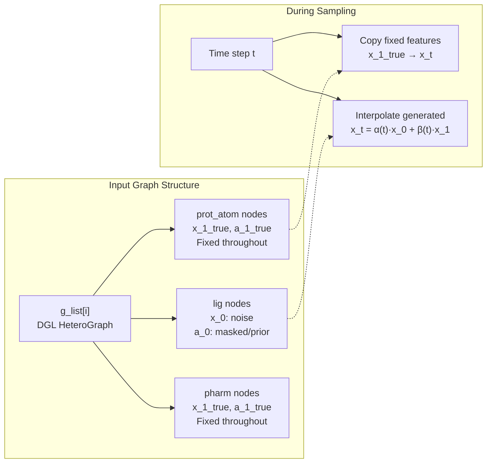
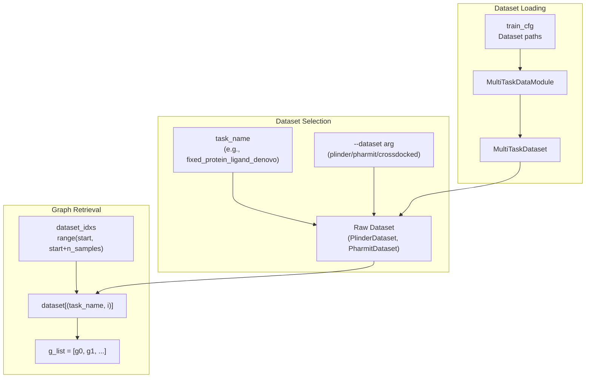
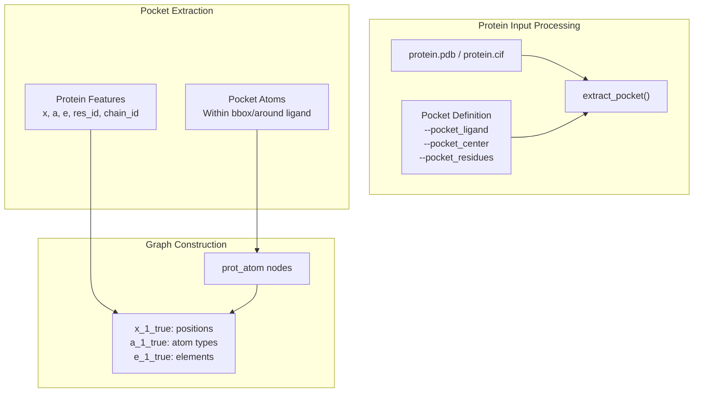
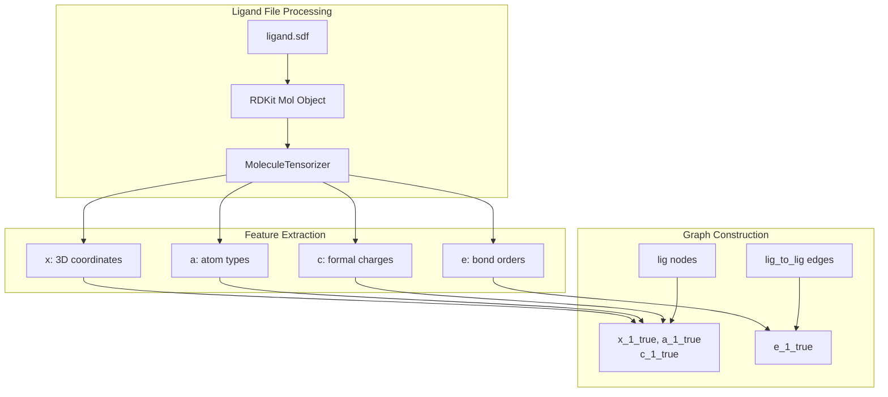
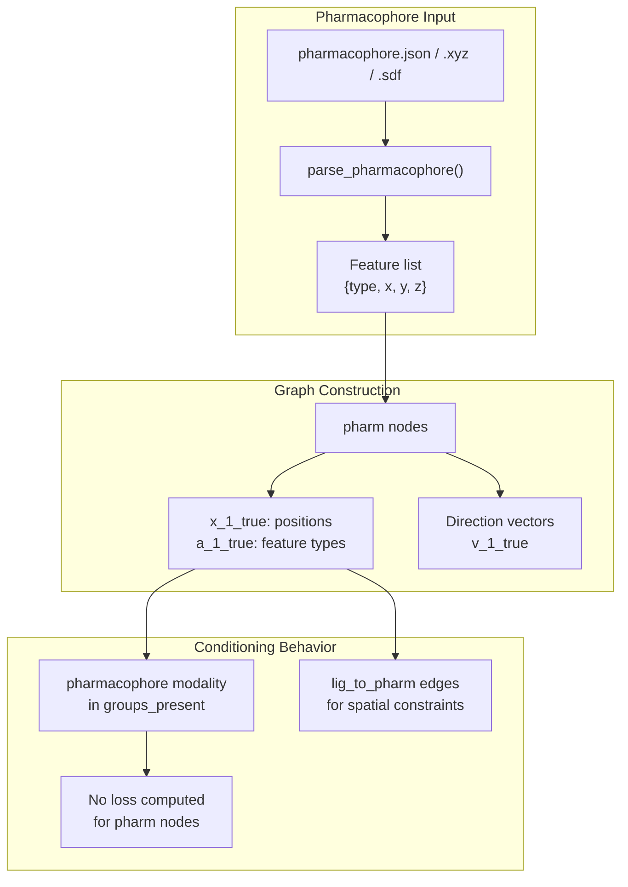
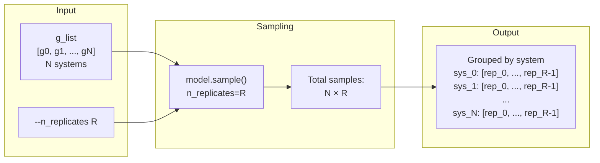

# Conditional Generation

<details>
<summary>Relevant source files</summary>

The following files were used as context for generating this wiki page:

- [configs/eval/default.yaml](configs/eval/default.yaml)
- [omtra/data/graph/utils.py](omtra/data/graph/utils.py)
- [omtra/eval/evals.py](omtra/eval/evals.py)
- [omtra/eval/system.py](omtra/eval/system.py)
- [omtra/eval/utils.py](omtra/eval/utils.py)
- [readme.md](readme.md)
- [routines/sample.py](routines/sample.py)

</details>


## Purpose and Scope

Conditional generation in OMTRA refers to the process of generating molecular structures (ligands, proteins, or pharmacophores) while constraining parts of the system to known or desired values. This page explains how OMTRA conditions generation on proteins, ligands, and/or pharmacophores, and how conditional information is provided to the model.

For information about the overall sampling workflow, see [Sampling Pipeline](#8.1). For details on prior distributions used in generation, see [Prior Distributions](#8.2). For output format specifications, see [SampledSystem and Output Formats](#8.4).

## Overview of Conditional Generation

OMTRA supports multiple forms of conditional generation through its task system. Each task defines which modalities are fixed (conditioning) versus which are generated:

| Task Type | Fixed Modalities | Generated Modalities | Use Case |
|-----------|-----------------|---------------------|----------|
| `denovo_ligand_condensed` | None | ligand_identity, ligand_structure | Unconditional molecule generation |
| `fixed_protein_ligand_denovo_condensed` | protein_identity, protein_structure | ligand_identity, ligand_structure | Structure-based drug design |
| `rigid_docking_condensed` | protein_identity, protein_structure, ligand_identity | ligand_structure | Molecular docking |
| `ligand_conformer_condensed` | ligand_identity | ligand_structure | Conformer generation |
| `denovo_ligand_from_pharmacophore_condensed` | pharmacophore | ligand_identity, ligand_structure | Pharmacophore-guided design |
| `fixed_protein_pharmacophore_ligand_denovo_condensed` | protein_identity, protein_structure, pharmacophore | ligand_identity, ligand_structure | Protein + pharmacophore design |

Sources: [readme.md:215-256](), [omtra/tasks/tasks.py]()

## Conditioning Mechanisms

### Task-Based Conditional Control



The task's `groups_present` and `groups_generated` attributes determine which modalities are used for conditioning versus generation. Fixed modalities retain their `_1_true` features throughout sampling, while generated modalities follow flow matching trajectories.

Sources: [omtra/tasks/tasks.py](), [omtra/models/omtra.py]()

### Graph-Based Conditioning via g_list

Conditional information is passed to the model through `g_list`, a list of DGL heterogeneous graphs where each graph contains both fixed and to-be-generated features:



Sources: [routines/sample.py:344-345](), [omtra/models/omtra.py]()

## Input Sources

### Dataset-Based Conditioning

When sampling from datasets, OMTRA loads pre-processed graphs from Plinder, Pharmit, or CrossDocked datasets:



Sources: [routines/sample.py:298-345]()

**Implementation details:**

[routines/sample.py:312-334]()
```python
# Load dataset based on --dataset argument
if args.dataset == 'plinder':
    plinder_link_version = task.plinder_link_version
    dataset = multitask_dataset.datasets['plinder'][plinder_link_version]
elif args.dataset == 'pharmit':
    dataset = multitask_dataset.datasets['pharmit']
elif args.dataset == 'crossdocked':
    dataset = multitask_dataset.datasets['crossdocked']

# Get system indices
if args.sys_idx_file is None:
    dataset_idxs = range(args.dataset_start_idx, 
                        args.dataset_start_idx + args.n_samples)
else:
    # Load pre-selected indices from file
    with open(args.sys_idx_file, "r") as f:
        line = f.readline().strip()
        dataset_idxs = [int(i) for i in line.split(",")]
        dataset_idxs = dataset_idxs[:args.n_samples]

# Retrieve graphs
g_list = [dataset[(task_name, i)].to(device) for i in dataset_idxs]
```

### File-Based Conditioning

OMTRA also supports conditioning on structures provided directly as files via command-line arguments:

| Argument | File Format | Purpose |
|----------|-------------|---------|
| `--protein_file` | PDB, CIF | Protein structure for conditioning |
| `--ligand_file` | SDF | Ligand structure/identity for conditioning |
| `--pharmacophore_file` | JSON, XYZ, SDF | Pharmacophore constraints |

Sources: [readme.md:182-193]()

When files are provided, the CLI wrapper constructs graphs from these inputs and sets `args.g_list_from_files`:

[routines/sample.py:293-296]()
```python
# Check if g_list was provided from input files from cli
if hasattr(args, 'g_list_from_files') and args.g_list_from_files is not None:
    g_list = args.g_list_from_files
    n_replicates = args.n_replicates
```

Sources: [routines/sample.py:288-296](), [omtra/cli/omtra_cli.py]()

## Conditional Input Types

### Protein Conditioning

Protein structures are provided as PDB or CIF files and define the binding pocket:



Sources: [readme.md:189-193](), [omtra/data/graph/]()

**Pocket Definition Methods:**

1. **Reference Ligand** (`--pocket_ligand reference.sdf`): Extract pocket atoms within a bounding box around the reference ligand
2. **Center Coordinates** (`--pocket_center 10.5,20.3,15.2 --bbox_length 23.0`): Define pocket center and box size
3. **Residue Selection** (`--pocket_residues A:123-130,B:50-55`): Specify binding site residues explicitly

Sources: [readme.md:268-295]()

### Ligand Conditioning

Ligand structures are provided as SDF files. Depending on the task, ligand identity and/or structure can be fixed:

| Task Type | ligand_identity | ligand_structure | Use Case |
|-----------|----------------|------------------|----------|
| `rigid_docking_condensed` | Fixed | Generated | Dock known ligand |
| `ligand_conformer_condensed` | Fixed | Generated | Generate conformers |
| `fixed_protein_ligand_denovo_condensed` | Generated | Generated | Design new ligand |



Sources: [omtra/data/xace_ligand.py](), [omtra/data/graph/]()

### Pharmacophore Conditioning

Pharmacophores define spatial chemical features that generated ligands should satisfy. Three file formats are supported:

**1. JSON Format (Pharmit-compatible):**

```json
{
  "points": [
    {
      "name": "Aromatic",
      "x": 10.5, "y": 20.3, "z": 15.2,
      "enabled": true
    },
    {
      "name": "HydrogenAcceptor",
      "x": 8.2, "y": 18.7, "z": 14.1,
      "enabled": true
    }
  ]
}
```

**2. XYZ Format:**

```
7
Pharmacophore features
P 12.456 8.234 15.789
S 10.123 11.456 14.234
F 14.567 9.890 13.456
```

**3. SDF Format:** Automatically extract pharmacophores from ligand structure

Sources: [readme.md:334-509]()

**Supported Feature Types:**

| Feature Name | Description | Element Mapping (XYZ) |
|--------------|-------------|----------------------|
| `Aromatic` | Aromatic ring center | P |
| `HydrogenDonor` | H-bond donor | S |
| `HydrogenAcceptor` | H-bond acceptor | F |
| `PositiveIon` | Positively charged | N |
| `NegativeIon` | Negatively charged | O |
| `Hydrophobic` | Hydrophobic region | C |
| `Halogen` | Halogen bond donor | Cl |

Sources: [readme.md:386-409](), [omtra/data/pharmacophores.py]()



Sources: [omtra/data/pharmacophores.py](), [omtra/data/graph/]()

## Center of Mass Handling

For protein-conditioned tasks, OMTRA can set a center of mass (`coms`) to ensure generated ligands are positioned correctly in the binding pocket:

[routines/sample.py:347-354]()
```python
# set coms if protein is present, prefer ligand com
coms = None
if g_list is not None and 'protein_identity' in task.groups_present:
    if g_list[0].num_nodes('lig') > 0 and 'x_1_true' in g_list[0].nodes['lig'].data:
        coms = [g.nodes['lig'].data['x_1_true'].mean(dim=0) for g in g_list]
    # fallback protein atom com if present
    elif g_list[0].num_nodes('prot_atom') > 0 and 'x_1_true' in g_list[0].nodes['prot_atom'].data:
        coms = [g.nodes['prot_atom'].data['x_1_true'].mean(dim=0) for g in g_list]
```

This ensures ligand positions are initialized around the binding pocket rather than at the origin.

Sources: [routines/sample.py:347-354]()

## Replicates and Batch Generation

For conditional generation, `--n_replicates` controls how many samples to generate per input system:



[routines/sample.py:356-371]()
```python
sampled_systems = model.sample(
    g_list=g_list,
    n_replicates=n_replicates,  # Number of samples per input system
    task_name=task_name,
    unconditional_n_atoms_dist=args.dataset,
    device=device,
    n_timesteps=args.n_timesteps,
    visualize=args.visualize,
    coms=coms,  # Center of mass for positioning
    stochastic_sampling=args.stochastic_sampling,
    noise_scaler=args.noise_scaler,
    eps=args.eps,
    n_lig_atom_margin=args.n_lig_atom_margin if args.use_gt_n_lig_atoms else None,
    n_lig_atoms_mean=getattr(args, 'n_lig_atoms_mean', None),
    n_lig_atoms_std=getattr(args, 'n_lig_atoms_std', None)
)
```

Sources: [routines/sample.py:356-371]()

## Evaluation with Ground Truth

For conditional tasks, OMTRA can write ground truth structures alongside generated samples for comparison:

[routines/sample.py:230-272]()
```python
def write_ground_truth(
        n_systems: int,
        n_replicates: int,
        task: Task,
        output_dir: Path, 
        sampled_systems,
        g_list,
        prot_cif: bool = True
    ):
    for cond_idx in range(n_systems):
        # get an example system containing the ground truth information
        sys_idx = cond_idx*n_replicates
        sys = sampled_systems[sys_idx]

        # directory for writing ground truth
        sys_gt_dir = output_dir / f"sys_{cond_idx}_gt"
        sys_gt_dir.mkdir(parents=True, exist_ok=True)

        # write the ground truth ligand
        gt_lig_file = sys_gt_dir / "ligand.sdf"
        sys.write_ligand(gt_lig_file, ground_truth=True, g=g_list[cond_idx].to('cpu'))

        # write the ground truth protein if present
        if 'protein_identity' in task.groups_present:
            if prot_cif:
                gt_prot_file = sys_gt_dir / "protein.cif"
                sys.write_protein(gt_prot_file, ground_truth=True)
            else:
                sys.write_protein_pdb(sys_gt_dir, filename='protein', ground_truth=True)

        # write the ground truth pharmacophore
        if 'pharmacophore' in task.groups_present:
            gt_pharm_file = sys_gt_dir / "pharmacophore.xyz"
            sys.write_pharmacophore(gt_pharm_file, ground_truth=True, g=g_list[cond_idx].to('cpu'))
```

This creates a directory structure like:
```
output_dir/
  sys_0_gt/
    ligand.sdf          # Ground truth ligand
    protein.cif         # Conditional protein
    pharmacophore.xyz   # Conditional pharmacophore
    gen_ligands.sdf     # Generated ligands (all replicates)
  sys_1_gt/
    ...
```

Sources: [routines/sample.py:230-272](), [routines/sample.py:395-438]()

## Conditional Evaluation Metrics

Different metrics are computed depending on which modalities are conditioned vs generated:

| Task Type | Relevant Metrics |
|-----------|-----------------|
| Protein-conditioned design | `intermolecular_distance`, `volume_overlap`, `pb_valid_pocket` |
| Docking tasks | `ligand_rmsd`, `ligand_kabsch_rmsd`, `volume_overlap` |
| Pharmacophore-conditioned | `pharm_match` (feature matching threshold) |
| Conformer generation | `ligand_rmsd`, `pb_valid_conformer` |

Sources: [configs/eval/default.yaml:1-684](), [omtra/eval/evals.py]()

**Example: Pharmacophore Match Evaluation**

[omtra/eval/evals.py:325-329]()
```python
@register_eval("pharm_match")
def check_pharm_match(
    sampled_systems: List[SampledSystem], params: Dict[str, Any]
) -> Dict[str, Any]:
    return compute_pharmacophore_match(sampled_systems, **params)
```

This metric computes how well generated ligands satisfy the pharmacophore constraints.

Sources: [omtra/eval/evals.py:325-329](), [omtra/eval/pharmacophore.py]()

---