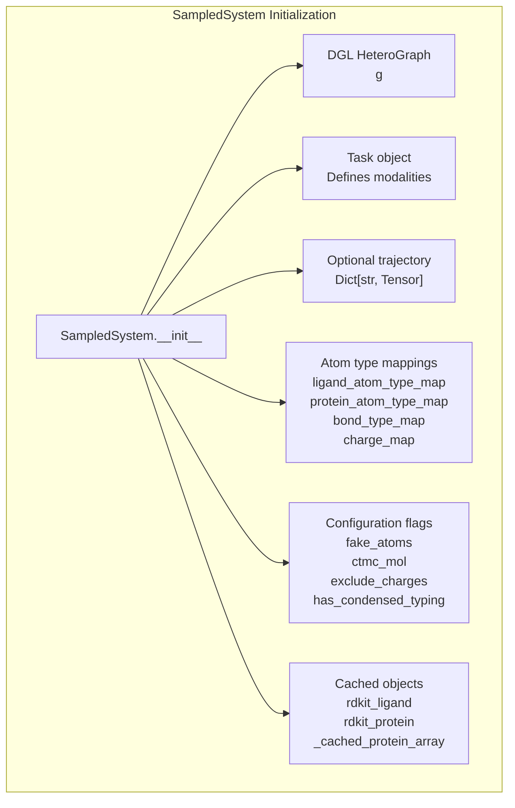
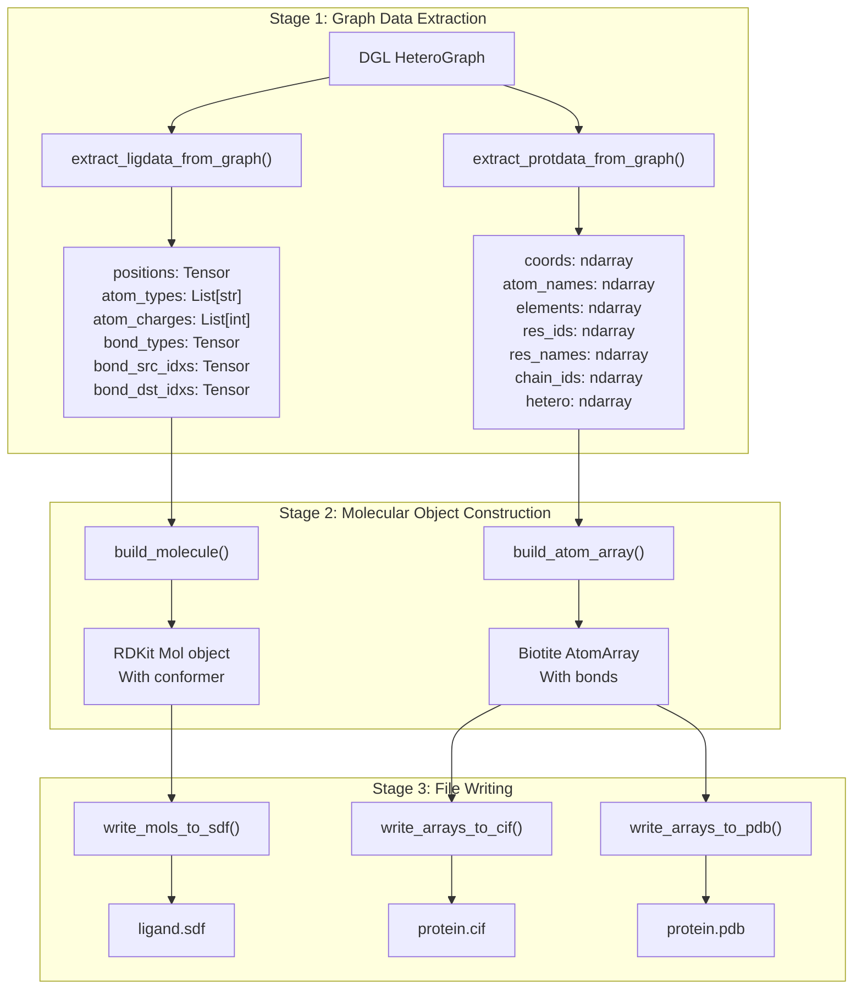
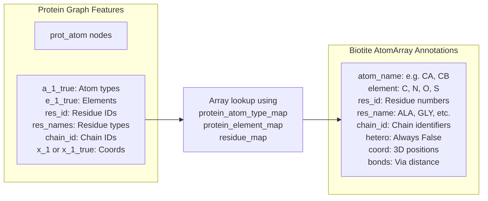
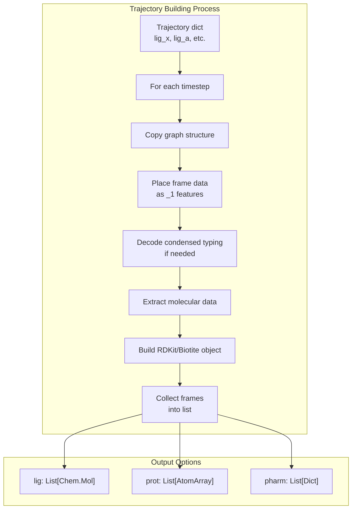
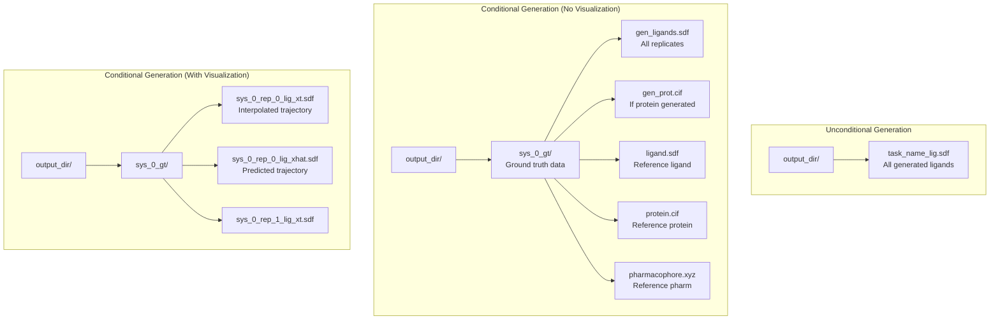
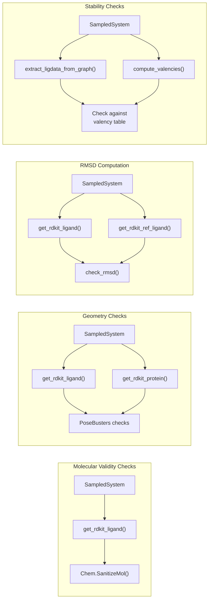

# SampledSystem and Output Formats

<details>
<summary>Relevant source files</summary>

The following files were used as context for generating this wiki page:

- [configs/eval/default.yaml](configs/eval/default.yaml)
- [omtra/data/graph/utils.py](omtra/data/graph/utils.py)
- [omtra/eval/evals.py](omtra/eval/evals.py)
- [omtra/eval/system.py](omtra/eval/system.py)
- [omtra/eval/utils.py](omtra/eval/utils.py)
- [routines/sample.py](routines/sample.py)

</details>


This page documents the `SampledSystem` class, which converts generated molecular graphs into standard molecular file formats, and the output formats used by OMTRA. The `SampledSystem` class serves as the bridge between OMTRA's internal graph representation and external molecular formats like SDF, CIF, PDB, and XYZ files.

For information about the sampling pipeline that creates `SampledSystem` objects, see [Sampling Pipeline](#8.1). For evaluation metrics computed on `SampledSystem` objects, see [Built-in Metrics](#9.1).

## Overview

The `SampledSystem` class is defined in [omtra/eval/system.py]() and provides functionality to:

- Convert DGL heterogeneous graphs to RDKit molecules and Biotite atom arrays
- Extract ligand, protein, and pharmacophore data from graphs
- Write molecules to standard file formats (SDF, CIF, PDB, XYZ)
- Support trajectory visualization across timesteps
- Compute molecular properties for validation

**Key Design Principle**: `SampledSystem` maintains a reference to the graph and lazily converts to molecular objects only when requested, caching the results for efficiency.

Sources: [omtra/eval/system.py:38-95]()

## SampledSystem Class Structure

### Class Definition and Initialization



Sources: [omtra/eval/system.py:38-95]()

### Core Attributes

| Attribute | Type | Purpose |
|-----------|------|---------|
| `g` | `dgl.DGLHeteroGraph` | The molecular graph with node/edge features |
| `task` | `Task` | Task definition specifying modalities |
| `traj` | `Dict[str, torch.Tensor]` | Optional trajectory data for visualization |
| `fake_atoms` | `bool` | Whether molecule contains placeholder atoms |
| `ctmc_mol` | `bool` | Whether using CTMC masked representation |
| `has_condensed_typing` | `bool` | Whether using condensed atom typing |
| `rdkit_ligand` | `Chem.Mol` | Cached RDKit molecule for ligand |
| `rdkit_protein` | `Chem.Mol` | Cached RDKit molecule for protein |
| `_cached_protein_array` | `AtomArray` | Cached Biotite array for protein |

Sources: [omtra/eval/system.py:43-94]()

## Graph to Molecular Object Conversion Pipeline

The conversion from DGL graphs to molecular objects follows a multi-stage pipeline:



Sources: [omtra/eval/system.py:491-644]()

### Ligand Extraction and Conversion

The ligand extraction process handles multiple atom representations:

**Graph Feature Mapping**:
- `a_1`: Atom type indices → Element symbols (C, N, O, etc.)
- `c_1`: Charge indices → Formal charges (-1, 0, +1, etc.)
- `e_1`: Bond type indices → Bond orders (single, double, triple, aromatic)
- `x_1`: 3D coordinates → Conformer positions

**Special Cases Handled**:
- **Fake atoms**: Represented as "Sn" (tin), filtered out unless `show_fake_atoms=True`
- **Masked atoms**: CTMC masked atoms shown as "Se" (selenium)
- **Masked bonds**: Bond type = 0 (unbonded)
- **Condensed atom typing**: Decoded to explicit atom/charge/etc features

Sources: [omtra/eval/system.py:491-575]()

### Protein Extraction and Conversion

Protein data extraction retrieves structural and chemical annotations:



**Note**: Protein features use `_1_true` suffix for atom types and elements (fixed ground truth), but `_1` or `_1_true` for coordinates depending on whether reference structure is requested.

Sources: [omtra/eval/system.py:577-603]()

## Output File Formats

OMTRA supports multiple standard molecular file formats for different molecular types:

### File Format Summary

| Molecular Type | Primary Format | Alternative Format | Use Case |
|----------------|----------------|-------------------|----------|
| Ligand | SDF | - | Small molecules, conformers |
| Protein | CIF | PDB | Protein structures, trajectories |
| Pharmacophore | XYZ | - | Pharmacophore features |
| Non-protein non-drug entities (NPNDE) | CIF | - | Ions, cofactors, etc. |
| Complete system | CIF | - | Protein + ligand + NPNDE |

### SDF Format for Ligands

The `write_mols_to_sdf()` function writes RDKit molecules to SDF files:

**Features**:
- Kekulization disabled to preserve aromatic representation
- Each molecule assigned a unique ID (e.g., `OMTRA0001`, `OMTRA0002`)
- Supports writing multiple conformers or molecules to a single file
- Invalid molecules (None) are skipped

**File Structure**:
```
OMTRA0001
  ... (structure data)
  ... (properties)
$$$$
OMTRA0002
  ... (structure data)
  ... (properties)
$$$$
```

Sources: [omtra/eval/system.py:841-854](), [routines/sample.py:383-426]()

### CIF Format for Proteins and Systems

The `write_arrays_to_cif()` function writes Biotite atom arrays to mmCIF files:

**Features**:
- Supports multiple models (frames) in a single file
- Preserves bond information
- Standard PDBx/mmCIF format compatible with visualization tools
- Used for both individual proteins and complete systems

**Usage**:
- Single protein: `sys.write_protein(output_file)`
- Protein trajectory: `sys.write_protein(output_file, trajectory=True)`
- Complete system: Stack ligand, protein, NPNDE arrays

Sources: [omtra/eval/system.py:820-824](), [omtra/eval/system.py:753-768]()

### PDB Format for Proteins

The `write_arrays_to_pdb()` function writes individual PDB files:

**Features**:
- One file per frame (for trajectories)
- Legacy format, but widely supported
- Used when explicit per-frame files are needed

**Naming Convention**: `{filename}_{frame_idx}.pdb`

Sources: [omtra/eval/system.py:826-831](), [omtra/eval/system.py:771-780]()

### XYZ Format for Pharmacophores

Pharmacophores are written using a custom XYZ-like format:

**Format**:
```
{n_features}

{element} {x} {y} {z}
{element} {x} {y} {z}
...
```

**Element Mapping**: Pharmacophore types are mapped to pseudo-elements for visualization:
- Hydrophobic → `C`
- Aromatic → `DU` (dummy atom)
- HBond Acceptor → `O`
- HBond Donor → `N`
- Positive Ionizable → `P`
- Negative Ionizable → `S`

Sources: [omtra/eval/system.py:833-838](), [omtra/eval/system.py:783-803]()

## Trajectory Visualization Support

`SampledSystem` supports visualizing the generation process across timesteps:

### Trajectory Data Structure

When `visualize=True` during sampling, the model stores intermediate states:

```python
traj = {
    'lig_x': Tensor[n_timesteps, n_atoms, 3],        # Ligand positions
    'lig_a': Tensor[n_timesteps, n_atoms],           # Ligand atom types
    'lig_c': Tensor[n_timesteps, n_atoms],           # Ligand charges
    'lig_to_lig_e': Tensor[n_timesteps, n_edges],   # Bond types
    'lig_x_pred': Tensor[n_timesteps, n_atoms, 3],   # Predicted endpoints
    # ... similar for prot, pharm if generated
}
```

Sources: [omtra/eval/system.py:646-707]()

### Building Trajectory Frames

The `build_traj()` method converts trajectory data to molecular objects:



**Endpoint vs. Trajectory**:
- `ep_traj=False`: Use `lig_x`, `lig_a`, etc. (actual interpolated values)
- `ep_traj=True`: Use `lig_x_pred`, `lig_a_pred`, etc. (predicted destinations)

Sources: [omtra/eval/system.py:646-707]()

### Writing Trajectories

Trajectory writing methods accept `trajectory` and `endpoint` flags:

**Example Usage**:
```python
# Write interpolated trajectory
sys.write_ligand("lig_xt.sdf", trajectory=True, endpoint=False)

# Write predicted endpoints trajectory
sys.write_ligand("lig_xhat.sdf", trajectory=True, endpoint=True)

# Write final frame only
sys.write_ligand("lig_final.sdf", trajectory=False)
```

Sources: [omtra/eval/system.py:735-751](), [routines/sample.py:465-481]()

## Usage in Sampling Pipeline

The sampling pipeline in [routines/sample.py]() uses `SampledSystem` to organize and write outputs:

### Output Directory Structure



Sources: [routines/sample.py:230-481]()

### Writing Ground Truth

The `write_ground_truth()` function extracts reference structures from the input graphs:

**Process**:
1. For each system, select a representative `SampledSystem` (first replicate)
2. Create `sys_{idx}_gt/` directory
3. Write ground truth ligand using `write_ligand(ground_truth=True)`
4. Write ground truth protein if present in task
5. Write ground truth pharmacophore if present in task

**Key Method**: `write_ligand(ground_truth=True)` uses `get_gt_ligand()` which:
- Clones the graph
- Decodes condensed typing if needed
- Moves `_1_true` features to `_1` position
- Builds RDKit molecule from ground truth data

Sources: [routines/sample.py:230-272](), [omtra/eval/system.py:408-421]()

### Grouping Replicates

For conditional generation, samples are organized by system and replicate:

**Naming Convention**: `sys_{system_idx}_rep_{replicate_idx}`

**Grouping Process**:
1. Generate names for all samples
2. Parse names to extract system and replicate indices
3. Group samples into lists by system
4. Write all replicates for a system to the same directory

Sources: [routines/sample.py:160-228](), [routines/sample.py:406-438]()

## Integration with Evaluation

`SampledSystem` objects are passed directly to evaluation functions:

### Evaluation Function Signature

All evaluation functions in [omtra/eval/evals.py]() follow this pattern:

```python
def eval_function(
    sampled_systems: List[SampledSystem], 
    params: Dict[str, Any]
) -> Dict[str, Any]:
    # Compute metrics using SampledSystem methods
    for sys in sampled_systems:
        mol = sys.get_rdkit_ligand()
        # ... compute metrics on mol
    return metrics
```

Sources: [omtra/eval/evals.py:37-329]()

### Common Evaluation Patterns



Sources: [omtra/eval/evals.py:37-329](), [omtra/eval/utils.py:25-192]()

### Evaluation Metrics Configuration

Metrics are configured per-task in [configs/eval/default.yaml]():

**Example Configuration**:
```yaml
rigid_docking:
  - stability:
      train: true
      params: {}
  - ligand_rmsd:
      train: true
      params:
        rmsd_threshold: 2.0
  - volume_overlap:
      train: true
      params:
        clash_cutoff: 0.05
```

The sampling script can compute these metrics by passing `--metrics`:

```bash
omtra sample checkpoint.ckpt --task rigid_docking --metrics
```

Sources: [configs/eval/default.yaml:157-179](), [routines/sample.py:483-498]()

## Key Helper Methods

### Valency Computation

The `compute_valencies()` method calculates total bond orders for each atom:

**Process**:
1. Extract bond types and indices from graph
2. Build adjacency matrix with bond orders (aromatic = 1.5)
3. Sum bond orders per atom

**Usage**: Used by stability checks to validate atom valencies against chemically valid values.

Sources: [omtra/eval/system.py:805-818]()

### Condensed Atom Type Decoding

The `decode_conda()` method converts condensed atom representations to explicit features:

**Purpose**: The condensed typing system encodes [atom_type, charge, num_hs] as a single token. This method decodes it back to individual features.

**Process**:
1. Find all features with `cond_a` in name
2. Use `CondensedAtomTyper.cond_a_to_feats()` to decode
3. Add decoded features to graph with appropriate suffix
4. Return modified graph

Sources: [omtra/eval/system.py:96-117]()

### Feature Suffix Handling

Methods accept `reference` or `ground_truth` flags to select feature suffixes:

| Flag | Position Suffix | Type Suffix | Use Case |
|------|----------------|-------------|----------|
| `reference=False` | `_1` | `_1` | Generated molecule |
| `reference=True` | `_1_true` | `_1_true` | Ground truth for comparison |
| `ground_truth=True` | `_1_true` | `_1_true` | Writing reference structures |

Sources: [omtra/eval/system.py:138-293](), [omtra/eval/system.py:577-603]()

## Summary

The `SampledSystem` class provides a unified interface for:

1. **Conversion**: DGL graphs → RDKit/Biotite objects
2. **Extraction**: Separating ligand, protein, pharmacophore data
3. **Writing**: Standard file formats (SDF, CIF, PDB, XYZ)
4. **Visualization**: Trajectory support across timesteps
5. **Evaluation**: Direct integration with metric computation

This design allows the sampling and evaluation pipelines to work with a consistent representation while supporting diverse output formats and downstream analysis tools.

Sources: [omtra/eval/system.py:1-875](), [routines/sample.py:1-503]()

---