# Evaluation

<details>
<summary>Relevant source files</summary>

The following files were used as context for generating this wiki page:

- [configs/eval/default.yaml](configs/eval/default.yaml)
- [notebooks/docking_evaluation.ipynb](notebooks/docking_evaluation.ipynb)
- [omtra/data/graph/utils.py](omtra/data/graph/utils.py)
- [omtra/eval/evals.py](omtra/eval/evals.py)
- [omtra/eval/system.py](omtra/eval/system.py)
- [omtra/eval/utils.py](omtra/eval/utils.py)
- [omtra_pipelines/docking_eval/docking_eval.py](omtra_pipelines/docking_eval/docking_eval.py)
- [omtra_pipelines/docking_eval/gen_eval_cmds.py](omtra_pipelines/docking_eval/gen_eval_cmds.py)
- [omtra_pipelines/docking_eval/sampleblaster.py](omtra_pipelines/docking_eval/sampleblaster.py)
- [routines/sample.py](routines/sample.py)

</details>


This page describes how OMTRA evaluates generated molecules using both built-in metrics and comprehensive docking evaluation pipelines. For information on the sampling process that produces molecules to evaluate, see [Sampling and Inference](#8).

## Overview

OMTRA provides two complementary evaluation approaches:

1. **Built-in Metrics**: Fast, lightweight metrics computed during or immediately after sampling, including validity, stability, geometry, and basic structure-based metrics
2. **Docking Evaluation Pipeline**: Comprehensive evaluation using external tools (GNINA, PoseBusters, PoseCheck) for scoring generated poses in protein contexts

Both approaches operate on `SampledSystem` objects, which wrap DGL graphs containing generated molecules and provide methods to convert them to standard molecular formats.

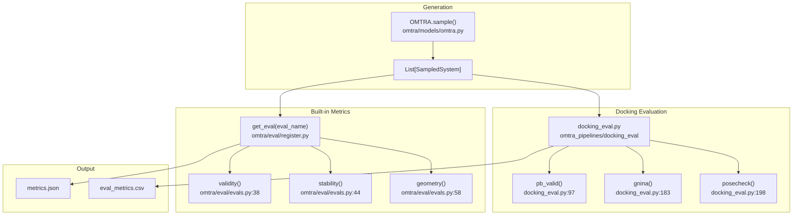

**Sources**: [omtra/eval/evals.py:1-329](), [omtra_pipelines/docking_eval/docking_eval.py:1-1400](), [routines/sample.py:483-498]()

## Built-in Metrics System

### Metric Registration and Execution

Built-in metrics are registered using the `@register_eval` decorator and configured in [configs/eval/default.yaml](). During sampling, metrics can be computed by passing `--metrics` flag to [routines/sample.py]().

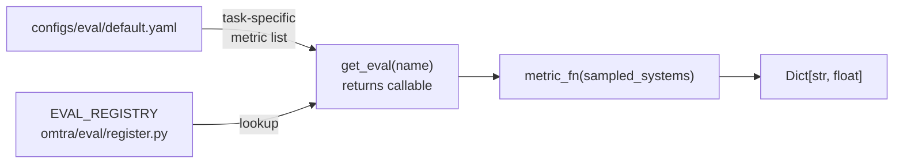

**Sources**: [omtra/eval/register.py:1-20](), [configs/eval/default.yaml:1-684](), [routines/sample.py:483-498]()

### Core Metric Categories

| Metric Category | Function | Purpose | Output Keys |
|----------------|----------|---------|-------------|
| **Validity** | `validity()` | RDKit sanitization success | `frac_valid_mols`, `frac_connected`, `avg_num_components` |
| **Stability** | `stability()` | Atom valency validation | `frac_atoms_stable`, `frac_mols_stable_valence` |
| **REOS/Rings** | `reos_and_rings()` | Drug-like filters, ring system checks | `flag_rate`, `ood_rate` |
| **Geometry** | `geometry()` | Bond/angle validity, clashes | `geometry_frac_valid_bonds`, `geometry_number_clashes` |
| **Flatness** | `flatness()` | Ring planarity | `flatness_max_distance_from_plane` |
| **RMSD** | `ligand_rmsd()` | Coordinate deviation from reference | `ligand_rmsd`, `ligand_kabsch_rmsd` |
| **Pharmacophore** | `pharm_match()` | Pharmacophore feature matching | `perfect_pharm_match`, `frac_true_pharms_matched` |

**Sources**: [omtra/eval/evals.py:37-329]()

### Validity Metric

The validity metric checks whether generated molecules can be successfully sanitized by RDKit and counts connected components.

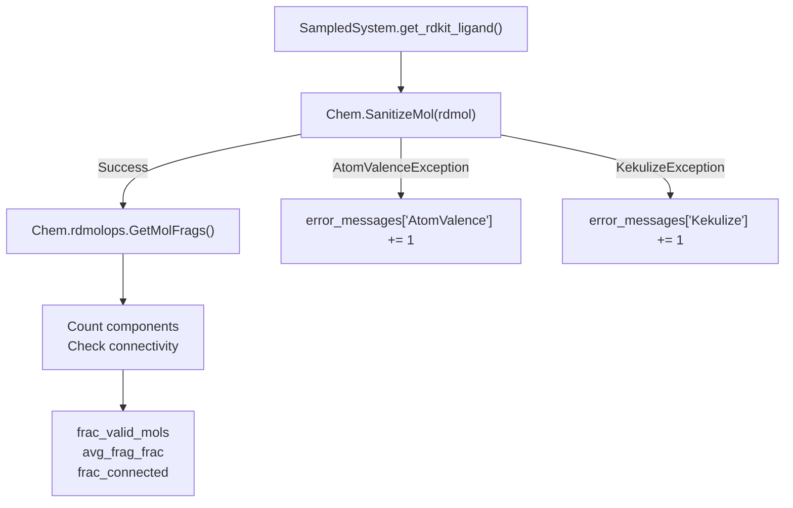

**Implementation**:
- Iterates through `List[SampledSystem]`
- Converts each to RDKit molecule via `get_rdkit_ligand()`
- Attempts `Chem.SanitizeMol()` and catches exceptions
- Counts molecular fragments and tracks largest fragment fraction
- Reports aggregated statistics

**Sources**: [omtra/eval/utils.py:25-106]()

### Stability Metric

Validates atom valencies against a reference table of valid valencies per element and charge state.

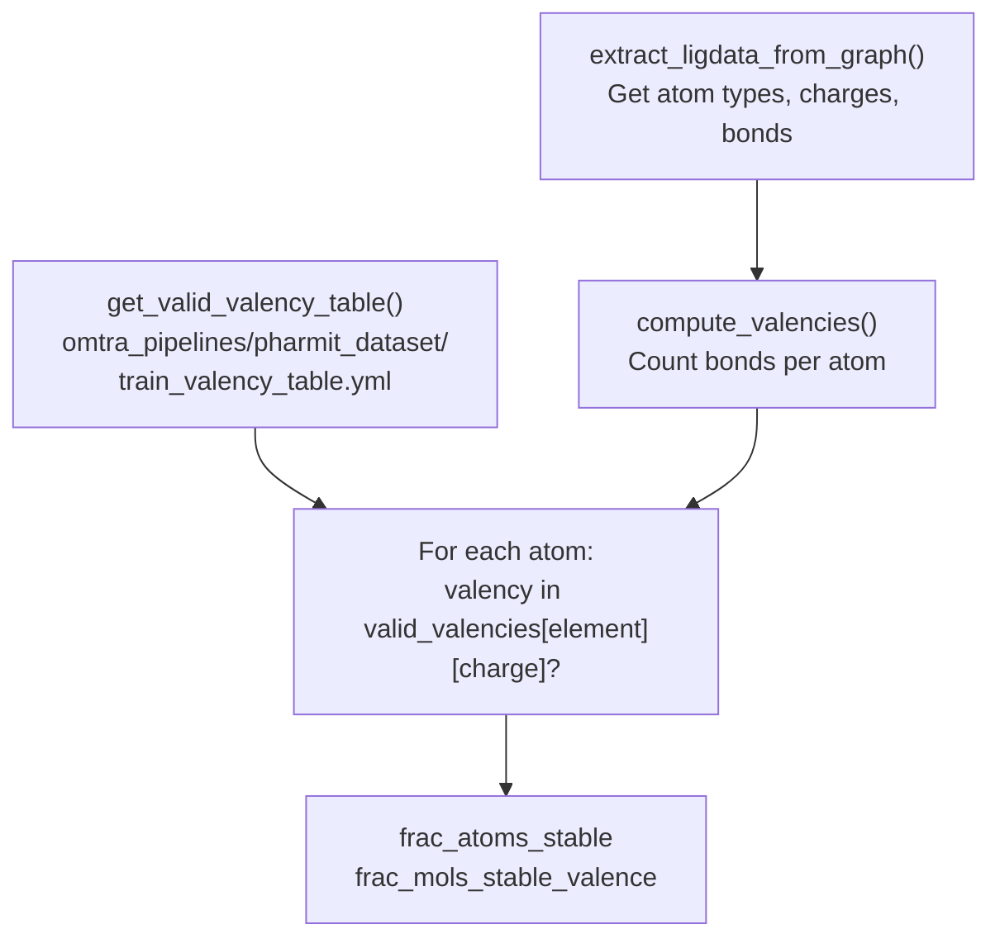

**Sources**: [omtra/eval/utils.py:109-192]()

### PoseBusters Integration

PoseBusters provides configurable validation suites for different scenarios:

| Config | Use Case | Reference Needed | Protein Needed |
|--------|----------|------------------|----------------|
| `mol` | Unconditional ligand generation | No | No |
| `dock` | De novo ligand design | No | Yes |
| `redock` | Ligand conformer generation | Yes (true ligand) | Yes |
| `complex` | Pocket validation | Yes (protein) | Yes |

```python
# Example from omtra/eval/evals.py:202-242
@register_eval("pb_valid_unconditional")
def pb_valid_unconditional(sampled_systems, params):
    pb_cfg_path = Path(omtra_root()) / 'omtra/eval/pb_config/default.yaml'
    buster = pb.PoseBusters(config=pb_cfg, **params)
    df_pb = buster.bust(valid_rdmols, None, None)
    # Returns aggregated pass/fail metrics
```

**Sources**: [omtra/eval/evals.py:202-329](), [omtra_pipelines/docking_eval/docking_eval.py:97-121]()

## Docking Evaluation Pipeline

The comprehensive evaluation pipeline in [omtra_pipelines/docking_eval/docking_eval.py]() combines sampling, external tool evaluation, and metric aggregation.

### Pipeline Architecture

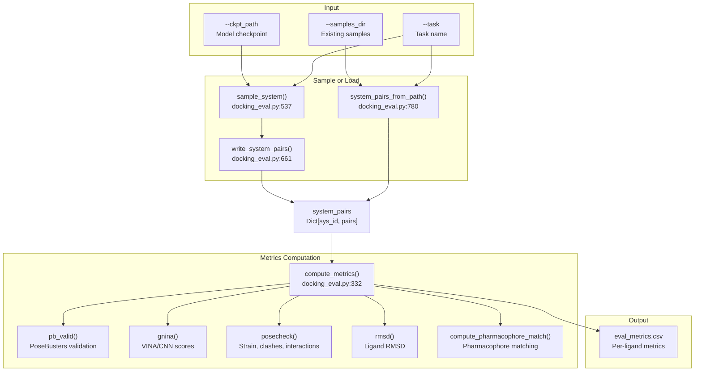

**Sources**: [omtra_pipelines/docking_eval/docking_eval.py:39-778]()

### System Pairs Structure

The pipeline organizes generated ligands and proteins into `system_pairs`, a nested dictionary structure:

```python
system_pairs = {
    'sys_0_gt': {
        'pair_0': {
            'gen_ligs': List[Chem.Mol],           # Generated ligands
            'gen_ligs_file': Path,                # SDF file path
            'gen_ligs_ids': List[str],            # Ligand identifiers
            'gen_prot_file': Path,                # Generated/reference protein PDB
            'gen_prot_id': str,                   # Protein identifier
            'true_lig': Chem.Mol,                 # Ground truth ligand
            'true_lig_file': Path,                # Ground truth SDF
            'true_prot_file': Path,               # Ground truth protein PDB
            'true_prot_id': str,                  # True protein identifier
            'true_pharm': Dict,                   # Pharmacophore data (if applicable)
        }
    }
}
```

For tasks generating protein structure, each replicate gets its own pair. For fixed protein tasks, all replicates share one pair.

**Sources**: [omtra_pipelines/docking_eval/docking_eval.py:661-777]()

### GNINA Evaluation

GNINA provides docking scores using both classical VINA scoring and CNN-based scoring functions.

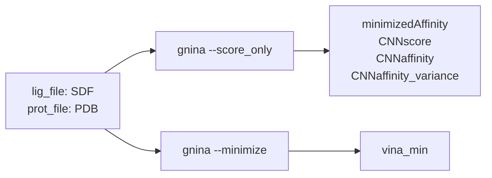

**Implementation Details**:
- Uses pre-built GNINA binary at `omtra_root()/gnina.1.3.2`
- Runs `--score_only` for fast scoring without optimization
- Runs `--minimize` for energy-minimized affinity prediction
- Parses scores from output SDF file properties
- Wrapped with timeout (default 2700s) via `run_with_timeout()`

**Sources**: [omtra_pipelines/docking_eval/docking_eval.py:124-195]()

### PoseCheck Integration

PoseCheck computes strain energy, steric clashes, and protein-ligand interactions.

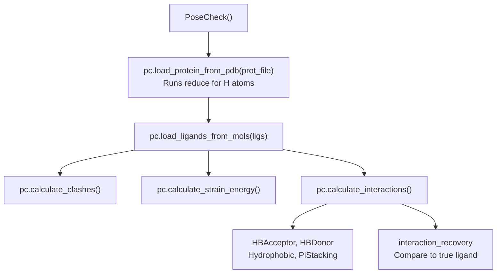

**Key Metrics**:
- `clashes`: Steric clash count
- `strain`: Strain energy (kcal/mol)
- `HBAcceptor`, `HBDonor`, `Hydrophobic`, `PiStacking`: Interaction counts normalized by ligand atom count
- `interaction_recovery`: Fraction of true interactions recovered by generated ligand

**Sources**: [omtra_pipelines/docking_eval/docking_eval.py:198-245]()

### Timeout and Error Handling

All metric functions are wrapped with `run_with_timeout()` to prevent hanging:

```python
def run_with_timeout(func, *args, timeout, **kwargs):
    """Run function in separate process with timeout."""
    q = mp.Queue()
    p = mp.Process(target=target, args=(q, *args), kwargs=kwargs)
    p.start()
    p.join(timeout)
    
    if p.is_alive():
        p.terminate()
        p.join()
        return None  # Timeout occurred
    
    return q.get()  # Return result or exception
```

If a batch fails, the pipeline attempts to evaluate ligands individually to maximize coverage.

**Sources**: [omtra_pipelines/docking_eval/docking_eval.py:295-318](), [omtra_pipelines/docking_eval/docking_eval.py:395-419]()

### Pharmacophore Matching

Evaluates whether generated ligands reproduce pharmacophore features from reference ligands.

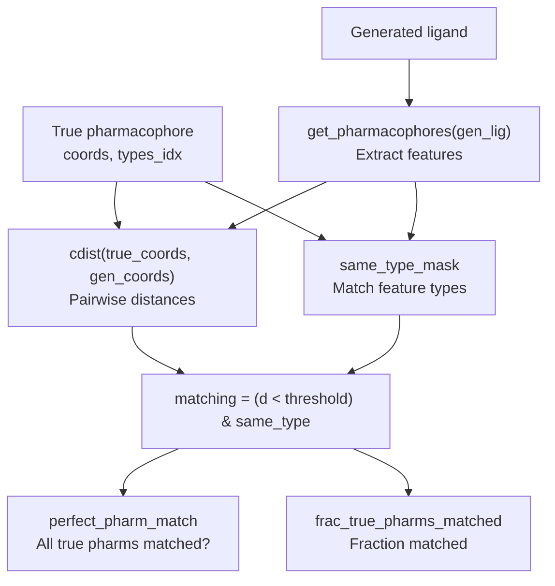

**Parameters**:
- `threshold`: Distance threshold in Angstroms (default 1.0)

**Sources**: [omtra_pipelines/docking_eval/docking_eval.py:255-292]()

## SampledSystem Class

The `SampledSystem` class is the core data structure for evaluation, wrapping DGL graphs and providing conversion methods.

### Class Overview

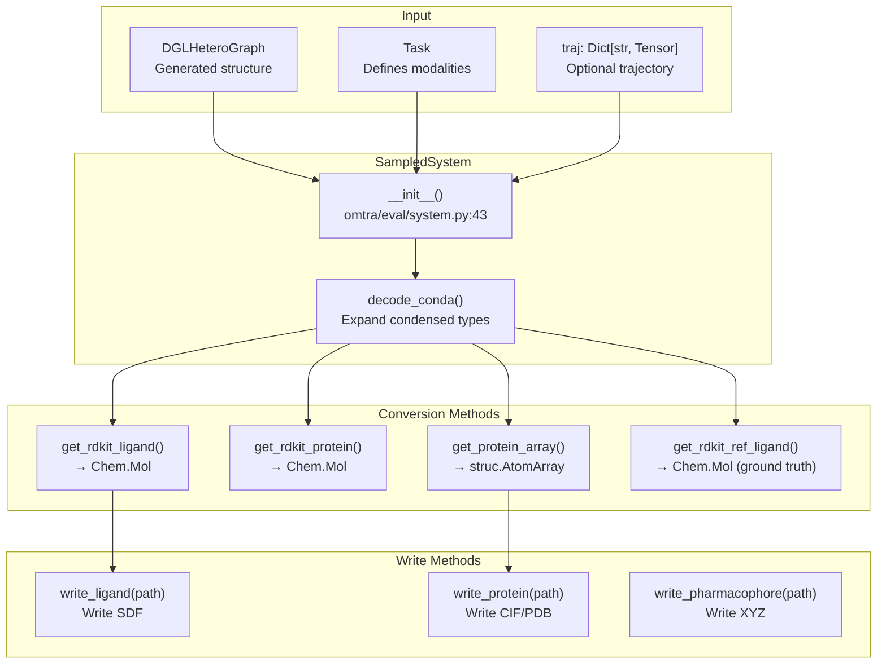

**Sources**: [omtra/eval/system.py:38-95]()

### RDKit Molecule Construction

The conversion from DGL graph to RDKit molecule follows this pipeline:

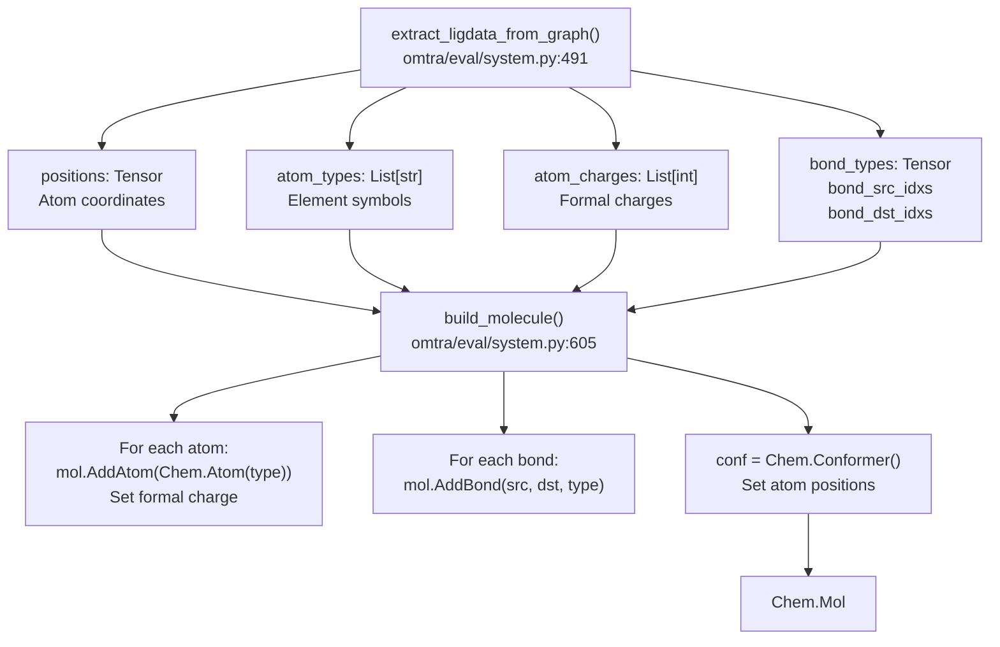

**Key Steps**:
1. Extract features from graph with suffix `_1` (generated) or `_1_true` (reference)
2. Handle fake atoms (type `Sn`) and masked atoms (type `Se`) if present
3. Filter to upper triangle of adjacency matrix to avoid duplicate bonds
4. Convert atom/bond type indices to RDKit types using constant maps
5. Create RDKit molecule, add atoms with charges, add bonds, set conformer

**Sources**: [omtra/eval/system.py:400-644]()

### Protein Array Construction

Biotite `AtomArray` objects are used for protein structures:

```python
def get_protein_array(self, g=None, reference=False, include_bonds=True):
    # Extract data from graph
    coords, atom_names, elements, res_ids, res_names, chain_ids, hetero = \
        self.extract_protdata_from_graph(g=g, reference=reference)
    
    # Build AtomArray
    arr = self.build_atom_array(
        coords=coords,
        atom_name=atom_names,
        element=elements,
        res_id=res_ids,
        res_name=res_names,
        chain_id=chain_ids,
        hetero=hetero,
        include_bonds=include_bonds
    )
    return arr
```

**Features**:
- Maps protein atom types using `protein_atom_type_map` and `protein_element_map`
- Maps residue types using `residue_map`
- Preserves chain IDs and residue numbering
- Bonds inferred via `struc.connect_via_distances()` if not provided
- Cached for efficiency when used repeatedly

**Sources**: [omtra/eval/system.py:373-398]()

### Trajectory Reconstruction

For visualization, trajectories can be reconstructed by placing each timestep's features on a dummy graph:

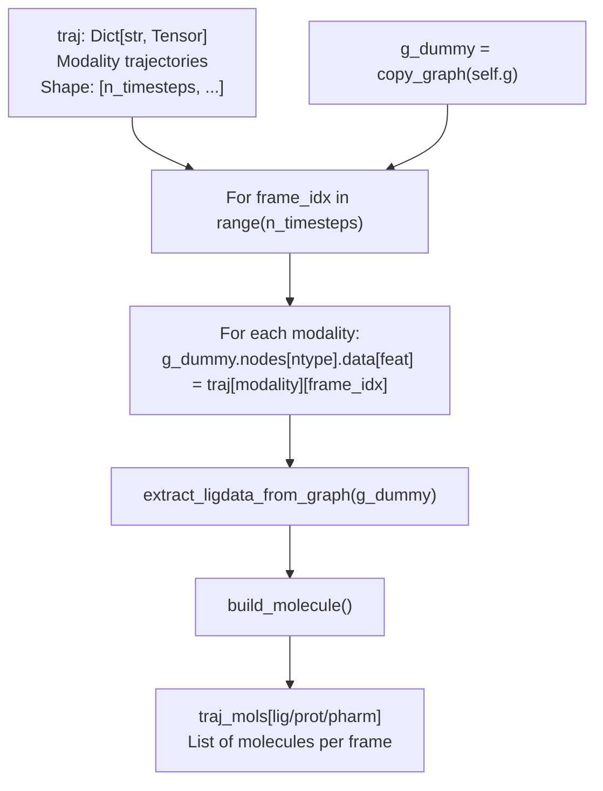

**Sources**: [omtra/eval/system.py:646-707]()

## Evaluation Configuration

### Task-Specific Metrics

[configs/eval/default.yaml]() defines which metrics run for each task:

```yaml
rigid_docking_condensed:
  - stability:
      train: true
      params: {}
  - reos_and_rings:
      train: true
      params: {}
  - flatness:
      train: true
      params:
        threshold_flatness: 0.1
  - intermolecular_distance:
      train: true
      params:
        clash_cutoff: 0.05
  - ligand_rmsd:
      train: true
      params:
        rmsd_threshold: 2.0
  - volume_overlap:
      train: true
      params:
        clash_cutoff: 0.05
  - pb_valid_unconditional:
      train: true
      params:
        max_workers: 0
```

Each metric specifies:
- `train`: Whether to compute during training (for logging to wandb)
- `params`: Parameters passed to the metric function

**Sources**: [configs/eval/default.yaml:1-684]()

### Metric Execution During Sampling

When `--metrics` flag is passed to [routines/sample.py]():

```python
if args.metrics:
    default_eval_cfg = OmegaConf.load('configs/eval/default.yaml')
    
    metrics = {}
    for eval_entry in default_eval_cfg[task_name]:
        for eval_name, config in eval_entry.items():
            eval_fn = get_eval(eval_name)
            metrics.update(eval_fn(sampled_systems, config.get("params", {})))
    
    # Write metrics to JSON
    metrics_file = output_dir / f"{task_name}_metrics.json"
    with open(metrics_file, 'w') as f:
        json.dump(metrics, f)
```

**Sources**: [routines/sample.py:483-498]()

## Orchestration Scripts

### gen_eval_cmds.py

Generates docking evaluation commands from YAML configuration files:

```yaml
# Example config
- model_dir: /path/to/model
  tasks:
    - rigid_docking_condensed
    - fixed_protein_ligand_denovo_condensed
  n_samples: 100
  n_replicates: 10
  dataset: plinder
  split: test
```

**Command generation logic**:
1. Find best checkpoint via `find_best_checkpoint()` (prefers `last.ckpt`)
2. For each (model, task) pair, generate docking_eval.py command
3. Optionally batch into chunks if `batch_size` specified
4. Write commands to file for parallel execution

**Sources**: [omtra_pipelines/docking_eval/gen_eval_cmds.py:1-357]()

### sampleblaster.py

Chunks large evaluation jobs for parallel execution:

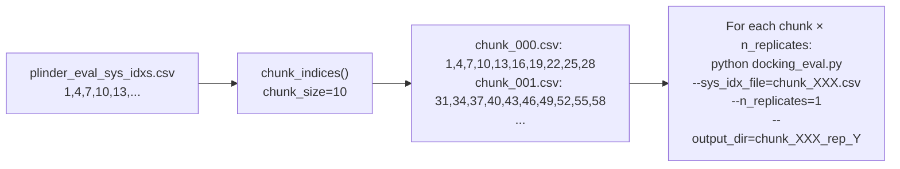

**Usage**:
```bash
python sampleblaster.py \
    --input_csv plinder_eval_sys_idxs.csv \
    --chunk_size 10 \
    --n_replicates 5 \
    --ckpt_path /path/to/checkpoint.ckpt \
    --task rigid_docking_condensed
```

**Outputs**:
- `chunks/chunk_XXX.csv`: Chunked system index files
- `eval_commands.txt`: All commands to run
- One command per (chunk, replicate) pair for parallel execution

**Sources**: [omtra_pipelines/docking_eval/sampleblaster.py:1-236]()

## Metrics Output Format

### Built-in Metrics JSON

```json
{
  "frac_valid_mols": 0.95,
  "frac_connected": 0.92,
  "avg_frag_frac": 0.98,
  "frac_atoms_stable": 0.94,
  "frac_mols_stable_valence": 0.89,
  "flag_rate": 0.12,
  "ood_rate": 0.03,
  "geometry_frac_valid_bonds": 0.96,
  "ligand_rmsd": 1.23
}
```

**Sources**: [routines/sample.py:493-497]()

### Docking Evaluation CSV

Output from docking_eval.py has one row per generated ligand:

| Column | Description |
|--------|-------------|
| `sys_id` | System identifier (e.g., `sys_0_gt`) |
| `protein_id` | Protein identifier |
| `gen_ligand_id` | Generated ligand identifier |
| `RDKit_valid` | RDKit sanitization success |
| `pb_*` | PoseBusters metrics |
| `minimizedAffinity` | VINA score |
| `CNNscore`, `CNNaffinity` | GNINA CNN scores |
| `vina_min` | VINA score after minimization |
| `clashes`, `strain` | PoseCheck metrics |
| `HBAcceptor`, `HBDonor`, etc. | Interaction counts |
| `interaction_recovery` | Interaction recovery fraction |
| `rmsd` | RMSD to ground truth |
| `perfect_pharm_match` | All pharmacophores matched |

Additionally, `*_true` columns contain metrics for ground truth ligands when applicable.

**Sources**: [omtra_pipelines/docking_eval/docking_eval.py:346-533]()

---