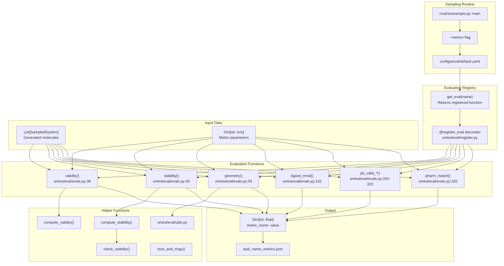
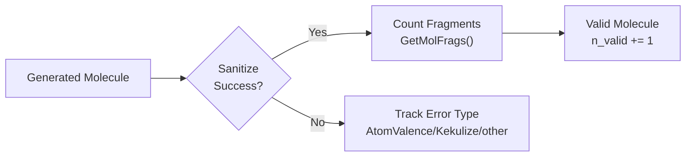
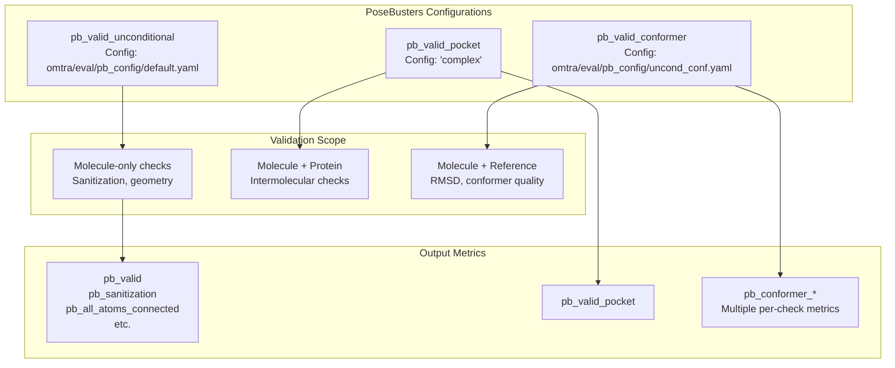
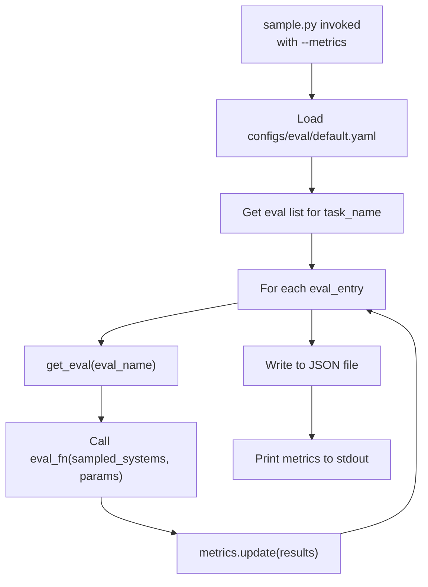

# Built-in Metrics

<details>
<summary>Relevant source files</summary>

The following files were used as context for generating this wiki page:

- [configs/eval/default.yaml](configs/eval/default.yaml)
- [omtra/data/graph/utils.py](omtra/data/graph/utils.py)
- [omtra/eval/evals.py](omtra/eval/evals.py)
- [omtra/eval/system.py](omtra/eval/system.py)
- [omtra/eval/utils.py](omtra/eval/utils.py)
- [routines/sample.py](routines/sample.py)

</details>


This page documents the evaluation metrics built into OMTRA for assessing generated molecular systems. These metrics evaluate various aspects of generated molecules including validity, chemical stability, geometry, and task-specific quality measures. For information about the comprehensive docking evaluation pipeline that uses external tools like GNINA, see [Docking Evaluation Pipeline](#9.2). For information about the `SampledSystem` class that wraps generated molecules for evaluation, see [SampledSystem and Output Formats](#8.4).

## Overview

OMTRA's built-in metrics are organized as registered evaluation functions that operate on lists of `SampledSystem` objects. Each metric returns a dictionary of computed values. Metrics can be:

- **Invoked during sampling** using the `--metrics` flag in [routines/sample.py:483-498]()
- **Configured per task** via YAML configuration files in [configs/eval/default.yaml]()
- **Extended** by registering new evaluation functions using the `@register_eval` decorator

The evaluation system supports both reference-free metrics (e.g., molecular validity) and reference-dependent metrics (e.g., RMSD to ground truth).

**Sources:** [routines/sample.py:483-498](), [omtra/eval/evals.py:1-329](), [configs/eval/default.yaml]()

## Evaluation Pipeline Architecture



**Sources:** [routines/sample.py:483-498](), [omtra/eval/evals.py:1-37](), [omtra/eval/utils.py]()

## Metric Registration System

All built-in metrics are registered using the `@register_eval` decorator, which maps a string name to an evaluation function. The standard signature for evaluation functions is:

```python
@register_eval("metric_name")
def metric_function(
    sampled_systems: List[SampledSystem], 
    params: Dict[str, Any]
) -> Dict[str, Any]:
    # Compute metrics
    return {"metric_1": value1, "metric_2": value2}
```

Registered metrics can be retrieved by name:
```python
from omtra.eval.register import get_eval

eval_fn = get_eval("validity")
results = eval_fn(sampled_systems, params={})
```

**Sources:** [omtra/eval/evals.py:1-2, 37-42](), [omtra/eval/register.py]()

## Core Metric Categories

### Molecular Validity Metrics

| Metric Name | Function | Description | Output Keys |
|-------------|----------|-------------|-------------|
| `validity` | [omtra/eval/evals.py:38-41]() | Checks if molecules are valid RDKit structures | `frac_valid_mols`, `avg_frag_frac`, `avg_num_components`, `frac_connected` |
| `stability` | [omtra/eval/evals.py:45-48]() | Validates atomic valencies against chemically allowed values | `frac_atoms_stable`, `frac_mols_stable_valence` |

The **validity** metric attempts to sanitize each generated molecule using RDKit and tracks various error types:



The **stability** metric verifies that each atom has a chemically valid valence given its charge, using a precomputed valency table:

- Uses [omtra_pipelines/pharmit_dataset/train_valency_table.yml]()
- Computes valencies from bond types using `SampledSystem.compute_valencies()` [omtra/eval/system.py:805-818]()
- Checks each `(atom_type, charge, valency)` tuple against allowed values

**Sources:** [omtra/eval/evals.py:38-48](), [omtra/eval/utils.py:25-192](), [omtra/eval/system.py:805-818]()

### Chemical Filter Metrics

| Metric Name | Function | Description | Output Keys |
|-------------|----------|-------------|-------------|
| `reos_and_rings` | [omtra/eval/evals.py:52-55]() | Applies REOS filters and counts ring systems | `flag_rate`, `ood_rate` |

The **reos_and_rings** metric evaluates two aspects:

1. **REOS Filters**: Rapid Elimination Of Swill rules (Glaxo and Dundee rule sets) that identify undesirable chemical motifs using SMARTS patterns
2. **Ring Systems**: Counts ring systems and identifies out-of-distribution (OOD) ring systems not found in ChEMBL

Returns:
- `flag_rate`: Fraction of molecules that trigger REOS alerts
- `ood_rate`: Rate of molecules containing ring systems not in ChEMBL reference

**Sources:** [omtra/eval/evals.py:52-55](), [omtra/eval/utils.py:194-239]()

### Geometry Metrics

These metrics use the PoseBusters library to validate molecular geometry:

| Metric Name | Function | Description | Key Parameters |
|-------------|----------|-------------|----------------|
| `geometry` | [omtra/eval/evals.py:59-95]() | Validates bond lengths, angles, and atom clashes | None |
| `flatness` | [omtra/eval/evals.py:99-123]() | Checks planarity of aromatic/conjugated systems | `threshold_flatness: 0.1` |

**Geometry outputs:**
- `geometry_frac_valid_bonds`: Fraction of bonds within acceptable length ranges
- `geometry_frac_valid_angles`: Fraction of angles within acceptable ranges  
- `geometry_number_clashes`: Average number of atomic clashes per molecule

**Flatness outputs:**
- `flatness_max_distance_from_plane`: Maximum deviation from planarity
- `flatness_frac_ring_systems_passed`: Fraction of ring systems that are sufficiently planar

**Sources:** [omtra/eval/evals.py:59-123]()

### Protein-Ligand Interaction Metrics

For tasks involving protein-ligand complexes:

| Metric Name | Function | Description | Key Parameters |
|-------------|----------|-------------|----------------|
| `intermolecular_distance` | [omtra/eval/evals.py:127-148]() | Checks for protein-ligand clashes | `clash_cutoff: 0.05` |
| `volume_overlap` | [omtra/eval/evals.py:181-199]() | Measures protein-ligand volume overlap | `clash_cutoff: 0.05` |

Both metrics require a protein structure from `SampledSystem.get_rdkit_protein()` and use PoseBusters checks:

- **intermolecular_distance**: Reports `intermolecular_distance_smallest` - the minimum distance between protein and ligand atoms
- **volume_overlap**: Reports `volume_overlap` - the overlapping volume between protein and ligand

**Sources:** [omtra/eval/evals.py:127-199]()

### Reference-Dependent Metrics

| Metric Name | Function | Description | Key Parameters |
|-------------|----------|-------------|----------------|
| `ligand_rmsd` | [omtra/eval/evals.py:152-177]() | Computes RMSD to reference ligand | `rmsd_threshold: 2.0` |

The **ligand_rmsd** metric compares generated ligands to ground truth using PoseBusters:

**Outputs:**
- `ligand_rmsd`: Raw RMSD without alignment
- `ligand_kabsch_rmsd`: RMSD after optimal Kabsch alignment
- `ligand_centroid_distance`: Distance between molecular centroids

Requires `SampledSystem.get_rdkit_ref_ligand()` to retrieve ground truth.

**Sources:** [omtra/eval/evals.py:152-177]()

## PoseBusters Integration

OMTRA integrates PoseBusters validation at three levels:



| Function | Use Case | Inputs | Config | Lines |
|----------|----------|--------|--------|-------|
| `pb_valid_unconditional` | De novo ligand generation | Ligand only | [omtra/eval/pb_config/default.yaml]() | [evals.py:203-241]() |
| `pb_valid_pocket` | Pocket-conditioned generation | Ligand + Protein | Built-in "complex" | [evals.py:244-279]() |
| `pb_valid_conformer` | Conformer generation | Ligand + Reference | [omtra/eval/pb_config/uncond_conf.yaml]() | [evals.py:282-322]() |

**Sources:** [omtra/eval/evals.py:203-322]()

## Pharmacophore Metrics

| Metric Name | Function | Description | Key Parameters |
|-------------|----------|-------------|----------------|
| `pharm_match` | [omtra/eval/evals.py:326-329]() | Evaluates pharmacophore constraint satisfaction | `threshold: 1.0` |

The pharmacophore matching metric evaluates how well generated ligands satisfy input pharmacophore constraints. Implementation details are in [omtra/eval/pharmacophore.py]().

**Sources:** [omtra/eval/evals.py:326-329]()

## Task-Specific Metric Configuration

The [configs/eval/default.yaml]() file specifies which metrics apply to each task:

### Example: De Novo Ligand Generation

```yaml
denovo_ligand:
  - validity:
      train: true
      params: {}
  - stability:
      train: true
      params: {}
  - reos_and_rings:
      train: true
      params: {}
  - flatness:
      train: true
      params:
        threshold_flatness: 0.1
  - pb_valid_unconditional:
      train: true
      params:
        max_workers: 0
```

### Example: Rigid Docking

```yaml
rigid_docking:
  - stability:
      train: true
      params: {}
  - intermolecular_distance:
      train: true
      params:
        clash_cutoff: 0.05
  - ligand_rmsd:
      train: true
      params:
        rmsd_threshold: 2.0
  - volume_overlap:
      train: true
      params:
        clash_cutoff: 0.05
```

**Configuration Structure:**

| Field | Description |
|-------|-------------|
| Metric name | Top-level key matching registered eval name |
| `train` | Boolean flag (currently unused, for future train-time logging) |
| `params` | Dictionary passed to the evaluation function |

**Sources:** [configs/eval/default.yaml:1-684]()

## Computing Metrics During Sampling

Metrics are computed during sampling when the `--metrics` flag is provided:

```python
# From routines/sample.py:483-498
if args.metrics:
    # Load default eval configuration
    default_eval_path = Path(omtra_root()) / 'configs' / 'eval' / 'default.yaml'    
    default_eval_cfg = OmegaConf.load(default_eval_path)

    metrics = {}
    for eval_entry in default_eval_cfg[task_name]:
        for eval_name, config in eval_entry.items():
            # Get registered eval function and call it
            metrics.update(get_eval(eval_name)(sampled_systems, config.get("params", {})))
    
    # Write metrics to JSON
    metrics_file = output_dir / f"{task_name}_metrics.json"
    with open(metrics_file, 'w') as f:
        json.dump(metrics, f)
```

**Workflow:**



**Sources:** [routines/sample.py:483-498]()

## Summary of Registered Metrics

| Metric Name | Category | Reference Required | Protein Required | Primary Use Cases |
|-------------|----------|-------------------|------------------|-------------------|
| `validity` | Molecular | No | No | All generation tasks |
| `stability` | Molecular | No | No | All generation tasks |
| `reos_and_rings` | Chemical | No | No | Drug-like molecule generation |
| `geometry` | Geometric | No | No | All generation tasks |
| `flatness` | Geometric | No | No | Aromatic/conjugated systems |
| `intermolecular_distance` | Interaction | No | Yes | Protein-conditioned tasks |
| `ligand_rmsd` | Geometric | Yes | No | Docking, conformer generation |
| `volume_overlap` | Interaction | No | Yes | Protein-conditioned tasks |
| `pb_valid_unconditional` | Validation | No | No | De novo generation |
| `pb_valid_pocket` | Validation | No | Yes | Pocket-conditioned generation |
| `pb_valid_conformer` | Validation | Yes | No | Conformer generation |
| `pharm_match` | Constraint | No | No | Pharmacophore-guided tasks |

**Sources:** [omtra/eval/evals.py:1-329](), [configs/eval/default.yaml]()

---