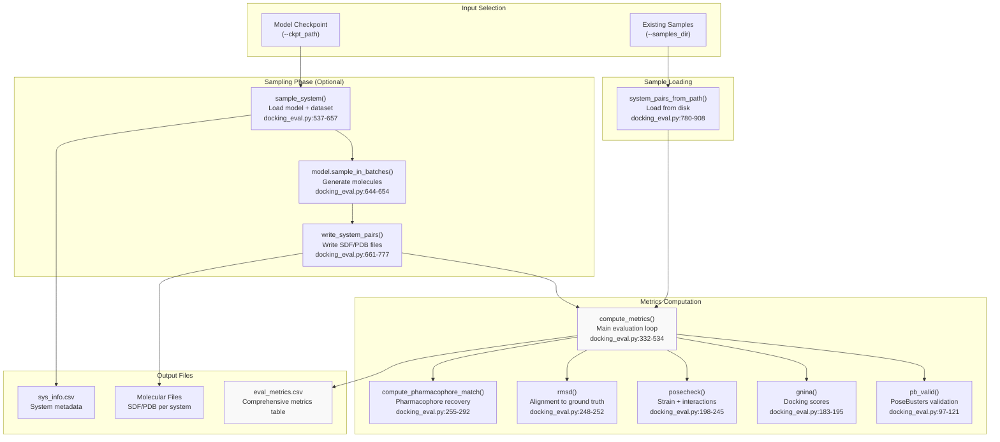
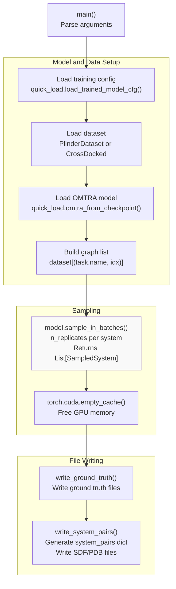
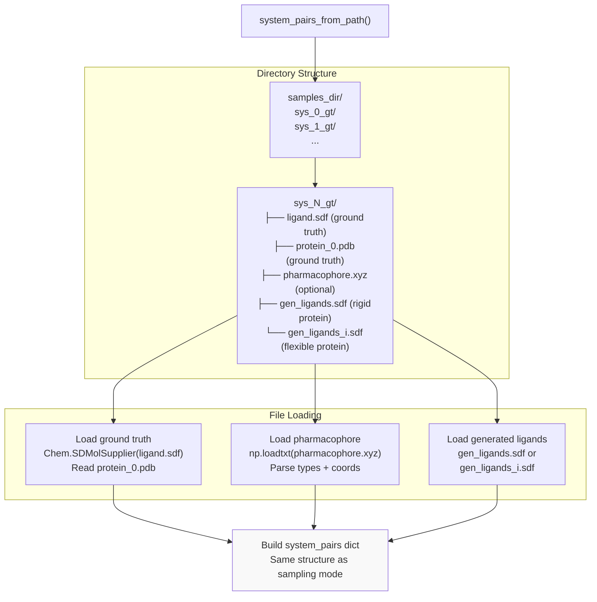
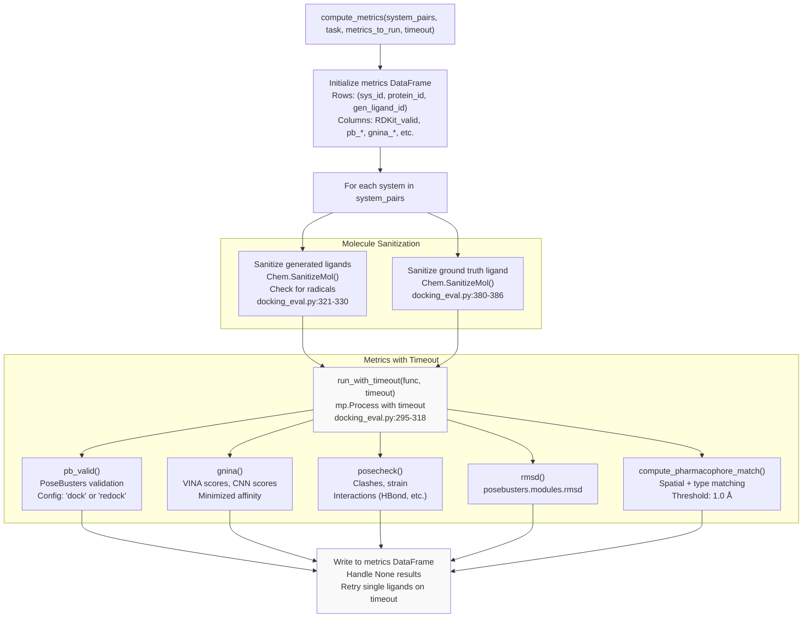

# Docking Evaluation Pipeline

<details>
<summary>Relevant source files</summary>

The following files were used as context for generating this wiki page:

- [notebooks/docking_evaluation.ipynb](notebooks/docking_evaluation.ipynb)
- [omtra_pipelines/docking_eval/docking_eval.py](omtra_pipelines/docking_eval/docking_eval.py)
- [omtra_pipelines/docking_eval/gen_eval_cmds.py](omtra_pipelines/docking_eval/gen_eval_cmds.py)
- [omtra_pipelines/docking_eval/sampleblaster.py](omtra_pipelines/docking_eval/sampleblaster.py)

</details>


This page describes the comprehensive docking evaluation pipeline implemented in [omtra_pipelines/docking_eval/docking_eval.py](). This pipeline provides extensive molecular evaluation using external validation tools including GNINA, PoseBusters, and PoseCheck. For basic built-in metrics computed during sampling, see [Built-in Metrics](#9.1). For batch orchestration tools that help run evaluations at scale, see [Orchestration Scripts](#9.3).

## Purpose and Scope

The docking evaluation pipeline serves two primary functions:

1. **Unified Sampling and Evaluation**: Samples molecules from a trained OMTRA checkpoint and immediately evaluates them using multiple external tools
2. **Post-hoc Evaluation**: Evaluates previously generated samples stored on disk

The pipeline computes a comprehensive set of metrics including molecular validity, docking scores, structural quality, protein-ligand interactions, and RMSD to ground truth when available.

## Pipeline Architecture



**Sources**: [omtra_pipelines/docking_eval/docking_eval.py:1-1050]()

## Command-Line Interface

The main script accepts two mutually exclusive input modes:

| Mode | Argument | Description |
|------|----------|-------------|
| Sample from checkpoint | `--ckpt_path` | Path to model checkpoint for sampling |
| Evaluate existing samples | `--samples_dir` | Path to directory containing pre-generated samples |

### Core Arguments

**Input/Output Options:**
- `--ckpt_path`: Model checkpoint path (mutually exclusive with `--samples_dir`)
- `--samples_dir`: Existing samples directory (mutually exclusive with `--ckpt_path`)
- `--output_dir`: Output directory for results (default: model directory for checkpoints, samples directory for existing samples)
- `--sample_only`: Skip metrics computation, only generate samples
- `--exit_if_done`: Exit if `eval_metrics.csv` already exists

**Sampling Options:**
- `--task`: Task name (e.g., `rigid_docking_condensed`, `fixed_protein_ligand_denovo_condensed`) [required]
- `--dataset`: Dataset to sample from (`plinder` or `crossdocked`) [default: `plinder`]
- `--split`: Data split (`train`, `val`, `test`) [default: `test`]
- `--n_samples`: Number of systems to evaluate
- `--n_replicates`: Number of replicates per system [required]
- `--n_timesteps`: Integration steps for sampling [default: 250]
- `--dataset_start_idx`: Starting index in dataset [default: 0]
- `--sample_start_idx`: Starting index when loading from `--samples_dir`
- `--sys_idx_file`: Path to file with pre-selected system indices
- `--max_batch_size`: Maximum batch size for model sampling [default: 500]

**Metrics Options:**
- `--disable_pb_valid`: Disable PoseBusters validity checks
- `--disable_gnina`: Disable GNINA docking scores
- `--disable_posecheck`: Disable PoseCheck strain and interaction analysis
- `--disable_rmsd`: Disable RMSD calculation
- `--disable_interaction_recovery`: Disable protein-ligand interaction recovery metrics
- `--disable_pharm_match`: Disable pharmacophore matching
- `--disable_ground_truth_metrics`: Disable all ground truth evaluations
- `--disable_strain`: Disable strain energy calculation
- `--timeout`: Maximum time in seconds for any metric [default: 2700]

**Sources**: [omtra_pipelines/docking_eval/docking_eval.py:39-94]()

## Sampling Mode Workflow

When provided with `--ckpt_path`, the pipeline performs end-to-end sampling and evaluation:



The `system_pairs` dictionary structure returned by `write_system_pairs()`:

```python
system_pairs = {
    'sys_0_gt': {
        'pair_0': {
            'gen_ligs': [rdkit.Mol, ...],           # Generated ligands
            'gen_ligs_file': Path,                   # SDF file path
            'gen_ligs_ids': ['gen_ligands_0', ...], # Molecule IDs
            'true_lig': rdkit.Mol,                   # Ground truth ligand
            'true_lig_file': Path,                   # Ground truth SDF
            'gen_prot_file': Path,                   # Generated/reference protein PDB
            'gen_prot_id': str,                      # Protein identifier
            'true_prot_file': Path,                  # Ground truth protein PDB
            'true_prot_id': str,                     # Ground truth protein ID
            'true_pharm': dict,                      # Pharmacophore data (if present)
        }
    },
    # ... more systems
}
```

**Sources**: [omtra_pipelines/docking_eval/docking_eval.py:537-657](), [omtra_pipelines/docking_eval/docking_eval.py:661-777]()

## Evaluation Mode Workflow

When provided with `--samples_dir`, the pipeline loads existing samples from disk:



For tasks that generate flexible proteins (`protein_structure` in `groups_generated`), each replicate has its own ligand-protein pair. For rigid protein tasks, all replicates share the same reference protein.

**Sources**: [omtra_pipelines/docking_eval/docking_eval.py:780-908]()

## Metrics Computation

The `compute_metrics()` function iterates through all system pairs and computes requested metrics with timeout protection:



**Sources**: [omtra_pipelines/docking_eval/docking_eval.py:332-534]()

### PoseBusters Validation

PoseBusters checks molecular and structural validity:

```python
def pb_valid(gen_ligs, true_lig, prot_file, task: Task, pb_workers=0):
    # Determine config based on task
    if ('ligand_identity' in task.groups_generated) or \
       ('ligand_identity_condensed' in task.groups_generated):
        config = 'dock'  # De novo design
        true_lig = None
    elif true_lig is None:
        config = 'dock'  # No reference ligand
    else:
        config = 'redock'  # Redocking with reference
    
    buster = pb.PoseBusters(config=config, max_workers=pb_workers)
    df_pb = buster.bust(gen_ligs, true_lig, prot_file)
    # ... prefix columns with 'pb_' and compute 'pb_valid'
```

**Columns produced**: `pb_sanitization`, `pb_all_atoms_connected`, `pb_bond_lengths`, `pb_bond_angles`, `pb_internal_steric_clash`, `pb_aromatic_ring_flatness`, `pb_double_bond_flatness`, `pb_internal_energy`, `pb_protein_ligand_maximum_distance`, `pb_minimum_distance_to_protein`, `pb_minimum_distance_to_organic_cofactors`, `pb_minimum_distance_to_inorganic_cofactors`, `pb_minimum_distance_to_waters`, `pb_volume_overlap_with_protein`, `pb_volume_overlap_with_organic_cofactors`, `pb_volume_overlap_with_inorganic_cofactors`, `pb_volume_overlap_with_waters`, `pb_valid` (overall validity)

**Sources**: [omtra_pipelines/docking_eval/docking_eval.py:97-121]()

### GNINA Docking Scores

GNINA computes VINA-based and CNN-based docking scores:

```python
def gnina(lig_file, prot_file, env):
    # Score-only mode
    vina_results = _run_gnina(lig_file, prot_file, env, minimization=False)
    # Minimization mode
    vina_min_results = _run_gnina(lig_file, prot_file, env, minimization=True)
    
    return {
        'minimizedAffinity': {...},      # VINA score
        'CNNscore': {...},               # CNN scoring confidence
        'CNNaffinity': {...},            # CNN-predicted affinity
        'CNNaffinity_variance': {...},   # CNN prediction variance
        'vina_min': {...}                # Minimized VINA score
    }
```

The binary path is located at `omtra_root()/gnina.1.3.2`. Download from [https://github.com/gnina/gnina/releases/tag/v1.3.2](https://github.com/gnina/gnina/releases/tag/v1.3.2) if not present.

**Sources**: [omtra_pipelines/docking_eval/docking_eval.py:124-195]()

### PoseCheck Analysis

PoseCheck computes strain energy and protein-ligand interactions:

```python
def posecheck(ligs, prot_file, true_lig=None, true_prot_file=None, 
              interaction_recovery=False, disable_strain=False):
    pc = PoseCheck()
    pc.load_protein_from_pdb(prot_file)  # Runs reduce for hydrogens
    pc.load_ligands_from_mols(ligs)
    
    results = {}
    results['clashes'] = pc.calculate_clashes()
    if not disable_strain:
        results['strain'] = pc.calculate_strain_energy()
    
    interactions = pc.calculate_interactions()
    # Compute per-atom interaction counts for:
    # HBAcceptor, HBDonor, Hydrophobic, PiStacking
    
    if interaction_recovery:
        # Compare generated interactions to ground truth
        # Compute recovery fraction
```

**Interaction types tracked**: `HBAcceptor`, `HBDonor`, `Hydrophobic`, `PiStacking`

**Interaction recovery types** (if enabled): `HBAcceptor`, `HBDonor`, `PiStacking`, `XBDonor`, `CationPi`, `PiCation`, `Cationic`, `Anionic`

**Sources**: [omtra_pipelines/docking_eval/docking_eval.py:198-245]()

### RMSD Calculation

For tasks that regenerate known ligands (not de novo design), RMSD to ground truth is computed:

```python
def rmsd(gen_lig, true_lig):
    res = check_rmsd(mol_pred=gen_lig, mol_true=true_lig)
    res = res.get("results", {})
    rmsd = res.get("rmsd", -1.0)
    return rmsd
```

RMSD is disabled for de novo tasks where `ligand_identity_condensed` is in `task.groups_generated`.

**Sources**: [omtra_pipelines/docking_eval/docking_eval.py:248-252]()

### Pharmacophore Matching

For tasks with pharmacophore conditioning, this metric evaluates whether generated ligands recover ground truth pharmacophore features:

```python
def compute_pharmacophore_match(gen_ligs, true_pharm, threshold=1.0):
    for gen_lig in gen_ligs:
        # Extract pharmacophores from generated ligand
        gen_coords, gen_types, _, _ = get_pharmacophores(gen_lig)
        
        # Load ground truth pharmacophore
        true_coords = true_pharm['coords']
        true_types = true_pharm['types_idx']
        
        # Compute distance matrix
        d = cdist(true_coords, gen_coords)
        same_type_mask = true_types[:, None] == gen_types[None, :]
        
        # Match if distance < threshold AND same type
        matching_pharms = (d < threshold) & same_type_mask
        
        results['perfect_pharm_match'].append(all_true_matched)
        results['frac_true_pharms_matched'].append(fraction_matched)
```

**Metrics**: `perfect_pharm_match` (boolean), `frac_true_pharms_matched` (float in [0, 1])

**Sources**: [omtra_pipelines/docking_eval/docking_eval.py:255-292]()

## Output Structure

### Directory Layout

```
output_dir/
├── eval_metrics.csv           # Main metrics table
├── sys_info.csv               # System metadata (if available)
└── sys_N_gt/                  # One directory per system
    ├── ligand.sdf             # Ground truth ligand
    ├── protein_0.pdb          # Ground truth protein
    ├── pharmacophore.xyz      # Ground truth pharmacophore (if present)
    ├── gen_ligands.sdf        # Generated ligands (rigid protein tasks)
    ├── gen_ligands_0.sdf      # Generated ligand 0 (flexible protein tasks)
    ├── gen_ligands_1.sdf      # Generated ligand 1 (flexible protein tasks)
    ├── gen_prot_0.pdb         # Generated protein 0 (flexible protein tasks)
    └── gen_prot_1.pdb         # Generated protein 1 (flexible protein tasks)
```

### Metrics CSV Structure

The `eval_metrics.csv` contains one row per generated ligand:

| Column Group | Columns | Description |
|--------------|---------|-------------|
| Identifiers | `sys_id`, `protein_id`, `gen_ligand_id` | System and molecule identifiers |
| Validity | `RDKit_valid` | Passed RDKit sanitization |
| PoseBusters | `pb_*` | 18 PoseBusters checks + `pb_valid` overall |
| GNINA | `minimizedAffinity`, `CNNscore`, `CNNaffinity`, `CNNaffinity_variance`, `vina_min` | Docking scores |
| PoseCheck | `clashes`, `strain`, `HBAcceptor`, `HBDonor`, `Hydrophobic`, `PiStacking`, `interaction_recovery` (optional) | Structural quality and interactions |
| RMSD | `rmsd` | Alignment to ground truth (if applicable) |
| Pharmacophore | `perfect_pharm_match`, `frac_true_pharms_matched` | Pharmacophore recovery (if applicable) |
| Ground Truth | `*_true` columns | Metrics computed on ground truth ligand |
| Metadata | `system_id`, `ligand_id`, `ccd`, `n_gt_lig_atoms` | System information from dataset |

Ground truth metrics (suffixed with `_true`) are computed once per system and duplicated across all replicates for that system.

**Sources**: [omtra_pipelines/docking_eval/docking_eval.py:332-534](), [omtra_pipelines/docking_eval/docking_eval.py:922-1045]()

## Usage Examples

### Sample and Evaluate from Checkpoint

```bash
python omtra_pipelines/docking_eval/docking_eval.py \
    --ckpt_path /path/to/model/checkpoints/last.ckpt \
    --task rigid_docking_condensed \
    --dataset plinder \
    --split test \
    --n_samples 100 \
    --n_replicates 10 \
    --n_timesteps 250 \
    --max_batch_size 500 \
    --timeout 2700
```

### Evaluate Existing Samples

```bash
python omtra_pipelines/docking_eval/docking_eval.py \
    --samples_dir /path/to/samples_rigid_docking_condensed_plinder \
    --task rigid_docking_condensed \
    --n_samples 100 \
    --n_replicates 10 \
    --output_dir /path/to/evaluation_output
```

### Sample Only (Skip Metrics)

```bash
python omtra_pipelines/docking_eval/docking_eval.py \
    --ckpt_path /path/to/model/checkpoints/last.ckpt \
    --task fixed_protein_ligand_denovo_condensed \
    --n_samples 50 \
    --n_replicates 5 \
    --sample_only
```

### Selective Metrics Evaluation

```bash
python omtra_pipelines/docking_eval/docking_eval.py \
    --samples_dir /path/to/samples \
    --task rigid_docking_pharmacophore_condensed \
    --n_samples 100 \
    --n_replicates 10 \
    --disable_gnina \
    --disable_strain \
    --disable_ground_truth_metrics
```

### Using System Index File

```bash
# Create index file with specific systems
echo "0,5,10,15,20" > selected_systems.csv

python omtra_pipelines/docking_eval/docking_eval.py \
    --ckpt_path /path/to/model/checkpoints/last.ckpt \
    --task rigid_docking_condensed \
    --sys_idx_file selected_systems.csv \
    --n_replicates 20
```

**Sources**: [omtra_pipelines/docking_eval/docking_eval.py:922-1048]()

## Timeout Handling

All expensive metrics are wrapped with `run_with_timeout()` to prevent hanging on problematic systems:

```python
def run_with_timeout(func, *args, timeout, **kwargs):
    # Spawn separate process
    q = mp.Queue()
    p = mp.Process(target=target, args=(q, *args), kwargs=kwargs)
    p.start()
    p.join(timeout)
    
    if p.is_alive():
        p.terminate()
        p.join()
        print(f"[TIMEOUT] {func.__name__} killed after {timeout}s")
        return None
    
    result = q.get() if not q.empty() else None
    if isinstance(result, Exception):
        print(f"[ERROR] {func.__name__} failed: {result}")
        return None
    return result
```

If a batch of ligands times out, the pipeline retries each ligand individually with a reduced timeout (120s). This allows partial results to be recovered.

**Sources**: [omtra_pipelines/docking_eval/docking_eval.py:295-318](), [omtra_pipelines/docking_eval/docking_eval.py:397-420](), [omtra_pipelines/docking_eval/docking_eval.py:454-468]()

## Integration with Orchestration Tools

For large-scale evaluation, this pipeline integrates with orchestration scripts:

- **[gen_eval_cmds.py](#9.3)**: Generates docking_eval.py commands from YAML configuration files
- **[sampleblaster.py](#9.3)**: Chunks system indices and generates parallelizable commands with multiple replicates

These tools are described in detail in [Orchestration Scripts](#9.3).

**Sources**: [omtra_pipelines/docking_eval/gen_eval_cmds.py:1-357](), [omtra_pipelines/docking_eval/sampleblaster.py:1-236]()

---