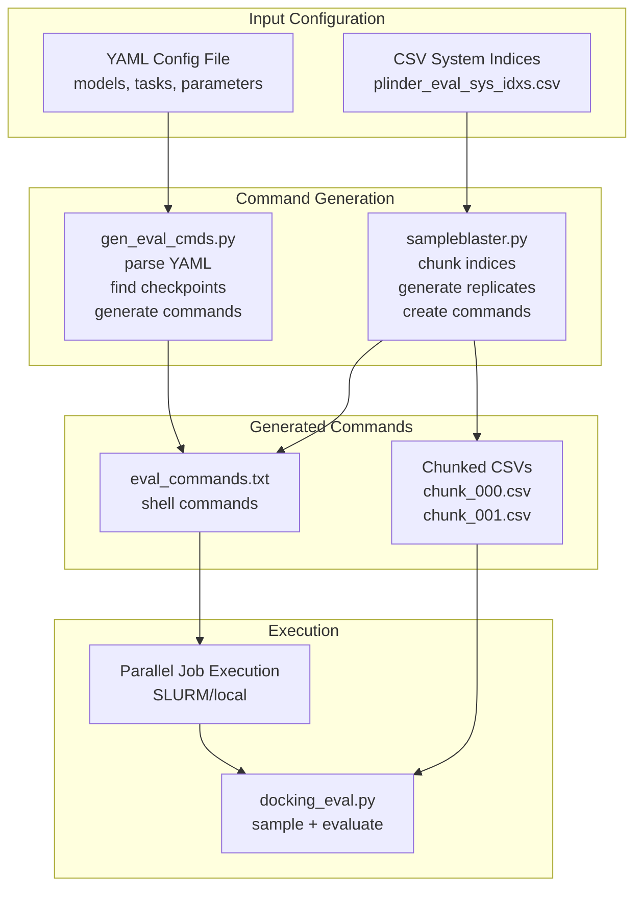
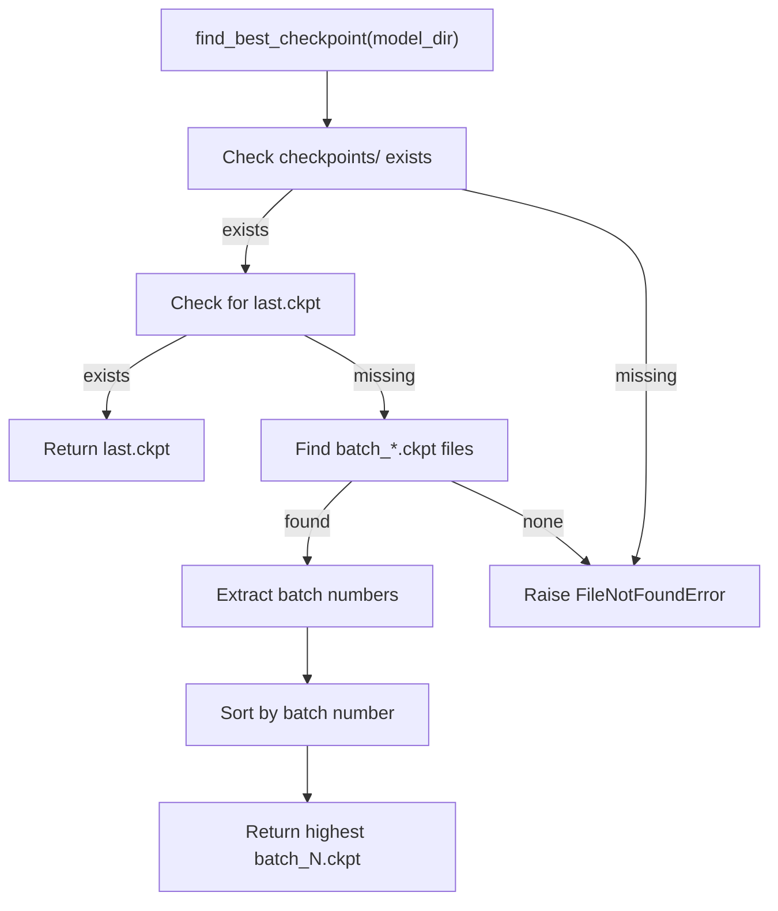
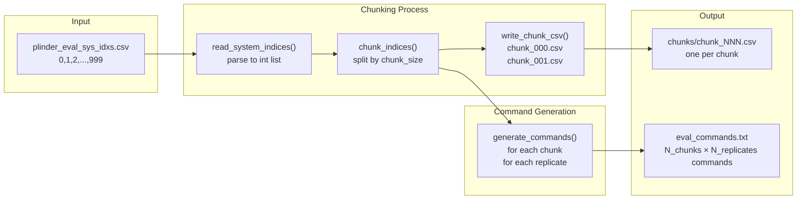
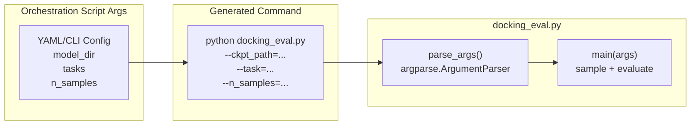

# Orchestration Scripts

<details>
<summary>Relevant source files</summary>

The following files were used as context for generating this wiki page:

- [notebooks/docking_evaluation.ipynb](notebooks/docking_evaluation.ipynb)
- [omtra_pipelines/docking_eval/docking_eval.py](omtra_pipelines/docking_eval/docking_eval.py)
- [omtra_pipelines/docking_eval/gen_eval_cmds.py](omtra_pipelines/docking_eval/gen_eval_cmds.py)
- [omtra_pipelines/docking_eval/sampleblaster.py](omtra_pipelines/docking_eval/sampleblaster.py)

</details>


## Purpose and Scope

Orchestration scripts automate large-scale evaluation workflows by generating and managing multiple evaluation jobs. These scripts are designed to facilitate parallel execution of the docking evaluation pipeline across many systems, checkpoints, and tasks.

This page covers the command-generation utilities in `omtra_pipelines/docking_eval/`. For details on the underlying evaluation metrics, see [Built-in Metrics](#9.1). For the core evaluation pipeline that these scripts orchestrate, see [Docking Evaluation Pipeline](#9.2).

---

## Overview

The orchestration system provides two complementary approaches for batch evaluation:

1. **YAML-based Configuration** (`gen_eval_cmds.py`) - Define multiple models and tasks in a configuration file, automatically generate evaluation commands
2. **Chunk-based Parallel Processing** (`sampleblaster.py`) - Split large evaluation sets into parallel jobs with replicates

Both scripts generate shell commands that invoke `docking_eval.py` with appropriate arguments, enabling easy parallelization across compute clusters.



**Sources:** [omtra_pipelines/docking_eval/gen_eval_cmds.py:1-357](), [omtra_pipelines/docking_eval/sampleblaster.py:1-236]()

---

## YAML-based Command Generation

### Script: gen_eval_cmds.py

The `gen_eval_cmds.py` script reads a YAML configuration file specifying models, tasks, and evaluation parameters, then generates complete `docking_eval.py` commands for each combination.

#### Key Functions

| Function | Purpose | Lines |
|----------|---------|-------|
| `load_config()` | Parse and validate YAML configuration | [155-176]() |
| `find_best_checkpoint()` | Locate optimal checkpoint (last.ckpt or highest batch_N.ckpt) | [112-152]() |
| `generate_commands()` | Create docking_eval.py commands from config | [190-323]() |
| `add_if_not_none()` | Conditionally add command-line flags | [178-182]() |

#### YAML Configuration Schema

```yaml
# List of model/task configurations
- model_dir: /path/to/model/run_directory
  tasks:
    - rigid_docking_condensed
    - fixed_protein_ligand_denovo_condensed
  n_samples: 100
  n_replicates: 10
  dataset: plinder
  split: test
  max_batch_size: 300
  timeout: 2700
  
- model_dir: /path/to/another/model
  samples_dir: /path/to/existing/samples  # Optional: use pre-generated samples
  tasks:
    - rigid_docking_pharmacophore_condensed
  n_samples: 50
  batch_size: 10  # Optional: chunk into batches of 10 systems
```

#### Command-line Usage

```bash
python gen_eval_cmds.py config.yaml \
    --output_file eval_commands.txt \
    --plinder_path /path/to/plinder \
    --crossdocked_path /path/to/crossdocked \
    --default_n_samples 10 \
    --default_n_replicates 1
```

#### Checkpoint Selection Logic

The script automatically finds the best checkpoint in a model directory:

1. **First priority**: `checkpoints/last.ckpt` if it exists
2. **Fallback**: Highest numbered `checkpoints/batch_*.ckpt` file

This logic is implemented in [omtra_pipelines/docking_eval/gen_eval_cmds.py:112-152]().



**Sources:** [omtra_pipelines/docking_eval/gen_eval_cmds.py:112-152]()

#### Batching Support

When `batch_size` is specified in the YAML config, the script generates multiple commands covering different index ranges:

```python
# Example: n_samples=100, batch_size=25 produces 4 commands
# Command 1: --dataset_start_idx 0 --n_samples 25
# Command 2: --dataset_start_idx 25 --n_samples 25
# Command 3: --dataset_start_idx 50 --n_samples 25
# Command 4: --dataset_start_idx 75 --n_samples 25
```

Implementation: [omtra_pipelines/docking_eval/gen_eval_cmds.py:221-277]()

**Sources:** [omtra_pipelines/docking_eval/gen_eval_cmds.py:1-357]()

---

## Chunk-based Batch Processing

### Script: sampleblaster.py

The `sampleblaster.py` script splits a CSV file of system indices into smaller chunks and generates replicate evaluation commands for parallel execution. This is particularly useful for large-scale evaluations requiring statistical replicates.

#### Key Functions

| Function | Purpose | Lines |
|----------|---------|-------|
| `read_system_indices()` | Parse CSV file into list of integers | [105-113]() |
| `chunk_indices()` | Split indices into fixed-size chunks | [116-122]() |
| `write_chunk_csv()` | Write chunk to individual CSV file | [125-129]() |
| `generate_commands()` | Create docking_eval.py commands per chunk/replicate | [132-177]() |

#### Workflow



**Sources:** [omtra_pipelines/docking_eval/sampleblaster.py:105-177]()

#### Command-line Usage

```bash
python sampleblaster.py \
    --input_csv plinder_eval_sys_idxs.csv \
    --chunk_size 50 \
    --n_replicates 5 \
    --reps_per_cmd 1 \
    --ckpt_path /path/to/model/checkpoints/last.ckpt \
    --task fixed_protein_pharmacophore_ligand_denovo_condensed \
    --output_dir ./sampleblaster_output \
    --additional_args "--disable_gnina --disable_rmsd --disable_strain"
```

#### Example Output Structure

For an input CSV with 1000 system indices, `--chunk_size 50`, and `--n_replicates 5`:

```
sampleblaster_output/
├── chunks/
│   ├── chunk_000.csv  # Systems 0-49
│   ├── chunk_001.csv  # Systems 50-99
│   ├── ...
│   └── chunk_019.csv  # Systems 950-999
├── eval_commands.txt  # 100 commands (20 chunks × 5 replicates)
└── samples_<task>/
    ├── chunk_0_rep_0/
    ├── chunk_0_rep_1/
    ├── ...
    └── chunk_19_rep_4/
```

Each generated command targets a specific chunk and replicate:

```bash
python docking_eval.py \
    --ckpt_path=/path/to/model/checkpoints/last.ckpt \
    --task=fixed_protein_pharmacophore_ligand_denovo_condensed \
    --sys_idx_file=chunks/chunk_000.csv \
    --n_replicates=1 \
    --n_samples=50 \
    --bs_per_gbmem=5 \
    --output_dir=samples_<task>/chunk_0_rep_0 \
    --plinder_path=/path/to/plinder \
    --split=test \
    --dataset=plinder \
    --disable_gnina --disable_rmsd --disable_strain
```

**Sources:** [omtra_pipelines/docking_eval/sampleblaster.py:132-177]()

---

## Command Construction Details

### Common Arguments Pattern

Both orchestration scripts construct `docking_eval.py` commands with similar argument patterns:

| Argument | Purpose | Required |
|----------|---------|----------|
| `--ckpt_path` or `--samples_dir` | Model checkpoint or existing samples directory | Yes (mutually exclusive) |
| `--task` | Task name (e.g., `rigid_docking_condensed`) | Yes |
| `--sys_idx_file` | CSV file with system indices | Optional |
| `--n_samples` | Number of systems to evaluate | Yes |
| `--n_replicates` | Replicates per system | Yes |
| `--dataset` | Dataset name (`plinder` or `crossdocked`) | Yes |
| `--split` | Data split (`train`, `val`, `test`) | Yes |
| `--output_dir` | Directory for results | Optional |
| `--max_batch_size` | Maximum systems per sampling batch | Optional |
| `--bs_per_gbmem` | Batch size per GB GPU memory | Optional |

### Conditional Flag Addition

The scripts use helper functions to conditionally add flags:

```python
# Only add if value is not None
def add_if_not_none(cmd_parts, flag, value):
    if value is not None:
        cmd_parts.extend([flag, str(value)])
    return cmd_parts

# Only add boolean flag if True
def add_flag(cmd_parts, flag, value):
    if value == True:
        cmd_parts.append(flag)
    return cmd_parts
```

**Sources:** [omtra_pipelines/docking_eval/gen_eval_cmds.py:178-188]()

---

## Common Workflows

### Workflow 1: Multi-Model Evaluation

**Use Case:** Evaluate multiple trained models on the same test set.

```yaml
# config.yaml
- model_dir: /models/baseline_model
  tasks:
    - rigid_docking_condensed
  n_samples: 100
  n_replicates: 10
  dataset: plinder
  
- model_dir: /models/improved_model
  tasks:
    - rigid_docking_condensed
  n_samples: 100
  n_replicates: 10
  dataset: plinder
```

```bash
python gen_eval_cmds.py config.yaml --output_file commands.txt
# Produces 2 commands (one per model)

# Execute commands
bash commands.txt
# Or submit to SLURM
while read cmd; do sbatch --wrap "$cmd"; done < commands.txt
```

### Workflow 2: Large-Scale Replicate Evaluation

**Use Case:** Evaluate with many statistical replicates across a large test set.

```bash
# Split 1000 systems into chunks of 50, generate 10 replicates each
python sampleblaster.py \
    --input_csv plinder_eval_sys_idxs.csv \
    --chunk_size 50 \
    --n_replicates 10 \
    --ckpt_path /models/model/checkpoints/last.ckpt \
    --task rigid_docking_condensed
    
# Produces 200 commands (20 chunks × 10 replicates)
# Each command evaluates 50 systems with 1 replicate

# Execute in parallel (e.g., on SLURM cluster)
while read cmd; do sbatch --wrap "$cmd"; done < sampleblaster_output/eval_commands.txt
```

### Workflow 3: Multi-Task Evaluation

**Use Case:** Evaluate same model on different tasks.

```yaml
# config.yaml
- model_dir: /models/multitask_model
  tasks:
    - rigid_docking_condensed
    - fixed_protein_ligand_denovo_condensed
    - rigid_docking_pharmacophore_condensed
  n_samples: 100
  n_replicates: 5
  dataset: plinder
```

```bash
python gen_eval_cmds.py config.yaml --output_file commands.txt
# Produces 3 commands (one per task)
```

### Workflow 4: Evaluation with Pre-Generated Samples

**Use Case:** Run metrics on existing samples without re-sampling.

```yaml
# config.yaml
- samples_dir: /existing/samples/rigid_docking
  tasks:
    - rigid_docking_condensed
  n_samples: 100
  n_replicates: 10
  dataset: plinder
```

When `samples_dir` is specified instead of `model_dir`, the generated commands will use `--samples_dir` instead of `--ckpt_path`, skipping the sampling step and only computing metrics.

**Sources:** [omtra_pipelines/docking_eval/gen_eval_cmds.py:224-320]()

---

## Integration with docking_eval.py

### Argument Passing

The orchestration scripts generate complete command-line invocations that map to `docking_eval.py`'s argument parser:



### Key Argument Mappings

| Orchestration Config | docking_eval.py Argument | Purpose |
|---------------------|--------------------------|---------|
| `model_dir` + checkpoint selection | `--ckpt_path` | Model to sample from |
| `samples_dir` | `--samples_dir` | Use existing samples |
| `task` | `--task` | Task definition |
| `n_samples` | `--n_samples` | Number of systems |
| `n_replicates` | `--n_replicates` | Samples per system |
| `sys_idx_file` | `--sys_idx_file` | Pre-selected system indices |
| `batch_size` | `--dataset_start_idx` + `--n_samples` | Chunked evaluation |

**Sources:** [omtra_pipelines/docking_eval/gen_eval_cmds.py:236-277](), [omtra_pipelines/docking_eval/sampleblaster.py:147-168]()

---

## Configuration Reference

### gen_eval_cmds.py Command-Line Arguments

```bash
python gen_eval_cmds.py <config_file> [OPTIONS]

Required:
  config_file              YAML configuration file path

Optional:
  --default_n_samples      Default samples if not in config (default: 10)
  --default_n_replicates   Default replicates if not in config (default: 1)
  --default_dataset        Default dataset (default: plinder)
  --output_file            Output file for commands (default: stdout)
  --plinder_path           Path to Plinder dataset
  --crossdocked_path       Path to CrossDocked dataset
  --dataset_start_idx      Starting index for dataset
  --batch_size             Batch size for chunked processing
  --split                  Data split (default: test)
  --max_batch_size         Max batch size for sampling (default: 300)
  --timeout                Timeout for metrics in seconds (default: 2700)
```

**Sources:** [omtra_pipelines/docking_eval/gen_eval_cmds.py:10-109]()

### sampleblaster.py Command-Line Arguments

```bash
python sampleblaster.py [OPTIONS]

Required:
  --input_csv              CSV file with system indices
  --chunk_size             Systems per chunk
  --n_replicates           Replicate commands per chunk
  --ckpt_path              Model checkpoint path

Optional:
  --reps_per_cmd           Replicates per command (default: 1)
  --task                   Task name (default: fixed_protein_pharmacophore_ligand_denovo_condensed)
  --output_dir             Output directory (default: script directory)
  --commands_file          Commands filename (default: eval_commands.txt)
  --additional_args        Extra docking_eval.py args (default: --disable_gnina --disable_rmsd --disable_strain)
  --split                  Data split (default: test)
  --dataset                Dataset name (default: plinder)
  --crossdocked_path       Path to CrossDocked dataset
```

**Sources:** [omtra_pipelines/docking_eval/sampleblaster.py:16-102]()

---

## Performance Considerations

### Parallelization Strategy

Both scripts generate independent commands suitable for parallel execution:

- **SLURM clusters**: Submit each command as separate job
- **Local multi-GPU**: Use GNU parallel or custom scheduler
- **Cloud computing**: Distribute across compute instances

### Memory and Batch Size

The generated commands include `--bs_per_gbmem` or `--max_batch_size` to control GPU memory usage during sampling:

```bash
# sampleblaster.py sets bs_per_gbmem=5 by default
--bs_per_gbmem=5  # Batch size = 5 * GPU_GB
                  # e.g., 40GB GPU → batch_size=200

# gen_eval_cmds.py uses max_batch_size
--max_batch_size=300  # Fixed maximum batch size
```

### Disk Space Requirements

Each evaluation job produces:
- Sampled molecules (SDF files)
- Protein structures (PDB files)  
- Pharmacophore files (XYZ format)
- Metrics CSV file

For chunk-based processing, total disk usage scales with `n_chunks × chunk_size × n_replicates`.

**Sources:** [omtra_pipelines/docking_eval/gen_eval_cmds.py:94-98](), [omtra_pipelines/docking_eval/sampleblaster.py:155]()

---