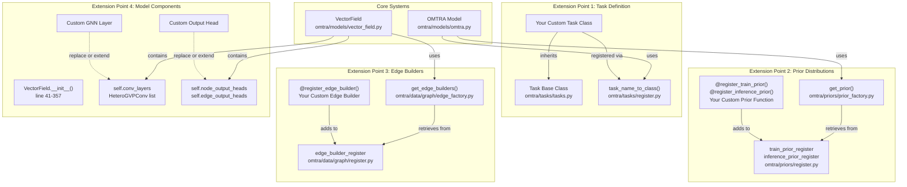
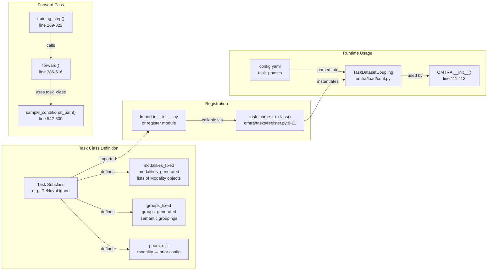
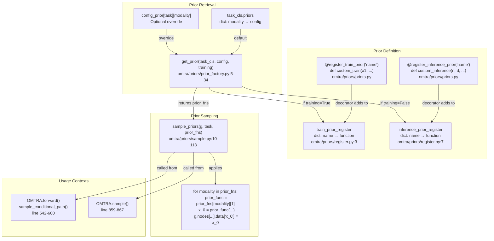
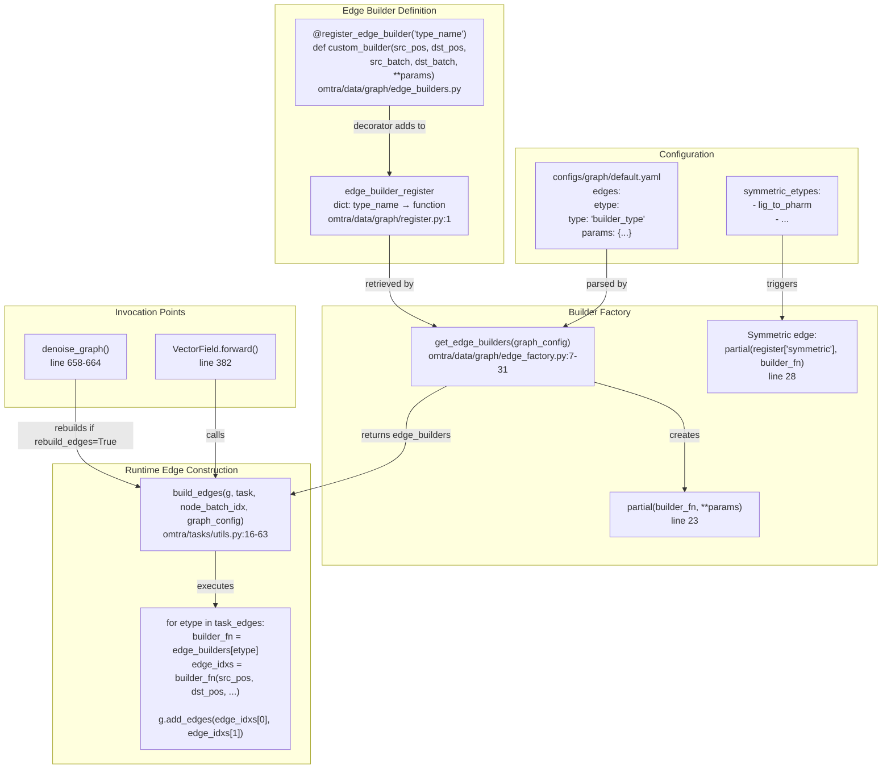
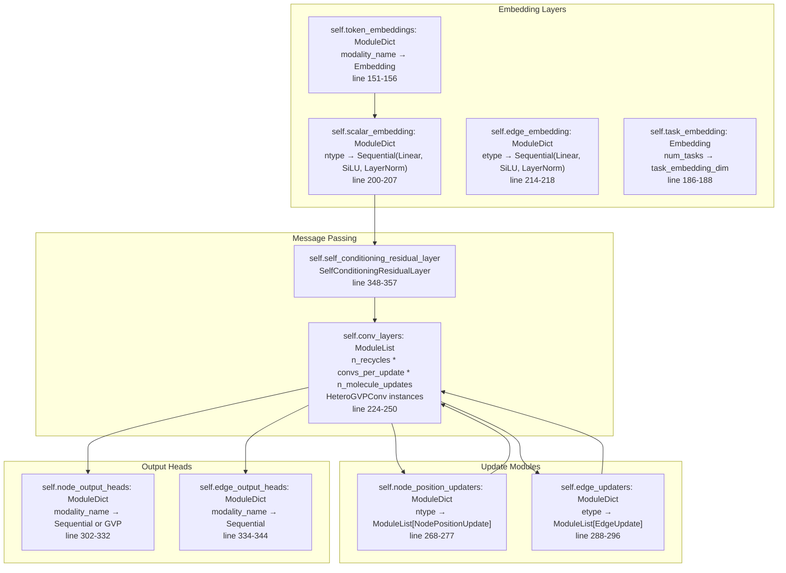
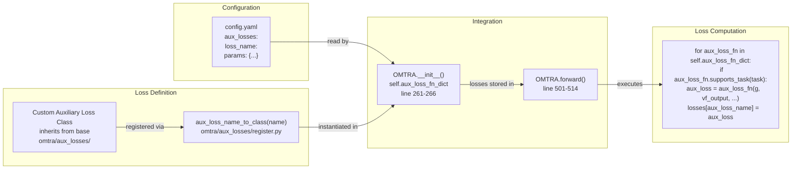

# Advanced Usage

<details>
<summary>Relevant source files</summary>

The following files were used as context for generating this wiki page:

- [configs/graph/default.yaml](configs/graph/default.yaml)
- [omtra/data/graph/__init__.py](omtra/data/graph/__init__.py)
- [omtra/data/graph/edge_builders.py](omtra/data/graph/edge_builders.py)
- [omtra/data/graph/edge_factory.py](omtra/data/graph/edge_factory.py)
- [omtra/data/graph/register.py](omtra/data/graph/register.py)
- [omtra/models/omtra.py](omtra/models/omtra.py)
- [omtra/models/self_conditioning.py](omtra/models/self_conditioning.py)
- [omtra/models/vector_field.py](omtra/models/vector_field.py)
- [omtra/priors/prior_factory.py](omtra/priors/prior_factory.py)
- [omtra/priors/priors.py](omtra/priors/priors.py)
- [omtra/priors/sample.py](omtra/priors/sample.py)
- [omtra/tasks/utils.py](omtra/tasks/utils.py)

</details>


## Purpose and Scope

This page provides technical guidance for extending and customizing OMTRA beyond its default configuration. It covers the main extension points in the system and how to implement custom components. For basic usage and running experiments with existing configurations, see [Getting Started](#2). For deep dives into specific extension mechanisms, see:

- [Creating Custom Tasks](#10.1)
- [Custom Priors and Conditional Paths](#10.2)
- [Custom Edge Builders](#10.3)
- [Extending the Model Architecture](#10.4)

## Extension Points Overview

OMTRA is designed with modularity in mind, providing several key extension points where users can inject custom functionality without modifying core model code.

### System Extension Architecture



**Sources:** [omtra/models/omtra.py:55-186](), [omtra/models/vector_field.py:40-358](), [omtra/tasks/tasks.py](), [omtra/priors/register.py](), [omtra/data/graph/register.py:1-11]()

### Extension Points Summary

| Extension Point | Primary Files | Registration Method | Use Case |
|----------------|---------------|---------------------|----------|
| **Custom Tasks** | `omtra/tasks/tasks.py` | Class inheritance + import | Define new generation objectives with different modality combinations |
| **Custom Priors** | `omtra/priors/priors.py`, `omtra/priors/register.py` | `@register_train_prior()`, `@register_inference_prior()` decorators | Implement new x₀ distributions for training or sampling |
| **Custom Edge Builders** | `omtra/data/graph/edge_builders.py`, `omtra/data/graph/register.py` | `@register_edge_builder()` decorator | Define new spatial connectivity patterns for graph construction |
| **Model Architecture** | `omtra/models/vector_field.py` | Direct modification or hydra instantiation | Add new GNN layers, attention mechanisms, or output heads |

**Sources:** [omtra/tasks/tasks.py](), [omtra/priors/priors.py:1-102](), [omtra/data/graph/edge_builders.py:1-32](), [omtra/models/vector_field.py:40-76]()

## Task System Architecture

Tasks define what the model generates and what information is provided as input. The task system uses a modality-based design where each task specifies which modalities are fixed (conditional inputs) and which are generated (model outputs).

### Task Definition Flow



**Sources:** [omtra/tasks/tasks.py](), [omtra/tasks/register.py:8-11](), [omtra/load/conf.py](), [omtra/models/omtra.py:111-113](), [omtra/models/omtra.py:386-516]()

### Key Task Components

A custom task must define:

1. **`name`**: Unique string identifier for the task
2. **`modalities_fixed`**: List of `Modality` objects provided as input
3. **`modalities_generated`**: List of `Modality` objects predicted by the model
4. **`priors`**: Dictionary mapping modality names to prior configurations
5. **Property methods**: `groups_fixed`, `groups_generated`, `groups_present`, `unconditional`

```python
# Example structure (do not copy, see page 10.1 for implementation details)
class CustomTask(Task):
    name = "custom_task"
    modalities_fixed = [lig_a, lig_c, lig_e]  # Identity features
    modalities_generated = [lig_x]  # Generate positions
    priors = {
        "lig_x": {"type": "gaussian", "params": {"std": 1.0}}
    }
```

**Sources:** [omtra/tasks/tasks.py]()

## Prior Distribution System

Priors define the initial distribution (x₀) from which the generative process begins. OMTRA uses a dual-registration system with separate priors for training and inference.

### Prior Registration and Usage Flow



**Sources:** [omtra/priors/priors.py:11-102](), [omtra/priors/register.py](), [omtra/priors/prior_factory.py:5-34](), [omtra/priors/sample.py:10-113](), [omtra/models/omtra.py:542-600](), [omtra/models/omtra.py:859-867]()

### Built-in Prior Types

| Prior Name | Training Function | Inference Function | Description |
|-----------|-------------------|-------------------|-------------|
| `gaussian` | `gaussian_train(x1, std, ot, ...)` | `gaussian_inference(n, d, std)` | Samples from N(0, std²I) with optional OT alignment |
| `masked` | `ctmc_masked_train(x1, n_categories)` | `ctmc_masked_inference(n, d)` | Sets all tokens to mask index (d) |
| `target_dependent_gaussian` | `target_dependent_gaussian_prior(x1, std)` | Same | Adds Gaussian noise to target: x₀ = x₁ + N(0, std²I) |
| `apo_exp` | `exp_prior(x0, std)` | Same | Uses experimental apo structure with noise |
| `apo_pred` | `pred_prior(x0, std)` | Same | Uses predicted apo structure with noise |

**Sources:** [omtra/priors/priors.py:11-102]()

### Prior Function Signatures

**Training priors** receive the target value and must return an initial value:
- For continuous features: `def prior_train(x1: torch.Tensor, **params) -> torch.Tensor`
- For categorical features: `def prior_train(x1: torch.Tensor, n_categories: int, **params) -> torch.Tensor`

**Inference priors** receive only dimensionality information:
- For continuous features: `def prior_inference(n: int, d: int, **params) -> torch.Tensor`
- For categorical features: `def prior_inference(n: int, d: int, **params) -> torch.Tensor`

**Sources:** [omtra/priors/priors.py:11-102](), [omtra/priors/prior_factory.py:5-34]()

## Edge Builder System

Edge builders define how spatial connectivity is established between different node types in the heterogeneous graph. They are called dynamically during the forward pass to construct edges based on node positions.

### Edge Builder Registration and Invocation



**Sources:** [omtra/data/graph/edge_builders.py:1-32](), [omtra/data/graph/register.py:1-11](), [omtra/data/graph/edge_factory.py:7-31](), [omtra/tasks/utils.py:16-63](), [omtra/models/vector_field.py:382](), [configs/graph/default.yaml:1-80]()

### Built-in Edge Builder Types

| Builder Type | Function | Parameters | Description |
|-------------|----------|------------|-------------|
| `complete` | `complete_graph()` | None | Fully-connected graph (calls `hetero_radius` with r=∞) |
| `radius` | `hetero_radius()` | `r`, `max_num_neighbors=1000` | Connects nodes within radius r |
| `knn` | `hetero_knn()` | `k` | Connects each source node to k nearest destination nodes |
| `symmetric` | `symmetric()` | `builder_fn` | Wrapper that swaps source/dest and reverses edge indices |

**Sources:** [omtra/data/graph/edge_builders.py:13-32]()

### Edge Builder Configuration Example

```yaml
edges:
  prot_atom_to_lig:
    type: radius
    params:
      r: 8.0
  lig_to_prot_atom:
    type: knn
    params:
      k: 5

symmetric_etypes:
  - lig_to_pharm  # Automatically creates pharm_to_lig as symmetric
```

If an edge type is listed in `symmetric_etypes`, the factory automatically creates the inverse edge builder using the `symmetric` wrapper, which swaps source and destination positions and reverses the resulting edge indices.

**Sources:** [configs/graph/default.yaml:1-80](), [omtra/data/graph/edge_factory.py:26-29]()

## Model Architecture Extension Points

The VectorField architecture provides several locations where custom components can be inserted or replaced.

### VectorField Component Structure



**Sources:** [omtra/models/vector_field.py:151-357]()

### Extension Strategies

| Component | Hydra Config Key | Direct Modification | Typical Use Case |
|-----------|------------------|---------------------|------------------|
| **HeteroGVPConv** | `vector_field.n_message_gvps`, `vector_field.n_update_gvps` | Replace `HeteroGVPConv` class | Custom message passing architecture |
| **Output Heads** | N/A | Modify `__init__` lines 302-344 | Add outputs for new modality types |
| **Self-Conditioning** | `vector_field.self_conditioning=true` | Modify `SelfConditioningResidualLayer` | Custom residual computation |
| **Position Updates** | `vector_field.n_molecule_updates`, `vector_field.convs_per_update` | Replace `NodePositionUpdate` class | Custom coordinate update mechanism |
| **Attention** | `vector_field.attention=true`, `vector_field.att_type='crosstype'` | Modify attention in `HeteroGVPConv` | Add cross-attention mechanisms |

**Sources:** [omtra/models/vector_field.py:40-76](), [omtra/models/vector_field.py:224-250](), [omtra/models/vector_field.py:268-296](), [omtra/models/vector_field.py:302-344]()

### Hydra Configuration for Vector Field

The VectorField is instantiated via Hydra in the OMTRA model:

```python
# omtra/models/omtra.py, line 151-157
self.vector_field = hydra.utils.instantiate(
    vector_field,  # DictConfig from configs/model/vector_field.yaml
    td_coupling=self.td_coupling,
    interpolant_scheduler=self.interpolant_scheduler,
    graph_config=self.graph_config,
    fake_atoms=self.fake_atom_p>0.0,
)
```

To customize the VectorField architecture, you can:
1. Modify parameters in `configs/model/vector_field.yaml`
2. Pass overrides via command line: `omtra train vector_field.n_recycles=2`
3. Create a new config file and reference it: `omtra train model=custom_vector_field`

**Sources:** [omtra/models/omtra.py:151-157]()

## Auxiliary Loss System

Auxiliary losses can be added to augment the primary flow matching objective without modifying the main forward pass.

### Auxiliary Loss Registration



**Sources:** [omtra/models/omtra.py:261-266](), [omtra/models/omtra.py:501-514](), [omtra/aux_losses/register.py]()

### Auxiliary Loss Interface

Custom auxiliary losses must implement:

1. **`__init__(self, **params)`**: Accept loss-specific parameters
2. **`supports_task(self, task_class: Task) -> bool`**: Return whether loss applies to this task
3. **`__call__(self, g, vf_output, task_class, node_batch_idxs, lig_ue_mask, time_weights=None) -> torch.Tensor`**: Compute loss value

**Sources:** [omtra/models/omtra.py:501-514](), [omtra/aux_losses/register.py]()

## Graph Configuration System

The graph configuration defines which edges are constructed, using which edge builders, and with what parameters. This is separate from edge builders themselves.

### Graph Config Structure

```yaml
edges:
  edge_type_name:
    type: builder_type  # One of: complete, radius, knn, khop
    params:
      # Builder-specific parameters
      r: 8.0        # For radius
      k: 5          # For knn
      
symmetric_etypes:
  - lig_to_pharm    # List of edge types that should have automatic inverse

cov_prot_edges: true  # Whether to infer covalent protein bonds
```

**Sources:** [configs/graph/default.yaml:1-80]()

### Graph Config Usage

The graph config is:
1. Loaded in `configs/config.yaml` under `graph: default`
2. Passed to OMTRA during initialization: `OMTRA(graph_config=cfg.graph, ...)`
3. Used by `get_edges_for_task()` to determine which edges are needed
4. Used by `get_edge_builders()` to create builder functions
5. Used by `build_edges()` to construct edges during forward pass

**Sources:** [omtra/data/graph/__init__.py:45-72](), [omtra/data/graph/edge_factory.py:7-31](), [omtra/tasks/utils.py:16-63]()

## Best Practices for Extension

### When Creating Custom Tasks

1. **Start from existing tasks**: Copy a similar task class and modify the modality lists
2. **Ensure modality consistency**: All generated modalities must have corresponding priors
3. **Test with small datasets**: Verify graph construction works before full training
4. **Document group semantics**: Clearly specify what `groups_fixed` and `groups_generated` represent

**Sources:** [omtra/tasks/tasks.py]()

### When Implementing Custom Priors

1. **Match signatures exactly**: Training and inference priors have different signatures
2. **Handle device placement**: Ensure returned tensors are on the correct device
3. **Validate dimensions**: Check that output shapes match expected modality dimensions
4. **Consider edge symmetry**: For edge modalities, ensure upper/lower triangular consistency

**Sources:** [omtra/priors/priors.py:11-102](), [omtra/priors/sample.py:74-76]()

### When Building Custom Edge Builders

1. **Use torch_cluster**: Leverage `torch_cluster.knn()` and `torch_cluster.radius()` for efficiency
2. **Handle batched inputs**: Account for `batch_idx` tensors to prevent cross-batch edges
3. **Return (2, n_edges) tensors**: Edge indices should be `torch.Tensor` of shape `[2, n_edges]`
4. **Test edge counts**: Verify that edge counts scale appropriately with node counts

**Sources:** [omtra/data/graph/edge_builders.py:1-32]()

### When Extending Model Architecture

1. **Use Hydra configs**: Prefer configuration-based modifications over code changes
2. **Maintain heterograph compatibility**: Ensure new layers work with DGL heterographs
3. **Follow naming conventions**: Use `ModuleDict` with entity names as keys for heterogeneous components
4. **Preserve gradient flow**: Verify that backpropagation works through new components

**Sources:** [omtra/models/vector_field.py:40-76](), [omtra/models/omtra.py:151-157]()

---